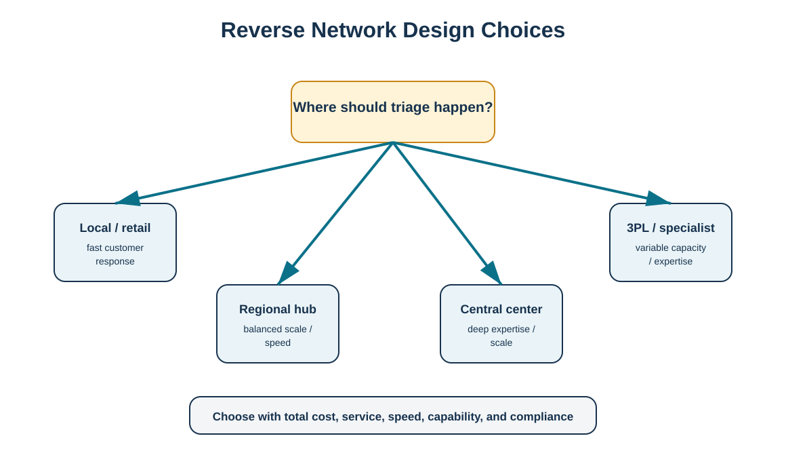
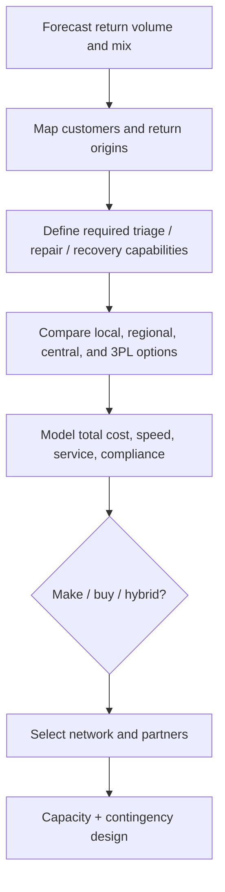

# 7. Reverse Network Design and Make-or-Buy

## Learning objectives

- choose where reverse activities should occur based on total cost, speed, capability, and compliance;
- compare centralized, distributed, and outsourced reverse networks;
- identify which activities can be split across internal and third-party providers;
- forecast return volume and mix as network-capacity inputs.

## Concept in plain English

Reverse flows need their own network logic. The best forward distribution center is not automatically the best return center. Reverse activities may require inspection benches, test equipment, technicians, quarantine space, cleaning, disassembly, material segregation, secondary-market channels, or environmental controls that forward nodes do not have.

Design choices include local/retail triage, regional return hubs, a central repair/remanufacturing center, supplier return paths, and specialized 3PL or recovery partners. The operating model can be hybrid: a carrier or 3PL may collect returns, a regional hub may inspect and consolidate, HarborPeak may retain high-value repair, and a specialist may handle electronics or material recovery.

Forecasts should consider return rate, reason mix, timing, product age, channel, warranty phase, and end-of-life obligations. Reverse demand is often more variable than forward demand, so contingency capacity and flexible labor/partner arrangements can be important.

## Why it matters

Poor network design creates avoidable transport legs and long customer cycle time. It can also send products to nodes that cannot safely or economically process them. On the other hand, building deep reverse capability everywhere is expensive. The network decision is therefore a classic total-cost and service trade-off.

## Decision model and workflow

The diagram compares local, regional, central, and specialist/3PL processing options around a triage-location decision.

### Evidence retained through the workflow

Retain return-volume forecast, origin density, service target, capability requirement, facility/partner capacity, transport assumptions, handling steps, compliance constraints, recovery yield, cost model, make/buy rationale, and contingency plan.

## Practical process flow

## Realistic example — HarborPeak Equipment Systems

RF-04 battery modules cannot simply follow the same return path as reusable totes. HarborPeak uses a specialist recovery partner for the battery stream because the required capabilities, evidence, and transportation controls differ from normal product returns. HX-400 controllers, by contrast, can be consolidated regionally and moved to HarborPeak's central refurbishment center. The network therefore varies by product/risk segment rather than applying one route to every return.

## Applied decision artifact

| Option | Typical strength | Typical risk |
|---|---|---|
| Local/retail | speed and customer convenience | inconsistent capability / scale |
| Regional hub | balance of consolidation and speed | extra handling layer |
| Central center | deep expertise and scale | longer transport / cycle time |
| 3PL/specialist | variable capacity and specialized skill | governance, data, dependency |

## Decision logic

- Segment reverse streams by value, risk, service need, and required capability.
- Forecast volume and condition mix before sizing facilities or contracts.
- Model full transport and handling paths, not only facility cost.
- Assess make-versus-buy at the activity level; collection, testing, repair, liquidation, and recycling need not share one sourcing decision.
- Require data visibility and chain-of-custody expectations in partner contracts.

## Trade-offs

Centralization usually improves scale, expertise, and inventory of repair parts but can add freight and time. Distributed triage improves speed but duplicates equipment and training. Outsourcing makes capacity more flexible and can add specialist expertise, yet it may reduce direct process control and make data integration critical.

## Commonly confused with

A **3PL reverse service** performs agreed logistics or processing activities. A **make-or-buy decision** asks whether HarborPeak should own a specific capability. The company can outsource transportation while retaining repair, or outsource liquidation while retaining customer authorization.

## Common mistakes

- Sending every return to the shipping DC because the building already exists.
- Comparing facility rent while ignoring transportation and recovery-value effects.
- Assuming outsourced means accountability is transferred completely.
- Failing to plan seasonal or launch-related return spikes.
- Using one partner for regulated and ordinary streams without verifying capability.

## Original knowledge check

**Question.** Which is the best reason to centralize high-skill refurbishment?

A. It always minimizes customer cycle time

B. It can concentrate specialized technicians, tooling, and repair-parts inventory

C. It eliminates reverse transportation

D. It removes the need for return forecasting

Answer and rationale

### Correct answer

**B. It can concentrate specialized technicians, tooling, and repair-parts inventory**

### Why it is correct

Centralization can create capability and scale advantages, although those benefits must be weighed against transportation and service time.

### Why the other answers are wrong

A is not guaranteed, C is false, and D ignores capacity planning.

## Practitioner perspective

Use network-design data at a level that supports decisions: return origins, volumes, product classes, service targets, handling requirements, and partner capacity. In system design, ensure returns can be routed to a different plant/storage location/service provider than the original outbound source without losing the commercial or serial-history link.

## Related concepts

- [Reverse Logistics Economics and Total-Cost Analysis](./04-reverse-logistics-economics-and-total-cost-analysis.md)
- [Product Life-Cycle Design for Reverse Logistics](./08-product-life-cycle-design-for-reverse-logistics.md)
- [Hazardous Waste Controls and Chain of Custody](./12-hazardous-waste-controls-and-chain-of-custody.md)

---

[Previous: Returns Authorization and Customer Experience](./06-returns-authorization-and-customer-experience.md) · [Section overview](./README.md) · [Next: Product Life-Cycle Design for Reverse Logistics](./08-product-life-cycle-design-for-reverse-logistics.md)