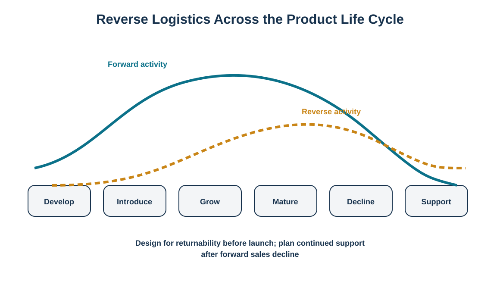
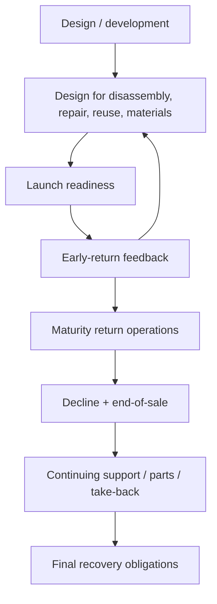

# 8. Product Life-Cycle Design for Reverse Logistics

## Learning objectives

- explain why reverse logistics begins in product design rather than at end of life;
- identify reverse-flow priorities during introduction, maturity, decline, and continuing support;
- use design-for-disassembly, repairability, packaging, and material choices to reduce future reverse cost;
- plan continuing parts/service/take-back obligations after forward sales decline.

## Concept in plain English

Reverse logistics activity usually lags the forward product life cycle. Returns begin after products are sold, grow as the installed base grows, and may continue long after new-product sales decline. That means design decisions made before launch determine future reverse cost.

Design teams can improve repair access, modular replacement, disassembly, material separation, packaging reuse, identification, and recovery of valuable components. They can also avoid unnecessary hazardous or difficult-to-recover materials when suitable alternatives exist. Early product introduction requires readiness for defects, misunderstanding, and ramp-up issues. Maturity may produce high return volumes that need industrialized processing. Decline requires phase-out planning, secondary markets, spare parts, and supplier continuity. Continuing support can last years if warranties, service contracts, legal obligations, or company policies remain in force.

The reverse plan therefore belongs in product lifecycle governance alongside sourcing, manufacturing, distribution, and service.

## Why it matters

A product can be cheap to assemble and expensive to take apart. Adhesives, mixed materials, inaccessible fasteners, proprietary packaging, or components without identity can make repair and recycling uneconomic. These costs may not appear until years after the original design decision, which is why reverse requirements need an explicit seat in development reviews.

## Decision model and workflow

The illustration shows reverse activity beginning after forward activity and extending into continuing support.

### Evidence retained through the workflow

Retain reverse-design requirements, disassembly/repair analysis, material/restricted-substance review, return packaging plan, identification/traceability plan, expected return curve, service-parts horizon, end-of-sale/end-of-support milestones, and approved recovery routes.

## Practical process flow

## Realistic example — HarborPeak Equipment Systems

HarborPeak's LB-22 battery module is a service-replacement product. The design review evaluates not only performance and unit cost but also whether the module can be safely removed, uniquely identified, tested for possible second-life use, and routed to a qualified recovery partner when it no longer meets service criteria. The launch plan also prepares the return channel before the installed base grows. This is more effective than creating a battery return process years later when the first large wave reaches end of life.

## Applied decision artifact

| Life-cycle stage | Reverse-flow priority |
|---|---|
| Development | design for repair, disassembly, reuse, material recovery |
| Introduction | early-return capacity, diagnostics, rapid engineering feedback |
| Growth/Maturity | stable RMA, industrialized triage/repair, recovery markets |
| Decline | phase-out, parts, excess inventory, secondary-market control |
| Continuing support | warranty/service/take-back and final recovery obligations |

## Decision logic

- Add reverse requirements to product-development gates.
- Plan return packaging and identification before first shipment.
- Build early-return feedback into engineering change and supplier-quality processes.
- Forecast mature-life return volume and required service/repair capacity.
- Define end-of-sale separately from end-of-support.
- Review reverse obligations whenever design or material changes occur.

## Trade-offs

Designing for modular repair can raise initial component or assembly cost while lowering lifetime service cost. Reusable packaging can cost more upfront and requires a return loop. Extending support improves customer confidence but creates parts and capability obligations. Eliminating hazardous or scarce materials may improve recovery but require redesign or alternate supplier qualification.

## Commonly confused with

**End of sales** means new commercial sales stop. **End of support** means the organization stops some defined service obligation. They are not the same date, and reverse flows often continue between them or beyond them.

## Common mistakes

- Waiting until product decline to define take-back routes.
- Designing only for assembly and not for disassembly.
- Assuming low initial returns mean no reverse capacity is needed.
- Ending spare-parts planning on the last sales date.
- Failing to update reverse procedures after engineering changes.

## Original knowledge check

**Question.** Why should reverse logistics be reviewed during product design?

A. Because all products will be returned

B. Because design choices influence repairability, disassembly, material recovery, packaging, and future reverse cost

C. Because reverse logistics replaces forward distribution

D. Because end-of-life laws are identical worldwide

Answer and rationale

### Correct answer

**B. Because design choices influence repairability, disassembly, material recovery, packaging, and future reverse cost**

### Why it is correct

Many reverse outcomes are determined by architecture and materials long before a return occurs.

### Why the other answers are wrong

A overstates return volume, C confuses the two networks, and D ignores jurisdiction differences.

## Practitioner perspective

Connect product lifecycle management and service planning. Bills of material, engineering-change history, serial/lot traceability, repair BOMs, service parts, return packaging, and disposal/recovery instructions should remain aligned. A reverse process based on an obsolete BOM can misidentify materials or replacement parts.

## Related concepts

- [Return Disposition and Value Recovery](./09-return-disposition-and-value-recovery.md)
- [Waste Hierarchy and the Four Rs](./10-waste-hierarchy-and-the-four-rs.md)
- [Product Stewardship: WEEE, RoHS, and E-Waste Applicability](./13-product-stewardship-weee-rohs-and-e-waste.md)

---

[Previous: Reverse Network Design and Make-or-Buy](./07-reverse-network-design-and-make-or-buy.md) · [Section overview](./README.md) · [Next: Return Disposition and Value Recovery](./09-return-disposition-and-value-recovery.md)