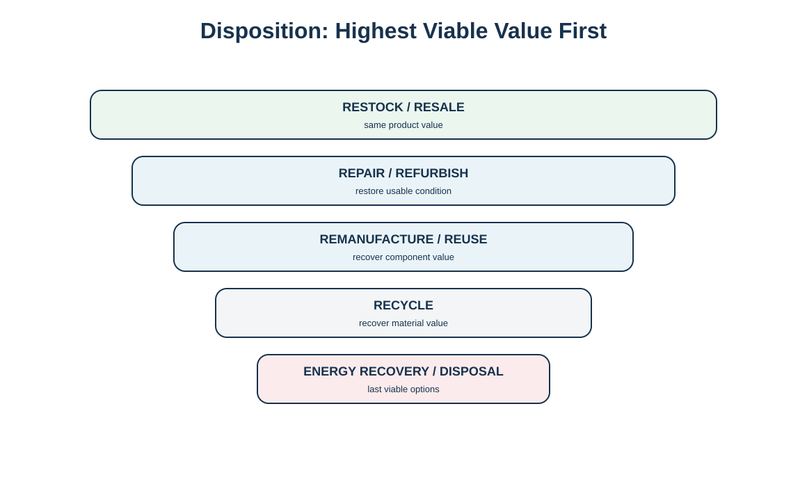
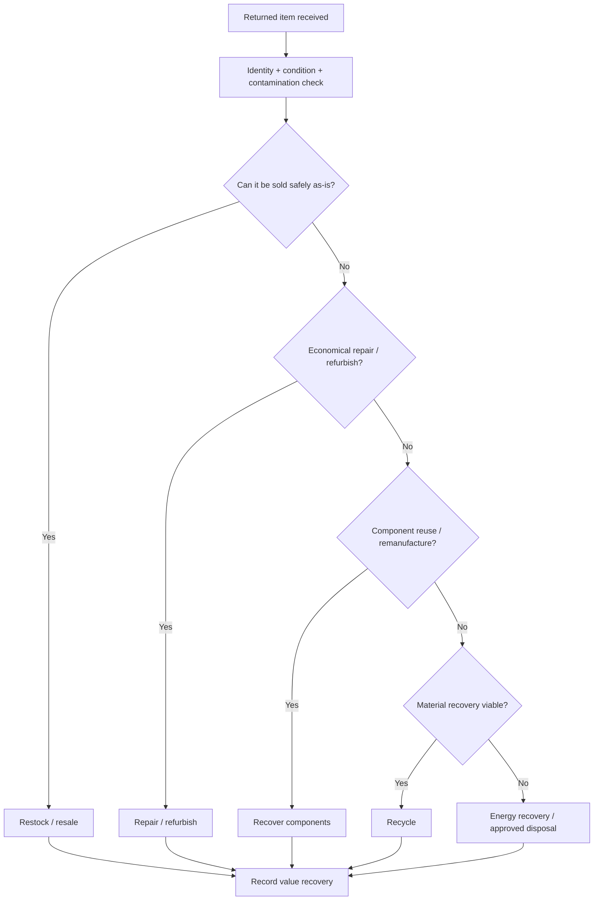

# 9. Return Disposition and Value Recovery

## Learning objectives

- apply a gated disposition sequence from restock through controlled disposal;
- distinguish repair, refurbishment, remanufacture, reuse, and recycling;
- select the highest-value feasible disposition rather than the highest theoretical recovery;
- retain evidence linking condition, economics, quality, and compliance to the disposition decision.

## Concept in plain English

Disposition is the decision about what happens after a returned item is inspected. A practical sequence asks whether the unit can be safely restocked or resold, whether repair or refurbishment can restore value, whether remanufacturing or component reuse is viable, whether materials can be recycled, whether energy recovery is appropriate and permitted, and finally whether controlled disposal is necessary.

The goal is **highest viable value**, not “never scrap.” A high-value unit may justify diagnostic testing and repair. A low-value item may cost more to inspect than its recoverable value. Safety, quality, legal, brand, and market constraints can eliminate a theoretically profitable option. For example, a product that cannot reliably meet performance criteria after refurbishment should not be pushed into a resale channel just because a buyer exists.

Remanufacturing generally restores a product through a defined industrial process using inspection, replacement, and testing; reuse may involve using the product or component again with much less transformation. Recycling recovers material rather than preserving the component's function.

## Why it matters

Disposition controls determine how much value the reverse network recovers and how much liability it retains. Poor triage can send good units to scrap, bad units to customers, hazardous items to the wrong stream, or counterfeit/unauthorized material back into saleable inventory.

## Decision model and workflow

The descending ladder emphasizes preserving product and component value before reducing the return to raw material or disposal.

### Evidence retained through the workflow

Retain identity, ownership, inspection/test result, contamination/safety status, estimated recovery by path, processing cost, quality criteria, market/channel restriction, approval, final destination, and recovered value.

## Practical process flow

## Realistic example — HarborPeak Equipment Systems

RF-03 is a reusable transit tote. If inspection shows the tote is structurally sound, cleaning and reuse is higher in the value hierarchy than shredding it for polymer recycling. RF-05 drive assemblies, by contrast, may require functional test. Units meeting defined criteria can be refurbished or remanufactured; failed components can be harvested only when engineering and quality controls allow; residual metals/electronics can then move to qualified recovery. HarborPeak records the disposition at unit or batch level depending on the product's value and traceability requirement.

## Applied decision artifact

| Disposition | What is preserved? |
|---|---|
| Restock/resale | product as saleable unit |
| Repair/refurbish | product function after limited restoration |
| Remanufacture/reuse | product/component function after defined recovery |
| Recycle | material value |
| Energy recovery | energy content, not material function |
| Disposal | neither product nor material value; controlled closure |

## Decision logic

- Quarantine until identity and condition are verified.
- Use quality and safety gates before economic comparison.
- Estimate incremental cost and recoverable value for realistic paths.
- Prefer preserving product/component value when feasible and compliant.
- Document any brand, channel, regulatory, or security constraints.
- Track actual recovery yield to improve future routing rules.

## Trade-offs

More testing can raise recovery yield but increase cost and cycle time. Remanufacturing can create attractive secondary-market revenue but may cannibalize new sales or require separate warranty/channel rules. Component harvesting increases complexity and traceability. Recycling is simpler than remanufacture but destroys component value.

## Commonly confused with

**Repair** fixes a specific fault. **Refurbishment** restores condition to a defined used-product standard. **Remanufacturing** is a more comprehensive industrial restoration to a defined specification. **Recycling** converts material for use as raw material; it does not preserve the original component function.

## Common mistakes

- Treating all customer returns as defective.
- Restocking before identity and condition verification.
- Choosing the highest resale price without subtracting processing cost.
- Calling material recycling “reuse.”
- Failing to segregate items with special handling or data-security concerns.

## Original knowledge check

**Question.** A returned reusable tote is intact after inspection and can be cleaned for another shipping cycle. Which disposition is strongest?

A. Recycle the polymer immediately

B. Reuse the tote after the required cleaning and inspection

C. Send it to energy recovery

D. Dispose because it has already been used

Answer and rationale

### Correct answer

**B. Reuse the tote after the required cleaning and inspection**

### Why it is correct

Reuse preserves more of the original product's functional value than recycling or disposal when quality and safety requirements are met.

### Why the other answers are wrong

A recovers only material value; C and D move lower in the hierarchy without need.

## Practitioner perspective

Use stock statuses and valuation carefully. Returned material should not become unrestricted saleable inventory solely because a goods receipt posted. Link inspection/quality decisions to inventory status and keep refurbished/remanufactured material identifiable if pricing, warranty, or channel rules differ from new product.

## Related concepts

- [Waste Hierarchy and the Four Rs](./10-waste-hierarchy-and-the-four-rs.md)
- [Reverse Logistics Economics and Total-Cost Analysis](./04-reverse-logistics-economics-and-total-cost-analysis.md)
- [Hazardous Waste Controls and Chain of Custody](./12-hazardous-waste-controls-and-chain-of-custody.md)

---

[Previous: Product Life-Cycle Design for Reverse Logistics](./08-product-life-cycle-design-for-reverse-logistics.md) · [Section overview](./README.md) · [Next: Waste Hierarchy and the Four Rs](./10-waste-hierarchy-and-the-four-rs.md)