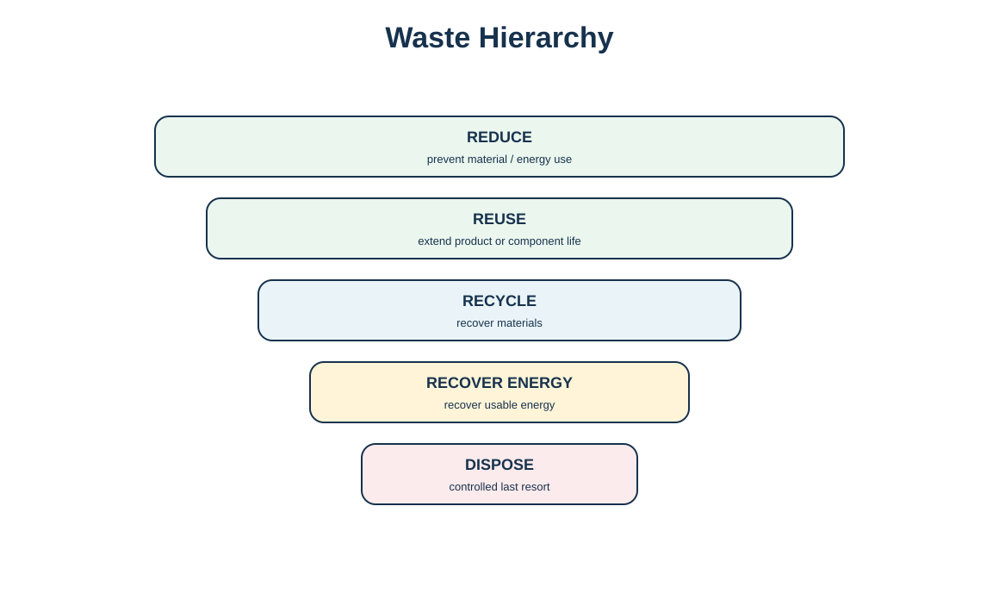
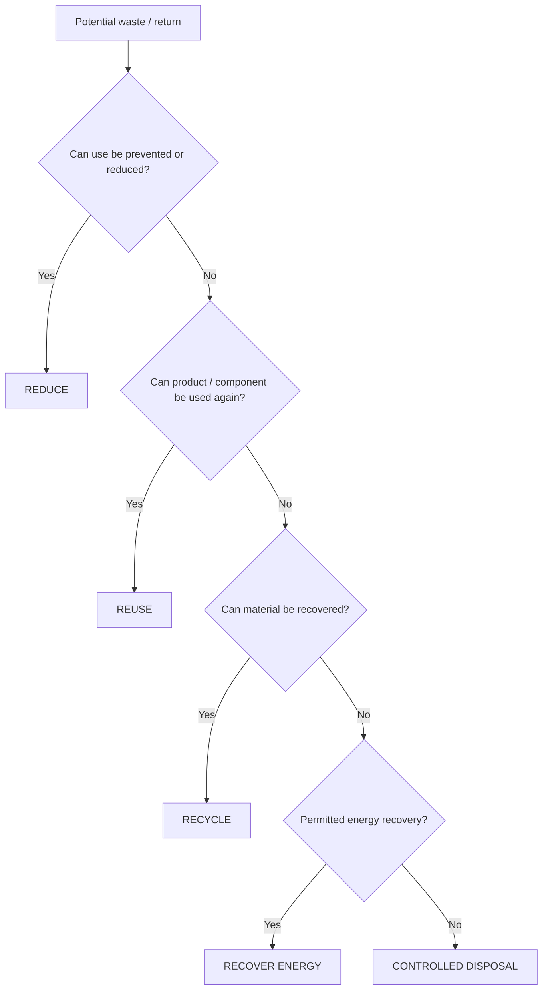

# 10. Waste Hierarchy and the Four Rs

## Learning objectives

- apply the waste hierarchy as a preference order rather than a rigid one-size rule;
- distinguish reduce, reuse, recycle, energy recovery, and disposal;
- connect waste prevention to product/process/supplier design;
- explain why higher hierarchy options often—but not always—support better economics.

## Concept in plain English

The waste hierarchy prioritizes actions that prevent resource use and preserve value before actions that recover only material or energy. In this section the hierarchy is **reduce → reuse → recycle → recover energy → dispose**. Reduction sits at the top because avoiding waste in the first place eliminates downstream handling. Reuse preserves the product or component's function. Recycling recovers material. Energy recovery captures energy when material recovery is no longer viable. Disposal is the last controlled option.

The hierarchy is a decision preference, not a substitute for safety, law, or economics. Reusing a contaminated component without a reliable restoration process would not be responsible merely because reuse ranks above recycling. The organization must first confirm technical and legal feasibility, then prefer the higher-value path.

Waste prevention can be influenced by product design, manufacturing process design, supplier quality, packaging, demand/inventory policy, and clean technology. The source learning materials use a 40/30/30 rule of thumb to illustrate that design, processing, and supplier inefficiency can all create scrap/rework/waste; this repository treats it only as a conceptual reminder, not a universal measured split.

## Why it matters

Focusing only on end-of-pipe recycling can miss the larger opportunity. If a process change eliminates 30% of scrap generation, the company avoids material purchase, handling, storage, and recovery cost simultaneously. Likewise, reusable packaging can reduce recurring purchase and disposal cost when the return loop is economically viable.

## Decision model and workflow

The visual makes prevention and functional reuse visibly higher than material recovery and disposal.

### Evidence retained through the workflow

Retain material/source, annual quantity, current disposition, prevention option, reuse option, recycling option, energy-recovery option, disposal need, technical constraints, legal constraints, economics, approved path, and owner.

## Practical process flow

## Realistic example — HarborPeak Equipment Systems

In [`waste-disposition-cases.csv`](../../assets/data/module-5/waste-disposition-cases.csv), WD-01 is a reusable transit tote loop. HarborPeak first reduces losses by controlling tote tracking and damage, then reuses sound totes. Failed totes may be mechanically recycled. WD-06 cardboard is different: practical reuse may be limited, so fiber recycling can be the best viable path after packaging reduction has been addressed. The hierarchy guides the question sequence without forcing the same answer for every material.

## Applied decision artifact

| Level | Decision question |
|---|---|
| Reduce | Can the material/energy use or waste generation be prevented? |
| Reuse | Can the product/component/packaging safely perform again? |
| Recycle | Can useful material be recovered? |
| Recover energy | Is controlled energy recovery a permitted viable option? |
| Dispose | What approved final disposal is required when higher options fail? |

## Decision logic

- Start with prevention opportunities in design, planning, process, supplier, and packaging decisions.
- Confirm safety and legal feasibility before promoting a higher hierarchy option.
- Measure avoided purchase/disposal cost as well as recovery revenue.
- Design segregation at the point of generation to preserve recovery quality.
- Review the hierarchy when technology or markets change.

## Trade-offs

A higher hierarchy option can require more transport, cleaning, testing, or administration than a lower option. Reusable packaging can have a higher upfront cost and requires a closed loop. Recycling markets can be volatile. Energy recovery may reduce landfill volume but destroys material. The hierarchy informs preference; the business and compliance case determines implementation.

## Commonly confused with

**Lean waste** means non-value-added activity from the customer's perspective. **Physical waste** is a material by-product requiring management. The same word appears in both contexts but the control methods differ.

## Common mistakes

- Calling any recycled-content purchase “reuse.”
- Building a recycling program before asking whether waste can be prevented.
- Assuming landfill is illegal or never necessary.
- Ignoring contamination that destroys recycling value.
- Using a rule-of-thumb percentage as though it were measured process data.

## Original knowledge check

**Question.** Which action is highest in the waste hierarchy?

A. Recycling scrap after it is created

B. Redesigning the process so the scrap is not generated

C. Recovering energy from the scrap

D. Sending the scrap to a controlled landfill

Answer and rationale

### Correct answer

**B. Redesigning the process so the scrap is not generated**

### Why it is correct

Reduction prevents the waste and associated downstream cost before recovery becomes necessary.

### Why the other answers are wrong

A and C recover value only after waste exists, while D is the last option.

## Practitioner perspective

In manufacturing systems, connect scrap/waste quantity to operation, material, reason code, and cost. Without a source process, a waste dashboard can show quantity but not the engineering or supplier action that would prevent recurrence.

## Related concepts

- [Waste Exchange and Total Waste Management](./11-waste-exchange-and-total-waste-management.md)
- [Return Disposition and Value Recovery](./09-return-disposition-and-value-recovery.md)
- [Product Life-Cycle Design for Reverse Logistics](./08-product-life-cycle-design-for-reverse-logistics.md)

---

[Previous: Return Disposition and Value Recovery](./09-return-disposition-and-value-recovery.md) · [Section overview](./README.md) · [Next: Waste Exchange and Total Waste Management](./11-waste-exchange-and-total-waste-management.md)