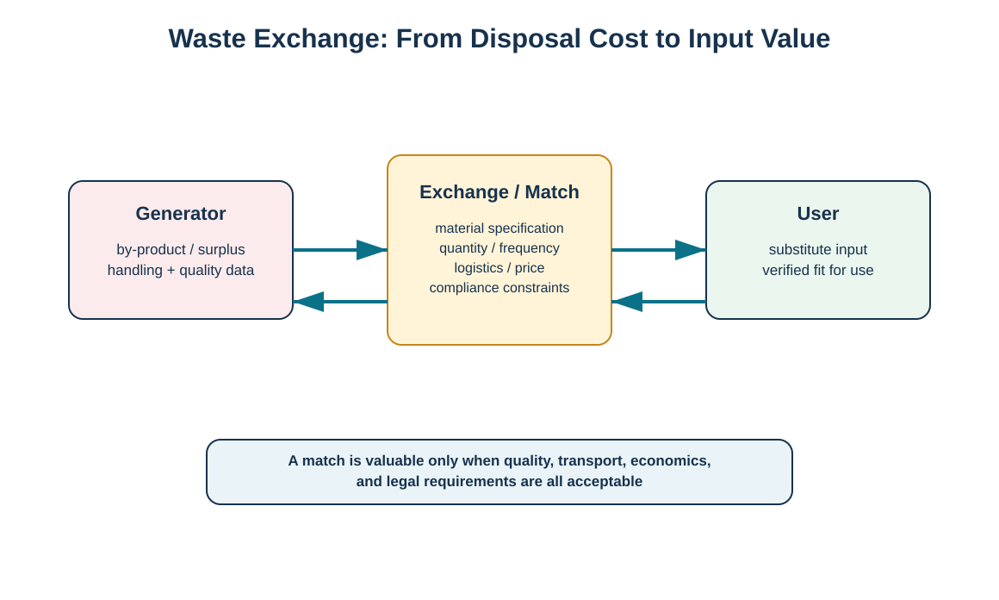
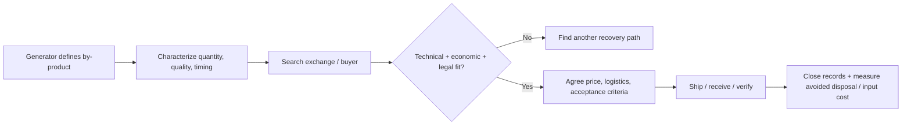

# 11. Waste Exchange and Total Waste Management

## Learning objectives

- explain how a waste exchange can convert a by-product from disposal burden to useful input;
- screen waste-exchange opportunities for specification, volume, logistics, economics, and legal fit;
- use total waste management to connect environmental choices to the business case;
- distinguish beneficial reuse from simply transferring a disposal problem.

## Concept in plain English

A waste exchange connects organizations that generate a by-product, surplus, off-specification material, or other residual stream with organizations that may be able to use it as an input. The exchange can be a formal marketplace, an industry network, a brokered relationship, or a direct supplier-customer arrangement. The economic logic is attractive: the generator may reduce disposal cost or earn revenue while the user may obtain a lower-cost input.

The match must still be technically and legally valid. The generator needs a stable description of composition, quality, contamination, quantity, frequency, packaging, and handling requirements. The receiving user must confirm that the material fits its process and that the transaction is allowed. Transportation can make or break the economics, particularly for low-value bulky material. “Free material” is not free if it costs more to segregate, test, transport, or process than the virgin input it replaces.

Total waste management adds a business-case lens: evaluate waste solutions as part of financial and operational performance rather than treating them only as a disposal activity.

## Why it matters

Waste is often priced as a cost because no one has searched for a user. A well-controlled exchange can preserve value and reduce disposal demand. But weak characterization can create quality, safety, or regulatory problems for the receiving organization. The exchange therefore needs the same discipline as sourcing any other input.

## Decision model and workflow

The diagram shows a generator and user connected by a matching process that evaluates specification, economics, logistics, and compliance.

### Evidence retained through the workflow

Retain material characterization, source process, quantity/frequency, quality specification, sampling/testing method, receiving-user approval, legal status determination, price/fee, transport responsibility, rejected-load process, backup disposition, and measured avoided cost/revenue.

## Practical process flow

## Realistic example — HarborPeak Equipment Systems

WD-02 covers aluminum controller housings. HarborPeak first evaluates component reuse/remanufacture. Housings that fail that gate can still have a metal-recycling route. Suppose a nearby fabricator can use clean, segregated aluminum offcuts generated during a related process. HarborPeak should not simply label the material “reusable.” It would create a specification, sample/acceptance process, expected monthly quantity, logistics responsibility, pricing method, and contingency route if the buyer cannot take the material.

## Applied decision artifact

| Screening dimension | Question |
|---|---|
| Technical | Can the receiver use it without unacceptable quality risk? |
| Quantity | Is supply volume/frequency useful and predictable enough? |
| Logistics | Does transport/packaging preserve the economic case? |
| Legal/EHS | Is transfer/use allowed and properly controlled? |
| Economics | Is avoided disposal + sale value greater than added handling? |
| Continuity | What happens if the receiving market disappears? |

## Decision logic

- Characterize the stream before searching for a buyer.
- Treat the receiver like a customer with acceptance specifications.
- Compare total economics against existing disposal/recovery routes.
- Verify whether the stream is legally a product/by-product/waste in the relevant jurisdiction; terminology alone does not decide status.
- Maintain a backup route for demand interruptions.
- Measure both avoided disposal cost and any input/sale value.

## Trade-offs

A long-term exchange can create stable economics but dependency on one receiver. Higher purity improves marketability but may require costly segregation. A distant buyer may pay more per unit but lose the advantage through transport cost and emissions. Selling waste can generate revenue yet create product-liability or quality obligations depending on the transaction.

## Commonly confused with

A **waste exchange** is a market/matching mechanism. **Recycling** is a processing activity. A waste exchange may support direct reuse, reprocessing, or recycling depending on the material and user.

## Common mistakes

- Calling a material “by-product” to avoid evaluating waste rules.
- Ignoring specification variability.
- Comparing selling price without subtracting segregation and freight.
- Building a process around one buyer with no contingency.
- Shipping material before the receiver has approved its quality and handling requirements.

## Original knowledge check

**Question.** A material has a willing buyer, but freight and segregation cost exceed the avoided disposal cost plus sale revenue. What should HarborPeak conclude?

A. Use the exchange because reuse always ranks higher

B. The current exchange route is not economically justified without another strategic reason

C. Increase the waste quantity to improve the business case

D. Ignore transportation because it is a logistics cost

Answer and rationale

### Correct answer

**B. The current exchange route is not economically justified without another strategic reason**

### Why it is correct

Hierarchy preference does not eliminate total-cost analysis. The company should search for a closer user, reduce handling cost, or choose another compliant route.

### Why the other answers are wrong

A ignores economics, C creates more waste, and D excludes a real cost.

## Practitioner perspective

If recurring by-product sales become material, treat them with master-data and order controls appropriate to the business. Link source material, quantity, quality status, buyer, and revenue/avoided-cost reporting. Keep waste-compliance records separate when the material remains legally regulated.

## Related concepts

- [Waste Hierarchy and the Four Rs](./10-waste-hierarchy-and-the-four-rs.md)
- [Hazardous Waste Controls and Chain of Custody](./12-hazardous-waste-controls-and-chain-of-custody.md)
- [Reverse Logistics Economics and Total-Cost Analysis](./04-reverse-logistics-economics-and-total-cost-analysis.md)

---

[Previous: Waste Hierarchy and the Four Rs](./10-waste-hierarchy-and-the-four-rs.md) · [Section overview](./README.md) · [Next: Hazardous Waste Controls and Chain of Custody](./12-hazardous-waste-controls-and-chain-of-custody.md)