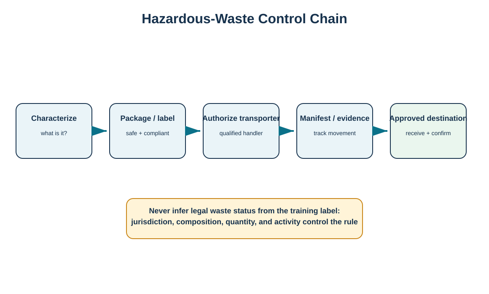
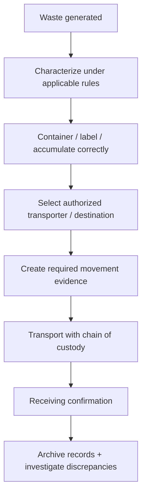

# 12. Hazardous Waste Controls and Chain of Custody

## Learning objectives

- explain why hazardous-waste reverse flows require characterization, controlled handling, and evidence;
- distinguish chemical hazard communication from waste-classification and disposal rules;
- design a chain-of-custody process through transporter and receiving facility;
- recognize when transboundary movements require a separate legal/regulatory review.

## Concept in plain English

Hazardous waste cannot be managed by a generic “scrap” process. The organization first needs a legally supportable characterization based on composition, process knowledge, testing when required, and the rules of the jurisdiction. From there it may need specific containers, accumulation controls, labels, transporter qualifications, movement documents/manifests, approved treatment/storage/disposal or recovery facilities, and retained evidence of receipt and final handling.

The Globally Harmonized System (GHS) is primarily a chemical hazard-classification and communication framework using labels and safety data sheets. Those inputs are valuable for safe handling, but a product's GHS/SDS information does **not by itself determine its legal waste classification** in every jurisdiction. Waste status depends on applicable waste law, the material, how it was generated, and other facts.

For U.S. RCRA-regulated off-site hazardous-waste shipments, EPA describes a cradle-to-grave tracking framework using the hazardous-waste manifest/e-Manifest system. Cross-border waste shipments can add another layer; the Basel Convention governs transboundary movements for participating countries and, since 1 January 2025, amended controls make all electrical/electronic waste covered by the relevant amendments subject to prior-informed-consent controls under the Convention's framework. Always verify the countries and waste stream involved.

## Why it matters

A reverse-flow organization may handle returned products safely yet fail on the residue, battery, solvent, or electronic waste created during repair and disassembly. Incomplete chain-of-custody records can create compliance exposure long after the physical material left the facility. The control objective is therefore both safe movement and demonstrable closure.

## Decision model and workflow

The visual turns hazardous-waste movement into a documented chain from characterization through confirmed receipt.

### Evidence retained through the workflow

Retain waste determination/characterization basis, source process, composition/test data, container/label status, accumulation date where applicable, transporter authorization, movement document/manifest, destination authorization, shipment dates, receiving confirmation, discrepancy resolution, and record-retention basis.

## Practical process flow

## Realistic example — HarborPeak Equipment Systems

WD-04 marks spent cleaning solvent as **hazard characterization required** rather than declaring a legal status. HarborPeak uses process/SDS information as an input, obtains the required waste determination under the applicable rules, and routes the material only after container, transporter, document, and destination requirements are resolved. WD-07 similarly flags retired battery modules for battery/e-waste review and blocks cross-border movement until the responsible compliance owner confirms the governing rules and required consents.

## Applied decision artifact

| Control gate | Evidence question |
|---|---|
| Characterize | What facts and rule basis determine the waste status? |
| Package/label | What handling and hazard communication is required? |
| Transport | Is the transporter authorized for this stream/jurisdiction? |
| Track | What manifest/movement record is required? |
| Destination | Is the receiving facility authorized and has receipt been confirmed? |
| Close | Are discrepancies resolved and records retained? |

## Decision logic

- Do not use the training dataset's hazard label as a legal determination.
- Separate worker/transport hazard communication from waste-classification analysis.
- Block shipment until required transporter, destination, and movement-document controls are complete.
- Investigate quantity or receipt discrepancies promptly.
- Perform a separate review before moving waste across national borders.
- Monitor rule changes and electronic-manifest requirements.

## Trade-offs

More rigorous segregation and characterization increase handling cost but can avoid misclassification and may preserve recovery value. Centralizing hazardous streams can improve expertise but lengthen transport. Sending complex streams to specialists can reduce internal capability requirements while increasing supplier-governance dependence.

## Commonly confused with

An **SDS/GHS classification** communicates chemical hazards for safe use and handling. A **hazardous-waste determination** is a legal waste-classification decision under the relevant waste regime. They inform one another but are not interchangeable.

## Common mistakes

- Assuming an SDS section on disposal is a complete waste-classification decision.
- Shipping before the receiving facility is confirmed.
- Losing chain-of-custody evidence after a 3PL takes possession.
- Mixing incompatible waste streams to reduce container count.
- Treating cross-border e-waste or hazardous waste like ordinary product returns.

## Original knowledge check

**Question.** A returned chemical product has an SDS showing corrosive hazards. What does that prove about its waste status?

A. It automatically proves the waste classification in every jurisdiction

B. It provides hazard information, but the applicable waste determination still must be performed

C. It means the material cannot be transported

D. It means it must be recycled rather than disposed

Answer and rationale

### Correct answer

**B. It provides hazard information, but the applicable waste determination still must be performed**

### Why it is correct

Hazard communication and waste classification serve related but different legal/operational purposes.

### Why the other answers are wrong

A overgeneralizes across jurisdictions, while C and D infer handling/disposition conclusions not established by the SDS alone.

## Practitioner perspective

EHS and logistics data need a controlled interface. Material master or SDS data can support classification work, while the waste record should carry the legal determination, container, accumulation, transporter, manifest/movement, destination, and receipt evidence. Do not force these into an ordinary purchase or delivery document with no compliance fields.

## Freshness checkpoint

Regulatory detail changes. For operational use, verify current U.S. EPA/state hazardous-waste rules and e-Manifest requirements, current UNECE GHS revision adopted by the relevant jurisdiction, and applicable Basel/national controls before transboundary movement. The reference register links to authoritative sources.

## Related concepts

- [Waste Exchange and Total Waste Management](./11-waste-exchange-and-total-waste-management.md)
- [Product Stewardship: WEEE, RoHS, and E-Waste Applicability](./13-product-stewardship-weee-rohs-and-e-waste.md)
- [Section D references](./REFERENCES.md)

---

[Previous: Waste Exchange and Total Waste Management](./11-waste-exchange-and-total-waste-management.md) · [Section overview](./README.md) · [Next: Product Stewardship: WEEE, RoHS, and E-Waste Applicability](./13-product-stewardship-weee-rohs-and-e-waste.md)