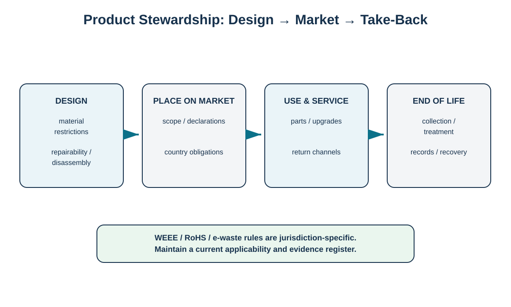

# 13. Product Stewardship: WEEE, RoHS, and E-Waste Applicability

## Learning objectives

- explain how product design and end-of-life obligations can be linked under product-stewardship rules;
- distinguish WEEE collection/treatment concepts from RoHS substance restrictions;
- build a jurisdiction/applicability register instead of assuming one global rule;
- recognize the need to check current e-waste and transboundary-movement requirements.

## Concept in plain English

Product stewardship moves reverse logistics upstream into product decisions. Two European Union frameworks illustrate the difference between **design/market-entry restrictions** and **end-of-life collection/treatment obligations**.

The EU RoHS framework restricts specified hazardous substances in electrical and electronic equipment within its scope and supports safer end-of-life treatment. The current European Commission summary identifies ten restricted substances or substance groups, not only the original six commonly taught in older summaries. The EU WEEE framework focuses on preventing and reducing the impacts of waste electrical and electronic equipment and on collection, treatment, recovery, and recycling. The Commission completed an evaluation of the WEEE Directive in July 2025, illustrating why a learning repository should avoid turning a static summary into filing guidance.

Applicability depends on product type, exclusions, role in the supply chain, country implementation, dates, and specific obligations. The operating control should therefore be a maintained applicability register tied to product and market, not a single checkbox labeled “WEEE/RoHS compliant.”

## Why it matters

A product can meet forward market requirements yet create end-of-life cost and liability if take-back, identification, treatment, or material information is not designed. Conversely, an end-of-life collection program cannot compensate for a product that fails an applicable substance restriction at market entry. The two control families interact but solve different problems.

## Decision model and workflow

The life-cycle model links product design, placing on the market, service, and end-of-life evidence.

### Evidence retained through the workflow

Retain product/category, market/country, legal role, scope determination, exemptions if relied upon, material/substance evidence, registration/producer-responsibility obligations, marking/information requirements, take-back/recovery route, effective date, owner, and review trigger.

## Realistic example — HarborPeak Equipment Systems

HarborPeak's electronic controller family is sold into several markets. Rather than copying one EU-oriented checklist into every plant, HarborPeak maintains a market applicability record: product/category, legal entity role, country, applicable product-substance requirements, producer/registration/take-back obligations if any, evidence owner, and effective date. When a design change introduces a new component, the team rechecks both substance and end-of-life implications before release. Retired modules entering a cross-border recovery route receive an additional waste-movement review rather than relying on the original product compliance status.

## Applied decision artifact

| Framework | Primary control question |
|---|---|
| RoHS-type substance restriction | Can the product be placed on the market with its material content and evidence? |
| WEEE-type producer responsibility | What collection, treatment, information, reporting, and financing obligations apply? |
| National e-waste law | What country/state-specific take-back or handling rules apply? |
| Basel/transboundary waste controls | Can this waste legally move across the planned borders and with what consent/documentation? |

## Decision logic

- Determine applicability by product, market, role, and date.
- Keep substance-restriction evidence separate from take-back/recovery evidence.
- Treat exemptions as controlled and time-sensitive.
- Reassess after engineering changes, market expansion, or legal updates.
- Perform a separate transboundary-waste review for end-of-life shipments crossing borders.

## Trade-offs

More restricted materials can increase sourcing/design cost while reducing end-of-life hazard and improving recyclability. Producer-responsibility programs create collection and reporting cost but can improve material recovery and supply security. Central global standards simplify product design, while local implementations still require market-specific evidence and reporting.

## Commonly confused with

**RoHS** addresses restricted substances in covered electrical/electronic equipment. **WEEE** addresses waste electrical/electronic equipment and end-of-life management. They are related but not interchangeable, and national implementation details matter.

## Common mistakes

- Teaching the original six RoHS substances as the current complete list.
- Assuming WEEE obligations are identical in every EU country.
- Treating a CE/product compliance record as proof that end-of-life shipment rules are satisfied.
- Ignoring exemption expiry or scope changes.
- Using “e-waste” as a universal legal classification without jurisdiction review.

## Original knowledge check

**Question.** Which statement is strongest?

A. A product that meets RoHS automatically satisfies all WEEE and cross-border e-waste requirements

B. RoHS substance restrictions and WEEE/end-of-life obligations should be evaluated as related but separate control families

C. WEEE applies only after every product becomes hazardous waste

D. The same e-waste rule applies worldwide

Answer and rationale

### Correct answer

**B. RoHS substance restrictions and WEEE/end-of-life obligations should be evaluated as related but separate control families**

### Why it is correct

They address different points in the product lifecycle and have different applicability/evidence requirements.

### Why the other answers are wrong

A overextends product compliance, C mischaracterizes scope, and D ignores jurisdiction-specific law.

## Practitioner perspective

In PLM/ERP/EHS architecture, store market applicability and material declarations at product level, while take-back/producer-responsibility registrations and reporting may be legal-entity/market-specific. Link these records so an engineering change can trigger the required compliance reassessment.

## Freshness checkpoint

The current EU sources cited in this repository show an active WEEE evaluation process and a RoHS framework restricting ten substances/substance groups. For operational use, always verify the latest consolidated legislation, exemptions, national implementation, and product scope rather than relying on a study note.

## Related concepts

- [Hazardous Waste Controls and Chain of Custody](./12-hazardous-waste-controls-and-chain-of-custody.md)
- [Product Life-Cycle Design for Reverse Logistics](./08-product-life-cycle-design-for-reverse-logistics.md)
- [Section D references](./REFERENCES.md)

---

[Previous: Hazardous Waste Controls and Chain of Custody](./12-hazardous-waste-controls-and-chain-of-custody.md) · [Section overview](./README.md) · [Next: Section D Review](./14-section-d-review.md)