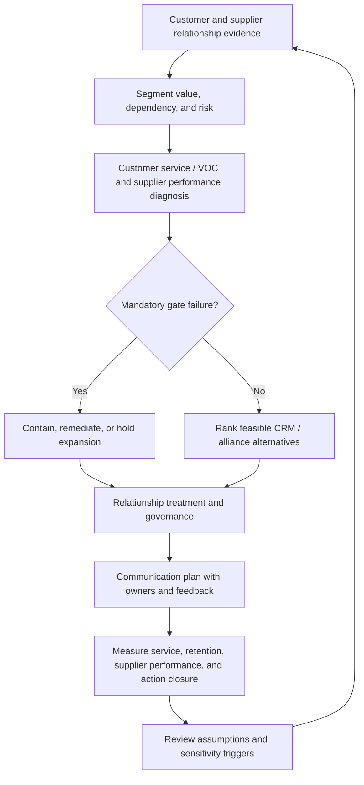

# ClearSpan Customer-Supplier Relationship Stabilization Decision

## Decision context

ClearSpan Automation Systems has grown through multiple customer channels and a mixed supplier base, but its customer and supplier relationship practices are no longer consistent enough for the next growth stage. Leadership is preparing a 90-day stabilization program and must decide where to concentrate relationship-management effort, which CRM technology to fund, how to contain supplier dependency, which strategic alliance to advance, and how to close communication and corrective-action gaps.

The decision is intentionally end to end. A high-value customer segment can still be damaged by poor service recovery. A strategically important supplier can still require containment when performance or certification evidence is weak. A numerically attractive alliance or technology case cannot override a failed mandatory gate.

All companies, customers, suppliers, values, scores, costs, interactions, and communication records in this case are fictional and independently created for learning purposes.

## End-to-end decision flow

## Source data

Use the locked ClearSpan datasets. Do not replace the values unless the task explicitly requests a sensitivity case.

### Customer portfolio and relationship evidence

- [Customer segments](../../assets/data/module-6/customer-segments.csv)
- [Customer channel preferences](../../assets/data/module-6/customer-channel-preferences.csv)
- [Customer lifecycle accounts](../../assets/data/module-6/customer-lifecycle-accounts.csv)
- [Customer VOC interactions](../../assets/data/module-6/customer-voc-interactions.csv)
- [Customer service performance](../../assets/data/module-6/customer-service-performance.csv)
- [CRM technology cases](../../assets/data/module-6/crm-technology-cases.csv)

### Supplier, alliance, and governance evidence

- [Supplier segmentation](../../assets/data/module-6/supplier-segmentation.csv)
- [Supplier sourcing relationships](../../assets/data/module-6/supplier-sourcing-relationships.csv)
- [Strategic alliance cases](../../assets/data/module-6/strategic-alliance-cases.csv)
- [Supplier performance](../../assets/data/module-6/supplier-performance.csv)
- [Supplier certification](../../assets/data/module-6/supplier-certification.csv)
- [Relationship communications](../../assets/data/module-6/relationship-communications.csv)

Use the [Relationship Performance Formula & Control Sheet](../../calculations/relationship-performance/formula-sheet.md) for controlled calculation definitions.

## Controlled assumptions

Use these assumptions only for this fictional capstone:

- The account-lifecycle file is a **selected diagnostic sample**, not the complete ClearSpan customer population. Calculate churn and retention only for that sample and do not present the result as enterprise-wide churn.
- Customer relationship priority should combine economic exposure, observed service/VOC evidence, and relationship state. Do not create an unsupported universal composite score.
- CRM technology alternatives must pass process-fit, data-access, and security gates before economic ranking. Among feasible cases, compare the locked three-year net benefit.
- Alliance candidates must pass all five hard gates in the formula/control sheet before their weighted alliance score can be ranked.
- A supplier with **NOT CERTIFIED** status or an unresolved hard certification gate cannot receive an expanded strategic commitment until the failing evidence is remediated.
- For this capstone, supplier performance below **80/100** is an urgent remediation trigger. This is a fictional training threshold, not an ASCM standard.
- For critical relationship communication programs, use these fictional operating targets: **100% message delivery, at least 90% feedback rate, and at least 90% action closure**. Falling below a target requires an owner and corrective response; these targets are not universal formulas.
- A sole-source or highly concentrated supplier is not automatically replaced. Continuity risk, alternate qualification, switch lead time, customer impact, and remediation feasibility must be considered together.
- Direct customer feedback remains separate from operational service metrics. Good OTIF does not by itself prove customer satisfaction.

## Assignment

Prepare one executive relationship decision pack addressing the following seven tasks.

### 1. Prioritize the customer relationship portfolio

Use `customer-segments.csv` to calculate each segment's share of annual gross profit and the cumulative share represented by the largest two and three segments.

Then use `customer-lifecycle-accounts.csv` to calculate, for the selected account sample:

- churn rate;
- retention rate;
- current revenue represented by vulnerable accounts; and
- prior-period revenue represented by accounts that churned.

Use `customer-channel-preferences.csv` to recommend an appropriate primary contact treatment for Strategic OEM, Service Networks, and Digital SMB customers. State which customer segments should receive immediate protection or recovery attention and why.

### 2. Diagnose customer service, VOC, and recovery controls

Use `customer-service-performance.csv` to identify the weakest segments for OTIF, response-time attainment, complaint rate, and stockout frequency.

Use `customer-voc-interactions.csv` to calculate overall response-time attainment and corrective-action closure for the selected VOC interactions. Identify which service/recovery issues deserve immediate management attention.

Then use the customer-facing rows in `relationship-communications.csv` to test whether the current communication programs meet the capstone's 100% / 90% / 90% operating targets.

### 3. Select the CRM enablement path and run an adoption sensitivity

Apply the process-fit, data-access, and security gates in `crm-technology-cases.csv`. Rank only feasible alternatives by three-year net benefit.

State the base CRM technology recommendation and reproduce its three-year TCO, realized benefit, and net benefit.

Then run this sensitivity: **Cloud CRM Accelerate adoption falls from 90% to 70%, while every other input remains unchanged.** Recalculate its three-year realized benefit and net benefit and state whether the technology decision changes. Also calculate its approximate break-even adoption percentage.

### 4. Contain supplier concentration and calibrate relationship depth

Use `supplier-segmentation.csv` to calculate the share of the modeled supplier spend held by suppliers currently classified as Strategic.

Use `supplier-sourcing-relationships.csv` to identify the strongest concentration/continuity exposures. Compare at least BlueMesa Electronics, NorthRiver Sensors, Redwood Machining, and Summit Industrial Software.

State where ClearSpan should deepen collaboration, where it should prioritize alternate qualification or continuity controls, and where transactional treatment remains appropriate.

### 5. Govern supplier performance, certification, and alliance selection

Use `supplier-performance.csv` to identify the supplier requiring the most urgent remediation under the capstone's below-80 performance trigger. Reproduce that supplier's on-time delivery, defect rate, corrective-action closure, and weighted performance score.

Use `supplier-certification.csv` to determine whether the same supplier can receive expanded strategic commitment.

Then apply the alliance hard gates in `strategic-alliance-cases.csv` and rank the feasible candidates. Explain why a numerically higher but gate-failed alternative does not win. Recommend one alliance to advance first and define the main governance condition attached to that recommendation.

### 6. Build the end-to-end relationship communication and action-control model

Use `relationship-communications.csv` to identify every program that misses at least one of the capstone's communication targets.

Design a 30/60/90-day relationship stabilization plan with named owners, measures, thresholds, and escalation triggers. The plan must connect customer recovery, CRM adoption, supplier remediation/certification, alliance governance, and executive portfolio review.

### 7. Present the integrated executive decision record

Summarize the final decisions in one table. Each major decision must include:

- the decision and owner;
- mandatory gates;
- evidence and calculation;
- strongest rejected alternative or unresolved exposure;
- customer/supplier/financial consequence; and
- the trigger that forces re-evaluation.

## Required executive decision record

| Field | Required content |
|---|---|
| Decision | Choice, scope, and accountable owner |
| Mandatory gates | Process, data, security, certification, ethics, IP, capacity, or continuity conditions that must pass |
| Evidence | Dataset, formula, horizon, and assumptions |
| Alternative / exposure | Strongest rejected alternative or unresolved dependency |
| Economic effect | Gross profit, revenue exposure, technology economics, spend, or shared-value consequence where relevant |
| Relationship effect | Retention, service, collaboration depth, supplier performance, certification, or communication consequence |
| Trigger | Condition that forces re-evaluation or escalation |
| Control | Metric, threshold, evidence owner, and review cadence |

## Submission quality gates

A complete submission must:

- reproduce every quoted calculated result from the linked datasets;
- treat the lifecycle account file as a selected diagnostic sample rather than a population estimate;
- keep direct customer feedback separate from operational service metrics;
- apply CRM, alliance, and certification gates before ranking or expanding commitment;
- avoid using a weighted supplier or alliance score to average away a failed hard gate;
- distinguish single sourcing from sole sourcing when discussing concentration risk;
- label capstone-specific supplier and communication thresholds as fictional training controls;
- show the 70% CRM-adoption sensitivity and approximate break-even adoption point; and
- end with owned implementation controls rather than a list of activities.

## Capstone knowledge checks

### Question 1

**Question.** The selected lifecycle sample contains five churned accounts among sixteen accounts that were active at period start. What is the correct interpretation?

A. The selected diagnostic sample has a 31.25% churn rate; enterprise churn cannot be inferred from this file alone

B. ClearSpan's enterprise churn rate is 31.25%

C. Churn should include the four new accounts in the denominator

D. Churn is 68.75% because eleven accounts were retained

Answer and rationale

### Correct answer

**A. The selected diagnostic sample has a 31.25% churn rate; enterprise churn cannot be inferred from this file alone**

### Why it is correct

The formula uses accounts active at period start as the denominator, but the dataset is explicitly a selected diagnostic sample rather than the entire customer population.

### Why the other answers are wrong

- **B.** It overgeneralizes a sample result to the enterprise.
- **C.** New accounts were not active at period start and therefore do not belong in the churn denominator.
- **D.** 68.75% is the selected-sample retention rate, not churn.

### Question 2

**Question.** BlueMesa Co-Development has the highest numerical alliance score but fails the IP/security gate. What should ClearSpan do?

A. Select it because 89/100 is the highest score

B. Exclude it from feasible ranking until the IP/security gate is resolved

C. Average the failed gate into the weighted score

D. Select it only if annual shared value is more than the shared investment

Answer and rationale

### Correct answer

**B. Exclude it from feasible ranking until the IP/security gate is resolved**

### Why it is correct

The capstone and formula sheet require hard gates to pass before weighted alliance ranking.

### Why the other answers are wrong

- **A.** A high weighted score cannot override a mandatory gate.
- **C.** Averaging converts a hard requirement into a preference.
- **D.** Economic attractiveness does not cure the security failure.

### Question 3

**Question.** BlueMesa Electronics is sole source, has zero qualified alternates, is NOT CERTIFIED, and has a 180-day switch lead time. Which response is best?

A. Immediately stop all receipts regardless of customer impact

B. Expand the strategic commitment because dependency proves importance

C. Contain the current dependency, remediate certification/performance gaps, and accelerate continuity/alternate qualification work

D. Ignore certification because the supplier is technologically strong

Answer and rationale

### Correct answer

**C. Contain the current dependency, remediate certification/performance gaps, and accelerate continuity/alternate qualification work**

### Why it is correct

The relationship must manage both the existing dependency and the failed performance/certification evidence. Immediate abandonment may be infeasible, while expansion would increase exposure.

### Why the other answers are wrong

- **A.** It ignores the sole-source condition and 180-day switching reality.
- **B.** Dependency increases the need for control; it does not justify expanding a failed relationship.
- **D.** Technology strength does not erase certification or delivery failures.

### Question 4

**Question.** Service Networks has the lowest OTIF and response-time attainment in the service dataset. What additional evidence should be used before designing the recovery response?

A. Only annual revenue

B. Only the CRM software subscription price

C. Only supplier performance scores

D. Direct VOC/complaint evidence and the segment's contact-channel preference

Answer and rationale

### Correct answer

**D. Direct VOC/complaint evidence and the segment's contact-channel preference**

### Why it is correct

Operational service metrics show what happened; VOC and channel evidence help explain the customer experience and how the recovery interaction should be delivered.

### Why the other answers are wrong

- **A.** Revenue alone does not explain service failure or recovery needs.
- **C.** Supplier performance may contribute upstream but does not replace direct customer evidence.
- **B.** Software cost does not define the relationship response.

### Question 5

**Question.** Cloud CRM Accelerate is economically best at 90% adoption but becomes negative at 70% adoption. What is the strongest governance conclusion?

A. Adoption is a decision-critical assumption that requires a measured rollout gate and re-evaluation trigger

B. The technology must be selected because it had the best base-case net benefit

C. Adoption is an implementation detail and should not change the business case

D. Replace the feasibility gates with adoption percentage

Answer and rationale

### Correct answer

**A. Adoption is a decision-critical assumption that requires a measured rollout gate and re-evaluation trigger**

### Why it is correct

The realized-benefit formula explicitly depends on adoption. A sensitivity that changes the recommendation proves that adoption must be governed as a critical assumption.

### Why the other answers are wrong

- **C.** It ignores a modeled driver of realized benefit.
- **B.** Base-case economics are not permanent when a decision-changing assumption moves.
- **D.** Adoption does not replace process, data, or security feasibility gates.

## Evaluation rubric

A strong capstone response should demonstrate:

- **Relationship segmentation discipline:** differentiated treatment is supported by value, need, lifecycle, dependency, or risk evidence.
- **Gate discipline:** process, data, security, certification, IP/security, and other hard gates are applied before economic or weighted ranking.
- **Reproducibility:** calculations match the linked datasets and controlled formulas.
- **Sample discipline:** lifecycle-sample results are not presented as enterprise population estimates.
- **Customer evidence discipline:** service metrics and direct customer feedback are interpreted together but not conflated.
- **Supplier judgment:** sole/single/multisource concentration is considered alongside performance, certification, switch lead time, and alternates.
- **Communication quality:** every critical relationship has an audience, purpose, owner, feedback mechanism, action closure, and escalation trigger.
- **Implementation quality:** recommendations end with accountable owners, thresholds, evidence, review cadence, and explicit failure responses.

[Open the worked solution](./solution-guide.md) · [Return to Module 6](../README.md)