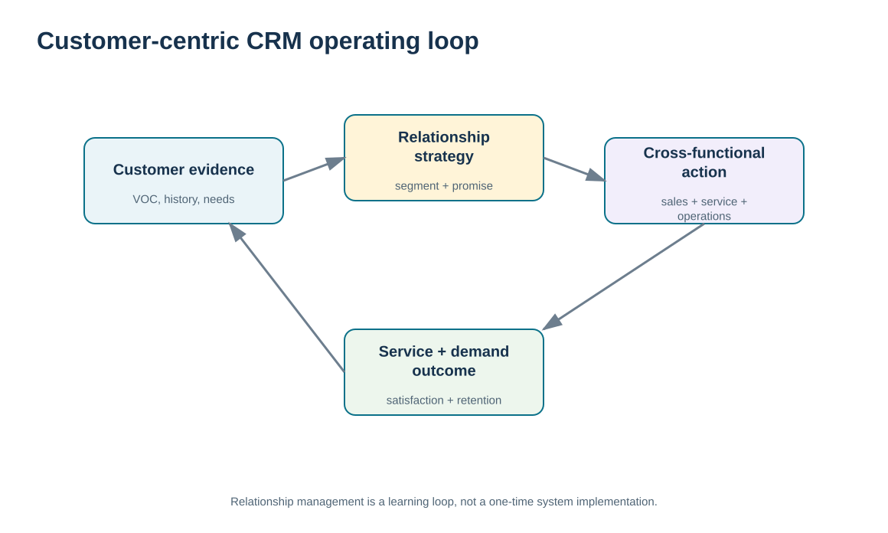
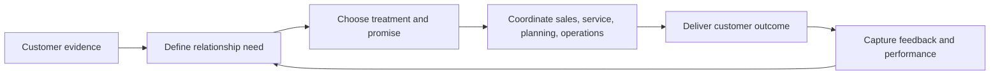

# 1. Customer-Centric Relationships and CRM Purpose

## Learning objectives

After this topic, you should be able to:

- explain CRM as a customer-first relationship operating philosophy rather than only a software package
- connect customer evidence to coordinated commercial, service, planning, and operations decisions
- identify the organizational behaviors needed for a genuinely customer-centric supply chain
- distinguish Module 6 relationship management from the demand-management and market-analysis work already covered in Module 1

## Concept in plain English

Customer relationship management (CRM) starts with a management choice: organize decisions around understanding and serving customers over time. Technology can support that choice, but the software is not the relationship. A company can own an expensive CRM platform and still behave in a product-centric way if teams do not listen to customers, share information, coordinate commitments, or learn from outcomes.

A customer-centric relationship therefore links several activities that are often separated by department. Marketing and sales learn what different customers value. Customer service sees complaints, questions, and recovery needs. Planning sees demand changes and the feasibility of promises. Operations and logistics know whether the promised product, timing, and service can actually be delivered. Finance can see whether the relationship creates sustainable value. CRM provides a common operating philosophy for bringing those views together around the customer rather than allowing each function to optimize its own task.

The relationship view is also longer than a single transaction. A one-time sale can be successful financially while still damaging future trust if delivery is unreliable or the customer has to repeat the same issue to several departments. Conversely, a disciplined recovery from a failure may strengthen the relationship if the organization responds quickly, communicates clearly, fixes the cause, and remembers the lesson. The goal is not to make every customer happy at any cost. It is to build the right relationship with the right customer segment while protecting the enterprise's ability to perform profitably.

This lesson does not replace demand management. Module 1 explains how demand is created, sensed, shaped, prioritized, and aligned with supply. Here, those demand signals become relationship evidence: which customers need more attention, which service commitments matter, which feedback requires action, and which internal owner is accountable for the response.

## Why it matters

Customer-facing failure is rarely owned by only one function. A late order may originate in planning, supply, quality, logistics, or order-entry data, yet the customer experiences one company. Without a relationship operating model, each function can report that its own task is complete while the customer remains dissatisfied.

Customer centricity therefore creates an integration requirement. The organization needs a repeatable way to capture customer evidence, choose the appropriate relationship treatment, coordinate cross-functional execution, measure the outcome, and feed learning back into the next decision. That loop is the foundation for the rest of Section A.

## Decision model and workflow

The visual treats CRM as a closed operating loop: customer evidence informs a relationship choice, coordinated functions execute it, the customer experiences an outcome, and feedback changes the next decision.

### Evidence retained through the workflow

| Evidence | Why retain it |
| --- | --- |
| Customer need and relationship context | Prevents the organization from treating every contact as an isolated transaction. |
| Promise and accountable owner | Makes clear what the company has committed to do and who coordinates delivery. |
| Cross-functional constraints | Shows whether planning, supply, logistics, quality, or finance can support the promise. |
| Customer outcome and feedback | Provides the evidence required to learn rather than simply close the transaction. |

## Practical process flow

## Realistic example — ClearSpan Automation Systems

ClearSpan Automation Systems sells industrial sensing and control products to strategic OEMs, distributors, service networks, smaller digital customers, and project-based new accounts. The company has historically managed each touchpoint separately: sales owns opportunities, service owns cases, and operations owns shipments. A strategic OEM complains that order status is inconsistent across those groups. Sales sees a growing account, service sees repeated delivery questions, and operations sees mostly on-time receipts. No single view explains the relationship.

ClearSpan reframes the problem as a CRM operating issue. The account team records the customer's most important requirement—reliable commitment visibility—then identifies the internal owners who influence that outcome. Instead of buying another tool immediately, the team first defines the relationship process: who owns the promise, who updates exceptions, how the customer is informed, and which feedback confirms whether confidence has improved.

## Applied decision artifact or worked calculation

Use the fictional [`customer-segments.csv`](../../assets/data/module-6/customer-segments.csv) as the starting relationship portfolio. It shows five segments with different relationship tiers and service models. For example, **Strategic OEM** customers are assigned a named-account team plus engineering coordination, while **Digital SMB** customers use a scaled digital self-service model with pooled support.

The dataset is not a recommendation that all companies use these exact tiers. It is a decision artifact showing that customer centricity does **not** mean identical treatment. The useful control is to document, for each segment, the relationship objective, the service model, the accountable owner, and the evidence that will prove whether the model is working. That artifact becomes an input to later lessons on segmentation, channels, CRM technology, and service performance.

## Decision logic

- Start with the customer relationship need, not the available CRM feature.
- Define a clear promise and one accountable relationship owner before coordinating supporting functions.
- Use differentiated treatment by segment; customer-centric does not mean unlimited high-touch service for everyone.
- Capture the outcome and direct customer feedback so the next decision is based on evidence.
- Escalate systemic failures across functions instead of asking customer-facing staff to repeatedly absorb them.

## Trade-offs

| Tension | Decision implication |
| --- | --- |
| Customer responsiveness vs. internal efficiency | More tailored treatment can increase coordination cost; use segmentation to reserve high-touch effort where it creates value. |
| Functional ownership vs. end-to-end accountability | Specialized teams remain necessary, but the customer needs one coherent promise and escalation path. |
| Relationship investment vs. profitability | A strong relationship is valuable only when the service model can be sustained economically. |

## Commonly confused with

**CRM** is often confused with a **CRM system**. The first is the relationship-management philosophy and operating model; the second is a technology enabler. A system can capture contacts, cases, orders, and history, but it cannot by itself create customer-first decisions, ownership, or trust.

## Common mistakes

- Treating CRM implementation as a software deployment with no process or ownership redesign.
- Assuming every customer should receive the same service intensity.
- Measuring sales volume while ignoring complaints, service reliability, and retention signals.
- Allowing functions to make incompatible promises to the same customer.
- Closing a customer issue without feeding the lesson into future planning and service decisions.

## Original knowledge check

**Question.** A strategic OEM tells ClearSpan that it receives different promised dates from sales and customer service. Which response best reflects CRM as an operating philosophy?

A. Add another field to the CRM screen and leave ownership unchanged

B. Create one relationship promise process with an accountable owner and shared exception evidence

C. Ask operations to stop sharing dates with customer-facing teams

D. Give every customer a dedicated executive sponsor

Answer and rationale

### Correct answer

**B. Create one relationship promise process with an accountable owner and shared exception evidence**

### Why it is correct

The problem is inconsistent cross-functional relationship management. A shared promise process and accountable owner integrate the customer experience while still allowing functions to contribute their expertise.

### Why the other answers are wrong

- **A.** A technology field does not resolve conflicting decision rights or accountability.

- **C.** Removing operational evidence would make promises less reliable, not more customer-centric.

- **D.** High-touch sponsorship for every customer ignores segmentation and can create an unsustainable service model.

## Practitioner perspective

In an SAP or broader enterprise landscape, customer data is usually distributed across sales, order management, service, planning, logistics, finance, and analytics. The practical question is not “Which system owns the customer?” but “Which process owns the customer promise, and which systems provide the evidence?” Keep the accountable business decision visible even when several applications support it.

## Related concepts

- [Module 1 — Demand Management](../../01-supply-chains-demand-forecasting/section-c-demand-management/README.md)
- [Customer Segmentation and Customer-Focused Marketing](./02-customer-segmentation-and-customer-focused-marketing.md)
- [CRM Strategy, Process Design, and Organizational Ownership](./10-crm-strategy-process-design-and-organizational-ownership.md)
- [CRM-SRM Integration and End-to-End Relationship Management](../section-b-supplier-and-supply-chain-relationships/14-crm-srm-integration-and-end-to-end-relationship-management.md)

---

[Previous: Section overview](./README.md) · [Section overview](./README.md) · [Next: Customer Segmentation and Customer-Focused Marketing](./02-customer-segmentation-and-customer-focused-marketing.md)
