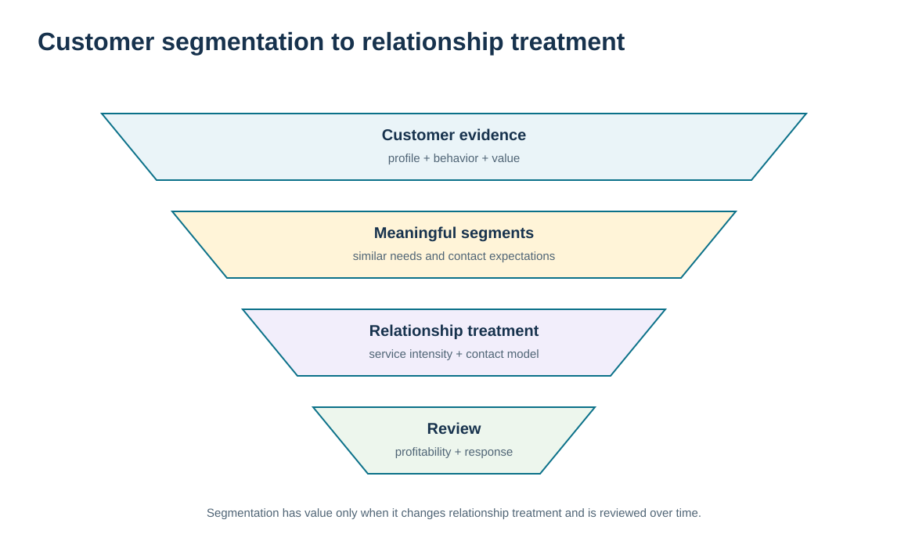
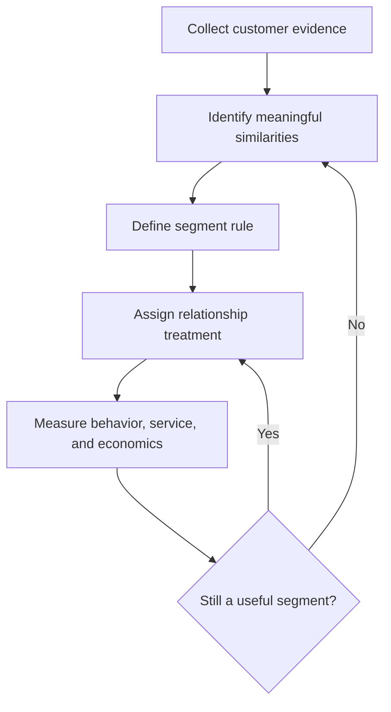

# 2. Customer Segmentation and Customer-Focused Marketing

## Learning objectives

After this topic, you should be able to:

- explain why customer segmentation is required for differentiated relationship management
- distinguish descriptive customer attributes from segments that actually change CRM treatment
- use demographic, attitudinal, behavioral, value, need, and channel evidence without stereotyping individuals
- connect segmentation to a profitable customer-focused service strategy rather than to network design

## Concept in plain English

Segmentation groups customers who can be managed with a similar relationship approach. The purpose is not to create attractive labels. A useful CRM segment changes a decision: the amount of human attention, the preferred contact method, the service proposition, the type of information shared, or the way the organization develops the relationship.

Historic segmentation often relied heavily on broad descriptors such as geography, industry, company size, age, income, or other demographic characteristics. Those variables can still be useful, but they are only proxies. CRM becomes more powerful when it combines them with evidence about actual behavior, needs, value, channel preference, service expectations, and the current relationship state. Two customers that look similar demographically may require different treatment because one values self-service and speed while the other depends on engineering collaboration and scheduled executive reviews.

Customer-focused marketing starts with the customer requirement rather than assuming that the existing product or service should be pushed uniformly to the market. In relationship terms, the question becomes: which group are we trying to serve, what does that group value, what level of service and contact is justified, and how will we know whether the treatment is profitable and effective?

Segmentation should remain revisable. A customer can grow, shrink, adopt a new channel, become vulnerable, or move into a more strategic role. The organization therefore needs evidence-based rules and periodic review rather than permanent labels. Module 2 uses segmentation to design network and service policies. Module 6 uses it more narrowly to decide **relationship treatment**—how the company interacts with, supports, develops, and learns from the customer.

## Why it matters

Without segmentation, organizations tend to choose one of two bad extremes. They either provide the same low-cost generic treatment to everyone, frustrating customers who require deeper coordination, or they provide expensive high-touch service to everyone, destroying the economics of the model.

A disciplined segmentation approach gives customer-facing teams a common basis for differentiated service while reducing arbitrary “special treatment.” It also makes changes auditable: if an account is moved into a strategic tier, the evidence and expected relationship outcome should be visible.

## Decision model and workflow

The visual shows segmentation as a funnel from customer evidence to a relationship treatment. The final output is not a warehouse or network policy; it is the CRM service and contact approach.

### Evidence retained through the workflow

| Evidence | Why retain it |
| --- | --- |
| Stable descriptive attributes | Provides context such as industry, geography, customer type, or business model. |
| Observed buying and service behavior | Shows what customers actually do rather than what the organization assumes they do. |
| Needs, value, and channel preference | Connects the segment to a relationship decision. |
| Segment economics and outcome measures | Tests whether differentiated treatment produces sustainable value. |

## Practical process flow

## Realistic example — ClearSpan Automation Systems

ClearSpan has hundreds of small customers and a much smaller number of OEMs, distributors, service partners, and project accounts. Sales originally proposes segmenting only by annual revenue. Customer service challenges that approach because service networks generate less revenue than strategic OEMs but require rapid technical response and parts availability. Meanwhile, many Digital SMB customers prefer self-service and would find repeated account-manager calls intrusive.

The team therefore uses revenue as only one input. It also considers service need, buying pattern, relationship potential, and preferred contact channel. That produces segments that change the CRM treatment rather than simply describing the customer.

## Applied decision artifact or worked calculation

The fictional [`customer-segments.csv`](../../assets/data/module-6/customer-segments.csv) contains five distinct relationship segments. Notice that **Service Networks** generate $7.68 million of annual revenue, below several other segments, yet their relationship tier is *Preferred* and their service model is a fast-response service desk. The reason is the nature of the relationship need, not revenue alone.

A useful segmentation control is a short rule card with four fields: **segment evidence → treatment → owner → reassessment trigger**. For ClearSpan, a trigger might be a material change in revenue, order pattern, service requirements, channel preference, or relationship state. This keeps the segment tied to action rather than becoming a static marketing label.

## Decision logic

- Use a segmentation variable only when it changes a relationship decision.
- Combine descriptive attributes with observed behavior, needs, value, and channel evidence.
- Avoid assuming that the highest-revenue segment always deserves the most intensive service.
- Document why each segment receives its service model and how that model will be measured.
- Review assignments when customer behavior, importance, or needs materially change.

## Trade-offs

| Tension | Decision implication |
| --- | --- |
| Simple segments vs. precise segments | Simple rules are easier to govern; excessive granularity creates tiny groups that are difficult to serve consistently. |
| Revenue focus vs. relationship need | Revenue is visible and useful, but strategic importance and service criticality can justify different treatment. |
| Stability vs. responsiveness | Stable segments help execution, but stale segments misallocate attention when customer behavior changes. |

## Commonly confused with

**Customer segmentation for CRM** is not the same as **network segmentation**. Module 2 asks which inventory, capacity, and fulfillment policies different demand streams require. Here the concern is the customer relationship: service intensity, contact style, information exchange, and account development.

## Common mistakes

- Segmenting only by easy-to-query demographics or revenue.
- Creating so many segments that operating teams cannot distinguish the treatments.
- Using assumptions about a group instead of validating actual customer behavior and needs.
- Assigning premium service without checking the economics.
- Failing to define when a customer can move from one segment to another.

## Original knowledge check

**Question.** ClearSpan has two customers with similar annual revenue. One wants portal self-service; the other requires frequent engineering coordination. What is the strongest segmentation conclusion?

A. They must remain in the same segment because revenue is similar

B. Channel and service need can justify different CRM treatments despite similar revenue

C. The customer needing engineering support should automatically receive the lowest-cost channel

D. Only demographic variables are valid for segmentation

Answer and rationale

### Correct answer

**B. Channel and service need can justify different CRM treatments despite similar revenue**

### Why it is correct

A useful CRM segment exists to change relationship treatment. Similar revenue does not erase meaningful differences in preferred channel and required relationship support.

### Why the other answers are wrong

- **A.** Revenue is one input, not a complete relationship rule.

- **C.** The objective is fit and sustainable value, not forcing every customer to the cheapest channel.

- **D.** CRM segmentation can use behavior, value, needs, and channel evidence in addition to demographics.

## Practitioner perspective

In enterprise systems, segment codes often become master-data fields. That makes governance important: define the business rule, the owner allowed to change the assignment, the effective date, and the downstream processes that consume it. A segment that has no effect on service, workflow, or decision logic is probably just descriptive reporting data.

## Related concepts

- [Module 2 — Market Segmentation and Service Choices](../../02-network-design-digital-connectivity-performance/section-a-network-design-and-technology-investment/02-market-segmentation-and-service-choices.md)
- [Customer Value, Pareto Effect, Profitability, and Lifetime Potential](./03-customer-value-pareto-profitability-and-lifetime-potential.md)
- [Contact-Channel Strategy and Cost-to-Serve Trade-offs](./05-contact-channel-strategy-and-cost-to-serve-trade-offs.md)

---

[Previous: Customer-Centric Relationships and CRM Purpose](./01-customer-centric-relationships-and-crm-purpose.md) · [Section overview](./README.md) · [Next: Customer Value, Pareto Effect, Profitability, and Lifetime Potential](./03-customer-value-pareto-profitability-and-lifetime-potential.md)
