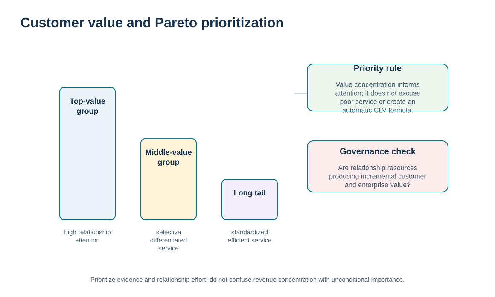
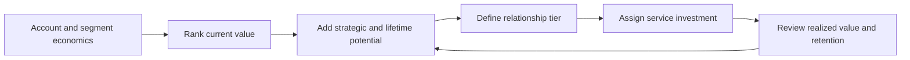

# 3. Customer Value, Pareto Effect, Profitability, and Lifetime Potential

## Learning objectives

After this topic, you should be able to:

- explain the Pareto effect as a prioritization lens rather than a fixed 80/20 law
- distinguish customer revenue from gross-profit contribution and broader relationship potential
- use customer value evidence to calibrate relationship investment without abandoning lower-value customers
- avoid presenting an organization-specific customer-lifetime-value formula as if it were a universal standard

## Concept in plain English

Customer value is unevenly distributed. In many portfolios, a relatively small group of customers contributes a large share of revenue, profit, strategic access, learning, or future opportunity. The Pareto effect is a useful way to notice that concentration, but it should not be treated as a rule that exactly 20 percent of customers must produce exactly 80 percent of value.

For CRM, the important decision is what **value** means. Revenue alone can be misleading because two accounts with the same sales may have very different margins, service costs, risk, growth potential, or strategic relevance. Profitability is therefore a stronger relationship signal than revenue by itself, while lifetime potential adds a forward-looking view: will the customer likely remain, grow, collaborate, refer others, or open access to an attractive market?

The concept also has a governance implication. High-value customers may justify dedicated account resources, joint planning, executive sponsorship, or customized service. Lower-value customers still require a reliable proposition, but their service model may need to be more standardized or digital. The goal is not to neglect small customers; it is to align relationship investment with evidence of current and potential value.

Because organizations calculate customer lifetime value in different ways, this repository does not impose one universal formula. Instead, later lessons use transparent training measures such as gross profit, retention, revenue change, and relationship state. These measures help learners reason about long-run value without implying that one CLV equation applies everywhere.

## Why it matters

A relationship portfolio can consume substantial selling and service capacity. If high-cost attention is assigned by habit, seniority, or the loudest escalation, the company may spend scarce resources on accounts that do not justify the treatment while under-serving customers that drive long-term value.

A value-concentration view makes the allocation explicit. It also reveals where a customer appears important on revenue but less attractive on margin, or where a smaller customer has strategic potential that a backward-looking revenue ranking would miss.

## Decision model and workflow

The visual separates customer count from value contribution and then adds a governance layer: concentration is a signal for prioritization, not permission to ignore the rest of the portfolio.

### Evidence retained through the workflow

| Evidence | Why retain it |
| --- | --- |
| Revenue by account or segment | Shows commercial scale but not the full economic contribution. |
| Gross margin or contribution | Improves the view of relationship economics. |
| Service intensity and cost-to-serve evidence | Prevents high-maintenance accounts from appearing more attractive than they are. |
| Growth, retention, learning, and strategic potential | Adds the forward-looking relationship dimension that current revenue misses. |

## Practical process flow

## Realistic example — ClearSpan Automation Systems

ClearSpan initially assumes its Strategic OEM segment is the only group deserving management attention because it produces the most revenue. The portfolio data show that Strategic OEM also produces the most annual gross profit, but the Service Networks segment has a much higher gross-margin percentage and a service role that can affect end-user uptime. Meanwhile, the Digital SMB segment contains many accounts and orders, so even a scaled relationship model must be designed carefully because a small percentage deterioration can affect a large customer population.

Rather than creating one “top customer” list, ClearSpan separates current economics, relationship criticality, and future potential. That allows the company to reserve executive and engineering capacity for the relationships that need it while still building a reliable scaled experience for the broader base.

## Applied decision artifact or worked calculation

From [`customer-segments.csv`](../../assets/data/module-6/customer-segments.csv), ClearSpan's fictional annual gross profit by segment is:

| Segment | Annual revenue | Gross margin | Annual gross profit |
|---|---:|---:|---:|
| Strategic OEM | $18.90M | 34% | $6.426M |
| Growth Distributors | $16.80M | 27% | $4.536M |
| Service Networks | $7.68M | 42% | $3.226M |
| Digital SMB | $9.30M | 31% | $2.883M |
| Projects / New Logos | $5.50M | 29% | $1.595M |

The table demonstrates why revenue ranking and relationship value are not identical. Service Networks rank fourth on revenue but third on gross profit because of the higher margin. A practitioner should add service cost, retention, strategic importance, and future potential before making a relationship-investment decision. The values here are fictional training evidence, not a universal customer valuation formula.

## Decision logic

- Define the value measure before ranking customers.
- Use revenue as context, not as a substitute for profitability and relationship potential.
- Treat Pareto concentration as an empirical pattern to test, not a fixed 80/20 requirement.
- Calibrate relationship investment to current value, future potential, and required service intensity.
- Review whether the chosen service model is actually improving retention, profitability, or strategic outcomes.

## Trade-offs

| Tension | Decision implication |
| --- | --- |
| Current value vs. future potential | A new or smaller account may deserve development resources when credible future value exists. |
| High-touch service vs. scalable economics | Dedicated attention can deepen strategic relationships but becomes expensive when applied too broadly. |
| Portfolio efficiency vs. customer fairness | Differentiated treatment should still preserve a reliable baseline proposition for lower-tier customers. |

## Commonly confused with

The **Pareto effect** is a pattern of concentration, not a customer-lifetime-value formula. **Customer lifetime value** is an organization-specific economic model of expected future relationship value. This module uses the Pareto lens and transparent training metrics without claiming one universal CLV calculation.

## Common mistakes

- Assuming revenue is the same as profit or total relationship value.
- Forcing the data to fit an exact 80/20 split.
- Using current profit to ignore future growth, retention, or strategic learning.
- Interpreting differentiated service as permission to provide unreliable service to lower-value customers.
- Creating an organization-specific lifetime-value formula and presenting it as a universal standard.

## Original knowledge check

**Question.** A segment produces less revenue than another segment but has a much higher gross margin and is critical to end-user service. What should ClearSpan do before reducing relationship investment?

A. Rank only by revenue because it is objective

B. Apply an exact 80/20 rule and remove support from the bottom 80 percent

C. Evaluate profitability, service criticality, and future relationship potential together

D. Move all customers into the same service tier to avoid bias

Answer and rationale

### Correct answer

**C. Evaluate profitability, service criticality, and future relationship potential together**

### Why it is correct

Customer value is multidimensional. Revenue alone can hide strong margin contribution and strategic relationship importance.

### Why the other answers are wrong

- **A.** Revenue is useful but incomplete.

- **B.** Pareto is a lens, not a mandatory 80/20 allocation rule.

- **D.** Uniform treatment can over-serve some customers and under-serve others.

## Practitioner perspective

A useful portfolio dashboard should show both the ranking and the reason for the ranking. If a “strategic” label cannot be traced to current economics, future potential, or a documented operational dependency, it is vulnerable to politics. Keep the evidence transparent enough that commercial, service, finance, and supply-chain leaders can challenge the tier constructively.

## Related concepts

- [Customer Segmentation and Customer-Focused Marketing](./02-customer-segmentation-and-customer-focused-marketing.md)
- [Lifetime Customer Relationships and Retention Economics](./09-lifetime-customer-relationships-and-retention-economics.md)
- [Module 2 — Financial Insight](../../02-network-design-digital-connectivity-performance/section-c-performance-and-financial-insight/README.md)

---

[Previous: Customer Segmentation and Customer-Focused Marketing](./02-customer-segmentation-and-customer-focused-marketing.md) · [Section overview](./README.md) · [Next: Customer Needs, Value Profiles, and Service Design](./04-customer-needs-value-profiles-and-service-design.md)