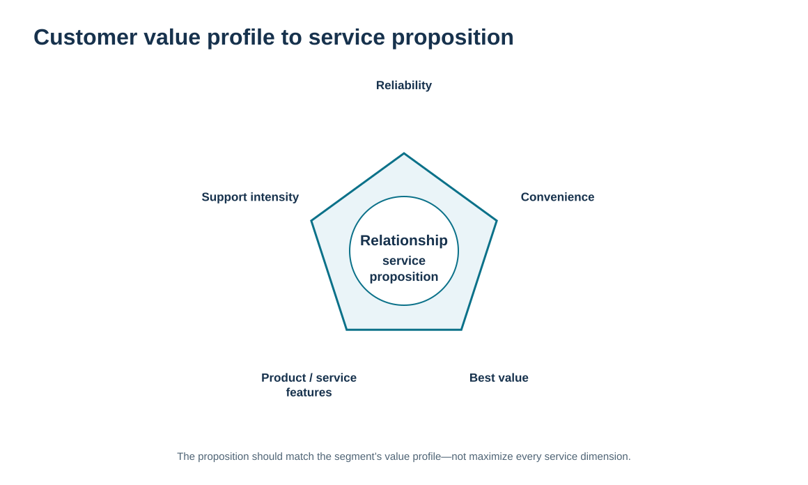
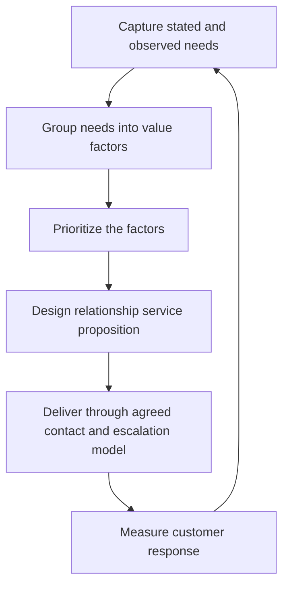

# 4. Customer Needs, Value Profiles, and Service Design

## Learning objectives

After this topic, you should be able to:

- build a customer value profile from the needs that matter to a relationship segment
- distinguish reliability, convenience, price/value, product/service features, and support expectations
- convert needs into a relationship service proposition without redesigning the physical distribution network
- identify the trade-off between richer service and the resources required to sustain it

## Concept in plain English

A customer does not experience value as one number. Different segments can emphasize reliability, convenience, total value, product or service features, access to expertise, or the speed and quality of support. A **value profile** makes those priorities explicit so that the relationship model can respond deliberately.

The important step is translation. A statement such as “this customer values reliability” is too vague to manage. The relationship team must ask what reliability means in practice: stable promised dates, consistent technical response, dependable spare-parts support, accurate status, or another outcome. Likewise, “convenience” may mean self-service access for one segment and a single human point of contact for another.

The service proposition should reflect the profile without confusing customer relationship design with product engineering or physical network design. Module 3 owns formal product-design methods such as QFD; Module 5 owns distribution-channel and fulfillment architecture. Module 6 uses the customer's expressed priorities to define how the organization **relates** to the customer: the service promise, contact model, escalation path, information cadence, and amount of collaborative attention.

A value profile is most useful when it includes relative importance and evidence. The organization should be able to explain why it believes a factor matters and how it will test whether the chosen relationship treatment improves the customer's experience.

## Why it matters

Companies often offer expensive service features because they sound customer friendly rather than because the target customer values them. That creates cost without loyalty. The opposite failure is to standardize away a relationship feature that a critical customer genuinely needs.

A value profile disciplines both choices. It makes the team agree on the customer's priorities before designing the treatment, and it provides a basis for measuring whether the treatment is delivering the expected value.

## Decision model and workflow

The visual moves from customer needs through a value profile into a relationship service proposition. The emphasis is on what the customer values and how the relationship responds, not on the physical network that fulfills the product.

### Evidence retained through the workflow

| Evidence | Why retain it |
| --- | --- |
| Direct VOC and interview evidence | Provides the customer’s own description of priorities. |
| Observed service and buying behavior | Tests whether stated preferences match actual behavior. |
| Relative importance of value factors | Prevents the team from treating every requested feature as equally important. |
| Service cost and outcome evidence | Checks whether the proposed relationship treatment is sustainable and effective. |

## Practical process flow

## Realistic example — ClearSpan Automation Systems

ClearSpan's Strategic OEM customers repeatedly ask for predictable commitments, engineering coordination, and early visibility of changes. Digital SMB customers, by contrast, place many small orders and primarily want fast self-service, accurate status, and easy issue resolution. Treating both groups with the same relationship design would either make the SMB model too expensive or make the OEM model too shallow.

ClearSpan creates a value profile for each segment. It keeps the physical fulfillment decisions in the logistics workstream, but it uses the profile to define who communicates, what information is shared, how quickly exceptions are escalated, and how much relationship customization is justified.

## Applied decision artifact or worked calculation

Combine [`customer-segments.csv`](../../assets/data/module-6/customer-segments.csv) with [`customer-channel-preferences.csv`](../../assets/data/module-6/customer-channel-preferences.csv). The Strategic OEM segment is modeled with a named account team plus engineering coordination, and **55%** of surveyed respondents prefer a field representative. Digital SMB uses digital self-service plus pooled support, and **70%** prefer the portal.

That does not prove a universal relationship design; it creates a traceable training decision. The artifact should record: **value factor → evidence → relationship feature → owner → outcome measure**. For example, “convenience” for Digital SMB may map to portal availability and fast digital support, while “reliability” for Strategic OEM may map to a named owner and structured exception review.

## Decision logic

- Use direct and observed customer evidence to define the value profile.
- Translate broad needs into specific relationship features that can be owned and measured.
- Prioritize the few factors that materially differentiate the segment instead of promising everything.
- Keep relationship-service design separate from detailed product engineering and physical fulfillment design.
- Revisit the profile when customer feedback or behavior shows that priorities have changed.

## Trade-offs

| Tension | Decision implication |
| --- | --- |
| Customization vs. standardization | Tailored service can create value, but excessive variation raises complexity and cost. |
| Stated preference vs. observed behavior | Customers may request features they rarely use; validate both evidence types. |
| Service richness vs. cost-to-serve | A high-touch proposition should be justified by the segment’s needs and economics. |

## Commonly confused with

A **value profile** in this lesson describes what a customer segment values in the relationship and service experience. It is not the same as a detailed **product specification** or a **distribution service-output design**. Those decisions may consume the profile as an input, but they are owned elsewhere in the repository.

## Common mistakes

- Writing a generic list of desirable service features without ranking importance.
- Assuming every customer defines reliability or convenience the same way.
- Using internal opinions as a substitute for customer evidence.
- Promising a premium service feature without assigning an owner and cost.
- Allowing relationship design to silently duplicate product or logistics design work.

## Original knowledge check

**Question.** A Digital SMB segment strongly prefers self-service while Strategic OEM customers ask for engineering coordination. What is the best use of this evidence?

A. Give both segments the same high-touch service to ensure fairness

B. Translate the different needs into distinct relationship service propositions

C. Redesign warehouse locations before changing the contact model

D. Use revenue alone to decide which channel customers must accept

Answer and rationale

### Correct answer

**B. Translate the different needs into distinct relationship service propositions**

### Why it is correct

The value profile exists to convert customer needs into differentiated relationship treatment. The physical network and product design are separate decisions.

### Why the other answers are wrong

- **A.** Identical treatment can be both expensive and poorly matched to customer preferences.

- **C.** Warehouse design is a logistics decision and does not answer the contact/service relationship need.

- **D.** Revenue alone does not establish the right service proposition or preferred channel.

## Practitioner perspective

When building a value-profile field or service tier in CRM, avoid free-text labels that mean different things to every user. Define observable behaviors: response target, named-owner requirement, review cadence, escalation threshold, and preferred channel. That turns “customer intimacy” from a slogan into an operating design.

## Related concepts

- [Contact-Channel Strategy and Cost-to-Serve Trade-offs](./05-contact-channel-strategy-and-cost-to-serve-trade-offs.md)
- [Customer Information, VOC, Business Intelligence, and Data Warehouses](./06-customer-information-voc-business-intelligence-and-data-warehouses.md)
- [Module 5 — Channel Design and Service Outputs](../../05-forward-reverse-logistics/section-b-distribution-services-and-transportation-choices/04-channel-design-supply-and-distribution-channels-and-service-outputs.md)

---

[Previous: Customer Value, Pareto Effect, Profitability, and Lifetime Potential](./03-customer-value-pareto-profitability-and-lifetime-potential.md) · [Section overview](./README.md) · [Next: Contact-Channel Strategy and Cost-to-Serve Trade-offs](./05-contact-channel-strategy-and-cost-to-serve-trade-offs.md)
