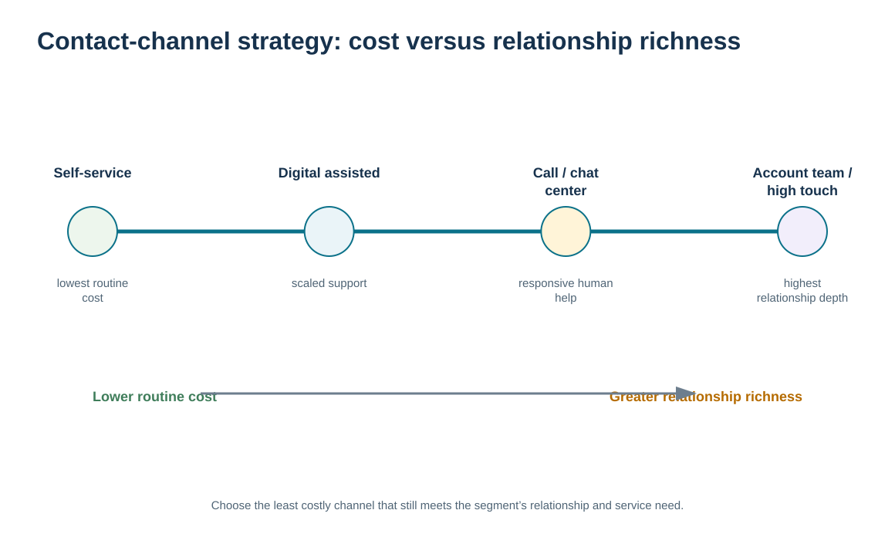
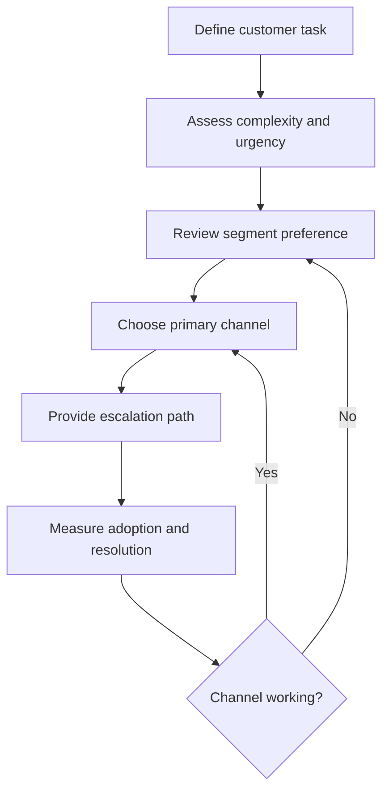

# 5. Contact-Channel Strategy and Cost-to-Serve Trade-offs

## Learning objectives

After this topic, you should be able to:

- match customer contact channels to segment preference and relationship complexity
- compare self-service, digital, assisted, and high-touch channels using both cost and relationship richness
- distinguish a customer contact channel from the physical order and fulfillment channel
- design a channel migration or mix that protects customers who need human support

## Concept in plain English

A contact channel is the path through which the customer and organization communicate and receive service. It may be a portal, email, chat, telephone, field representative, account team, or another interface. The best channel is not automatically the newest or cheapest. It is the one that fits the customer's need, the complexity of the interaction, and the economics of the relationship.

Self-service and digital channels can make routine interactions fast, consistent, and scalable. They are especially useful when the task is structured: checking order status, downloading documentation, updating simple information, or opening a standard support request. Assisted channels such as phone or chat add human interpretation. Field and account-team channels provide richer communication and are valuable when decisions are complex, trust-sensitive, or cross-functional.

Channel strategy therefore involves both **preference** and **fit**. A customer may say it prefers email but still need a live technical discussion for an escalation. A strategic account may prefer a field representative for relationship reviews while using the portal for routine transactions. The organization can design a channel mix rather than forcing every interaction through one path.

This is different from fulfillment-channel design. Module 5 distinguishes how customers place orders from how physical orders are fulfilled. Here the focus is the relationship/contact experience: how customers obtain information, raise issues, collaborate, and receive support.

## Why it matters

Poor channel design creates hidden cost and friction. Forcing simple interactions into a high-touch channel consumes expensive capacity. Forcing complex or emotionally sensitive issues into self-service can increase repeat contacts, escalation, and churn.

The relationship team should therefore treat channel design as a service decision with measurable adoption and outcome evidence. If customers bypass the intended channel, the organization should investigate whether the problem is training, functionality, trust, or genuine need for a different contact model.

## Decision model and workflow

The spectrum compares channels from lower-cost, lower-richness self-service toward higher-cost, higher-richness human interaction. The correct choice depends on the task and customer relationship, not a blanket digital-first rule.

### Evidence retained through the workflow

| Evidence | Why retain it |
| --- | --- |
| Channel-preference research | Shows where customers say they want to interact. |
| Actual channel usage and repeat contacts | Tests adoption and whether the preferred channel is solving the task. |
| Interaction complexity and sensitivity | Identifies cases that require richer two-way communication. |
| Cost-to-serve and service outcome | Shows whether the channel mix creates sustainable value. |

## Practical process flow

## Realistic example — ClearSpan Automation Systems

ClearSpan's service-network customers frequently need rapid troubleshooting. The channel study shows **40%** prefer phone/chat, more than any other option for that segment. By contrast, **70%** of Digital SMB respondents prefer the portal. ClearSpan could reduce cost by forcing both groups to use the portal, but that would ignore the different interaction needs.

The company instead makes the portal the default for routine Digital SMB service and keeps pooled assisted support for escalation. Service Networks receive fast phone/chat access, with portal status available as a complementary tool. Strategic OEM and Projects/New Logos retain a stronger field-representative component for complex coordination.

## Applied decision artifact or worked calculation

The fictional [`customer-channel-preferences.csv`](../../assets/data/module-6/customer-channel-preferences.csv) provides a direct channel-mix decision artifact. Dominant preferences are:

- Strategic OEM: **Field representative — 55%**
- Growth Distributors: **Portal — 45%**
- Service Networks: **Phone/chat — 40%**
- Digital SMB: **Portal — 70%**
- Projects / New Logos: **Field representative — 50%**

Do not read the dominant percentage as a mandate that every customer in the segment must use that channel. Instead, define a **primary channel**, the types of interactions suited to it, and an **escalation channel** for exceptions. Then track whether customers actually use the model and whether first-contact resolution, response time, repeat contacts, and satisfaction improve.

## Decision logic

- Match the channel to both the customer segment and the specific interaction.
- Use lower-cost self-service for structured tasks when customers can complete them successfully.
- Preserve richer human channels for complexity, trust, negotiation, and high-impact exceptions.
- Design escalation paths so a customer is not trapped in an unsuitable channel.
- Measure adoption and resolution outcomes before declaring a digital migration successful.

## Trade-offs

| Tension | Decision implication |
| --- | --- |
| Cost-to-serve vs. interaction richness | Digital channels scale efficiently; human channels communicate nuance and build trust. |
| Customer preference vs. process control | Preferred channels matter, but some regulated or sensitive communications may require formal methods. |
| Channel standardization vs. flexibility | Standardization improves efficiency; a controlled channel mix can better fit diverse relationship needs. |

## Commonly confused with

A **contact channel** is how the relationship communicates or provides service. An **order channel** is how demand enters the company, and a **fulfillment strategy** is how product is physically delivered. One portal may support all three, but the underlying decisions are different.

## Common mistakes

- Moving customers to a cheaper channel without validating task suitability.
- Measuring login counts instead of successful customer outcomes.
- Treating a segment-level preference as an absolute rule for every account and interaction.
- Providing no human escalation path when self-service fails.
- Confusing contact-channel design with warehouse or fulfillment-network design.

## Original knowledge check

**Question.** ClearSpan wants to reduce service cost for Digital SMB customers, but some complex technical incidents cannot be resolved in the portal. Which design is strongest?

A. Require portal use for every interaction with no exception

B. Use the portal as the primary channel with an assisted escalation path for complex incidents

C. Move all Digital SMB customers to field representatives

D. Redesign the distribution network instead of the service channel

Answer and rationale

### Correct answer

**B. Use the portal as the primary channel with an assisted escalation path for complex incidents**

### Why it is correct

The design captures the scale benefit of self-service while preserving a richer channel when task complexity requires it.

### Why the other answers are wrong

- **A.** A rigid channel can increase failure and repeat contacts when the task is unsuitable.

- **C.** High-touch service for every interaction would likely destroy the segment economics and contradict the preference evidence.

- **D.** Physical fulfillment design does not solve a customer contact-channel problem.

## Practitioner perspective

For CRM and service platforms, capture both the **preferred channel** and the **interaction outcome**. If customers repeatedly abandon a portal and call, the data should expose that behavior. Channel strategy improves when digital adoption is measured by successful resolution, not by the number of users redirected away from people.

## Related concepts

- [Customer Needs, Value Profiles, and Service Design](./04-customer-needs-value-profiles-and-service-design.md)
- [CRM Technology Architecture and Customer Data Integration](./11-crm-technology-architecture-and-customer-data-integration.md)
- [Module 5 — Order Channels and Fulfillment Strategy](../../05-forward-reverse-logistics/section-b-distribution-services-and-transportation-choices/05-order-channels-and-fulfillment-strategy-design.md)

---

[Previous: Customer Needs, Value Profiles, and Service Design](./04-customer-needs-value-profiles-and-service-design.md) · [Section overview](./README.md) · [Next: Customer Information, VOC, Business Intelligence, and Data Warehouses](./06-customer-information-voc-business-intelligence-and-data-warehouses.md)
