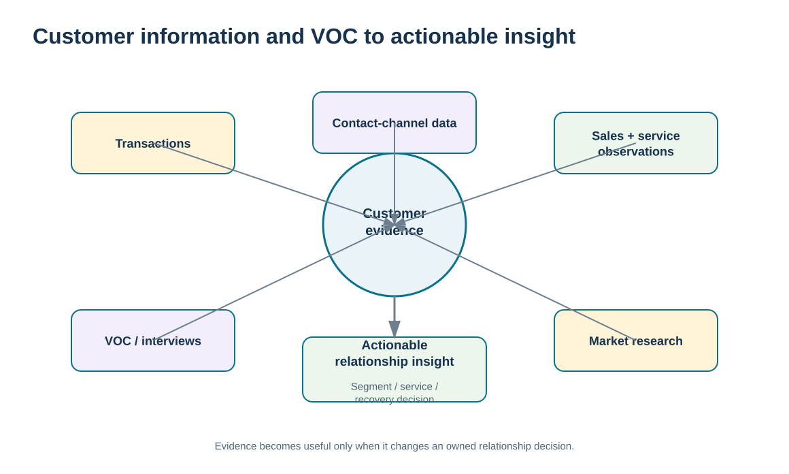
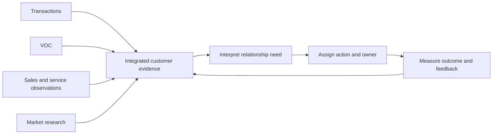

# 6. Customer Information, VOC, Business Intelligence, and Data Warehouses

## Learning objectives

After this topic, you should be able to:

- identify the main customer-information sources used to understand segments and relationships
- explain voice of the customer as direct customer evidence rather than an internal assumption
- distinguish business intelligence and data-warehouse enablement from enterprise architecture design
- convert fragmented customer observations into an actionable relationship insight with traceable evidence

## Concept in plain English

CRM depends on information from many customer interactions. Transactions show what was bought, when, in what quantity, and through which channel. Sales and service teams hear questions, objections, complaints, and future plans. Surveys, interviews, reviews, workshops, and other voice-of-the-customer (VOC) methods capture what customers say they need and how they experience the relationship. External market research can add context about competitors and broader trends.

No single source is complete. Transaction history is objective but cannot explain every motive. A salesperson can provide rich context but may observe only part of the customer's organization. Complaint data identifies failures, yet satisfied customers may never submit a complaint. VOC becomes most useful when the organization combines direct statements with operational behavior and then tests the interpretation over time.

**Business intelligence** is the use of organized information to support decisions. A **data warehouse** is one common way to store and query integrated data for analysis. In this module those terms matter because CRM needs a consolidated view of customer evidence. Module 2 owns the deeper questions of information architecture, data platforms, integration, data quality, and analytics. Module 6 asks a narrower question: what customer evidence must be available so the relationship team can make a better decision?

Actionability is the final test. A customer insight that never changes a service promise, account plan, product discussion, escalation, or improvement action is only information. Relationship management requires an owner and a closed loop from evidence to action and back to feedback.

## Why it matters

Customer knowledge is easily fragmented. Sales may know future demand, service may know recurring technical problems, finance may know payment behavior, and logistics may know delivery failures. If those signals are not connected, the company can misclassify the relationship or repeat the same mistake.

A governed customer-information loop also prevents anecdote from dominating. Strong individual stories are valuable, but they should be combined with broader evidence before the organization changes a segment strategy or service policy.

## Decision model and workflow

The hub visual shows multiple customer-information sources converging into governed interpretation before a relationship action is selected. It deliberately separates the customer insight from the underlying enterprise data architecture.

### Evidence retained through the workflow

| Evidence | Why retain it |
| --- | --- |
| Transaction and order history | Shows actual buying patterns and service events. |
| VOC interviews, surveys, and reviews | Captures the customer’s own language about needs, expectations, and problems. |
| Sales and service observations | Adds context that structured transaction data may miss. |
| Decision, owner, and follow-up result | Makes the insight actionable and preserves whether the action worked. |

## Practical process flow

## Realistic example — ClearSpan Automation Systems

A Growth Distributor tells ClearSpan that portal usability is a problem. A single survey comment could be dismissed as preference, but the broader evidence shows late response, an open corrective action, and a vulnerable account with declining revenue. The relationship team now has a stronger signal that the issue is not merely cosmetic.

ClearSpan combines the VOC interaction with account history and service-performance evidence. It does not ask the customer to repeat the story to multiple departments. The resulting action has an owner, response target, corrective-action record, and follow-up check.

## Applied decision artifact or worked calculation

The fictional [`customer-voc-interactions.csv`](../../assets/data/module-6/customer-voc-interactions.csv) contains 24 customer interactions across interviews, complaints, surveys, support cases, project reviews, and follow-up calls. Each record retains the touchpoint, issue, severity, sentiment, response target, actual response, complaint indicator, corrective-action status, and follow-up satisfaction.

For example, interaction **V005** records a Growth Distributor portal-usability issue: the response target was 24 hours, actual response was 31 hours, the target was missed, and the corrective action remained open at that observation. A later follow-up (**V022**) records a 20-hour response within target and a follow-up satisfaction score of 3/5. The pair demonstrates why CRM evidence should include both the problem and the recovery result.

The decision artifact is an **insight record**: source evidence, interpreted relationship issue, confidence/limitations, accountable owner, action, target date, and follow-up outcome.

## Decision logic

- Combine direct customer voice with operational and behavioral evidence.
- Distinguish a raw data point from an interpreted relationship insight.
- Assign an owner and action to material insights so they do not remain in reports.
- Use follow-up evidence to test whether the interpretation and response were effective.
- Link to Module 2 for platform, data-quality, integration, or analytics design rather than duplicating those topics.

## Trade-offs

| Tension | Decision implication |
| --- | --- |
| Rich qualitative insight vs. scalable quantitative data | Interviews reveal context; structured data supports pattern detection across many customers. |
| Centralized view vs. source detail | Integration improves visibility, but the original source and context should remain traceable. |
| Fast action vs. evidence confidence | Urgent issues may require immediate containment while broader diagnosis continues. |

## Commonly confused with

**VOC** is direct evidence of what customers say they need or experience. **Business intelligence** organizes information for decisions. A **data warehouse** is a technology/data-storage concept that can support BI. They are related but not interchangeable, and none of them replaces the business decision about how to respond to the customer.

## Common mistakes

- Treating complaint volume as the complete voice of the customer.
- Collecting survey data without assigning action ownership.
- Assuming sales notes or operational metrics are automatically equivalent to direct customer feedback.
- Building a central data store but leaving definitions and source context ambiguous.
- Allowing technology architecture discussion to replace the relationship decision.

## Original knowledge check

**Question.** A customer complaint says order-status information is unreliable, while system data show mostly on-time deliveries. What should ClearSpan do next?

A. Ignore the complaint because the operational KPI is acceptable

B. Combine the direct VOC with status-accuracy and interaction evidence to identify the actual relationship issue

C. Replace the data warehouse immediately

D. Assume the customer is wrong because delivery performance is quantitative

Answer and rationale

### Correct answer

**B. Combine the direct VOC with status-accuracy and interaction evidence to identify the actual relationship issue**

### Why it is correct

Operational service and customer perception are different evidence types. The organization needs both to understand whether the problem is physical delivery, information accuracy, expectation setting, or another relationship failure.

### Why the other answers are wrong

- **A.** An acceptable delivery KPI does not prove the information experience is acceptable.

- **C.** A technology replacement is premature without diagnosing the relationship and process problem.

- **D.** Quantitative data and customer voice answer different questions and should be reconciled, not ranked by default.

## Practitioner perspective

In CRM integration work, preserve lineage. A “customer 360” view should let users see whether a fact came from an order, service case, survey, account note, or calculated model. Without provenance, users can confuse observation with inference and act with more confidence than the evidence supports.

## Related concepts

- [CRM Technology Architecture and Customer Data Integration](./11-crm-technology-architecture-and-customer-data-integration.md)
- [Customer Service Metrics, Satisfaction, Feedback, and Service Recovery](./14-customer-service-metrics-satisfaction-feedback-and-service-recovery.md)
- [Module 2 — Information Architecture and Data Platforms](../../02-network-design-digital-connectivity-performance/section-b-connected-supply-networks-and-master-data/07-information-architecture-and-data-platforms.md)

---

[Previous: Contact-Channel Strategy and Cost-to-Serve Trade-offs](./05-contact-channel-strategy-and-cost-to-serve-trade-offs.md) · [Section overview](./README.md) · [Next: CRM Segment Strategies: Demographic, Behavioral, Value, and Service Intensity](./07-crm-segment-strategies-demographic-behavioral-value-and-service-intensity.md)
