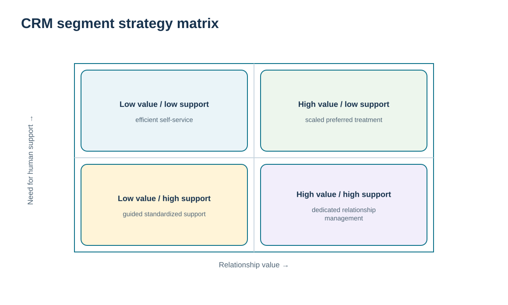
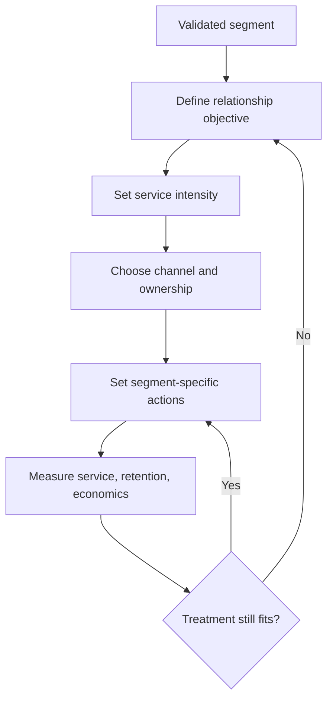

# 7. CRM Segment Strategies: Demographic, Behavioral, Value, and Service Intensity

## Learning objectives

After this topic, you should be able to:

- convert segment evidence into differentiated CRM treatment
- distinguish demographic or behavioral descriptors from value- and service-intensity decisions
- calibrate self-service, assisted, and high-relationship models to the segment
- use commercial levers only as downstream CRM choices rather than reteaching demand-shaping theory

## Concept in plain English

Segmentation creates groups; CRM segment strategy decides what the organization will **do differently** for those groups. The treatment can vary by service intensity, communication frequency, account ownership, channel, information offered, onboarding, retention action, or degree of collaboration.

Several types of evidence can shape the strategy. Demographic or profile variables may describe who the customer is. Behavioral evidence shows what the customer actually buys or how it interacts. Value evidence shows the economic and strategic importance of the relationship. Need evidence shows what service is required. Channel evidence shows how the customer prefers to interact. A good strategy uses the combination rather than assuming one variable determines the relationship.

Service intensity is especially important. Some customers can be served effectively through self-service and automated communication. Others need periodic human support. Strategic relationships may justify named teams, joint reviews, or cross-functional coordination. The relationship should become more intensive because the customer and business case require it—not because “high touch” sounds superior.

CRM may influence product, price, placement/contact, or promotion decisions, but Module 1 already explains the Four Ps as demand-shaping levers. In Module 6 they appear only as relationship choices that have been tailored to an already-understood segment. The governing question remains: what treatment will deepen or efficiently maintain the right relationship?

## Why it matters

A segmentation project creates no value if the operating model stays the same. Teams need clear rules for what changes when an account is classified as strategic, preferred, scaled, or develop.

Differentiated treatment also protects scarce customer-facing capacity. The company can reserve deep human coordination for relationships that justify it while using well-designed digital service for routine needs. The result is not “more service”; it is **better-fit service**.

## Decision model and workflow

The matrix uses relationship value and need for human support as two illustrative dimensions. It shows why a high-value customer can still use efficient digital processes for routine work while receiving deeper support for complex decisions.

### Evidence retained through the workflow

| Evidence | Why retain it |
| --- | --- |
| Segment definition and assignment reason | Makes the strategy traceable to evidence rather than a sales label. |
| Customer value and service need | Determines whether deeper relationship investment is justified. |
| Channel preference and interaction complexity | Guides the mix of digital and human contact. |
| Outcome measures by segment | Tests whether the differentiated strategy actually improves service, retention, or economics. |

## Practical process flow

## Realistic example — ClearSpan Automation Systems

ClearSpan's Strategic OEM segment is high value and often needs engineering coordination, so the CRM strategy includes a named account team, scheduled business reviews, and a richer escalation model. Digital SMB is also commercially important in aggregate, but customers generally prefer the portal and generate many small transactions. Its strategy emphasizes self-service, pooled support, clear digital status, and fast escalation only when the issue exceeds the standard path.

Service Networks sit in between: they are not the highest-revenue segment, but their response requirements are time-sensitive. ClearSpan therefore gives them a preferred relationship tier and a fast-response service desk rather than forcing them into either the strategic-account or scaled-digital model.

## Applied decision artifact or worked calculation

Use [`customer-segments.csv`](../../assets/data/module-6/customer-segments.csv) together with [`customer-channel-preferences.csv`](../../assets/data/module-6/customer-channel-preferences.csv). A simple CRM treatment card for each fictional segment can contain:

| Field | Example — Service Networks |
|---|---|
| Relationship objective | Retain service partners by improving rapid issue resolution |
| Tier | Preferred |
| Primary service model | Fast-response service desk |
| Dominant contact preference | Phone/chat — 40% |
| High-touch trigger | Critical repeat failure or end-user downtime risk |
| Scaled treatment | Portal status and knowledge content for routine needs |
| Outcome measures | Response attainment, complaints, OTIF, retention, follow-up satisfaction |

The treatment card is more useful than a segment name because it connects the classification directly to owned actions and measures.

## Decision logic

- Define the relationship objective before choosing tactics.
- Use value and service need together to calibrate relationship intensity.
- Mix digital and human channels according to task complexity and customer preference.
- Make segment treatment operational through ownership, triggers, and measurable outcomes.
- Review the strategy when segment behavior or relationship economics change.

## Trade-offs

| Tension | Decision implication |
| --- | --- |
| Personalization vs. repeatability | More tailored treatment can improve fit but makes training, controls, and scaling harder. |
| Human support vs. automation | Human interaction adds judgment and trust; automation improves speed and scale for routine tasks. |
| Segment strategy vs. individual exception | Rules provide consistency, but important account-specific needs may justify controlled exceptions. |

## Commonly confused with

A **segment** is the group; a **CRM segment strategy** is the differentiated relationship treatment for that group. The strategy can use product, price, contact, and promotion choices, but it is not a duplicate lesson on demand shaping or the Four Ps.

## Common mistakes

- Creating segments but leaving the service model unchanged.
- Assuming high-value customers require human handling for every routine interaction.
- Using demographic stereotypes instead of observed relationship evidence.
- Allowing every salesperson to invent a different treatment for the same segment.
- Measuring segment revenue without measuring service, retention, and relationship outcomes.

## Original knowledge check

**Question.** Which action best turns a customer segment into a CRM strategy?

A. Assign a label and keep the same service process for everyone

B. Define the segment-specific relationship objective, channel, service intensity, ownership, triggers, and measures

C. Replace all account managers with automation

D. Use the Four Ps without any customer relationship evidence

Answer and rationale

### Correct answer

**B. Define the segment-specific relationship objective, channel, service intensity, ownership, triggers, and measures**

### Why it is correct

CRM segment strategy is the operating treatment that follows from the segment. It must change decisions and be measurable.

### Why the other answers are wrong

- **A.** A label with no treatment difference creates little operating value.

- **C.** Automation is one possible enabler, not a universal relationship strategy.

- **D.** Commercial levers should follow customer evidence rather than substitute for it.

## Practitioner perspective

In CRM configuration, avoid dozens of segment-specific workflows unless the business can explain the operational difference. A small number of clearly governed treatments usually outperforms a large taxonomy that users cannot remember. Keep the relationship strategy visible in account planning, service routing, and escalation rules.

## Related concepts

- [Customer Segmentation and Customer-Focused Marketing](./02-customer-segmentation-and-customer-focused-marketing.md)
- [Contact-Channel Strategy and Cost-to-Serve Trade-offs](./05-contact-channel-strategy-and-cost-to-serve-trade-offs.md)
- [Module 1 — Demand Shaping and the Four Ps](../../01-supply-chains-demand-forecasting/section-c-demand-management/06-demand-shaping-and-four-ps.md)

---

[Previous: Customer Information, VOC, Business Intelligence, and Data Warehouses](./06-customer-information-voc-business-intelligence-and-data-warehouses.md) · [Section overview](./README.md) · [Next: Relationship Lifecycle: Prospects, Vulnerable, Loyal, Win-Back, Churn, and Loyalty](./08-relationship-lifecycle-prospects-vulnerable-loyal-win-back-churn-and-loyalty.md)
