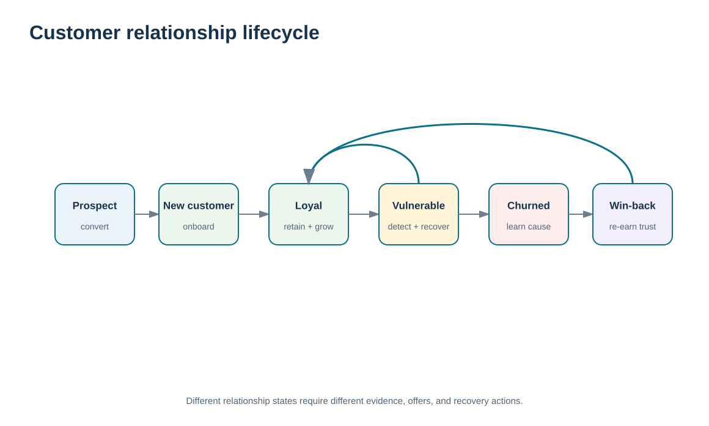
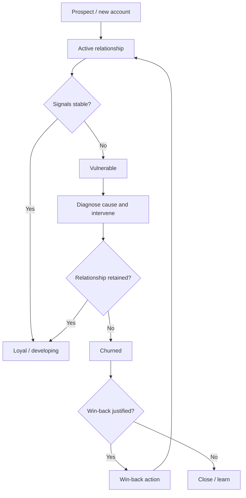

# 8. Relationship Lifecycle: Prospects, Vulnerable, Loyal, Win-Back, Churn, and Loyalty

## Learning objectives

After this topic, you should be able to:

- distinguish prospect, vulnerable, loyal, churned, and win-back relationship states
- use behavioral and service signals to choose an appropriate CRM action by relationship state
- calculate the repository-defined training churn and retention rates using the correct starting-account denominator
- distinguish customer relationship lifecycle from product life-cycle management

## Concept in plain English

Customer relationships change over time. A prospect is not yet an established customer and needs confidence-building information and an appropriate path to purchase. A newly acquired account needs onboarding and expectation setting. A loyal customer may need recognition, continued reliability, and relevant development rather than constant promotional pressure. A vulnerable account shows signals that the relationship is weakening. A churned account has become inactive, while a win-back candidate is a former customer worth approaching again when the likely value and reason for departure justify the effort.

These states are useful because the correct CRM action differs. A prospect should not be treated like a long-standing strategic customer. A vulnerable customer should not receive the same routine communication as a stable loyal account. A churned customer should not automatically receive a discount; the organization should first understand why the relationship ended and whether the original cause has been corrected.

Churn is an outcome, but **predictive churn** is a management idea: use signals that may indicate a customer is becoming vulnerable before the relationship ends. Declining order frequency, repeated complaints, missed response commitments, deteriorating service performance, reduced engagement, or an unresolved critical issue can all be signals. No single indicator proves churn. The practical task is to combine evidence, identify the accounts where intervention is justified, and then test whether the intervention changes the relationship outcome.

This is a customer **relationship lifecycle**, not the product life cycle. Module 1 explains development, introduction, growth, maturity, and decline for products. A13 later discusses how CRM priorities may change as a product or service moves through those stages. Here the object being managed is the account relationship itself.

## Why it matters

Treating every active customer as “healthy” hides deterioration until revenue disappears. Relationship-state management gives customer-facing teams a controlled way to identify who needs development, protection, recovery, or scaled routine service.

It also disciplines retention spending. Not every churned account should be won back, and not every vulnerable signal warrants executive attention. The action should reflect customer value, cause, recovery feasibility, and the cost of intervention.

## Decision model and workflow

The lifecycle visual separates relationship states and shows that the organization can intervene before churn, recover after failure, or decide not to pursue a win-back when the economics or fit are weak.

### Evidence retained through the workflow

| Evidence | Why retain it |
| --- | --- |
| Starting-period active-account population | Defines the denominator for churn and retention calculations. |
| Order/revenue trend and engagement | Shows behavioral change that may indicate vulnerability. |
| Service failures and VOC evidence | Helps distinguish a relationship problem from normal demand variation. |
| Intervention and end-state outcome | Tests whether the CRM action actually protected or recovered the relationship. |

## Practical process flow

## Realistic example — ClearSpan Automation Systems

ClearSpan tracks 20 fictional accounts for a selected diagnostic sample. Several established accounts remain loyal, several show declining revenue and are classified as vulnerable, and four accounts that were active at the start of the period become inactive. Four other accounts are new during the period and therefore do not belong in the starting denominator for the churn calculation.

The company uses this state view to avoid generic campaigns. A vulnerable Service Network account with a documented response-delay problem receives a service-recovery plan. A newly onboarded distributor receives training and portal support. A churned strategic OEM is reviewed for win-back only after the company determines whether the original delivery failure has been addressed.

## Applied decision artifact or worked calculation

Using [`customer-lifecycle-accounts.csv`](../../assets/data/module-6/customer-lifecycle-accounts.csv), **16** accounts were active at the start of the training period. Of those, **5** became inactive by period end and **11** remained active. The locked training calculation is therefore **5 / 16 = 31.25% churn** and **11 / 16 = 68.75% retention**. The formula/control sheet defines:

`churn rate = starting active accounts that became inactive / starting active accounts × 100%`

`retention rate = starting active accounts active at period end / starting active accounts × 100%`

New accounts are excluded from the starting denominator. These are repository-defined training calculations used to make relationship-state decisions reproducible; they are not presented as the only valid enterprise churn convention.

The useful artifact is a **relationship-state register** containing account, current state, evidence, risk/value, next action, owner, due date, and outcome.

## Decision logic

- Classify relationship state from evidence, not account-manager intuition alone.
- Use a stable starting-account denominator for churn and retention.
- Treat vulnerability as a trigger for diagnosis, not proof that churn is inevitable.
- Choose win-back only when the relationship value and corrected cause justify the effort.
- Keep product life-cycle decisions separate from account relationship-state decisions.

## Trade-offs

| Tension | Decision implication |
| --- | --- |
| Early intervention vs. false positives | Acting early can protect value, but overreacting to weak signals wastes relationship capacity. |
| Retention vs. profitability | Retaining an account is not automatically desirable if the required treatment destroys value or strategic fit. |
| Win-back vs. learning and exit | Some lost customers are better treated as a source of learning than as targets for expensive recovery. |

## Commonly confused with

**Customer relationship lifecycle** describes the state of the customer-company relationship. **Product life cycle** describes the market stage of a product or service. A mature product can have new customers, loyal customers, vulnerable customers, and churned customers at the same time.

## Common mistakes

- Including new customers in the starting denominator for churn.
- Equating a revenue dip with certain churn without checking other evidence.
- Using discounts as the default retention or win-back tactic.
- Treating a churned high-value account as recoverable before fixing the cause of failure.
- Confusing account relationship state with the stage of the product being purchased.

## Original knowledge check

**Question.** A customer was active at the start of the year, experienced repeated unresolved service failures, and made no purchases by year end. A new customer joined midyear. Which account belongs in the churn denominator?

A. Only the new customer

B. Neither account because churn is only a revenue metric

C. Both accounts because both are in the CRM system

D. Only the account active at the start of the year

Answer and rationale

### Correct answer

**D. Only the account active at the start of the year**

### Why it is correct

The training churn calculation uses accounts active at the start of the period as the denominator. New accounts did not have an existing relationship at the denominator date.

### Why the other answers are wrong

- **A.** The new account is excluded from the starting population.

- **C.** Presence in the CRM system is not the denominator rule.

- **B.** Churn is a relationship-status outcome in this training model, not simply a revenue variance.

## Practitioner perspective

A lifecycle field is only useful when the transition rules are governed. Define who can move an account into “vulnerable,” what evidence is required, and what workflow follows. Otherwise the status becomes a subjective label that users either ignore or manipulate to protect their pipeline metrics.

## Related concepts

- [Lifetime Customer Relationships and Retention Economics](./09-lifetime-customer-relationships-and-retention-economics.md)
- [Customer Service Metrics, Satisfaction, Feedback, and Service Recovery](./14-customer-service-metrics-satisfaction-feedback-and-service-recovery.md)
- [Module 1 — Product Life Cycle](../../01-supply-chains-demand-forecasting/section-c-demand-management/07-product-life-cycle.md)

---

[Previous: CRM Segment Strategies: Demographic, Behavioral, Value, and Service Intensity](./07-crm-segment-strategies-demographic-behavioral-value-and-service-intensity.md) · [Section overview](./README.md) · [Next: Lifetime Customer Relationships and Retention Economics](./09-lifetime-customer-relationships-and-retention-economics.md)