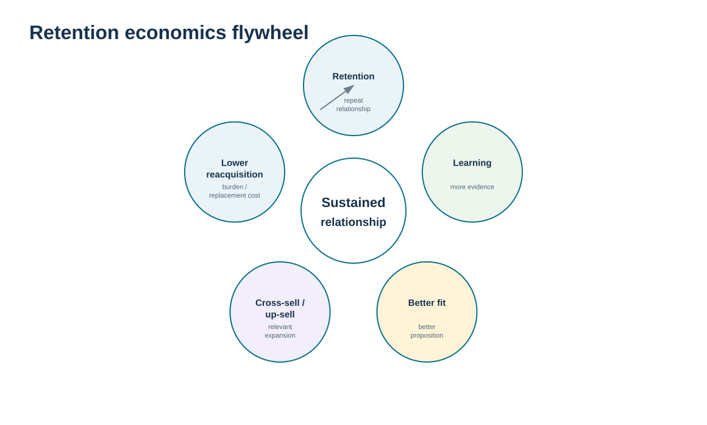
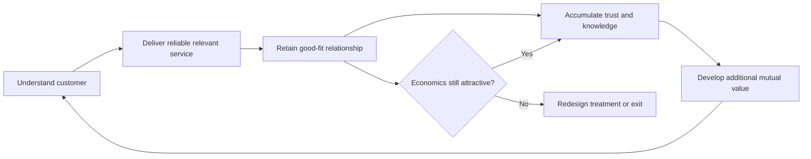

# 9. Lifetime Customer Relationships and Retention Economics

## Learning objectives

After this topic, you should be able to:

- explain why lifetime relationships can reduce acquisition burden and increase learning and development opportunity
- connect retention to cross-sell, up-sell, service learning, and relationship profitability without asserting a universal CLV formula
- use the fictional retention and CRM-technology evidence to evaluate whether a retention investment is economically credible
- distinguish profitable retention from retaining every account at any cost

## Concept in plain English

A lifetime-customer perspective changes the unit of management from a single transaction to the ongoing relationship. Acquiring a new customer often requires commercial effort, onboarding, data setup, qualification, education, and trust building. If a good-fit customer remains, future transactions can benefit from that accumulated knowledge. The organization knows the customer's environment; the customer knows how to work with the supplier. That familiarity can lower friction and create opportunities for additional products, services, collaboration, referrals, or joint improvement.

The value is not automatic. A long relationship can also accumulate concessions, special processes, or unresolved problems that make it unprofitable. The correct objective is therefore not “keep every customer forever.” It is to retain relationships that create sustainable mutual value and to understand what is causing valuable customers to weaken or leave.

Retention economics should be transparent. Different companies use different customer-lifetime-value models, discount rates, service-cost assumptions, and acquisition-cost definitions. This repository therefore does not impose one universal CLV formula. Instead, the learning model uses observable evidence: retention/churn, revenue trend, margin, service performance, CRM investment, adoption, labor savings, and modeled retention-margin uplift.

The relationship flywheel is useful: better customer understanding can improve service; reliable service can strengthen retention; retained customers produce more interaction history; that history can improve future decisions. The cycle is valuable only when the organization learns and when the economics remain positive.

## Why it matters

Retention is a lagging outcome with strategic consequences. A company that repeatedly replaces churned customers may keep revenue flat while incurring higher acquisition and onboarding effort, losing relationship knowledge, and creating more demand volatility.

At the same time, retention programs can become financially undisciplined. A high-cost recovery effort should be justified by the relationship's value and by evidence that the underlying problem can be corrected.

## Decision model and workflow

The flywheel emphasizes learning and lower relationship friction rather than claiming that tenure itself creates value. The cycle can reverse if service failures, poor fit, or excessive cost erode the relationship.

### Evidence retained through the workflow

| Evidence | Why retain it |
| --- | --- |
| Retention and churn by meaningful segment | Shows whether relationship stability is improving or deteriorating. |
| Revenue, margin, and service-cost trend | Checks whether retained business remains economically attractive. |
| Cross-sell/up-sell or development opportunity | Shows whether relationship knowledge is generating broader value. |
| Investment and realized benefit evidence | Tests whether CRM and retention initiatives create net value rather than activity. |

## Practical process flow

## Realistic example — ClearSpan Automation Systems

ClearSpan sees a 31.25% churn rate in its selected training sample—high enough to trigger diagnosis, not a claim about the whole enterprise. Rather than immediately fund a broad loyalty campaign, leadership asks where churn is occurring, what failures preceded it, and which customer groups justify deeper intervention.

At the same time, the CRM team evaluates four technology options. One feasible option has the strongest modeled three-year net benefit, but the benefit depends on adoption and retention-margin uplift actually being realized. The relationship economics therefore connect the business process, customer behavior, and technology adoption rather than treating the system purchase itself as value.

## Applied decision artifact or worked calculation

The repository-defined training model in [`crm-technology-cases.csv`](../../assets/data/module-6/crm-technology-cases.csv) compares simple three-year CRM economics. **Cloud CRM Accelerate (CRM-02)** passes the process-fit, data-access, and security gates. Its locked values are:

- three-year TCO: **$1,135,000**;
- three-year realized benefit: **$1,377,000**;
- three-year net benefit: **$242,000**;
- expected adoption: **90%**.

The formula/control sheet calculates realized benefit from annual labor savings plus annual retention-margin uplift, multiplied by three years and expected adoption. This is explicitly a **repository-defined training comparison**, not a universal CRM business-case method. The important lesson is that retention value should be tied to observable assumptions and feasibility gates, then reviewed after implementation.

## Decision logic

- Segment retention analysis so a portfolio average does not hide where relationships are weakening.
- Protect valuable, good-fit relationships by addressing root causes rather than relying on generic incentives.
- Use transparent economic assumptions for retention investments and CRM enablement.
- Do not count modeled retention uplift as realized value until customer behavior confirms it.
- Redesign or exit a relationship when the cost of maintaining it persistently exceeds sustainable value.

## Trade-offs

| Tension | Decision implication |
| --- | --- |
| Retention vs. acquisition | Retaining good customers can reduce acquisition burden, but new-customer growth remains necessary. |
| Relationship depth vs. cost | Deeper coordination can create learning and loyalty while increasing service effort. |
| Modeled benefit vs. realized benefit | A business case may be attractive on paper but fail if adoption or customer outcomes do not materialize. |

## Commonly confused with

**Retention economics** is not the same as a universal **customer lifetime value** formula. CLV methods vary by company and purpose. This lesson focuses on the logic of long-term relationship value and transparent training evidence rather than prescribing one financial equation.

## Common mistakes

- Equating long tenure with a profitable relationship.
- Funding retention programs without identifying the cause of churn.
- Counting forecast retention uplift as realized value before behavior changes.
- Applying the same retention effort to every account regardless of value and fit.
- Presenting a repository training formula as a universal CLV standard.

## Original knowledge check

**Question.** ClearSpan has a long-standing account that requires frequent expensive exceptions and produces declining margin. What does a lifetime-customer perspective imply?

A. Evaluate mutual value and redesign the treatment if the relationship is no longer sustainable

B. Retain the account at any cost because tenure proves loyalty

C. Ignore service cost because acquisition has already been paid

D. Offer the largest discount available before diagnosing the problem

Answer and rationale

### Correct answer

**A. Evaluate mutual value and redesign the treatment if the relationship is no longer sustainable**

### Why it is correct

Lifetime relationship management seeks sustainable long-run value, not unconditional retention. Economics, service fit, and root causes still matter.

### Why the other answers are wrong

- **B.** Tenure alone does not make a relationship profitable or strategically appropriate.

- **C.** Ongoing service cost is part of relationship economics.

- **D.** A discount may reduce margin without fixing the service or fit problem.

## Practitioner perspective

When a CRM business case includes “retention uplift,” insist on a measurable bridge from system capability to business behavior: which users adopt the process, which customer actions change, how margin is measured, and who validates the result. Without that bridge, retention benefit becomes an untestable balancing figure used to justify technology.

## Related concepts

- [Relationship Lifecycle](./08-relationship-lifecycle-prospects-vulnerable-loyal-win-back-churn-and-loyalty.md)
- [CRM Technology Architecture and Customer Data Integration](./11-crm-technology-architecture-and-customer-data-integration.md)
- [Customer Service Metrics, Satisfaction, Feedback, and Service Recovery](./14-customer-service-metrics-satisfaction-feedback-and-service-recovery.md)

---

[Previous: Relationship Lifecycle: Prospects, Vulnerable, Loyal, Win-Back, Churn, and Loyalty](./08-relationship-lifecycle-prospects-vulnerable-loyal-win-back-churn-and-loyalty.md) · [Section overview](./README.md) · [Next: CRM Strategy, Process Design, and Organizational Ownership](./10-crm-strategy-process-design-and-organizational-ownership.md)