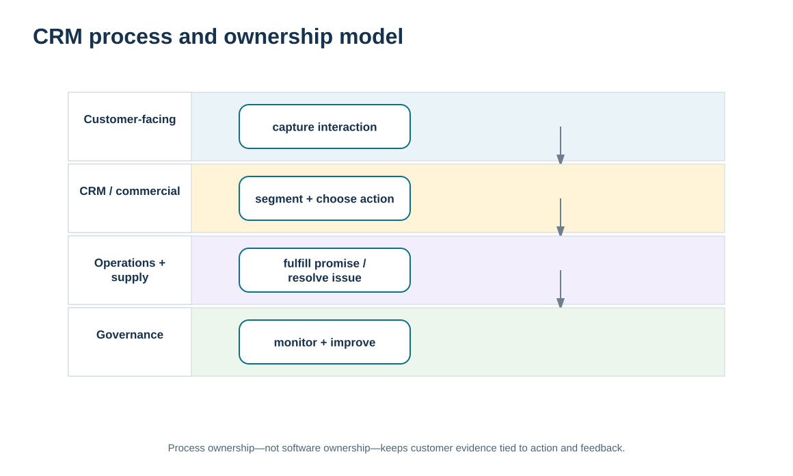
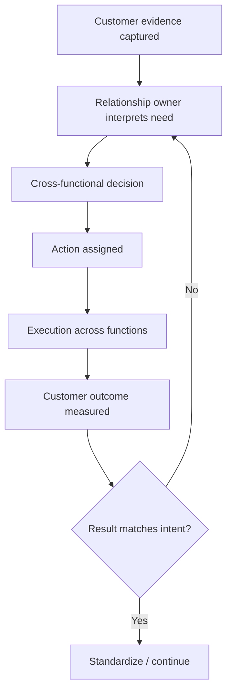

# 10. CRM Strategy, Process Design, and Organizational Ownership

## Learning objectives

After this topic, you should be able to:

- define CRM scope as an operating process spanning customer information, sales/service action, analysis, and feedback
- assign accountable ownership across customer-facing and enabling functions
- design a monitoring and feedback loop that adapts CRM decisions when results differ from expectations
- distinguish process and organizational design from the technology architecture covered in A11 and A12

## Concept in plain English

CRM strategy becomes real through process and ownership. A company may state that the customer comes first, yet customer information can remain trapped in separate departments and no one may be accountable for converting it into action. The operating design answers four practical questions: what customer evidence is collected, who interprets it, who decides, and who executes and monitors the response?

The scope can include sales operations, account management, service, analysis, customer-information dissemination, relationship building, and collaboration. Those activities do not need to sit in one department. In fact, a strategic customer may require sales, service, engineering, planning, operations, logistics, finance, and IT. What matters is that decision rights and handoffs are explicit.

Monitoring is part of the process, not an afterthought. CRM actions are based on imperfect assumptions about customer response. A campaign may not work, a service change may not improve satisfaction, or a segmentation rule may become stale. The process therefore needs feedback that compares expected and actual outcomes and triggers adaptation.

Organizational structure should fit the relationship need. High-value complex customers may justify named teams or cross-functional account governance. Scaled customers may be served by pooled teams and digital workflows. Whatever the model, customer information must be disseminated to the people who can affect the experience while access remains appropriate to the role.

## Why it matters

CRM failures are often described as technology failures when the deeper problem is unclear process ownership. If sales owns the account but service owns the complaint and operations owns the recovery, the customer can fall between organizational boundaries.

A process design with accountable owners also improves learning. Teams can see whether an action was executed, whether the customer response changed, and which part of the relationship model needs adjustment.

## Decision model and workflow

The swimlane visual separates evidence, decision ownership, execution, and monitoring across functions. It makes visible where a customer issue can stall if no owner connects the lanes.

### Evidence retained through the workflow

| Evidence | Why retain it |
| --- | --- |
| CRM objective and target relationship outcome | Keeps the process tied to a business purpose rather than activity volume. |
| RACI / decision-right record | Clarifies who is responsible, accountable, consulted, and informed. |
| Customer evidence and action history | Provides continuity across sales, service, and operational handoffs. |
| Expected vs. actual result | Enables the formal feedback loop needed to adapt the strategy. |

## Practical process flow

## Realistic example — ClearSpan Automation Systems

ClearSpan's Service Networks segment has weak response attainment and recurring complaints. Previously, service agents handled cases individually while sales and planning saw little of the pattern. The CRM process redesign establishes a Service Operations Lead as the relationship-process owner for the segment. Customer service remains responsible for case handling, planning and logistics are consulted when parts availability drives the issue, and customer success receives trend information.

The team does not need to reorganize the entire company. It needs a clear process showing which evidence creates an escalation, who convenes the decision, which function acts, and how the customer outcome is reviewed.

## Applied decision artifact or worked calculation

[`relationship-communications.csv`](../../assets/data/module-6/relationship-communications.csv) contains examples of relationship governance records that can support process ownership. For the fictional **Service-network escalation** program, the Service Operations Lead is responsible, the COO is accountable, Planning and Logistics are consulted, and Customer Success is informed. The record also includes cadence, medium, feedback, and action closure.

Use a CRM process card with: **trigger → evidence → accountable decision owner → responsible executor(s) → consulted/informed roles → service/relationship target → feedback date → closure evidence**. This is more useful than an organizational chart because it follows the customer outcome across functions.

## Decision logic

- Define CRM processes around customer outcomes, not departmental task boundaries.
- Assign one accountable owner for each material relationship decision even when execution is cross-functional.
- Disseminate customer information to the roles that can act, with appropriate access controls.
- Build expected-versus-actual feedback into the process so strategies can adapt.
- Choose team structure and governance intensity based on relationship complexity and value.

## Trade-offs

| Tension | Decision implication |
| --- | --- |
| Central coordination vs. functional expertise | A relationship owner creates coherence, but specialists still own their technical decisions. |
| Information sharing vs. access control | Customer context should reach the right people without exposing unnecessary confidential information. |
| Standard workflow vs. relationship flexibility | Standardization improves reliability while controlled exceptions preserve responsiveness to important customer needs. |

## Commonly confused with

**CRM process design** defines who does what with customer evidence. **CRM technology architecture** defines the capabilities and integrations that support those processes. A workflow problem cannot be solved by architecture alone, and a good process may still fail if the required information is unavailable.

## Common mistakes

- Assigning responsibility to a committee with no accountable owner.
- Measuring CRM activity such as calls or emails without linking it to a customer outcome.
- Keeping critical customer evidence in departmental silos.
- Launching an action with no expected result or follow-up date.
- Redesigning the application before agreeing on the business process and decision rights.

## Original knowledge check

**Question.** A recurring customer issue requires sales, service, planning, and logistics. Which design best prevents the issue from falling between departments?

A. Let each function close its own task independently

B. Assign one accountable relationship-process owner and explicit cross-functional roles

C. Move all responsibilities to IT because CRM uses technology

D. Ask the customer to contact each function separately

Answer and rationale

### Correct answer

**B. Assign one accountable relationship-process owner and explicit cross-functional roles**

### Why it is correct

Cross-functional execution needs a coherent customer outcome and a single accountable owner even when multiple functions remain responsible for their own actions.

### Why the other answers are wrong

- **A.** Independent task closure can leave the end-to-end customer issue unresolved.

- **C.** Technology supports the process but does not own the commercial/service decision.

- **D.** Forcing the customer to coordinate the supplier’s internal organization is the opposite of customer-centric management.

## Practitioner perspective

Map CRM ownership at the decision level, not only the application role level. “Sales user,” “service user,” and “CRM admin” tell you who can access a system; they do not tell you who is accountable when a strategic customer’s service promise is at risk. Business process ownership should be explicit outside the system permissions model.

## Related concepts

- [Customer-Centric Relationships and CRM Purpose](./01-customer-centric-relationships-and-crm-purpose.md)
- [CRM Technology Architecture and Customer Data Integration](./11-crm-technology-architecture-and-customer-data-integration.md)
- [Communication Purpose, Audience, Channel, Feedback, and Management Plans](../section-b-supplier-and-supply-chain-relationships/17-communication-purpose-audience-channel-feedback-and-management-plans.md)

---

[Previous: Lifetime Customer Relationships and Retention Economics](./09-lifetime-customer-relationships-and-retention-economics.md) · [Section overview](./README.md) · [Next: CRM Technology Architecture and Customer Data Integration](./11-crm-technology-architecture-and-customer-data-integration.md)