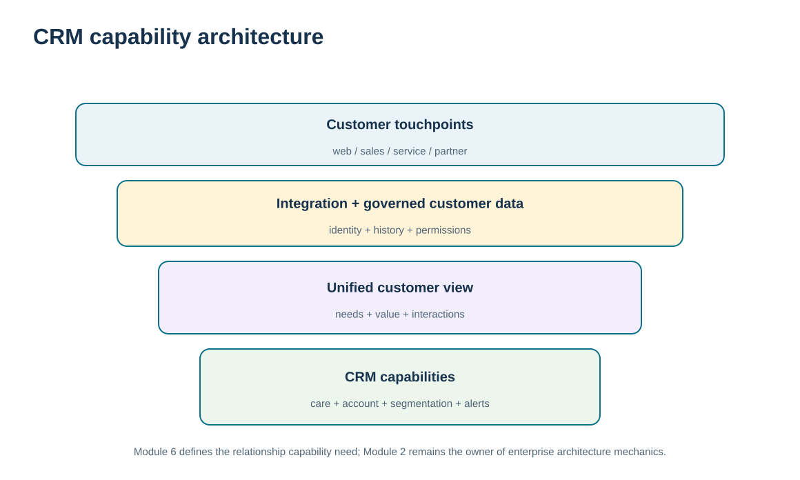
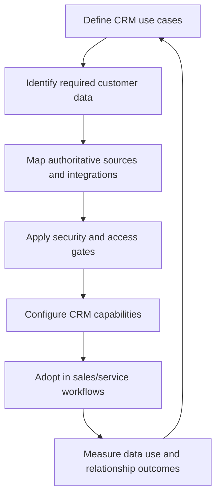

# 11. CRM Technology Architecture and Customer Data Integration

## Learning objectives

After this topic, you should be able to:

- explain the CRM-specific capability architecture needed to create an integrated customer view
- identify customer touchpoints, data sources, and integration requirements without reteaching enterprise architecture
- evaluate CRM solution alternatives using process-fit, data-access, and security gates before simple economics
- distinguish customer data integration from the broader data-platform, API, master-data, and data-quality disciplines in Module 2

## Concept in plain English

CRM technology should support the relationship process established in A10. It needs to capture and present customer information across relevant touchpoints so that sales, service, marketing, and other authorized users can see the context required for their decisions. Common capability areas include account and contact management, service/case support, opportunity and sales activity, segmentation, campaign support, customer history, analytics, and workflow.

The critical architectural idea is **integration of customer evidence**, not the purchase of one monolithic product. Customer information may originate in commerce, order management, service, finance, product usage, portals, field activity, and other systems. A CRM capability must either store, synchronize, reference, or access the information needed for the relationship process. The target should be a coherent customer view with defined ownership and access—not uncontrolled duplication of every data element.

Technology choices must also fit process, data, security, scale, and adoption. A low-cost point solution can be expensive if it fragments data or forces users into workarounds. A feature-rich enterprise platform can fail if the organization cannot implement it or users do not adopt the redesigned process. Feasibility therefore comes before economic ranking.

Module 2 owns the deeper architecture: cloud/SaaS deployment, APIs, middleware, data platforms, master data, data quality, cybersecurity, and analytics. This lesson consumes those disciplines as prerequisites and asks what the CRM relationship capability needs from them.

## Why it matters

A fragmented customer view creates inconsistent interactions. One team may not know about an open service issue while another launches a sales campaign. A customer may repeat the same information at every contact point. These are relationship failures enabled by technology fragmentation.

At the same time, integration can create privacy and security risk if data is shared too broadly. CRM architecture must therefore combine visibility with controlled access and a clear business purpose.

## Decision model and workflow

The architecture visual places touchpoints around an integrated customer view and then connects that view to CRM capabilities. It deliberately stops at the relationship-capability boundary and points broader architecture concerns back to Module 2.

### Evidence retained through the workflow

| Evidence | Why retain it |
| --- | --- |
| Required CRM processes and use cases | Prevents technology features from driving the business design. |
| Customer-data source and ownership map | Shows where required information originates and who governs it. |
| Integration, access, and security requirements | Defines how authorized users get reliable information without uncontrolled exposure. |
| Adoption and value measures | Tests whether the architecture improves work rather than merely moving data. |

## Practical process flow

## Realistic example — ClearSpan Automation Systems

ClearSpan evaluates four fictional CRM approaches. One best-of-breed sales stack appears attractive from a feature perspective but fails the locked data-access gate. A low-cost point CRM passes data access and security but fails the process-fit gate. Two alternatives pass all three gates.

The lesson is that architecture is not a feature contest. ClearSpan first asks whether the solution supports the relationship processes, can access the required customer evidence, and meets security requirements. Only the feasible alternatives move to economic comparison.

## Applied decision artifact or worked calculation

[`crm-technology-cases.csv`](../../assets/data/module-6/crm-technology-cases.csv) provides the controlled comparison. The feasibility gates are **process fit, data access, and security**. Only CRM-01 and CRM-02 pass all three. CRM-03 has a three-year net benefit of **-$291,600** and fails data access; CRM-04 has a three-year net benefit of **-$105,800** and fails process fit.

Among feasible cases, **Cloud CRM Accelerate** has a modeled three-year net benefit of **$242,000**, versus **$43,000** for Unified Enterprise CRM. Those economics are repository-defined training fields, not a substitute for Module 2's broader technology-investment method. The decision sequence remains: **relationship process → data/integration need → security/access feasibility → adoption → economics**.

## Decision logic

- Derive CRM technology requirements from relationship processes and decisions.
- Map required customer evidence to authoritative sources before designing integrations.
- Apply process-fit, data-access, and security gates before ranking alternatives.
- Use role-based access so customer visibility is purposeful rather than unlimited.
- Measure adoption and customer/process outcomes after implementation.

## Trade-offs

| Tension | Decision implication |
| --- | --- |
| Integrated suite vs. best-of-breed | A suite may simplify integration; specialized tools may offer stronger capabilities but increase interface and data-governance complexity. |
| Customer visibility vs. privacy/security | A richer customer view supports service but must respect access, confidentiality, and retention controls. |
| Feature breadth vs. adoption simplicity | More features do not create value when users cannot fit them into the operating process. |

## Commonly confused with

A **CRM architecture** is the relationship-capability view of customer data, workflows, and tools. **Enterprise information architecture** is broader and defines platforms, integrations, master data, security, and lifecycle across the business. This lesson specifies CRM needs; Module 2 provides the general architecture discipline.

## Common mistakes

- Selecting a CRM product before agreeing on the relationship use cases.
- Assuming one database automatically creates trustworthy customer information.
- Ignoring security and access because the data is “for customer service.”
- Ranking an option on cost or features after it has failed a mandatory data or process gate.
- Measuring deployment completion instead of user adoption and relationship outcomes.

## Original knowledge check

**Question.** A CRM option has the highest feature score and attractive pricing but cannot reliably access order-status data required by customer service. What should ClearSpan do?

A. Select it because the feature score is highest

B. Treat the data-access failure as a feasibility problem before economic ranking

C. Ask customer service to maintain a separate spreadsheet permanently

D. Ignore order status because it belongs to another system

Answer and rationale

### Correct answer

**B. Treat the data-access failure as a feasibility problem before economic ranking**

### Why it is correct

If a required relationship process cannot access necessary evidence, the solution does not meet the business need. Hard feasibility comes before weighted or economic comparison.

### Why the other answers are wrong

- **A.** Features cannot compensate for a mandatory capability gap.

- **C.** A permanent manual workaround recreates fragmentation and control risk.

- **D.** CRM may consume order status even when another system is the authoritative source.

## Practitioner perspective

In SAP-centered landscapes, CRM capability may span S/4HANA, service applications, sales platforms, data products, portals, integration layers, and analytics. Resist the urge to declare one system the “single source” for every customer fact. Define authoritative sources by data object and expose the required view through governed integration.

## Related concepts

- [Module 2 — Information Architecture and Data Platforms](../../02-network-design-digital-connectivity-performance/section-b-connected-supply-networks-and-master-data/07-information-architecture-and-data-platforms.md)
- [Module 2 — Data Quality, Cleansing, and Stewardship](../../02-network-design-digital-connectivity-performance/section-b-connected-supply-networks-and-master-data/17-data-quality-cleansing-and-stewardship.md)
- [Sales-Force Automation and Marketing Automation](./12-sales-force-automation-and-marketing-automation.md)

---

[Previous: CRM Strategy, Process Design, and Organizational Ownership](./10-crm-strategy-process-design-and-organizational-ownership.md) · [Section overview](./README.md) · [Next: Sales-Force Automation and Marketing Automation](./12-sales-force-automation-and-marketing-automation.md)
