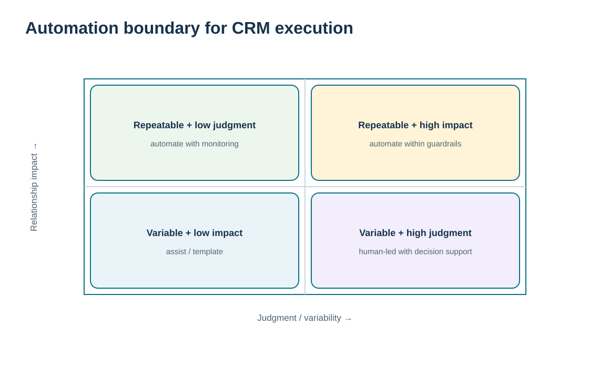
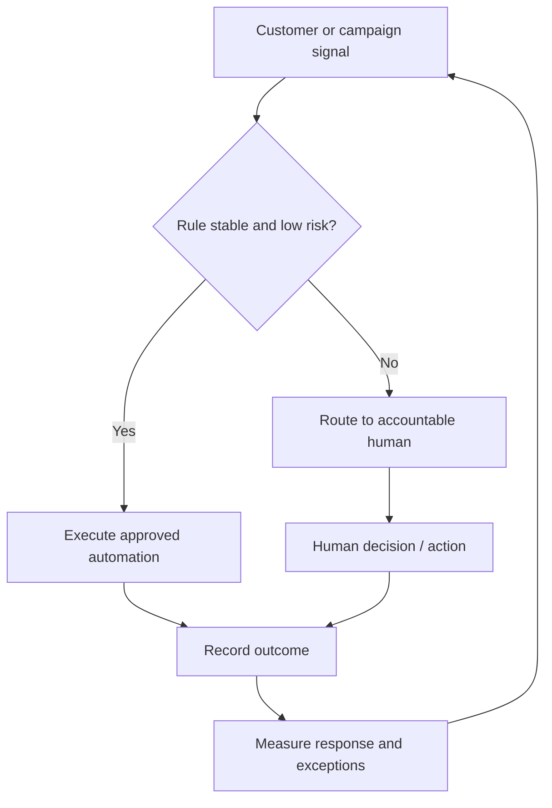

# 12. Sales-Force Automation and Marketing Automation

## Learning objectives

After this topic, you should be able to:

- distinguish sales-force automation from marketing automation and identify their relationship-management use cases
- design automation boundaries that keep judgment, approval, and sensitive customer interaction under appropriate human control
- connect automation to account/contact/opportunity, campaign, response, retention, and workflow evidence
- avoid automating a poorly defined process simply because a tool can execute it

## Concept in plain English

Sales-force automation (SFA) and marketing automation reduce manual work in recurring customer-facing processes. SFA can support account and contact management, opportunity tracking, follow-up tasks, sales activity, territory information, communication history, and access to customer/order context. Marketing automation can support campaign planning, audience selection, scheduling, workflow, response tracking, and analysis of campaign outcomes.

Automation is valuable when the task is repeatable and the rule is stable. It can remind an account owner to follow up, route a lead, generate a standard notification, or capture a response consistently. It should not silently replace human judgment where the decision is sensitive, ambiguous, strategic, or requires negotiation. A vulnerable strategic customer with a critical service failure is not merely a “campaign target.” The system may detect and route the signal, but an accountable person should decide the recovery.

A good automation design therefore separates **signal, rule, action, and control**. The system can identify the triggering evidence. A rule can determine whether the case is routine or requires review. Approved low-risk actions can execute automatically. High-impact actions can be routed to a human decision. Every automated step should leave an audit trail and an outcome that can be measured.

The purpose is not to maximize the number of automated tasks. It is to remove low-value manual effort while improving consistency and freeing people to handle relationship work that benefits from judgment and trust.

## Why it matters

Poor automation can scale a bad decision faster. Incorrect segmentation, stale data, or an insensitive campaign can affect thousands of customers in minutes. The same technology that reduces labor can amplify relationship damage.

Controlled automation improves both efficiency and discipline: routine tasks occur consistently, exceptions are surfaced, and customer-facing teams have more time for complex interactions.

## Decision model and workflow

The visual separates tasks by repeatability and judgment requirement. Routine, low-risk work can be automated; high-impact or ambiguous relationship decisions stay under human control with automation supporting the evidence and workflow.

### Evidence retained through the workflow

| Evidence | Why retain it |
| --- | --- |
| Trigger and business rule | Shows exactly why the automated action starts. |
| Data inputs and validation | Prevents incorrect or stale customer information from driving the workflow. |
| Approval / human-override rule | Defines where judgment remains mandatory. |
| Execution log and outcome | Provides traceability and evidence of whether automation created value. |

## Practical process flow

## Realistic example — ClearSpan Automation Systems

ClearSpan wants to automate follow-up for Digital SMB customers that abandon onboarding. The task is structured and low risk: send a helpful reminder and route repeated failures to pooled support. At the same time, the company considers automating win-back offers to churned Strategic OEM accounts. That second case is much riskier because the cause of churn may be unresolved and a generic offer can appear tone-deaf.

ClearSpan therefore automates the routine Digital SMB reminder but routes strategic win-back decisions to the account owner with service-failure context and approval.

## Applied decision artifact or worked calculation

Use [`crm-technology-cases.csv`](../../assets/data/module-6/crm-technology-cases.csv) as the enablement evidence, but pair it with an **automation-control record**:

| Control | Example |
|---|---|
| Trigger | onboarding incomplete after agreed interval |
| Required data | account ID, segment, onboarding status, contact consent |
| Automated action | standard reminder and self-service link |
| Human-review trigger | strategic tier, complaint open, or repeated failure |
| Owner | CRM Product Owner / business process owner |
| Outcome | completion, response, escalation, opt-out, complaint |

The architecture case with the best modeled economics still requires these business controls. Automation benefit should be counted only when adoption and process outcomes are realized.

## Decision logic

- Automate stable, repeatable, low-risk actions before judgment-heavy relationship decisions.
- Validate the data and trigger before allowing the workflow to act.
- Route strategic, sensitive, or ambiguous cases to an accountable human.
- Log both automated actions and human overrides so the control can be reviewed.
- Measure customer response and exceptions, not only labor hours saved.

## Trade-offs

| Tension | Decision implication |
| --- | --- |
| Efficiency vs. empathy | Automation is fast and consistent; sensitive situations may require human context and judgment. |
| Standardization vs. personalization | Rules improve control while over-standardization can make important customers feel misunderstood. |
| Automation scale vs. error scale | A correct rule can save large effort; a bad rule can create large relationship damage quickly. |

## Commonly confused with

**Sales-force automation** supports sales execution and account/opportunity work. **Marketing automation** supports campaigns, audience workflows, and response management. Both may use CRM data, but neither is identical to the broader CRM operating model or technology architecture.

## Common mistakes

- Automating a process whose business rule has not been agreed.
- Using stale or unvalidated customer data to trigger high-volume actions.
- Automating sensitive recovery or negotiation decisions without human review.
- Measuring success only by tasks eliminated rather than customer and process outcomes.
- Failing to provide a human override or escalation path.

## Original knowledge check

**Question.** Which ClearSpan activity is the strongest candidate for fully automated execution?

A. A decision to classify a major account as a win-back target after a disputed churn event

B. A compensation decision for a strategic account after a critical service failure

C. A renegotiation of a long-term customer commitment

D. A standardized onboarding reminder for a low-risk Digital SMB account

Answer and rationale

### Correct answer

**D. A standardized onboarding reminder for a low-risk Digital SMB account**

### Why it is correct

The task is repeatable, rule-based, and comparatively low risk. The other choices require relationship judgment, negotiation, or investigation.

### Why the other answers are wrong

- **B.** Compensation after a critical failure is sensitive and may require commercial and service judgment.

- **C.** Commitment renegotiation requires human decision rights and negotiation.

- **A.** A disputed churn event should be diagnosed before automated win-back action.

## Practitioner perspective

A workflow engine can make a process look controlled even when the underlying business rule is weak. Before automating, write the rule in plain language and test edge cases with business owners. If users cannot agree on when the action should occur, the system should not be asked to make that decision at scale.

## Related concepts

- [CRM Technology Architecture and Customer Data Integration](./11-crm-technology-architecture-and-customer-data-integration.md)
- [Relationship Lifecycle](./08-relationship-lifecycle-prospects-vulnerable-loyal-win-back-churn-and-loyalty.md)
- [Module 2 — Decision Support, Analytics, and AI](../../02-network-design-digital-connectivity-performance/section-b-connected-supply-networks-and-master-data/18-decision-support-analytics-and-ai.md)

---

[Previous: CRM Technology Architecture and Customer Data Integration](./11-crm-technology-architecture-and-customer-data-integration.md) · [Section overview](./README.md) · [Next: CRM Implementation, Change Management, and Product/Service Life-Cycle Alignment](./13-crm-implementation-change-management-and-life-cycle-alignment.md)