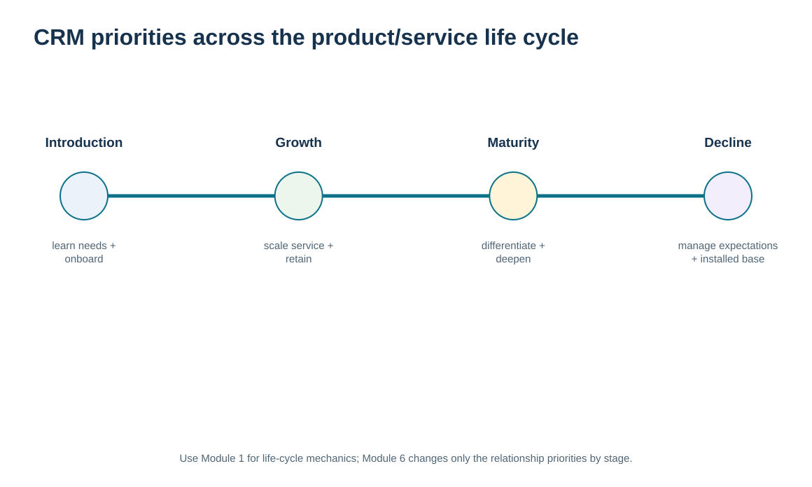
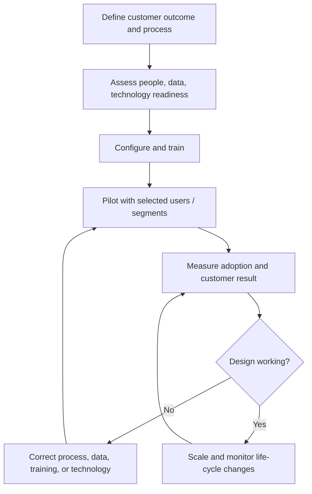

# 13. CRM Implementation, Change Management, and Product/Service Life-Cycle Alignment

## Learning objectives

After this topic, you should be able to:

- explain why CRM implementation requires process, people, data, leadership, and technology change
- align CRM priorities to product/service life-cycle conditions without reteaching the life-cycle stages
- evaluate implementation choices using fit, adoption, feedback, and efficiency rather than feature count alone
- identify when change management and customer learning should alter the CRM design

## Concept in plain English

CRM implementation is a business change, not a software installation. People must understand the customer-first intent, processes must be redesigned, customer data must be usable, decision rights must be clear, and the technology must make the work easier rather than create additional administrative burden. Leadership behavior matters because customer centricity often requires functions to share information and change local priorities.

Implementation should start with the relationship process and the customer outcome. The organization then configures the technology, training, measures, and governance needed to support that process. Feedback is essential because the initial design will contain assumptions. Users may discover that required data is missing, a workflow creates extra work, or a customer segment reacts differently than expected.

CRM strategy can also change as a product or service moves through its life cycle. Module 1 owns the actual life-cycle theory. Here, the life-cycle stage is simply an input to the relationship strategy. During introduction, the company may emphasize learning, education, early-user feedback, and rapid support. During growth, scalable onboarding and consistent service become more important. During maturity, retention, differentiation, cross-sell, and efficiency may receive greater attention. During decline, communication about support, replacement, phase-out, or migration becomes critical.

The same customer can experience several products at different stages, so the CRM design should not label the customer itself as “mature” or “declining.” The relationship owner combines product/service stage with account state, value, needs, and service evidence.

## Why it matters

Many CRM programs fail to deliver because the organization digitizes existing fragmentation. Users then see the system as extra data entry and create workarounds, which further reduce data quality and adoption.

Life-cycle alignment also prevents a static CRM model. A service-intensive launch strategy that made sense during introduction may become unnecessarily expensive after the offering stabilizes, while a decline-stage product may require more proactive communication even as sales fall.

## Decision model and workflow

The visual overlays changing CRM priorities on the product/service life cycle while keeping the relationship process separate. It shows that CRM emphasis changes with market conditions but does not replace the life-cycle framework from Module 1.

### Evidence retained through the workflow

| Evidence | Why retain it |
| --- | --- |
| Target CRM process and customer outcome | Defines what the implementation is intended to improve. |
| User adoption and workflow friction | Shows whether the new operating model is actually being used. |
| Customer feedback and service result | Tests whether implementation improves the relationship, not only internal compliance. |
| Product/service life-cycle context | Helps adjust CRM priorities as market and support needs change. |

## Practical process flow

## Realistic example — ClearSpan Automation Systems

ClearSpan's CRM team considers a rapid rollout of a low-cost point solution. The option is inexpensive, but the Phase 2 data mark it as failing the process-fit gate. Implementing it anyway would force users to adapt the relationship process to the tool rather than the other way around.

ClearSpan instead chooses a feasible option, pilots it with defined sales and service workflows, and measures adoption. For a newly launched control platform, the CRM emphasis is education and early feedback. For a mature product family, the emphasis is retention, service consistency, and identifying relevant additional value. The same platform supports both, but the relationship playbook differs.

## Applied decision artifact or worked calculation

The training economics in [`crm-technology-cases.csv`](../../assets/data/module-6/crm-technology-cases.csv) explicitly include **expected adoption** because a technically deployed CRM creates little value if users do not use the process. CRM-02 assumes **90%** adoption and produces a modeled three-year net benefit of **$242,000**. CRM-01 assumes **82%** adoption and produces **$43,000**.

Use an implementation control sheet with five gates: **process fit, data readiness, security/access, user adoption readiness, customer-outcome measurement**. Then add a life-cycle question: does the CRM treatment fit the current stage of the product/service being supported? This keeps change management and relationship strategy connected without duplicating product life-cycle theory.

## Decision logic

- Implement the customer relationship process, not the software feature list.
- Treat user adoption and workflow usability as conditions for realizing CRM value.
- Pilot, measure, and correct before large-scale deployment when uncertainty is material.
- Adjust CRM priorities as the supported product or service changes life-cycle stage.
- Use Module 1 for life-cycle strategy and Module 6 for the resulting relationship treatment.

## Trade-offs

| Tension | Decision implication |
| --- | --- |
| Speed of deployment vs. process readiness | A fast rollout can create visible progress but lock in poor workflows and workarounds. |
| Standardization vs. stage-specific treatment | A common platform reduces complexity while CRM priorities may still vary by offering and customer segment. |
| Feature capability vs. user simplicity | Rich functionality has little value when it increases friction and reduces adoption. |

## Commonly confused with

**CRM implementation change management** is about adoption of the customer relationship operating model. **Product life-cycle management** is broader market and supply-chain strategy. This lesson only uses life-cycle stage to adjust CRM emphasis; it does not reteach the stages or their full supply-chain implications.

## Common mistakes

- Treating go-live as proof that CRM value has been delivered.
- Choosing a system that fails the relationship process-fit gate because it is inexpensive.
- Training users on screens without explaining the customer outcome and decision logic.
- Keeping the same CRM treatment across introduction, growth, maturity, and decline without review.
- Confusing account relationship state with product/service life-cycle stage.

## Original knowledge check

**Question.** A CRM system is technically live, but users keep customer notes outside the system because the new workflow adds unnecessary steps. What is the best interpretation?

A. Implementation is complete because the system is available

B. The program has an adoption/process-design problem that threatens realized relationship value

C. The customers must change their behavior to fit the system

D. The solution should add more mandatory fields before any review

Answer and rationale

### Correct answer

**B. The program has an adoption/process-design problem that threatens realized relationship value**

### Why it is correct

CRM value depends on the operating process being usable and adopted. Technical availability alone does not create customer relationship improvement.

### Why the other answers are wrong

- **A.** Go-live is an implementation milestone, not the business outcome.

- **C.** Customer centricity does not mean forcing customers to compensate for poor internal design.

- **D.** More mandatory fields may increase friction unless the underlying process need is established.

## Practitioner perspective

Track adoption behavior by process, not only logins. A user may open CRM every day and still manage the real account plan in email or spreadsheets. Good adoption metrics examine whether the critical activities—customer history, actions, service context, opportunity status, escalation, and feedback—are actually executed in the governed process.

## Related concepts

- [CRM Strategy, Process Design, and Organizational Ownership](./10-crm-strategy-process-design-and-organizational-ownership.md)
- [CRM Technology Architecture and Customer Data Integration](./11-crm-technology-architecture-and-customer-data-integration.md)
- [Module 1 — Product Life Cycle](../../01-supply-chains-demand-forecasting/section-c-demand-management/07-product-life-cycle.md)

---

[Previous: Sales-Force Automation and Marketing Automation](./12-sales-force-automation-and-marketing-automation.md) · [Section overview](./README.md) · [Next: Customer Service Metrics, Satisfaction, Feedback, and Service Recovery](./14-customer-service-metrics-satisfaction-feedback-and-service-recovery.md)
