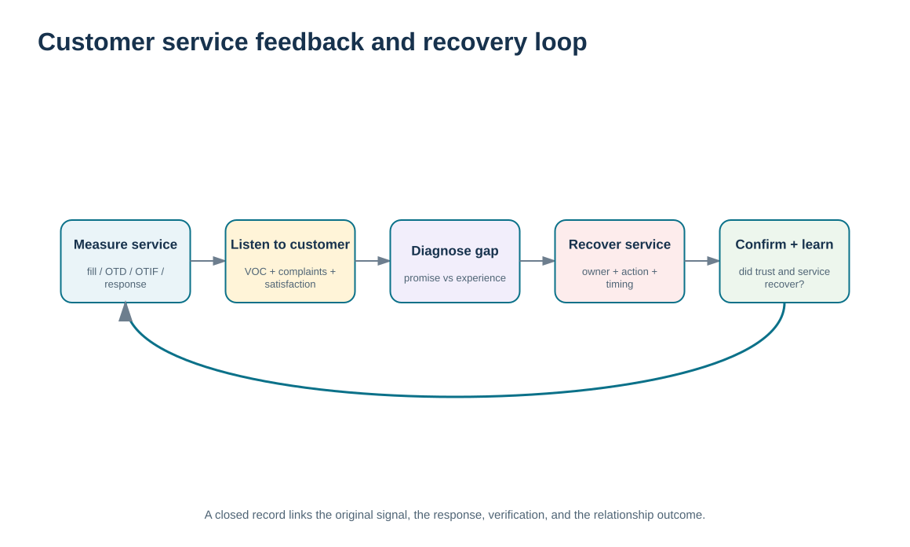
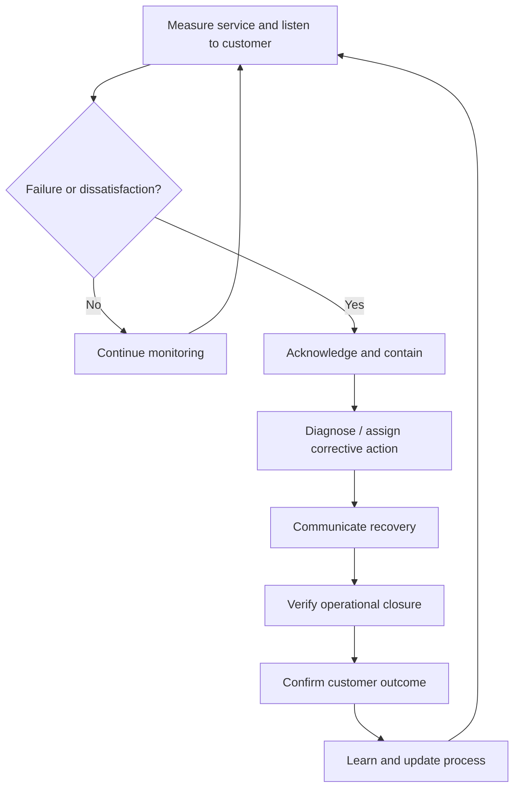

# 14. Customer Service Metrics, Satisfaction, Feedback, and Service Recovery

## Learning objectives

After this topic, you should be able to:

- calculate and interpret fill rate, on-time delivery, OTIF, stockout frequency, complaint rate, and response attainment using controlled denominators
- distinguish operational customer-service measures from direct customer satisfaction evidence
- build a closed-loop service-recovery process from failure detection through customer feedback and corrective-action closure
- use service metrics as relationship evidence without duplicating the metric-architecture work in Module 2

## Concept in plain English

Customer service performance can be measured from several angles. **Fill rate/customer service ratio** asks how much of the requested quantity was delivered on schedule under the defined rule. **On-time delivery** looks at whether eligible receipts arrived according to the agreed date definition. **OTIF** is stricter: an order counts only if it is both complete and on time. Stockout frequency describes how often inventory is unavailable under a defined check event. Response-time attainment asks whether inquiries that required a response were handled within the agreed target.

These operational measures matter, but they are not the same as customer satisfaction. A customer can receive a technically complete, on-time order and still be dissatisfied with communication, product fit, support, or the effort required to resolve a problem. Conversely, a customer may understand an occasional service failure when the supplier communicates well and recovers effectively. Direct customer feedback therefore remains separate evidence.

A relationship-management view adds **recovery**. When performance fails, the organization should identify the affected customer, acknowledge the problem, contain the immediate impact, assign corrective action, communicate progress, verify closure, and ask whether the recovery restored confidence. Closing the internal ticket without checking the customer outcome is incomplete relationship management.

Module 2 owns metric-definition architecture and the broader perfect-order discipline. Module 6 uses selected service measures to decide where relationships are at risk, what recovery is required, and whether the CRM process is improving customer experience.

## Why it matters

Service averages can hide severe relationship problems. A 95% result may look strong until the organization sees that the failures are concentrated in a critical segment or that thousands of customers are affected. Segment-level measures and direct feedback make the impact visible.

Recovery quality also influences retention. Repeated missed responses or open corrective actions tell the customer that the organization has not learned, even when the original failure was unavoidable.

## Decision model and workflow

The recovery-loop visual connects service evidence, customer feedback, containment, corrective action, communication, verification, and learning. The metric is a trigger for relationship action, not an end in itself.

### Evidence retained through the workflow

| Evidence | Why retain it |
| --- | --- |
| Stable metric definitions and denominators | Prevents performance from changing because the calculation changed. |
| Segment/account failure detail | Shows which relationships are actually affected by the aggregate result. |
| Direct customer feedback | Measures perception and unmet expectations that operational KPIs cannot prove. |
| Corrective-action and recovery outcome | Shows whether the organization fixed both the process and the relationship impact. |

## Practical process flow

## Realistic example — ClearSpan Automation Systems

ClearSpan's fictional service data show **Service Networks** with the weakest OTIF at **86.23%**, response-time attainment of **76.97%**, and the highest stockout frequency at **8.62%**. Projects/New Logos have similarly weak OTIF at **86.25%** and a higher complaint rate of **8.75 per 100 orders**.

The relationship team does not declare one segment “worst” based on a single number. It combines the service profile with VOC evidence. Several Service Network interactions show late response and repeat service failures. That combination justifies a focused recovery and improvement plan rather than a generic customer-satisfaction campaign.

## Applied decision artifact or worked calculation

Use [`customer-service-performance.csv`](../../assets/data/module-6/customer-service-performance.csv) with the [formula/control sheet](../../calculations/relationship-performance/formula-sheet.md). For Service Networks:

- orders complete: **90.58%**;
- on-time delivery: **90.00%**;
- unit fill rate: **91.56%**;
- OTIF: **86.23%**;
- stockout frequency: **8.62%**;
- complaints: **7.66 per 100 eligible orders**;
- response-time attainment: **76.97%**.

The measures use different denominators, so they must not be averaged into an invented “customer score.” Pair them with [`customer-voc-interactions.csv`](../../assets/data/module-6/customer-voc-interactions.csv) to identify actual account issues and recovery outcomes. The resulting artifact is a **segment service-recovery dashboard** with metric, threshold, affected accounts, customer feedback, owner, corrective action, and closure evidence.

## Decision logic

- Preserve the defined denominator and eligibility rule for every service measure.
- Diagnose at segment/account level when an aggregate metric misses target.
- Use direct customer feedback alongside operational metrics rather than inferring satisfaction from delivery performance alone.
- Close the loop from failure through corrective action and customer confirmation.
- Escalate repeated or concentrated failures as relationship risks, not isolated service cases.

## Trade-offs

| Tension | Decision implication |
| --- | --- |
| Speed vs. consistency | Fast service is valuable, but customers may prefer predictable performance over a volatile average. |
| Operational KPI vs. customer perception | Internal measures are objective and scalable; direct feedback reveals experience and expectations. |
| Immediate recovery vs. root-cause correction | Containment protects the customer now; corrective action prevents recurrence later. |

## Commonly confused with

**OTIF**, **fill rate**, **on-time delivery**, and **customer satisfaction** are not interchangeable. OTIF is order-level completeness plus timeliness; fill rate is quantity-based under the chosen rule; on-time delivery focuses on timeliness; satisfaction is the customer's perception and must be assessed directly.

## Common mistakes

- Averaging percentages that use different denominators.
- Using complaint count alone as the customer-satisfaction measure.
- Calling an order “OTIF” when it is on time but incomplete.
- Closing corrective action internally without confirming the customer recovery.
- Using a good portfolio average to ignore a weak strategic or service-critical segment.

## Original knowledge check

**Question.** A segment has 94% on-time delivery but only 86% OTIF. What is the best interpretation?

A. The metrics are contradictory and one must be wrong

B. Many orders may arrive on time but fail the completeness condition required for OTIF

C. Customer satisfaction is exactly 86%

D. The company should average the two percentages to create the true score

Answer and rationale

### Correct answer

**B. Many orders may arrive on time but fail the completeness condition required for OTIF**

### Why it is correct

OTIF requires both completeness and timeliness. On-time delivery can therefore be higher when some timely orders are incomplete.

### Why the other answers are wrong

- **A.** The measures answer different questions and can legitimately differ.

- **C.** OTIF is an operational service metric, not a direct satisfaction measure.

- **D.** Averaging unlike measures with different definitions does not create a valid “true” score.

## Practitioner perspective

In reporting, make the event definition visible. “On time” can mean requested date, confirmed date, ship date, receipt date, or a tolerance window. If the dashboard hides that choice, teams can spend meetings debating the number instead of fixing service. Store the definition with the metric and preserve the underlying order/receipt evidence for drill-down.

## Related concepts

- [Module 2 — Perfect Order and Customer Service](../../02-network-design-digital-connectivity-performance/section-c-performance-and-financial-insight/06-perfect-order-and-customer-service.md)
- [Customer Information, VOC, Business Intelligence, and Data Warehouses](./06-customer-information-voc-business-intelligence-and-data-warehouses.md)
- [Relationship Lifecycle](./08-relationship-lifecycle-prospects-vulnerable-loyal-win-back-churn-and-loyalty.md)

---

[Previous: CRM Implementation, Change Management, and Product/Service Life-Cycle Alignment](./13-crm-implementation-change-management-and-life-cycle-alignment.md) · [Section overview](./README.md) · [Next: Section A Review](./15-section-a-review.md)