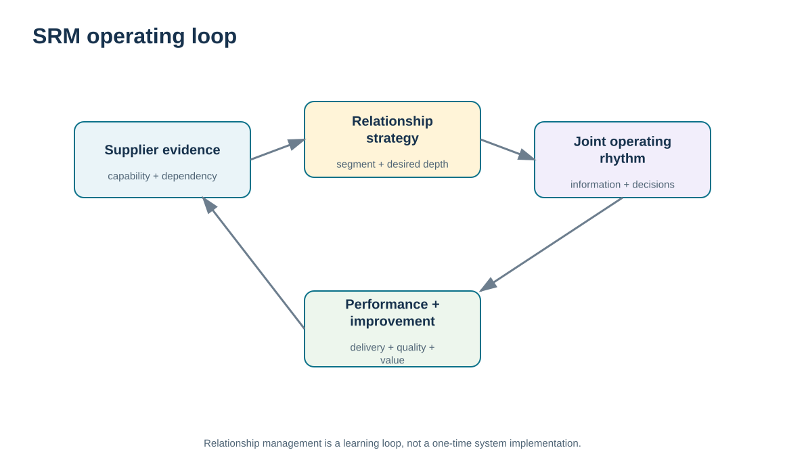
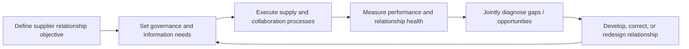

# 1. SRM Foundations and Supply-Side Relationship Strategy

## Learning objectives

After this topic, you should be able to:

- explain supplier relationship management as an ongoing post-award approach rather than only a purchasing transaction
- connect SRM to mutual profitability, supplier-process effectiveness, information sharing, and continuous improvement
- determine when deeper supplier relationships add value and when transaction efficiency is sufficient
- distinguish Module 6 SRM operations from the sourcing and category-strategy work already owned by Module 3

## Concept in plain English

Supplier relationship management (SRM) is the ongoing discipline for managing interactions with organizations that provide goods and services. The relationship can range from efficient routine transactions to deeper collaboration with suppliers that are strategically important, difficult to replace, highly customized, innovation-intensive, or tightly connected to customer outcomes.

The purpose is not supplier friendliness for its own sake. SRM should improve the effectiveness of the processes between the buying organization and the supplier. That can include information exchange, planning, procurement execution, performance measurement, issue resolution, development, joint improvement, and innovation. The relationship should support both marketplace needs and sustainable economics for the parties involved.

Deeper SRM usually requires more information sharing, more contact points, greater knowledge of each other's constraints, and sometimes connected processes. That added coordination has a cost. Routine suppliers with standard specifications and competitive alternatives may be better served through efficient transactional governance. Strategic suppliers may justify a named relationship owner, joint metrics, regular reviews, development plans, shared forecasts, or collaborative problem solving.

Module 3 already covers sourcing strategy, category segmentation, supplier selection, contracting, and procurement execution. Module 6 starts after the basic sourcing intent exists and asks what happens next: how should the relationship be governed, measured, developed, communicated, and adapted over time?

## Why it matters

A supplier can meet the purchase-order requirement and still weaken the broader supply chain through poor responsiveness, unstable quality, weak information exchange, or failure to invest in needed capabilities. Conversely, a buyer can damage a good supplier by providing unstable signals, late decisions, or unrealistic expectations.

SRM creates a structured operating loop so the relationship is not dependent on the chemistry of one buyer or account manager. Important expectations, measures, actions, and escalation paths remain visible even when people change.

## Decision model and workflow

The visual frames SRM as a loop from relationship intent through information exchange, joint execution, performance evidence, improvement, and renewed expectations.

### Evidence retained through the workflow

| Evidence | Why retain it |
| --- | --- |
| Supplier role and relationship objective | Defines why the supplier matters and what the relationship is expected to achieve. |
| Shared operating requirements and constraints | Makes demand, capacity, quality, lead-time, and process assumptions visible. |
| Performance and issue history | Shows whether the supplier and buyer are meeting agreed expectations. |
| Joint actions and realized value | Demonstrates whether deeper relationship investment is creating mutual benefit. |

## Practical process flow

## Realistic example — ClearSpan Automation Systems

ClearSpan buys precision sensors, servo components, control boards, packaging, machined housings, cable assemblies, and embedded software. Treating every supplier with the same governance would be inefficient. Prairie Packaging has several qualified alternatives, short lead time, and a transactional relationship. BlueMesa Electronics supplies control boards with no qualified alternate in the fictional data and requires much deeper management because the dependency and risk are far higher.

ClearSpan therefore builds SRM around the supplier's role. Routine suppliers receive standardized performance monitoring and efficient commercial contact. Strategic suppliers receive monthly relationship reviews, broader functional participation, and explicit improvement and continuity actions.

## Applied decision artifact or worked calculation

[`supplier-segmentation.csv`](../../assets/data/module-6/supplier-segmentation.csv) is the starting SRM portfolio. It assigns fictional relationship intensities and governance cadences based on evidence such as business criticality, supply risk, customization, innovation need, lead time, and qualified alternatives.

For example, **NorthRiver Sensors** is modeled as Strategic with monthly governance: business criticality 5/5, supply risk 4/5, customization 5/5, innovation need 5/5, 84-day lead time, and only one qualified alternate. **Prairie Packaging** is Transactional with semiannual governance: criticality 2/5, risk 1/5, customization 1/5, innovation need 1/5, 14-day lead time, and six qualified alternatives.

The artifact is an **SRM charter**: supplier role, relationship objective, governance cadence, information shared, key measures, development expectations, decision rights, and escalation path.

## Decision logic

- Begin with the supplier’s role and dependency, not a generic partnership aspiration.
- Match governance intensity to criticality, supply risk, customization, innovation, and replaceability.
- Define mutual expectations and information needs explicitly.
- Measure both supplier performance and buyer obligations when they affect the relationship.
- Redesign relationship depth when the supplier role, market, technology, or risk materially changes.

## Trade-offs

| Tension | Decision implication |
| --- | --- |
| Relationship depth vs. governance cost | Deeper relationships can create coordination and innovation value but require more time, information, and management attention. |
| Information sharing vs. confidentiality | Useful collaboration may require transparency while proprietary or sensitive information still needs boundaries. |
| Supplier dependence vs. mutual investment | Joint investment can improve performance and also increase switching difficulty and exposure. |

## Commonly confused with

**Strategic sourcing** determines how the organization will source a category and which suppliers should be selected or contracted. **SRM** governs the ongoing relationship after that intent exists. The two connect, but a sourcing event is not the same as managing the supplier relationship over time.

## Common mistakes

- Calling every important supplier a “partner” without defining the operating implications.
- Using the same governance cadence for low-risk transactional and high-dependency strategic suppliers.
- Measuring only purchase price and ignoring delivery, quality, responsiveness, innovation, and relationship health.
- Allowing the relationship to depend entirely on one buyer-supplier personal connection.
- Asking suppliers for deeper transparency without defining reciprocal expectations and information controls.

## Original knowledge check

**Question.** Which supplier most clearly justifies deeper SRM governance in ClearSpan’s fictional portfolio?

A. A packaging supplier with six alternatives and 14-day lead time

B. A control-board supplier with no qualified alternate, high criticality, high customization, and 112-day lead time

C. A routine supplier solely because it sends the most invoices

D. Any supplier that agrees to use the buyer’s portal

Answer and rationale

### Correct answer

**B. A control-board supplier with no qualified alternate, high criticality, high customization, and 112-day lead time**

### Why it is correct

Dependency, criticality, customization, and long recovery/switching characteristics justify more intensive relationship governance.

### Why the other answers are wrong

- **A.** This profile supports a more transactional relationship unless other evidence changes.

- **C.** Transaction volume alone does not define strategic relationship need.

- **D.** Technology adoption is an enabler, not proof that a deeper relationship is justified.

## Practitioner perspective

In ERP and SRM programs, separate the supplier master from the relationship model. The master identifies who the supplier is; the SRM design determines how that supplier is governed. A strategic status should trigger visible behaviors such as review cadence, scorecard scope, collaboration workflow, and escalation—not remain a label in a report.

## Related concepts

- [Module 3 — Supplier Relationship Models](../../03-sourcing-strategy-product-design-supplier-execution/section-b-category-strategy-and-supply-base/05-relationship-models.md)
- [Supplier Segmentation and Relationship Fit](./02-supplier-segmentation-and-relationship-fit.md)
- [Supplier Performance Measurement and KPI Governance](./11-supplier-performance-measurement-and-kpi-governance.md)

---

[Previous: Section overview](./README.md) · [Section overview](./README.md) · [Next: Supplier Segmentation and Relationship Fit](./02-supplier-segmentation-and-relationship-fit.md)
