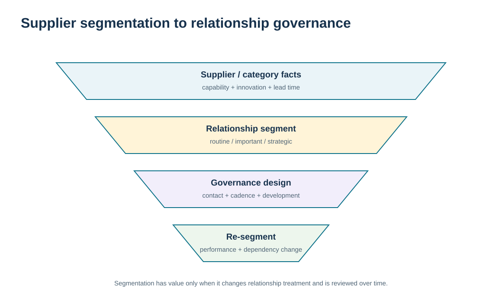
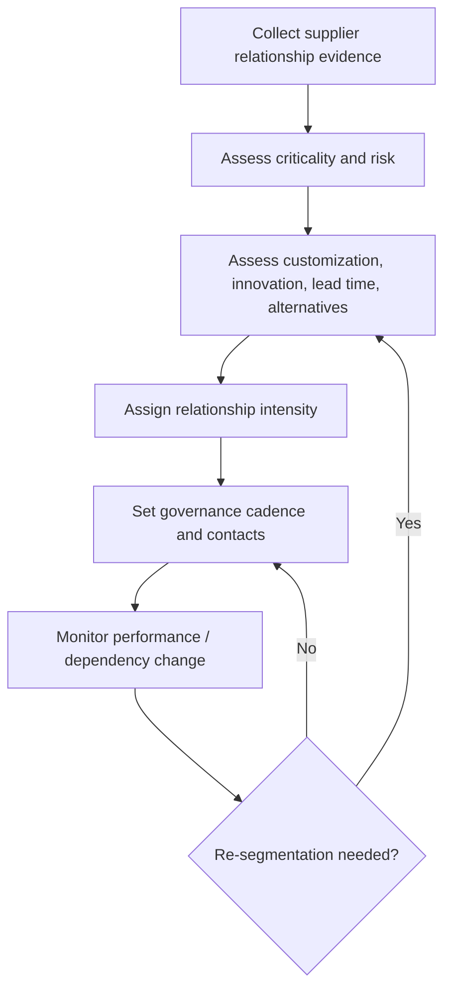

# 2. Supplier Segmentation and Relationship Fit

## Learning objectives

After this topic, you should be able to:

- segment suppliers for ongoing SRM governance using relationship-relevant evidence
- distinguish Module 6 relationship-fit segmentation from Module 3 sourcing/category segmentation
- use product/service type, capability, customization, innovation, lead time, risk, and alternatives to calibrate relationship intensity
- define governance cadence and contact depth that fit the supplier role

## Concept in plain English

Supplier segmentation is useful when it changes how the relationship is managed. The buyer may consider the type of product or service, business criticality, supply risk, supplier capability, customization, innovation need, lead time, available alternatives, and the ideal relationship needed to meet customer and enterprise goals.

The same supplier can be attractive commercially yet require a different ongoing governance model from another supplier. A standard low-risk commodity with many alternatives can often be managed through efficient transactions and periodic performance review. A highly customized component with long lead time, few alternatives, and heavy design interaction may require monthly governance, cross-functional contact, continuity planning, and supplier development.

Segmentation should not become a prestige hierarchy. A transactional supplier is not “bad,” and a strategic supplier is not automatically “better.” The segment describes the **appropriate relationship intensity**. Over-managing a routine supplier adds cost and bureaucracy; under-managing a critical supplier leaves dependency, performance, innovation, and continuity unmanaged.

Module 3 uses supplier segmentation as part of category and sourcing strategy. Module 6 consumes that strategic intent and calibrates the continuing SRM operating model: who meets, how often, which data are shared, what development is expected, and how performance or risk is escalated.

## Why it matters

Supply bases are too large for every supplier to receive the same management attention. Segmentation protects scarce engineering, quality, procurement, planning, and leadership time by directing deeper governance toward the relationships that need it.

It also creates consistency. Two suppliers with similar risk and dependency should not receive radically different governance solely because different buyers manage them.

## Decision model and workflow

The visual converts supplier evidence into relationship intensity and governance cadence. It makes the output an SRM decision, not a supplier-award ranking.

### Evidence retained through the workflow

| Evidence | Why retain it |
| --- | --- |
| Business criticality and supply risk | Shows the impact and likelihood of relationship failure. |
| Customization and innovation need | Indicates how much joint knowledge and coordination the relationship may require. |
| Lead time and qualified alternatives | Shows how quickly the buyer could recover or switch. |
| Capability and relationship history | Tests whether the intended depth is practical with this supplier. |

## Practical process flow

## Realistic example — ClearSpan Automation Systems

ClearSpan classifies NorthRiver Sensors, BlueMesa Electronics, and Summit Industrial Software as Strategic because their fictional profiles combine high business criticality, high customization or innovation need, and limited alternatives. Apex Motion Components and Redwood Machining are Collaborative: important enough for ongoing joint work, but with somewhat lower dependency. Prairie Packaging is Transactional because it is standardized, low risk, short lead time, and highly replaceable.

The label drives governance. Strategic suppliers receive monthly cross-functional reviews and continuity attention. Preferred suppliers receive quarterly reviews. Transactional suppliers receive standardized monitoring with less management overhead.

## Applied decision artifact or worked calculation

Use [`supplier-segmentation.csv`](../../assets/data/module-6/supplier-segmentation.csv) to create a relationship-fit card. Compare two fictional cases:

| Factor | BlueMesa Electronics | Prairie Packaging |
|---|---:|---:|
| Business criticality | 5/5 | 2/5 |
| Supply risk | 5/5 | 1/5 |
| Customization | 5/5 | 1/5 |
| Innovation need | 5/5 | 1/5 |
| Lead time | 112 days | 14 days |
| Qualified alternatives | 0 | 6 |
| Relationship intensity | Strategic | Transactional |
| Governance cadence | Monthly | Semiannual |

The artifact should also document the **reason for the segment**, not only the segment name. That explanation becomes the basis for future reclassification when alternatives, lead time, technology, or business criticality change.

## Decision logic

- Segment for an explicit governance decision, not for reporting decoration.
- Use multiple relationship factors rather than annual spend alone.
- Treat limited alternatives and long recovery/switching time as strong dependency evidence.
- Match review cadence and cross-functional participation to relationship intensity.
- Revisit the segment when capability, risk, demand, technology, or alternatives change.

## Trade-offs

| Tension | Decision implication |
| --- | --- |
| Segmentation simplicity vs. nuance | Few segments are easier to govern; too few can hide materially different relationship needs. |
| High spend vs. high dependency | A smaller-spend supplier can be strategically critical if switching is difficult or the component is unique. |
| Governance intensity vs. supplier burden | Frequent reviews can improve alignment but become bureaucracy when they do not support meaningful decisions. |

## Commonly confused with

**Supplier segmentation for SRM** asks how intensively to govern an ongoing relationship. **Supplier selection scoring** asks which supplier should win business. A supplier can already be selected and still require segmentation for the way the relationship will be managed.

## Common mistakes

- Using spend as the only segmentation factor.
- Treating “strategic” as a reward rather than a governance requirement.
- Failing to document why a supplier is in a segment.
- Keeping the same segment after the supply market or alternatives materially change.
- Creating review meetings that do not have decisions, evidence, or accountable actions.

## Original knowledge check

**Question.** A supplier has moderate annual spend but provides a highly customized component with one qualified alternate and a long lead time. What should drive the SRM segment?

A. Annual spend alone

B. Whether the buyer used a competitive bid

C. The supplier’s preference for fewer meetings

D. The combined dependency, customization, risk, and relationship requirements

Answer and rationale

### Correct answer

**D. The combined dependency, customization, risk, and relationship requirements**

### Why it is correct

Ongoing relationship intensity should reflect how difficult the supplier is to replace and how much coordination is needed, not spend alone.

### Why the other answers are wrong

- **A.** Spend is relevant but can miss strategic dependency.

- **C.** Supplier preference matters for designing interaction, but it does not erase the governance need.

- **B.** The sourcing method does not determine post-award relationship intensity by itself.

## Practitioner perspective

If supplier segmentation drives workflow, keep the logic visible in master-data governance. A segment change may affect review calendars, scorecard requirements, supplier-development tasks, executive visibility, and continuity controls. Avoid changing the code without checking these downstream consequences.

## Related concepts

- [Module 3 — Supplier Attractiveness and Segmentation](../../03-sourcing-strategy-product-design-supplier-execution/section-b-category-strategy-and-supply-base/04-supplier-attractiveness-and-segmentation.md)
- [SRM Foundations and Supply-Side Relationship Strategy](./01-srm-foundations-and-supply-side-relationship-strategy.md)
- [Supplier Co-Location, Integration, and Collaboration Depth](./03-supplier-co-location-integration-and-collaboration-depth.md)

---

[Previous: SRM Foundations and Supply-Side Relationship Strategy](./01-srm-foundations-and-supply-side-relationship-strategy.md) · [Section overview](./README.md) · [Next: Supplier Co-Location, Integration, and Collaboration Depth](./03-supplier-co-location-integration-and-collaboration-depth.md)