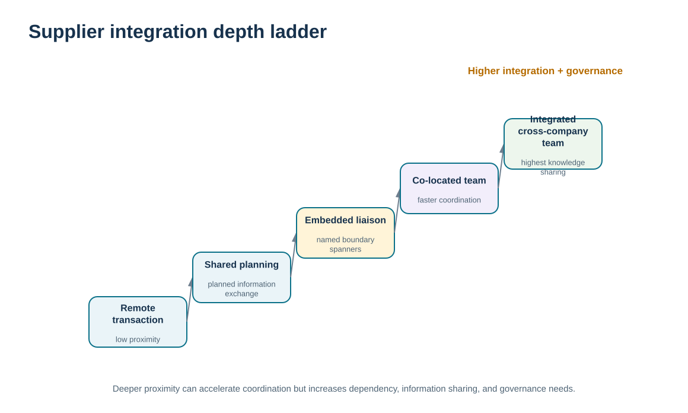
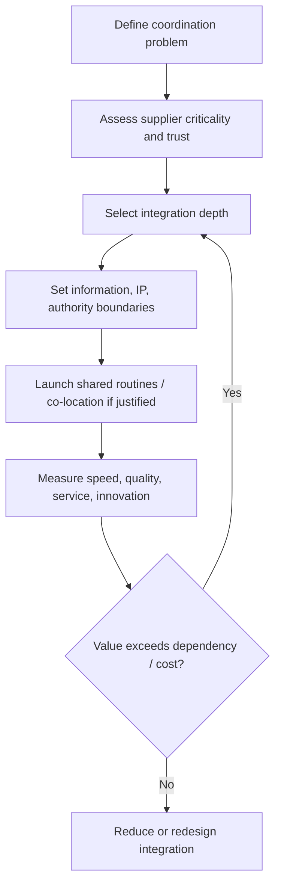

# 3. Supplier Co-Location, Integration, and Collaboration Depth

## Learning objectives

After this topic, you should be able to:

- explain co-location and deeper supplier integration as relationship-design choices rather than automatic best practices
- evaluate when proximity, shared teams, connected processes, and knowledge exchange can improve coordination
- identify the dependency, confidentiality, lock-in, and governance consequences of deeper integration
- distinguish relationship integration from collaborative product-design methods and technical visibility architecture

## Concept in plain English

Supplier integration can become progressively deeper. At a basic level, buyer and supplier exchange orders, confirmations, and performance information. A preferred or collaborative relationship may add shared planning, routine cross-functional contact, joint improvement, or supplier participation in selected business processes. In some situations, organizations place supplier personnel near or inside buyer facilities—co-location—to speed communication and problem solving.

The potential benefits come from reducing distance between decisions. Engineers can resolve specification issues faster, planners can align changes earlier, quality teams can close problems with better shared context, and operational teams can coordinate exceptions before they become customer failures. Knowledge can move more quickly than it would through periodic formal handoffs.

The same design increases dependency and control requirements. Co-located personnel may gain access to confidential information. Integrated processes can become hard to separate. Shared tools and routines may increase switching cost. Boundaries around intellectual property, security, decision authority, and data access therefore become more important as relationship depth increases.

Deeper integration should be justified by the relationship problem being solved. Module 3 covers early supplier involvement in product design. Module 2 covers partner visibility and integration architecture. This lesson focuses on the relationship choice itself: how much proximity and operational integration are appropriate, and what governance is needed to sustain it?

## Why it matters

Organizations sometimes mistake collaboration intensity for maturity: more meetings, more shared systems, and more co-location must be better. In reality, excessive integration with a routine supplier can waste resources and create avoidable lock-in.

Conversely, a strategic supplier that influences product performance or customer continuity may need faster, richer interaction than a conventional buyer-seller interface provides. The relationship design should match the value of reducing coordination delay.

## Decision model and workflow

The ladder visual shows increasing relationship depth from transaction exchange to shared planning, cross-functional integration, and selective co-location. Governance requirements increase alongside the potential value.

### Evidence retained through the workflow

| Evidence | Why retain it |
| --- | --- |
| Coordination problem and delay cost | Defines what deeper integration is expected to improve. |
| Information / IP sensitivity | Determines access boundaries and confidentiality controls. |
| Supplier dependency and switching difficulty | Shows the lock-in consequence of deeper integration. |
| Measured improvement from integrated work | Tests whether added relationship complexity creates real value. |

## Practical process flow

## Realistic example — ClearSpan Automation Systems

NorthRiver Sensors is critical to ClearSpan's high-precision product line and has only one qualified alternate in the fictional data. Engineering changes and forecast shifts can affect both companies. ClearSpan considers placing a supplier technical representative at a ClearSpan site two days per week.

The arrangement could speed engineering clarification and issue resolution, but it also creates access and dependency questions. ClearSpan defines which systems and design information the representative can access, which decisions remain with ClearSpan engineering, how concerns are escalated, and how the value of the arrangement will be measured. The company does not offer the same co-location model to Prairie Packaging because the coordination need does not justify it.

## Applied decision artifact or worked calculation

[`supplier-segmentation.csv`](../../assets/data/module-6/supplier-segmentation.csv) provides the relationship-depth evidence. NorthRiver Sensors scores 5/5 on customization and innovation need, 5/5 on business criticality, and has an 84-day lead time with one alternate. That profile can justify exploring deeper integration.

Use an **integration-depth decision record** with: problem to solve, proposed depth, shared processes, on-site/remote contact pattern, data/IP boundaries, decision rights, duration/pilot, success measures, exit conditions, and switching/continuity implications. The decision should be reversible where possible; a pilot can test whether co-location materially reduces cycle time or defects before the relationship becomes structurally dependent.

## Decision logic

- Deep integration only when it addresses a material coordination, innovation, quality, or continuity need.
- Increase governance and access controls as relationship depth increases.
- Define which decisions remain with each organization even when personnel or processes are co-located.
- Measure the improvement created by integration rather than assuming proximity is valuable.
- Preserve an exit or redesign path so collaboration does not become unmanaged lock-in.

## Trade-offs

| Tension | Decision implication |
| --- | --- |
| Faster coordination vs. confidentiality | Closer work can accelerate problem solving while exposing more sensitive information. |
| Shared process vs. switching flexibility | Integration can improve execution and make future supplier changes harder. |
| Relationship depth vs. management overhead | Rich collaboration requires time, governance, and capable people on both sides. |

## Commonly confused with

**Supplier integration/co-location** is a relationship-design choice. **Collaborative design** is a product-development method, and **partner connectivity** is a technology architecture topic. They can coexist, but one does not automatically require the others.

## Common mistakes

- Co-locating supplier staff without a defined business problem and success measure.
- Giving broad information access because the supplier is “strategic.”
- Allowing co-located personnel to blur decision authority.
- Ignoring increased switching cost and dependence.
- Applying a high-integration model to suppliers whose work can be managed efficiently through standard interfaces.

## Original knowledge check

**Question.** What is the strongest justification for co-locating a supplier technical expert with ClearSpan?

A. The relationship has frequent high-value coordination delays that proximity can measurably reduce

B. The supplier wants office space

C. All strategic suppliers should be treated identically

D. Co-location eliminates the need for confidentiality controls

Answer and rationale

### Correct answer

**A. The relationship has frequent high-value coordination delays that proximity can measurably reduce**

### Why it is correct

Co-location is justified when the value of faster, richer coordination exceeds the added cost, access risk, and dependency.

### Why the other answers are wrong

- **B.** Supplier convenience is not sufficient business justification.

- **C.** Strategic suppliers can require different relationship designs depending on the problem being solved.

- **D.** Closer access increases the need for clear confidentiality and authority controls.

## Practitioner perspective

For system access, treat supplier personnel as external users even when they sit inside a company facility. Identity, role, data scope, logging, and offboarding should be explicit. Physical proximity does not change the need for controlled digital boundaries.

## Related concepts

- [Module 3 — Collaborative Design and Early Involvement](../../03-sourcing-strategy-product-design-supplier-execution/section-c-product-design-for-supply-chain/02-collaborative-design-and-early-involvement.md)
- [Module 2 — Partner Visibility and Data Sharing](../../02-network-design-digital-connectivity-performance/section-b-connected-supply-networks-and-master-data/11-partner-visibility-and-data-sharing.md)
- [Collaboration Requirements, Management Tasks, and Barriers](./16-collaboration-requirements-management-tasks-and-barriers.md)

---

[Previous: Supplier Segmentation and Relationship Fit](./02-supplier-segmentation-and-relationship-fit.md) · [Section overview](./README.md) · [Next: SRM Technology, Portals, Procurement, and Sourcing Enablement](./04-srm-technology-portals-procurement-and-sourcing-enablement.md)