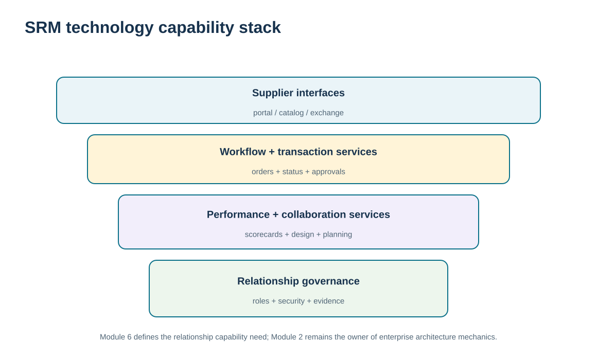
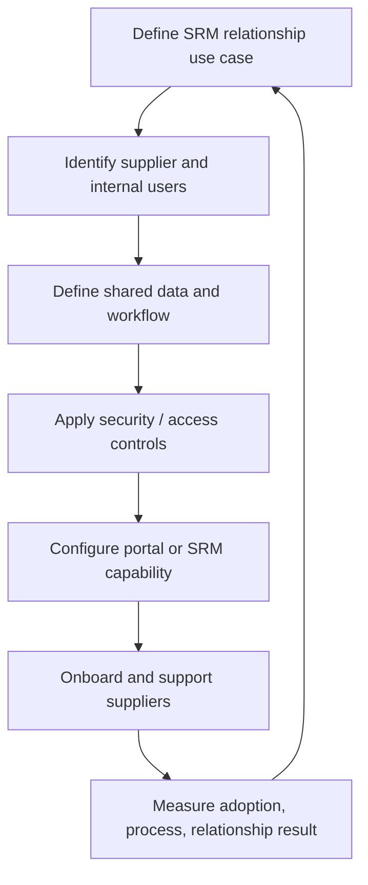

# 4. SRM Technology, Portals, Procurement, and Sourcing Enablement

## Learning objectives

After this topic, you should be able to:

- identify SRM technology functions that enable supplier interaction, performance, sourcing support, procurement, and collaboration
- distinguish supplier portals and SRM capabilities from enterprise integration architecture and digital marketplace design
- apply security, workflow, data, and relationship-fit requirements before automating supplier processes
- connect technology usage to supplier-development and performance outcomes rather than transaction volume alone

## Concept in plain English

SRM technology supports the processes used to work with suppliers. Capabilities can include supplier portals, profile and document management, sourcing support, procurement transactions, catalog access, order and status exchange, performance reporting, collaboration tools, workflow, security, and analytics. Some systems also support supplier development, collaborative design, planning, and member services.

A supplier portal is an interface, not a relationship strategy. It can make routine data exchange more efficient, give suppliers controlled access to relevant information, and create a shared record of actions. But forcing every supplier into the same portal can fail when the process is poorly designed, data definitions do not match, security is weak, or the relationship requires richer interaction.

Technology should therefore be selected around the SRM use case. A transactional supplier may need reliable catalog/order/invoice processes. A strategic supplier may need performance dashboards, action tracking, planning collaboration, secure document exchange, and structured review support. The same platform can provide different capabilities by supplier segment.

Module 2 owns APIs, middleware, cloud, cybersecurity, and information architecture. Module 3 owns digital procurement marketplaces and auction design. This topic remains at the supplier-relationship layer: what functions does the relationship require, what data must be exchanged, who is allowed to act, and how does the technology improve the SRM process?

## Why it matters

Manual email and spreadsheets can work at small scale but become difficult to control when many suppliers, actions, documents, and performance records are involved. SRM technology can make expectations and evidence visible to both parties.

Technology can also amplify poor process. If supplier master data, specifications, performance definitions, or access roles are unclear, automation makes the inconsistency faster rather than better.

## Decision model and workflow

The capability-stack visual separates supplier-facing interfaces from relationship workflows, shared evidence, and enabling controls. It avoids treating the platform as the relationship itself.

### Evidence retained through the workflow

| Evidence | Why retain it |
| --- | --- |
| Supplier-segment and use-case requirements | Determines which SRM capabilities are actually needed. |
| Shared data definitions and authoritative sources | Prevents buyer and supplier from acting on conflicting information. |
| Security, access, workflow, and audit controls | Defines who can see, submit, approve, and change information. |
| Adoption and relationship outcome measures | Tests whether the tool improves cycle time, quality, visibility, or collaboration. |

## Practical process flow

## Realistic example — ClearSpan Automation Systems

ClearSpan wants strategic suppliers to see performance results, respond to corrective actions, and participate in monthly governance without sending uncontrolled spreadsheets. For transactional suppliers, the priority is efficient order/document exchange. The company configures different supplier-facing capabilities by relationship segment instead of making every supplier use every feature.

BlueMesa Electronics, for example, needs a remediation workflow with action evidence and executive visibility. Prairie Packaging mainly needs reliable routine transactions and periodic performance visibility. The technology supports both relationships, but the operating use is different.

## Applied decision artifact or worked calculation

Build an **SRM capability matrix** using the fictional supplier segments:

| Relationship intensity | Core technology need | Optional deeper capability |
|---|---|---|
| Transactional | order/document exchange, basic profile, status | simple performance summary |
| Preferred | performance visibility, issue tracking | shared forecast/status views |
| Collaborative | joint actions, planning data, performance trends | design/planning collaboration |
| Strategic | controlled multi-function workspace, risk/continuity actions, executive governance | deeper integration and secure knowledge sharing |

Use [`supplier-segmentation.csv`](../../assets/data/module-6/supplier-segmentation.csv) to assign the relationship intensity and later [`supplier-performance.csv`](../../assets/data/module-6/supplier-performance.csv) to populate the performance layer. Technology should not change the supplier segment by itself.

## Decision logic

- Derive SRM technology functions from the supplier relationship process.
- Provide different capability depth by supplier segment when justified.
- Agree data definitions and access roles before automating exchange.
- Use workflow and audit evidence for actions that require approval or closure.
- Measure supplier/internal adoption and process outcomes, not portal login counts alone.

## Trade-offs

| Tension | Decision implication |
| --- | --- |
| Self-service efficiency vs. supplier burden | Portals reduce manual work when usable; poorly designed interfaces can shift administrative cost to suppliers. |
| Shared visibility vs. confidentiality | Collaboration benefits from information exchange while sensitive commercial, technical, and personal data need controlled access. |
| Common platform vs. relationship fit | One platform simplifies support, but different supplier segments may need different workflows and capability depth. |

## Commonly confused with

**SRM technology** supports supplier-relationship processes. **Digital procurement marketplaces/auctions** are sourcing and transaction mechanisms, while **integration architecture** defines the technical movement and control of data. Module 6 uses those as enablers rather than reteaching them.

## Common mistakes

- Buying an SRM portal before defining the supplier processes it must support.
- Giving every supplier the same functionality regardless of relationship need.
- Automating performance reports whose metric definitions are not agreed.
- Ignoring supplier usability and onboarding effort.
- Assuming portal adoption proves the supplier relationship has improved.

## Original knowledge check

**Question.** ClearSpan wants strategic suppliers to respond to corrective actions and share review evidence. What should drive the SRM technology design?

A. The largest possible feature list

B. The relationship workflow, required shared data, user roles, security, and closure evidence

C. A reverse auction template

D. A rule that all suppliers receive identical access

Answer and rationale

### Correct answer

**B. The relationship workflow, required shared data, user roles, security, and closure evidence**

### Why it is correct

SRM technology should enable the relationship process with controlled data and decision rights. Feature breadth without process fit does not create value.

### Why the other answers are wrong

- **A.** Unused features add complexity without proving relationship benefit.

- **C.** Auction design belongs to sourcing and may be irrelevant to ongoing SRM remediation.

- **D.** Access and capability should be governed by need and confidentiality, not uniformity.

## Practitioner perspective

Supplier portals often expose integration problems that internal users previously absorbed manually. Treat supplier onboarding as process design: test master data, units, dates, document status, approvals, and exception ownership end to end. A portal is successful when both parties can act on the same business meaning, not merely when messages are transmitted.

## Related concepts

- [Module 3 — Digital Procurement, Marketplaces, and Auctions](../../03-sourcing-strategy-product-design-supplier-execution/section-d-supplier-selection-contracting-and-procurement/12-digital-procurement-marketplaces-and-auctions.md)
- [Module 2 — Integration Patterns](../../02-network-design-digital-connectivity-performance/section-b-connected-supply-networks-and-master-data/09-integration-patterns-apis-middleware-events.md)
- [Supplier Performance Measurement and KPI Governance](./11-supplier-performance-measurement-and-kpi-governance.md)

---

[Previous: Supplier Co-Location, Integration, and Collaboration Depth](./03-supplier-co-location-integration-and-collaboration-depth.md) · [Section overview](./README.md) · [Next: Strategic Sourcing vs. Tactical Buying: Relationship Implications](./05-strategic-sourcing-vs-tactical-buying-relationship-implications.md)
