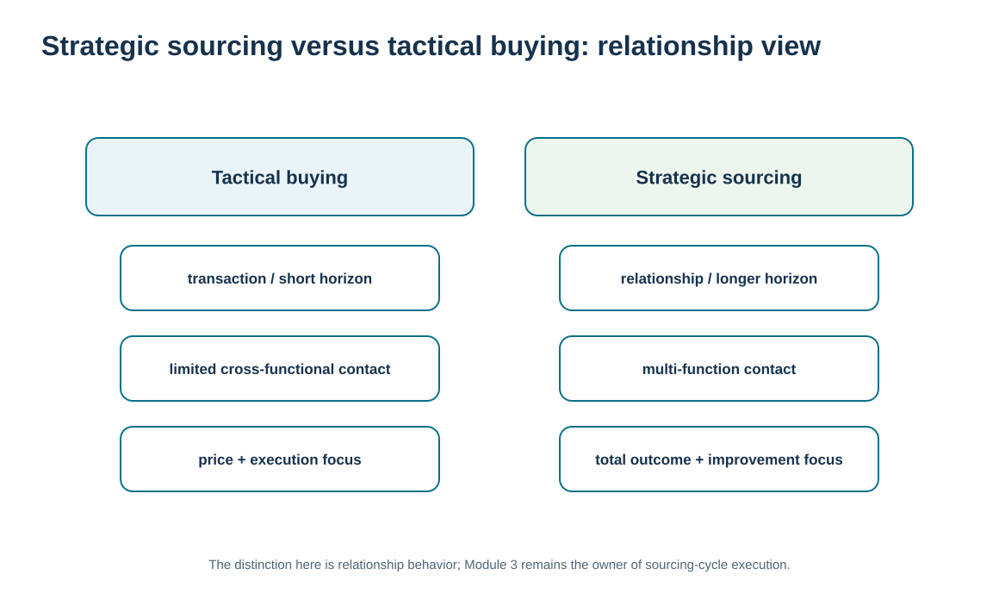
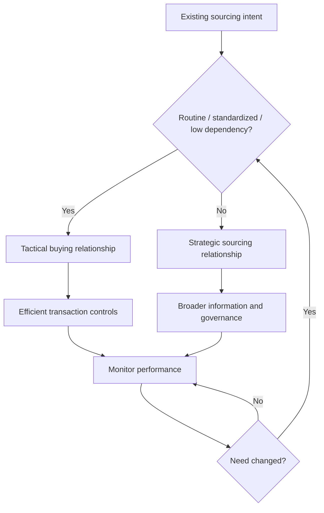

# 5. Strategic Sourcing vs. Tactical Buying: Relationship Implications

## Learning objectives

After this topic, you should be able to:

- distinguish strategic sourcing from tactical buying through their relationship implications
- explain how relationship duration, information sharing, cross-functional contact, and total-outcome orientation change with sourcing mode
- match governance depth to the nature of the supply need without reteaching the sourcing cycle
- recognize when a transactional buying relationship is appropriate rather than treating strategy as synonymous with complexity

## Concept in plain English

Strategic sourcing and tactical buying are different not only in procurement method but in the relationship they require. Tactical buying focuses on efficiently executing routine, well-defined, comparatively nonstrategic purchases. The relationship can often operate through clear specifications, standard transactions, and limited contact because the supply is stable and the consequence of switching is manageable.

Strategic sourcing addresses important supply needs where long-term value, capability, risk, technology, innovation, or customer outcomes justify a broader view. Once such a supplier is selected, the ongoing relationship often involves more information sharing, cross-functional contact, joint planning, performance governance, and attention to total outcomes rather than unit price alone.

The distinction is not a moral ranking. A tactical relationship can be excellent when the item is standardized and the market provides many capable alternatives. Forcing a strategic-alliance model onto routine buying adds meetings, cost, and supplier burden without corresponding value. Likewise, managing a highly customized critical supplier only through purchase orders can leave continuity and improvement risks unmanaged.

Module 3 owns the actual strategic-sourcing process: demand alignment, category strategy, cost analysis, supplier selection, negotiation, and contracting. Module 6 uses the resulting sourcing mode as an input to determine the appropriate relationship behavior after the commercial path is established.

## Why it matters

Organizations often say they want “strategic suppliers” while continuing to interact with those suppliers transactionally. The label then creates expectations that the process does not support. The opposite problem occurs when routine suppliers are pulled into expensive governance that neither party needs.

Clarifying the relationship implication makes the operating model coherent: transaction-focused supply gets efficient controls; strategic supply gets the information and governance needed for joint performance.

## Decision model and workflow

The visual contrasts tactical and strategic relationship behavior across time horizon, contact breadth, information sharing, decision focus, and improvement expectations.

### Evidence retained through the workflow

| Evidence | Why retain it |
| --- | --- |
| Nature of supply need | Shows whether the purchase is standardized/routine or strategically consequential. |
| Dependency, risk, customization, and innovation | Indicates the value of deeper relationship management. |
| Required information and cross-functional contacts | Defines how the relationship must operate beyond the buyer-seller interface. |
| Total-outcome measures | Tests whether strategic relationship effort improves cost, service, quality, risk, or innovation. |

## Practical process flow

## Realistic example — ClearSpan Automation Systems

ClearSpan purchases packaging from Prairie Packaging in a market with several alternatives and short lead time. The relationship can emphasize reliable transactions, standard specifications, and periodic performance review. By contrast, NorthRiver Sensors supports customized, innovation-intensive components with limited alternatives and long lead time. The relationship requires broader planning and engineering contact.

Both suppliers can be well managed. The difference is the amount and type of relationship infrastructure needed to protect the business outcome.

## Applied decision artifact or worked calculation

Compare [`supplier-segmentation.csv`](../../assets/data/module-6/supplier-segmentation.csv) with [`supplier-sourcing-relationships.csv`](../../assets/data/module-6/supplier-sourcing-relationships.csv). Prairie Packaging is modeled as Transactional, with six qualified alternatives and 14-day lead time. NorthRiver Sensors is Strategic, with one alternate, 84-day supplier lead time in the segmentation dataset, and an 80.77% share of the precision-sensor category in the sourcing-relationship dataset.

Use a **relationship consequence matrix** with four rows: information sharing, contact breadth, review cadence, and improvement expectations. The sourcing mode should explain why those rows differ. Do not rerun the sourcing event inside Module 6; the relationship decision begins from the established supply intent.

## Decision logic

- Use tactical relationship controls where the supply need is routine, standardized, and replaceable.
- Use broader strategic relationship governance where dependency, customization, risk, or innovation justify it.
- Match information sharing and cross-functional contact to the supply relationship rather than to organizational habit.
- Measure total relationship outcomes, not only purchase price, when the supply is strategically important.
- Reassess relationship mode when the category or supplier role materially changes.

## Trade-offs

| Tension | Decision implication |
| --- | --- |
| Transaction efficiency vs. collaboration depth | Routine buying benefits from simplicity; strategic supply may need richer coordination. |
| Price transparency vs. total value | Tactical markets may support direct price comparison, while strategic relationships often depend on capability and long-run outcomes. |
| Flexibility to switch vs. relationship investment | Deep relationships can create value and can also increase switching cost. |

## Commonly confused with

**Strategic sourcing** is not synonymous with **strategic alliance**. Strategic sourcing may lead to a range of relationship models. An alliance is a deeper relationship choice with additional commitment, governance, and mutual dependence.

## Common mistakes

- Calling a supplier strategic while interacting only through purchase-order exceptions.
- Using alliance-style governance for every routine supplier.
- Assuming tactical buying means poor supplier management.
- Reducing strategic relationship performance to price variance alone.
- Reteaching the supplier-selection and contracting cycle instead of focusing on post-award relationship behavior.

## Original knowledge check

**Question.** Which relationship behavior best differentiates a strategic supply relationship from routine tactical buying?

A. More invoices per month

B. A requirement that the supplier always be sole source

C. Broader cross-functional contact, information sharing, and total-outcome governance where the supply need justifies it

D. Elimination of formal performance measures

Answer and rationale

### Correct answer

**C. Broader cross-functional contact, information sharing, and total-outcome governance where the supply need justifies it**

### Why it is correct

Strategic relationships usually require deeper coordination because the supply has greater consequence, dependency, or value-creation potential.

### Why the other answers are wrong

- **A.** Transaction volume does not determine strategic relationship depth.

- **B.** Strategic relationships can use single, sole, or multisourcing depending on the situation.

- **D.** Performance governance usually becomes more important, not less.

## Practitioner perspective

In procurement systems, the transaction flow can look almost identical for tactical and strategic suppliers: purchase order, confirmation, receipt, invoice. The difference becomes visible in the surrounding governance—forecast sharing, engineering change, scorecards, joint actions, reviews, and escalation. Do not infer relationship depth from transaction type alone.

## Related concepts

- [Module 3 — Strategic Sourcing from Demand](../../03-sourcing-strategy-product-design-supplier-execution/section-a-sourcing-alignment-and-total-cost/01-strategic-sourcing-from-demand.md)
- [Transactional Relationships vs. Strategic Alliance Contact Models](./07-transactional-relationships-vs-strategic-alliance-contact-models.md)
- [SRM Foundations and Supply-Side Relationship Strategy](./01-srm-foundations-and-supply-side-relationship-strategy.md)

---

[Previous: SRM Technology, Portals, Procurement, and Sourcing Enablement](./04-srm-technology-portals-procurement-and-sourcing-enablement.md) · [Section overview](./README.md) · [Next: Single, Sole, and Multisourcing: Concentration and Relationship Risk](./06-single-sole-and-multisourcing-concentration-and-relationship-risk.md)