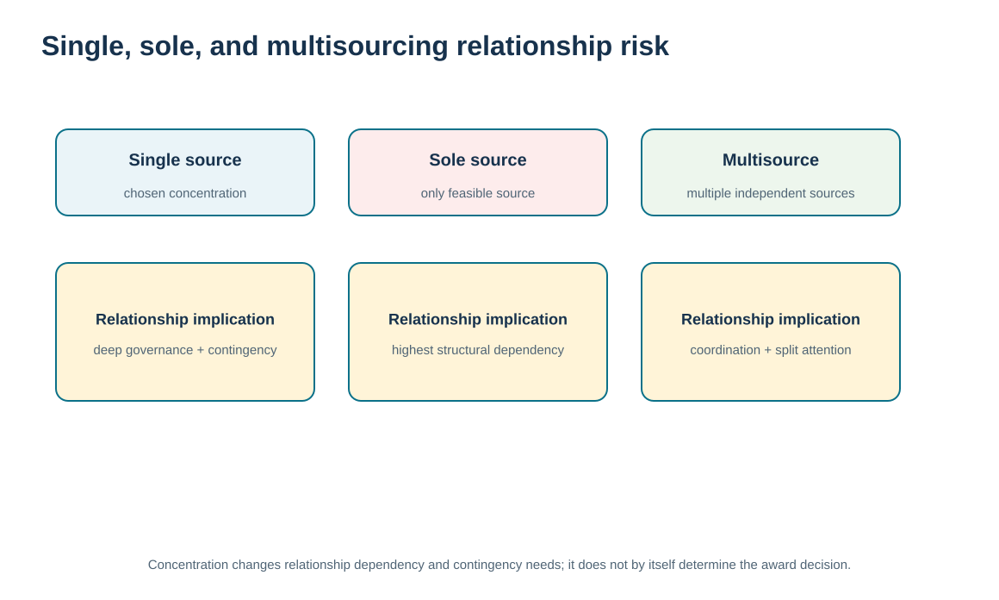
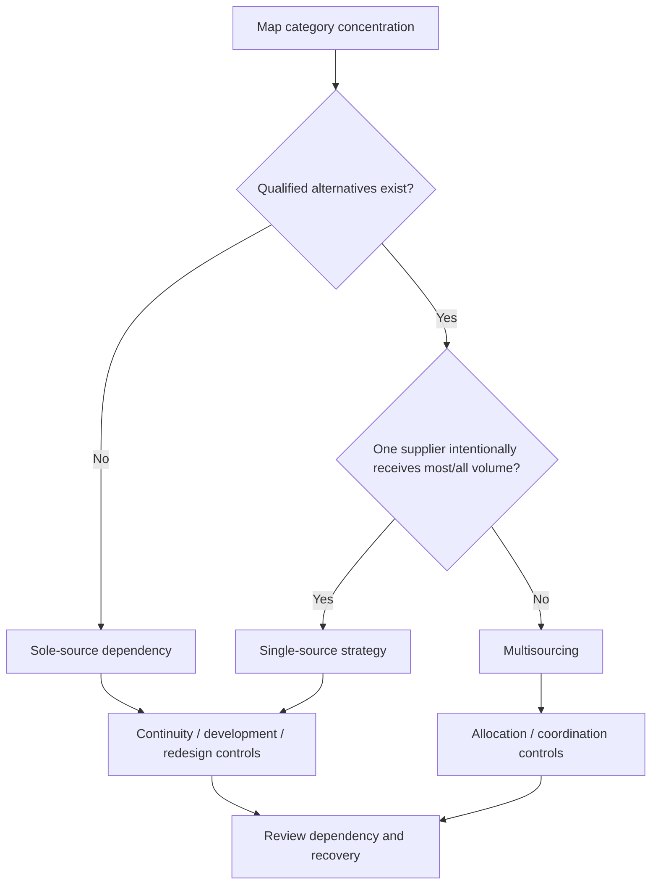

# 6. Single, Sole, and Multisourcing: Concentration and Relationship Risk

## Learning objectives

After this topic, you should be able to:

- distinguish single sourcing, sole sourcing, and multisourcing using the reason for concentration rather than the supplier count alone
- analyze how sourcing concentration changes dependency, leverage, continuity, information sharing, and relationship governance
- use supplier share, alternatives, switch lead time, and continuity buffer as relationship-risk evidence
- keep dual sourcing as a related concept rather than expanding it into a separate lesson that would blur this topic’s single/sole/multisourcing boundary

## Concept in plain English

Sourcing concentration changes the relationship. **Single sourcing** means the buyer deliberately chooses one supplier even though alternatives exist. **Sole sourcing** means only one practical source is available, often because of technology, intellectual property, tooling, design, qualification, or another structural barrier. **Multisourcing** means the buyer procures the requirement from more than one independent supplier.

The supplier count can look similar while the management problem differs. In both single and sole sourcing, one supplier may currently receive all the business. The difference is whether the buyer has a meaningful alternative. A single-source decision can potentially be changed after qualification and transition; a sole-source condition may require product redesign, licensing, technology change, or a new source to be developed before an alternative exists.

Concentration can create benefits. A supplier may receive enough volume to justify investment, dedicate capacity, learn the buyer's needs, and simplify coordination. It also increases dependency. Failure at a concentrated source can have a large impact, and the buyer may have less immediate leverage or flexibility. Multisourcing can reduce dependency and provide capacity options, but it can fragment volume, increase qualification and coordination work, and make deep joint investment less attractive.

The relationship response should therefore reflect the cause and consequence of concentration. The decision is not “single source bad, multisource good.” It is: what dependency have we created or inherited, how quickly can we recover, what information and governance are required, and what continuity measures are credible?

## Why it matters

Supply teams can underestimate concentration risk when a supplier has performed well for years. Strong performance lowers observed disruption frequency but does not create an alternate source. Conversely, spreading volume across many suppliers can create complexity without materially reducing risk if all suppliers share the same upstream dependency.

Relationship management makes the concentration visible and ensures that continuity, capacity, and improvement discussions match the exposure.

## Decision model and workflow

The visual compares single, sole, and multisourcing through dependency and recovery implications rather than presenting supplier count as a simple best-practice ranking.

### Evidence retained through the workflow

| Evidence | Why retain it |
| --- | --- |
| Supplier share of category spend/volume | Shows the current level of concentration. |
| Qualified alternatives | Distinguishes chosen concentration from structural exclusivity. |
| Switch/qualification lead time | Shows how quickly the buyer could recover from a failure. |
| Continuity buffer and supplier governance | Shows the protective measures surrounding the dependency. |

## Practical process flow

## Realistic example — ClearSpan Automation Systems

ClearSpan's BlueMesa Electronics relationship is fictional **sole source**: the supplier receives 100% of the category spend and there are no qualified alternatives. The switch lead time is 180 days, making continuity and remediation critical. NorthRiver Sensors is **single source** in the training data: it receives 80.77% of category spend, but one qualified alternate exists. Prairie Packaging is **multisourced**, with a 29.52% share and six qualified alternatives.

The relationship actions differ. BlueMesa needs continuity attention and potentially source-development or design-alternative work outside Module 6. NorthRiver needs governance that recognizes deliberate concentration. Prairie Packaging can be managed with more transactional flexibility.

## Applied decision artifact or worked calculation

Use [`supplier-sourcing-relationships.csv`](../../assets/data/module-6/supplier-sourcing-relationships.csv) to create a concentration-risk register. Key examples:

| Supplier | Strategy | Share | Alternates | Switch lead time | Buffer | Risk |
|---|---|---:|---:|---:|---:|---|
| BlueMesa Electronics | Sole | 100.00% | 0 | 180 days | 60 days | Critical |
| NorthRiver Sensors | Single | 80.77% | 1 | 120 days | 45 days | High |
| Prairie Packaging | Multi | 29.52% | 6 | 21 days | 14 days | Low |

The register should connect each exposure to an owner, continuity action, supplier-review cadence, and trigger for escalation. It does not replace Module 3 supply-base strategy; it makes the relationship consequence of concentration explicit.

## Decision logic

- Distinguish single from sole source by the existence of viable alternatives, not by volume share alone.
- Assess concentration together with switch/qualification time and continuity protection.
- Use deeper governance when dependency is high even if historical performance is good.
- Do not assume multisourcing automatically removes common-mode or upstream risk.
- Escalate structural sole-source conditions to sourcing/design/risk owners when relationship management alone cannot create an alternative.

## Trade-offs

| Tension | Decision implication |
| --- | --- |
| Volume concentration vs. leverage/investment | Concentrated volume can support commitment and efficiency while increasing dependence. |
| Multisourcing resilience vs. complexity | More sources can add options and also add qualification, coordination, and smaller-volume costs. |
| Inventory buffer vs. structural mitigation | Buffer buys time but does not create a substitute supplier or remove the root dependency. |

## Commonly confused with

**Single source** is a buyer choice among available alternatives. **Sole source** reflects a situation in which only one practical supplier is available. **Multisourcing** uses more than one independent supplier. This lesson intentionally keeps dual sourcing as a related concept rather than a separate definition so the decision boundary stays focused on single, sole, and multisourcing.

## Common mistakes

- Calling every one-supplier situation “sole source.”
- Using a safety-stock buffer as proof that a long sole-source dependency is solved.
- Assuming a low-cost source is low risk because its delivery history is strong.
- Multisourcing without checking whether the sources share the same upstream failure point.
- Ignoring how concentration changes the information and governance required in the relationship.

## Original knowledge check

**Question.** ClearSpan awards 100% of a category to one supplier even though another qualified source exists. What is the relationship best described as?

A. Sole source

B. Single source

C. Multisource

D. Joint venture

Answer and rationale

### Correct answer

**B. Single source**

### Why it is correct

Single sourcing is a deliberate decision to place the business with one supplier even though alternatives are available.

### Why the other answers are wrong

- **A.** Sole source means no practical alternative is available.

- **C.** Multisourcing uses more than one independent supplier.

- **D.** A joint venture is a separate collaboration/ownership structure, not a sourcing-concentration label.

## Practitioner perspective

Source strategy fields should distinguish commercial allocation from qualification status. A material can have one active supplier today but several technically qualified alternates, or it can have no approved alternative at all. Those cases require very different continuity and governance decisions, so the data model should not collapse them into “single vendor.”

## Related concepts

- [Module 3 — Supply Base Right-Sizing](../../03-sourcing-strategy-product-design-supplier-execution/section-b-category-strategy-and-supply-base/07-supply-base-right-sizing.md)
- [Supplier Segmentation and Relationship Fit](./02-supplier-segmentation-and-relationship-fit.md)
- [Supplier Performance Reporting, Error Control, Claims, and Remediation](./13-supplier-performance-reporting-error-control-claims-and-remediation.md)

---

[Previous: Strategic Sourcing vs. Tactical Buying: Relationship Implications](./05-strategic-sourcing-vs-tactical-buying-relationship-implications.md) · [Section overview](./README.md) · [Next: Transactional Relationships vs. Strategic Alliance Contact Models](./07-transactional-relationships-vs-strategic-alliance-contact-models.md)
