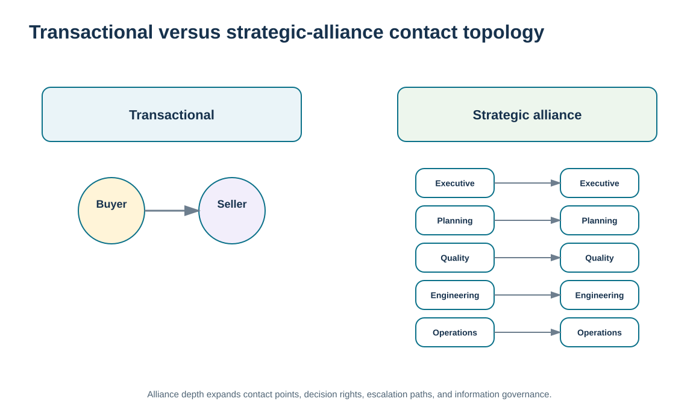
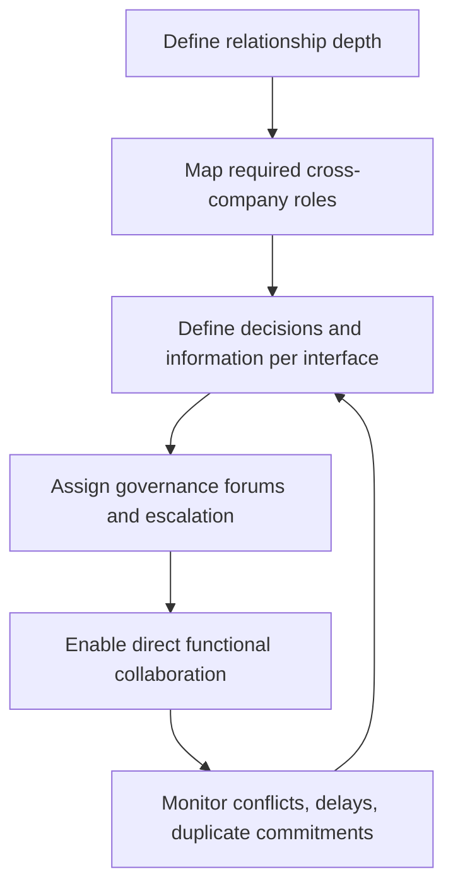

# 7. Transactional Relationships vs. Strategic Alliance Contact Models

## Learning objectives

After this topic, you should be able to:

- compare transactional and strategic-alliance relationships through the number and type of organizational contact points
- explain how information flow, decision rights, escalation, and governance expand as relationship depth increases
- design contact topology that supports the relationship without creating uncontrolled communication
- distinguish contact-model design from Module 3 category-level relationship-model selection

## Concept in plain English

A transactional supplier relationship can often function through a small number of formal contact points: buyer to sales representative, accounts payable to accounts receivable, and perhaps quality or logistics for exceptions. The information exchanged is relatively structured, and decisions are mostly bounded by the contract, order, specification, and standard escalation path.

A strategic alliance creates a very different contact topology. Engineering may work with engineering, planning with planning, operations with operations, quality with quality, finance with finance, and executives with executives. Multiple functions exchange information and make interdependent decisions. The relationship becomes less like a sequence of purchase transactions and more like an inter-organizational operating network.

More contact points can increase speed, knowledge, and collaboration, but they also increase communication complexity. Without governance, teams can make inconsistent commitments, disclose information too broadly, bypass accountable owners, or create parallel escalation paths. Alliance contact therefore needs structure: defined forums, decision rights, information boundaries, issue owners, and escalation rules.

Module 3 already describes a range of supplier relationship models. This lesson does not choose among transactional, preferred, collaborative, or ownership models for a category. It focuses on what the **contact network** looks like after a deeper relationship has been chosen and how that topology changes governance needs.

## Why it matters

Strategic relationships often fail not because organizations lack contact but because they have uncoordinated contact. One function promises a change that another cannot support; technical teams solve a problem without commercial awareness; executives learn about a dispute too late.

A deliberate contact model turns many interactions into a controlled relationship network. It preserves direct functional collaboration while keeping accountability and escalation coherent.

## Decision model and workflow

The topology visual contrasts a narrow transactional buyer-seller interface with a multi-function alliance network and overlays the governance layer needed to keep that network aligned.

### Evidence retained through the workflow

| Evidence | Why retain it |
| --- | --- |
| Required functional interfaces | Shows which roles genuinely need direct cross-company contact. |
| Decision rights and escalation boundaries | Prevents parallel contacts from creating incompatible commitments. |
| Information-sharing permissions | Limits sensitive data to the people and purposes that require it. |
| Forum cadence and issue history | Shows whether the contact model resolves decisions efficiently or creates duplication. |

## Practical process flow

## Realistic example — ClearSpan Automation Systems

ClearSpan manages Prairie Packaging through a relatively narrow contact model: purchasing handles routine commercial interaction, receiving/quality engage on exceptions, and performance is reviewed periodically. NorthRiver Sensors, by contrast, supports strategic product performance and innovation. Its relationship needs planning, engineering, quality, supplier management, and executive contacts.

ClearSpan does not simply tell everyone to “collaborate.” It defines which decisions can be made at each interface and where unresolved issues escalate. This preserves the speed of direct contact without losing commercial and strategic control.

## Applied decision artifact or worked calculation

Create a **relationship contact map** with columns for buyer role, supplier role, purpose, information exchanged, decision authority, cadence, and escalation owner. For a strategic supplier such as NorthRiver, the map might include:

- planning ↔ supplier planning: forecast/capacity alignment;
- engineering ↔ supplier engineering: specification and change coordination;
- quality ↔ supplier quality: defects, corrective actions, certification evidence;
- commercial/SRM ↔ supplier account lead: contract/relationship issues and scorecard;
- executive sponsor ↔ supplier executive: strategic alignment and unresolved escalations.

The contact map should not grant everyone authority to change price, specifications, commitments, or contractual obligations. It defines collaboration **and** limits.

## Decision logic

- Create direct functional contacts only where they improve a real relationship process.
- Define the decision authority and information boundary for each contact path.
- Use governance forums to reconcile cross-functional commitments.
- Preserve a clear escalation path even when many peer-to-peer contacts exist.
- Remove redundant interfaces when they create noise without decision value.

## Trade-offs

| Tension | Decision implication |
| --- | --- |
| Direct contact speed vs. coordination control | Peer-to-peer collaboration is fast; centralized approval prevents incompatible commitments. |
| Rich information vs. communication complexity | More interfaces improve context and increase the need for disciplined governance. |
| Relationship resilience vs. key-person dependence | Broader contacts reduce dependence on one buyer-seller pair but can diffuse accountability if roles are unclear. |

## Commonly confused with

A **contact model** describes who interacts with whom and for what purpose. A **supplier relationship model** describes the overall depth/type of relationship. A strategic model usually needs broader contacts, but the two concepts answer different questions.

## Common mistakes

- Equating more meetings with better collaboration.
- Allowing technical contacts to make commercial commitments outside their authority.
- Creating multiple escalation paths with no accountable relationship owner.
- Sharing sensitive information because a supplier is called a strategic partner.
- Relying on one buyer-supplier relationship for all communication in a highly integrated alliance.

## Original knowledge check

**Question.** What is the main governance risk when a strategic alliance adds many direct functional contacts?

A. The supplier will automatically become sole source

B. Different contacts can make inconsistent commitments unless decision rights and escalation are defined

C. Invoices can no longer be processed

D. Performance measures become unnecessary

Answer and rationale

### Correct answer

**B. Different contacts can make inconsistent commitments unless decision rights and escalation are defined**

### Why it is correct

A multi-function alliance gains speed and knowledge from direct contact but requires clear authority and governance to remain coherent.

### Why the other answers are wrong

- **A.** Contact breadth does not determine sourcing concentration.

- **C.** Routine transaction processes can continue within an alliance.

- **D.** Deeper relationships normally require stronger, not weaker, performance governance.

## Practitioner perspective

When integrating supplier collaboration tools, model roles and permissions around the contact map. A supplier engineer may need access to approved technical data but not commercial terms; a planner may need forecast and capacity views but not every quality investigation. Digital access should mirror relationship decision rights.

## Related concepts

- [Module 3 — Supplier Relationship Models](../../03-sourcing-strategy-product-design-supplier-execution/section-b-category-strategy-and-supply-base/05-relationship-models.md)
- [Strategic Alliance Design, Commitment, and Failure Modes](./09-strategic-alliance-design-commitment-and-failure-modes.md)
- [Communication Purpose, Audience, Channel, Feedback, and Management Plans](./17-communication-purpose-audience-channel-feedback-and-management-plans.md)

---

[Previous: Single, Sole, and Multisourcing: Concentration and Relationship Risk](./06-single-sole-and-multisourcing-concentration-and-relationship-risk.md) · [Section overview](./README.md) · [Next: Strategic Partner Selection and Alliance Rationale](./08-strategic-partner-selection-and-alliance-rationale.md)
