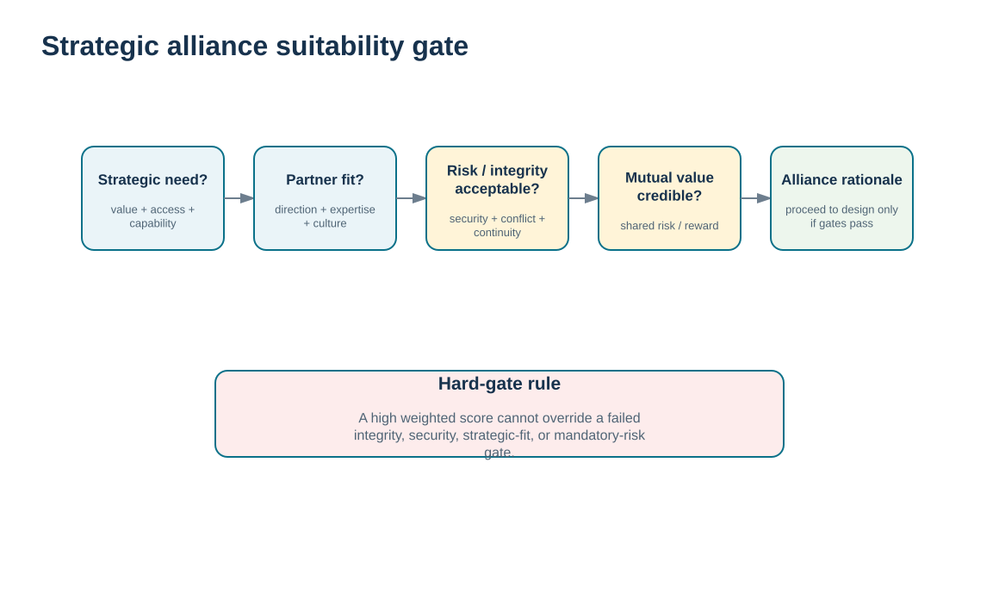
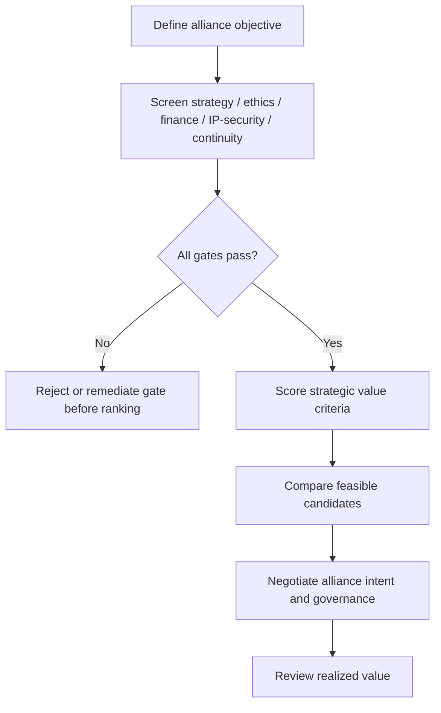

# 8. Strategic Partner Selection and Alliance Rationale

## Learning objectives

After this topic, you should be able to:

- determine when a strategic alliance is justified by value that cannot be achieved through a simpler supplier relationship
- evaluate alliance candidates using hard feasibility gates before weighted strategic-fit ranking
- assess value added, market access, operational strength, technology, growth, learning, and financial strength as relationship evidence
- distinguish alliance suitability from the initial supplier-selection and sourcing-award decision

## Concept in plain English

A strategic alliance should exist for a strategic reason. The parties may seek faster innovation, market access, complementary capabilities, operational improvement, technology strength, shared learning, growth, or a way to share investment and risk. The relationship is more demanding than ordinary supply, so the expected value must justify deeper commitment.

Alliance suitability has two layers. First are **hard gates**: conditions that must be acceptable before the relationship can be considered, such as strategy fit, ethics/compliance, financial viability, intellectual-property/security protection, and capacity/continuity. A high score cannot compensate for a failed mandatory condition. Second is comparative strategic value: among feasible partners, which candidate creates the strongest combined opportunity?

This sequence protects against a common decision error—allowing an attractive weighted average to hide a serious disqualifier. A partner may bring exceptional technology and market access but still be unsuitable if IP protection is unacceptable. The right response is to address the failed gate or reject the alliance, not to average the failure into the score.

The alliance decision occurs after basic supplier capability and eligibility are understood. Module 3 owns supplier selection and sourcing award. Module 6 asks whether the relationship should be elevated into an alliance and whether the candidate is suitable for that deeper mutual commitment.

## Why it matters

Alliances consume leadership attention, shared information, governance capacity, and often investment. Forming one simply because a supplier is important can create complexity without unique value.

A transparent gate-and-rank approach improves decision quality and creates an audit trail. It also helps explain why a numerically attractive candidate was not selected when a non-negotiable condition failed.

## Decision model and workflow

The visual makes the hard-gate sequence explicit before strategic ranking. Feasibility is a prerequisite, not one weighted criterion among many.

### Evidence retained through the workflow

| Evidence | Why retain it |
| --- | --- |
| Alliance objective and unique value case | Shows why ordinary supplier governance is insufficient. |
| Mandatory gate evidence | Protects ethics, financial, security/IP, strategic, and continuity boundaries. |
| Comparable strategic-value criteria | Supports ranking only among feasible candidates. |
| Shared investment and expected value | Tests whether the deeper relationship has credible mutual economics. |

## Practical process flow

## Realistic example — ClearSpan Automation Systems

ClearSpan evaluates five fictional alliance cases. BlueMesa Co-Development has the highest weighted alliance score at **89.0/100**, but it fails the IP/security gate. The case is therefore not rankable. NorthRiver Joint Innovation scores **88.0/100** and passes every hard gate, so it ranks first among feasible candidates.

This is intentional training design. The exercise demonstrates that strategic excitement must not override a mandatory control. ClearSpan can revisit BlueMesa only after the IP/security issue is genuinely resolved and re-evaluated.

## Applied decision artifact or worked calculation

Use [`strategic-alliance-cases.csv`](../../assets/data/module-6/strategic-alliance-cases.csv) with the [formula/control sheet](../../calculations/relationship-performance/formula-sheet.md). The repository-defined alliance score weights value added, market access, operations strength, technology strength, strategic growth, learning, and financial strength.

Feasible ranking in the locked data is:

1. **NorthRiver Joint Innovation — 88.0**
2. **Summit Connected Services Alliance — 87.0**
3. **Apex Regional Capacity Alliance — 81.0**

BlueMesa scores **89.0** but is excluded because the IP/security gate fails. LowCost Consortium scores **66.0** and fails strategy fit. The applied artifact should show both the gate evidence and the weighted criteria so decision makers cannot see the score without the feasibility status.

## Decision logic

- Form an alliance only when a simpler relationship cannot create the required strategic value.
- Define mandatory gates before scoring candidates.
- Do not rank or select a candidate that has failed a hard gate.
- Compare strategic-value criteria only among feasible partners.
- Review realized shared value after launch rather than treating the selection score as permanent proof.

## Trade-offs

| Tension | Decision implication |
| --- | --- |
| Strategic upside vs. commitment | An alliance can unlock unique value and requires greater management attention and mutual dependence. |
| Information sharing vs. IP/security | Deeper collaboration often needs more transparency while protecting proprietary knowledge becomes more important. |
| Speed to partner vs. due diligence | Urgency can favor fast formation; unresolved hard gates can create much larger downstream risk. |

## Commonly confused with

**Supplier selection** chooses a source for business. **Alliance selection** decides whether an already credible relationship should become a deeper strategic collaboration. The alliance gate therefore adds relationship-specific concerns such as shared strategic value, IP/security, mutual commitment, and governance.

## Common mistakes

- Forming an alliance because a supplier is large or well known without a defined strategic objective.
- Allowing a high weighted score to override a failed mandatory gate.
- Using vague “synergy” claims instead of measurable sources of shared value.
- Ignoring the supplier’s own incentives and expected benefits.
- Treating the selection score as proof that the alliance will remain healthy after implementation.

## Original knowledge check

**Question.** BlueMesa has the highest weighted alliance score but fails the IP/security gate. What should ClearSpan do under the locked decision logic?

A. Rank BlueMesa first because the weighted score is highest

B. Exclude BlueMesa from ranking until the hard gate is genuinely resolved and re-evaluated

C. Reduce the IP/security weight so the supplier can pass

D. Average the gate result into the score

Answer and rationale

### Correct answer

**B. Exclude BlueMesa from ranking until the hard gate is genuinely resolved and re-evaluated**

### Why it is correct

Mandatory feasibility gates are applied before ranking. A numerical score cannot compensate for a hard-gate failure.

### Why the other answers are wrong

- **A.** This violates the gate-before-ranking control.

- **C.** Changing the rules to admit a favored candidate undermines governance.

- **D.** A hard gate is intentionally not a weighted criterion.

## Practitioner perspective

Keep hard gates structurally separate in decision tools. If the spreadsheet or sourcing platform combines them into one weighted score, users will eventually select a high-scoring failed option. A visible PASS/FAIL feasibility field and rank suppression are stronger controls than a warning note.

## Related concepts

- [Module 3 — Supplier Criteria and Weighted Evaluation](../../03-sourcing-strategy-product-design-supplier-execution/section-d-supplier-selection-contracting-and-procurement/02-supplier-criteria-and-scorecards.md)
- [Strategic Alliance Design, Commitment, and Failure Modes](./09-strategic-alliance-design-commitment-and-failure-modes.md)
- [Alliance Implementation, Governance, and Continuous Review](./10-alliance-implementation-governance-and-continuous-review.md)

---

[Previous: Transactional Relationships vs. Strategic Alliance Contact Models](./07-transactional-relationships-vs-strategic-alliance-contact-models.md) · [Section overview](./README.md) · [Next: Strategic Alliance Design, Commitment, and Failure Modes](./09-strategic-alliance-design-commitment-and-failure-modes.md)