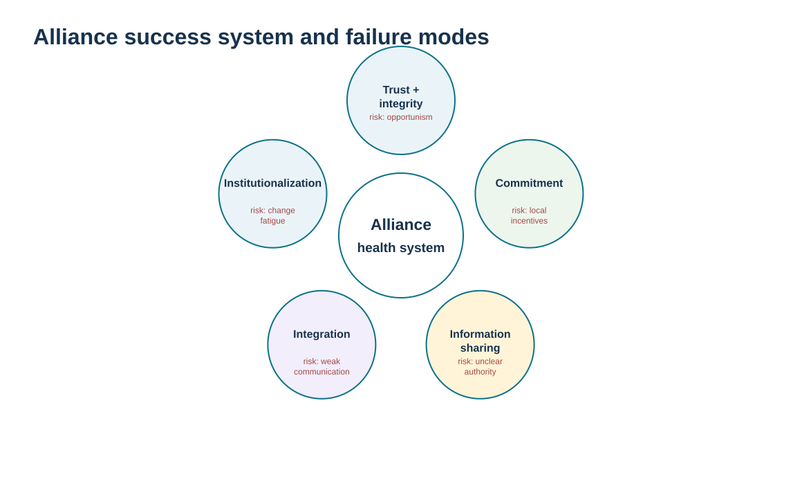
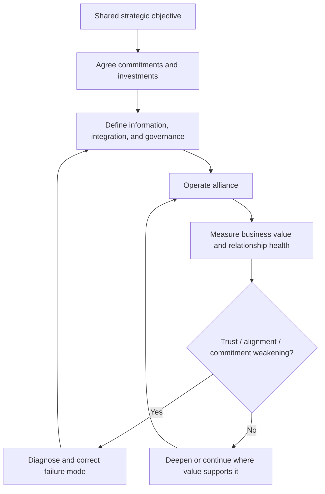

# 9. Strategic Alliance Design, Commitment, and Failure Modes

## Learning objectives

After this topic, you should be able to:

- explain the commitments that make a strategic alliance different from a conventional supplier relationship
- assess trust, interdependence, investment, information, integration, institutionalization, communication, and change readiness
- identify predictable alliance failure modes and the controls that counter them
- distinguish alliance relationship design from legal-structure and contract-negotiation topics owned elsewhere

## Concept in plain English

A strategic alliance is sustained by more than a signed agreement. The relationship normally requires meaningful commitment: parties share information, coordinate decisions, make investments, depend on each other's performance, and build processes that connect the organizations. Trust matters because not every contingency can be written into a contract; integrity matters because each side can often exploit information or power in ways that damage long-term value.

Several relationship characteristics reinforce one another. **Interdependence** means each party's success partly depends on the other. **Investment** signals that the alliance matters enough to commit resources. **Information** allows better joint decisions. **Integration** connects selected processes and teams. **Institutionalization** makes the relationship broader than a few individuals by embedding governance, routines, and organizational support. Communication and willingness to change keep the arrangement responsive as conditions evolve.

These same features create failure modes. Weak trust can limit information. Unequal commitment can produce resentment. Local incentives can encourage one party or function to optimize itself at the alliance's expense. Overdependence can make the relationship feel coercive. Poor communication can allow small misunderstandings to become strategic conflict. Leadership turnover can expose a relationship that existed only through personal chemistry.

The answer is not to eliminate formal contracts. Contracts remain important, but they cannot by themselves produce collaboration. Module 3 owns negotiation and contract design; B15 later compares structures such as joint ventures and virtual organizations. This lesson focuses on the **behavioral and governance system** that makes an alliance work after the parties decide to collaborate deeply.

## Why it matters

Alliance benefits are often delayed while the costs of coordination are immediate. Without visible commitment and shared value, participants can retreat to local priorities when pressure increases.

A failure-mode view is useful because alliances rarely collapse from one dramatic event. Trust, communication, or alignment often erode gradually. Relationship health needs to be monitored before operational performance makes the damage obvious.

## Decision model and workflow

The wheel visual shows mutually reinforcing alliance characteristics in the center and predictable failure pressures around the outside. A weakness in one part of the system can undermine the others.

### Evidence retained through the workflow

| Evidence | Why retain it |
| --- | --- |
| Shared objectives and value case | Creates a reason for both organizations to remain committed. |
| Mutual investments and dependencies | Shows whether the alliance is substantive rather than symbolic. |
| Information, process, and decision integration | Defines how the alliance actually operates across organizations. |
| Relationship-health signals and failure indicators | Provides early warning before commercial results deteriorate. |

## Practical process flow

## Realistic example — ClearSpan Automation Systems

NorthRiver Joint Innovation passes ClearSpan's fictional alliance gates and ranks first among feasible candidates. That result only says the candidate is suitable to consider. ClearSpan still needs to define how the alliance will function: what each side invests, what information is shared, how engineering and planning integrate, what results are jointly measured, and what happens when objectives conflict.

If ClearSpan asks NorthRiver to share technology roadmaps while providing little forecast visibility or delaying its own decisions, the relationship may become one-sided. The alliance design therefore includes reciprocal commitments and periodic review of both business value and relationship health.

## Applied decision artifact or worked calculation

Use [`strategic-alliance-cases.csv`](../../assets/data/module-6/strategic-alliance-cases.csv) as the selection evidence, then create an **alliance commitment charter** that goes beyond the score. For NorthRiver, the charter should include: shared objective, expected annual value, investments by each party, information categories, decision forums, IP/security boundaries, joint measures, escalation, leadership sponsors, and change/exit rules.

The dataset shows **$850,000** in fictional annual shared value and **$400,000** shared investment for NorthRiver. Those values do not prove the alliance will succeed. They create measurable expectations that later governance can compare with actual outcomes.

## Decision logic

- Convert alliance intent into reciprocal commitments that both organizations can observe.
- Embed the relationship in processes and governance rather than relying on individual chemistry.
- Define information and integration boundaries before expanding access.
- Monitor relationship health alongside financial and operational results.
- Address misaligned incentives, trust erosion, or unequal commitment early.

## Trade-offs

| Tension | Decision implication |
| --- | --- |
| Trust vs. formal control | Trust enables flexible collaboration; contracts and governance still protect boundaries and decision rights. |
| Interdependence vs. autonomy | Deeper mutual dependence can create unique value and reduce each party’s freedom to act independently. |
| Transparency vs. strategic exposure | Information sharing improves joint decisions while increasing the consequences of misuse or leakage. |

## Commonly confused with

A **strategic alliance** is a relationship characterized by shared objectives, information, investment, and linked processes. A **joint venture** is a specific structural arrangement involving a separate entity and shared ownership. An alliance can exist without a joint venture.

## Common mistakes

- Assuming the contract is sufficient to create trust and collaboration.
- Expecting one party to share information and invest while the other keeps transactional behavior.
- Building the alliance around two charismatic leaders with no institutional process.
- Ignoring relationship-health indicators until financial performance deteriorates.
- Allowing local incentives to reward behavior that harms the shared alliance objective.

## Original knowledge check

**Question.** Which condition most strongly indicates that a strategic alliance is institutionalized rather than dependent on personal chemistry?

A. Two executives have a strong personal relationship

B. Shared governance, cross-functional processes, decision rights, and measures continue even when individuals change

C. The supplier gives the buyer a discount

D. The alliance uses the same ERP vendor

Answer and rationale

### Correct answer

**B. Shared governance, cross-functional processes, decision rights, and measures continue even when individuals change**

### Why it is correct

Institutionalization embeds the alliance in organizational routines and governance so the relationship survives personnel changes.

### Why the other answers are wrong

- **A.** Personal trust can help but creates key-person dependency if not embedded.

- **C.** A discount is a commercial term, not evidence of alliance institutionalization.

- **D.** Common technology may help integration but does not create shared governance or commitment.

## Practitioner perspective

Alliance governance benefits from two scorecards: one for business outcomes and one for relationship health. A financially positive alliance can still be deteriorating if decision cycle time, trust, information quality, or executive engagement are falling. By the time financial results decline, the relationship problem may be expensive to repair.

## Related concepts

- [Strategic Partner Selection and Alliance Rationale](./08-strategic-partner-selection-and-alliance-rationale.md)
- [Alliance Implementation, Governance, and Continuous Review](./10-alliance-implementation-governance-and-continuous-review.md)
- [Collaboration Structures](./15-collaboration-structures-virtual-organizations-joint-ventures-and-partner-models.md)

---

[Previous: Strategic Partner Selection and Alliance Rationale](./08-strategic-partner-selection-and-alliance-rationale.md) · [Section overview](./README.md) · [Next: Alliance Implementation, Governance, and Continuous Review](./10-alliance-implementation-governance-and-continuous-review.md)
