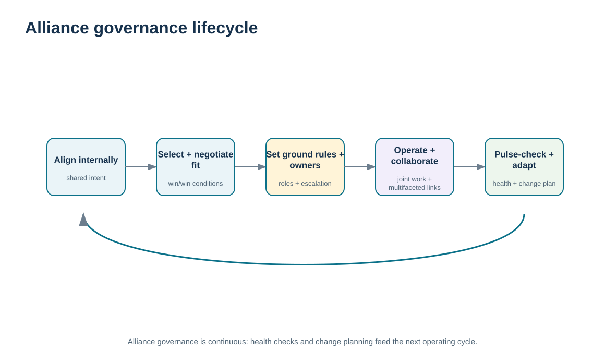
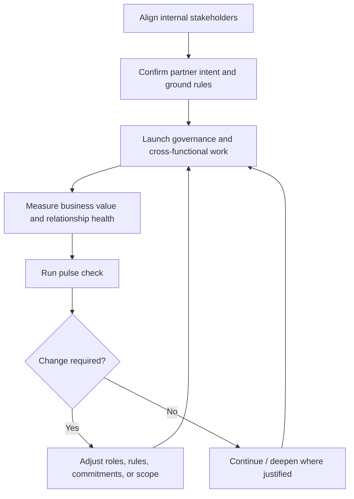

# 10. Alliance Implementation, Governance, and Continuous Review

## Learning objectives

After this topic, you should be able to:

- implement an alliance through staged governance rather than treating signature as completion
- establish internal alignment, ground rules, alliance management, collaboration routines, pulse checks, and change planning
- monitor both business results and relationship health through the alliance lifecycle
- distinguish alliance governance from generic project management and contract-clause administration

## Concept in plain English

Alliance implementation begins inside each organization. If internal functions are not aligned on the purpose, expected value, decision rights, information boundaries, and resource commitments, the external relationship will inherit those conflicts. Teams need to know what the alliance is supposed to accomplish, what they may commit, and what local incentives must change.

The relationship then needs ground rules. These include the major objectives, contact model, decision rights, escalation path, information-sharing boundaries, meeting cadence, measures, and expectations for problem solving. A named alliance manager or equivalent role helps coordinate the relationship, but that person should not become the only connection between the companies. Cross-functional participants still need direct collaboration within defined authority.

Implementation is not static. The parties should conduct periodic **pulse checks** that ask not only whether revenue, cost, service, or innovation targets are being met but whether trust, responsiveness, decision quality, and mutual commitment are healthy. An alliance can appear operationally successful while frustration accumulates beneath the surface.

Finally, the relationship must plan for change. Leadership moves, market shifts, technology changes, supplier events, new regulations, or strategy changes can alter the alliance. Governance should therefore include a way to revisit assumptions, update the operating model, and decide whether to deepen, redesign, or exit the relationship.

## Why it matters

The most carefully selected alliance can fail during implementation if the organizations do not convert intent into routines. Shared value is realized through day-to-day decisions, not the selection score.

Lifecycle governance also reduces key-person risk. When responsibilities, pulse checks, and change rules are documented, the alliance is more likely to survive personnel changes and periods of stress.

## Decision model and workflow

The timeline visual groups implementation into internal alignment, relationship setup, operating governance, health review, and adaptation. It treats the alliance as a living relationship rather than a one-time launch.

### Evidence retained through the workflow

| Evidence | Why retain it |
| --- | --- |
| Internal alignment record | Shows that functions understand the alliance purpose, commitments, and decision rights. |
| Ground rules and governance calendar | Defines how the relationship will operate and escalate issues. |
| Business-value and relationship-health measures | Separates economic/operational outcomes from trust and collaboration signals. |
| Pulse-check actions and change decisions | Demonstrates that review findings lead to adaptation rather than passive reporting. |

## Practical process flow

## Realistic example — ClearSpan Automation Systems

ClearSpan selects NorthRiver Joint Innovation as the highest-ranked feasible alliance candidate in the fictional evaluation. Before launch, ClearSpan aligns engineering, supply chain, finance, quality, and commercial leadership on what the alliance is expected to produce and which decisions each group may make with NorthRiver.

The parties then establish monthly operating reviews, quarterly value reviews, an executive escalation path, and a six-month relationship pulse check. If a key executive leaves or a technology roadmap changes, the alliance does not simply continue by inertia; the parties revisit the value case and governance.

## Applied decision artifact or worked calculation

The alliance case in [`strategic-alliance-cases.csv`](../../assets/data/module-6/strategic-alliance-cases.csv) gives NorthRiver a fictional annual shared-value expectation of **$850,000** and shared investment of **$400,000**. The implementation artifact should convert those expectations into a governance record:

| Governance element | Example control |
|---|---|
| Shared objective | joint innovation and faster design-to-launch decisions |
| Accountable sponsors | one executive per organization |
| Operating owner | alliance manager / supplier relationship lead |
| Review cadence | monthly operating, quarterly value, periodic pulse check |
| Hard boundaries | IP/security, ethics/compliance, approved decision rights |
| Measures | shared value, milestone reliability, issue closure, trust/health indicators |
| Change trigger | major strategy, leadership, technology, capacity, or risk shift |

The score that selected the alliance is not reused as a permanent performance measure. Implementation creates a new evidence set based on actual relationship behavior.

## Decision logic

- Align internal stakeholders before expecting consistent external collaboration.
- Write ground rules that define decisions, information, cadence, and escalation.
- Use both business-outcome and relationship-health evidence.
- Run pulse checks early enough to correct deterioration before value collapses.
- Plan for change and exit rather than assuming the alliance will remain appropriate indefinitely.

## Trade-offs

| Tension | Decision implication |
| --- | --- |
| Governance discipline vs. relationship flexibility | Rules prevent confusion, but the alliance still needs room to adapt to new information. |
| Formal reviews vs. operating burden | Regular reviews create visibility; excessive meetings can consume the value they are meant to protect. |
| Stability vs. adaptation | Consistency builds trust, while strategic changes may require redefining the alliance. |

## Commonly confused with

**Alliance governance** manages the ongoing inter-organizational relationship. **Project management** may be used for a specific joint initiative, and **contract management** governs contractual obligations. An alliance may contain projects and contracts, but its governance is broader than either one.

## Common mistakes

- Treating contract signature as the end of alliance implementation.
- Launching external collaboration before internal decision rights are aligned.
- Measuring only financial value while ignoring relationship-health deterioration.
- Allowing the alliance manager to become the only cross-company contact.
- Failing to define what events trigger a redesign or exit decision.

## Original knowledge check

**Question.** Six months after launch, an alliance is meeting cost targets but both organizations report slower decisions and declining trust. What should governance do?

A. Ignore the relationship signals because financial targets are being met

B. Use the pulse check to diagnose and correct the governance problem before business results deteriorate

C. Terminate the alliance immediately without review

D. Add more weighted selection criteria to the original supplier score

Answer and rationale

### Correct answer

**B. Use the pulse check to diagnose and correct the governance problem before business results deteriorate**

### Why it is correct

Relationship health is an early indicator. Alliance governance should act before the deterioration appears in lagging business results.

### Why the other answers are wrong

- **A.** Financial performance can lag behind relationship deterioration.

- **C.** Immediate termination may be disproportionate when the governance issue can be corrected.

- **D.** The original selection score does not manage the live relationship.

## Practitioner perspective

Create separate governance objects for alliance decisions and operational transactions. Purchase orders and invoices are not substitutes for a relationship action log. The alliance should have visible owners, open decisions, commitments, pulse-check findings, and change triggers that survive beyond the transaction system.

## Related concepts

- [Strategic Alliance Design, Commitment, and Failure Modes](./09-strategic-alliance-design-commitment-and-failure-modes.md)
- [Strategic Partner Selection and Alliance Rationale](./08-strategic-partner-selection-and-alliance-rationale.md)
- [Communication Purpose, Audience, Channel, Feedback, and Management Plans](./17-communication-purpose-audience-channel-feedback-and-management-plans.md)

---

[Previous: Strategic Alliance Design, Commitment, and Failure Modes](./09-strategic-alliance-design-commitment-and-failure-modes.md) · [Section overview](./README.md) · [Next: Supplier Performance Measurement and KPI Governance](./11-supplier-performance-measurement-and-kpi-governance.md)
