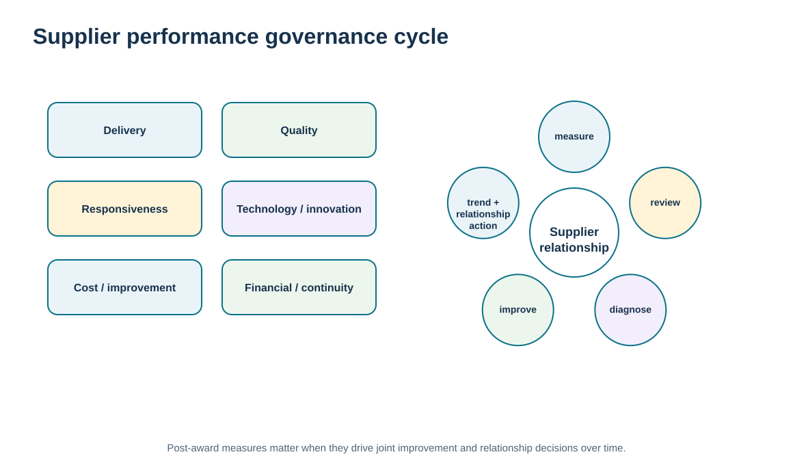
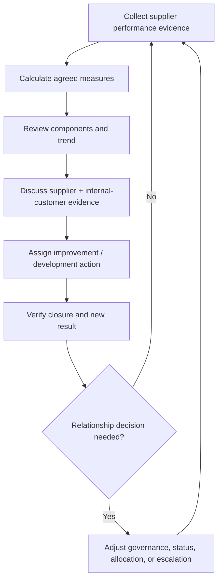

# 11. Supplier Performance Measurement and KPI Governance

## Learning objectives

After this topic, you should be able to:

- measure supplier performance longitudinally after award using delivery, quality, responsiveness, corrective action, internal-customer, technology, cost, and financial evidence
- distinguish post-award supplier performance governance from supplier-selection scoring
- apply a transparent weighted training score without allowing it to hide critical evidence
- use supplier performance reviews to drive joint improvement and relationship decisions

## Concept in plain English

Supplier performance management asks whether the live relationship is delivering what the supply chain needs. The evidence typically spans delivery reliability, quality, responsiveness and flexibility, corrective-action behavior, technology/integration capability, cost improvement, financial stability, and the experience of internal users who work with the supplier.

The scorecard should be small enough to focus attention on meaningful outcomes. A large collection of measures can make poor performance hard to see. At the same time, one aggregate score can hide a critical failure. A supplier with strong technology and cost performance may still create unacceptable delivery or quality risk. The relationship review therefore needs both the component evidence and any summary score.

Performance measurement should be collaborative where the relationship is important. Buyer and supplier should understand definitions, review the same evidence, discuss causes, and agree on improvement actions. The purpose is not only to grade the supplier; it is to improve the relationship and decide whether the current governance, business allocation, certification status, or development plan remains appropriate.

Module 2 owns general measurement-system design, and Module 3 owns pre-award supplier-selection scorecards. Here the measures are post-award and longitudinal. They answer: how is this supplier performing over time, what does that performance mean for the relationship, and what action should follow?

## Why it matters

Individual purchase orders can look acceptable while systemic supplier weakness builds slowly. Longitudinal measures make patterns visible and help the buyer distinguish an isolated exception from a deteriorating relationship.

Good measurement also improves fairness. Suppliers can challenge definitions and evidence rather than reacting to vague statements such as “service feels worse.”

## Decision model and workflow

The visual shows a closed scorecard-review-improvement cycle: measure, review, diagnose, act, and trend. The weighted score is one input, not the relationship decision by itself.

### Evidence retained through the workflow

| Evidence | Why retain it |
| --- | --- |
| Stable metric definitions and eligible populations | Allows supplier and buyer to reproduce the result. |
| Component performance by period | Shows which dimension is driving the overall relationship outcome. |
| Internal-customer feedback | Adds the experience of the people who design, receive, use, or support the supplier output. |
| Improvement action and trend | Shows whether review findings are producing better performance over time. |

## Practical process flow

## Realistic example — ClearSpan Automation Systems

The fictional supplier scorecard shows BlueMesa Electronics as the weakest supplier at **72.19/100**. The aggregate score is supported by component evidence: on-time delivery of **83.95%**, defect rate of **1.8%**, and corrective-action closure of only **53.33%**. The supplier also has strong technology integration at 4.8/5, which demonstrates why one favorable capability must not obscure broader performance risk.

Apex Motion Components scores **94.93/100**, but ClearSpan still reviews the components rather than declaring the supplier permanently excellent. Relationship performance can change as volume, product, people, or market conditions shift.

## Applied decision artifact or worked calculation

Use [`supplier-performance.csv`](../../assets/data/module-6/supplier-performance.csv) and the [formula/control sheet](../../calculations/relationship-performance/formula-sheet.md). The repository-defined weighted score uses seven components: delivery 25%, quality 20%, corrective-action closure 15%, internal-customer satisfaction 10%, technology integration 10%, cost reduction 10%, and responsiveness/flexibility 10%.

This is a **repository-defined training score**, not a universal supplier-performance formula. The stronger control is the supplier-performance review card:

- current result and trend by component;
- definition and source of each measure;
- material gap and business impact;
- supplier response / root-cause status;
- owner and due date;
- follow-up evidence;
- relationship decision if improvement fails.

Weighted totals help prioritize attention, but hard safety, compliance, certification, or continuity issues should remain visible outside the average.

## Decision logic

- Use stable definitions and comparable periods for supplier measures.
- Review component evidence before acting on the weighted total.
- Include internal-customer experience when it reveals relationship performance not captured by transactions.
- Convert material gaps into owned corrective or development actions.
- Use trends and closure evidence to inform relationship decisions over time.

## Trade-offs

| Tension | Decision implication |
| --- | --- |
| Simple score vs. diagnostic detail | A summary aids prioritization; component detail is required to understand and correct performance. |
| Standard metrics vs. supplier-specific relevance | Common measures enable comparison, while strategic relationships may need additional measures tied to their role. |
| Buyer control vs. collaborative measurement | The buyer needs governance; supplier participation can improve definition quality and commitment to improvement. |

## Commonly confused with

A **supplier-selection scorecard** evaluates candidates before or during award. A **supplier-performance scorecard** evaluates the live relationship after award. The measures can overlap, but the decision context and evidence horizon are different.

## Common mistakes

- Using the weighted score without looking at critical component failures.
- Changing definitions or targets without documenting the change.
- Rating suppliers on measures they cannot influence while ignoring buyer-caused problems.
- Holding review meetings with no action owners or follow-up evidence.
- Using one good period to erase a poor trend.

## Original knowledge check

**Question.** BlueMesa has excellent technology integration but weak delivery, quality, and corrective-action closure. What should ClearSpan do?

A. Review the component gaps and drive remediation; do not let one strong factor hide relationship risk

B. Ignore the weak measures because technology is strategic

C. Replace the supplier solely because its weighted score is below 80

D. Increase the technology weight until the total score becomes acceptable

Answer and rationale

### Correct answer

**A. Review the component gaps and drive remediation; do not let one strong factor hide relationship risk**

### Why it is correct

The purpose of the scorecard is diagnosis and relationship action. A strong component cannot offset every material weakness.

### Why the other answers are wrong

- **B.** Technology capability does not remove delivery and quality risk.

- **C.** A score alone should not trigger replacement without considering dependency, corrective potential, and other controls.

- **D.** Changing weights to rescue a favored supplier undermines the integrity of the measure.

## Practitioner perspective

Where possible, calculate supplier KPIs from shared transactional evidence rather than manual subjective entry. But do not eliminate qualitative internal-customer feedback; engineering, operations, quality, and service teams can identify relationship problems that delivery and defect measures miss. Keep qualitative ratings anchored with clear scales.

## Related concepts

- [Module 2 — Measurement System Design](../../02-network-design-digital-connectivity-performance/section-c-performance-and-financial-insight/01-measurement-system-design.md)
- [Module 3 — Supplier Criteria and Weighted Evaluation](../../03-sourcing-strategy-product-design-supplier-execution/section-d-supplier-selection-contracting-and-procurement/02-supplier-criteria-and-scorecards.md)
- [Supplier Performance Reporting, Error Control, Claims, and Remediation](./13-supplier-performance-reporting-error-control-claims-and-remediation.md)

---

[Previous: Alliance Implementation, Governance, and Continuous Review](./10-alliance-implementation-governance-and-continuous-review.md) · [Section overview](./README.md) · [Next: Supplier Certification, Rating Systems, and Qualification Evidence](./12-supplier-certification-rating-systems-and-qualification-evidence.md)