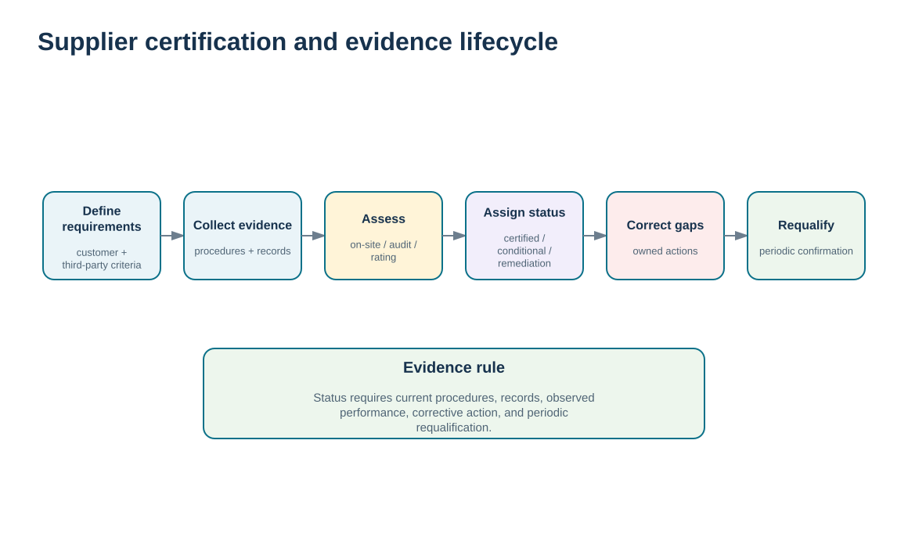
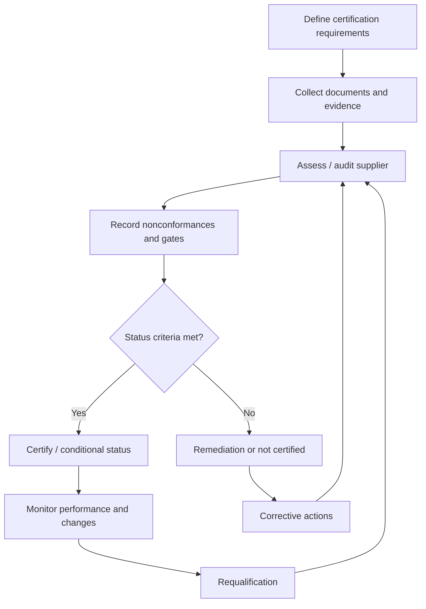

# 12. Supplier Certification, Rating Systems, and Qualification Evidence

## Learning objectives

After this topic, you should be able to:

- explain supplier certification as structured evidence of supplier capability and process control
- distinguish certification from ongoing performance measurement and from initial supplier selection
- use hard gates, audit evidence, nonconformance severity, corrective-action status, and requalification cadence to control certification status
- explain how certification can create value for both customer and supplier without becoming a substitute for relationship governance

## Concept in plain English

Supplier certification is a structured way to verify that a supplier operates and documents processes that meet defined customer or third-party requirements. The evidence may cover quality, delivery, safety, environmental systems, maintenance, flexibility, or other agreed requirements. Certification can be used before a strategic relationship, after selection, or periodically as part of ongoing assurance.

The strength of certification is the formal evidence trail. Requirements are defined; documents and processes are reviewed; nonconformances are recorded; corrective actions are assigned; a status is granted; and the supplier is re-evaluated on a planned cadence. This moves the relationship beyond informal confidence in individual people.

Certification still has limits. A certified supplier can experience a performance problem tomorrow. Certification shows that required systems and evidence have been assessed under the defined scope; it does not guarantee every future delivery or defect result. Ongoing supplier-performance measurement remains necessary.

The process can also benefit the supplier. A disciplined certification effort may expose capability gaps, improve process control, demonstrate credibility to customers, and support access to markets that require specific evidence. The value is higher when the buyer explains the business purpose and uses certification as part of development rather than as paperwork imposed without feedback.

## Why it matters

Strategic supplier relationships often depend on trust, but trust is stronger when important capabilities are supported by auditable evidence. Certification creates a repeatable assurance mechanism that is less dependent on personal judgment.

Periodic requalification also recognizes that supplier capability changes. Processes, facilities, people, technology, ownership, and performance can evolve after the original assessment.

## Decision model and workflow

The visual follows the certification evidence lifecycle from requirements and assessment through status, corrective action, and requalification. The status remains conditional on the evidence and hard gates.

### Evidence retained through the workflow

| Evidence | Why retain it |
| --- | --- |
| Defined certification scope and requirements | Prevents an ambiguous certificate from being treated as proof of unrelated capabilities. |
| Audit evidence and nonconformance severity | Shows what was assessed and which gaps were found. |
| Hard-gate and corrective-action status | Prevents a high average audit score from hiding a critical failure. |
| Requalification date and triggering changes | Keeps certification current as the supplier or requirement changes. |

## Practical process flow

## Realistic example — ClearSpan Automation Systems

ClearSpan's fictional certification data show **4 Certified**, **2 Conditional**, **1 Remediation**, and **1 Not Certified** supplier. BlueMesa Electronics receives **NOT CERTIFIED** despite having an audit score of 78 because the training data include a critical nonconformance, a failed delivery gate, and four open corrective actions. Harbor Cable Works receives **REMEDIATION** because required documents are incomplete even though its other hard gates pass.

The examples illustrate why certification status is not a simple average of audit points. Certain evidence is mandatory.

## Applied decision artifact or worked calculation

Use [`supplier-certification.csv`](../../assets/data/module-6/supplier-certification.csv) with the [formula/control sheet](../../calculations/relationship-performance/formula-sheet.md). The repository-defined training rule is transparent:

- **NOT CERTIFIED** for a critical nonconformance or failed safety/quality-system gate;
- **CERTIFIED** at audit score ≥90%, no critical issue, ≤1 major issue, complete documents, delivery gate pass, and zero open corrective actions;
- **CONDITIONAL** at score ≥80%, no critical issue, ≤2 major issues, complete documents, delivery gate pass, and ≤2 open actions;
- otherwise **REMEDIATION** unless a hard fail applies.

The cadence is also controlled: 12 months for Certified, 6 for Conditional, and 3 for Remediation/Not Certified. These thresholds are fictional training controls—not universal certification standards.

## Decision logic

- Define the certification scope and requirements before assessing the supplier.
- Keep critical hard gates separate from the overall audit score.
- Use corrective-action evidence to determine whether a conditional/remediation status can progress.
- Continue normal performance measurement after certification.
- Requalify periodically and when material supplier or requirement changes occur.

## Trade-offs

| Tension | Decision implication |
| --- | --- |
| Assurance depth vs. supplier burden | Extensive certification provides stronger evidence but consumes time and audit resources. |
| Standard criteria vs. relationship-specific requirements | Common frameworks improve consistency; critical relationships may require additional customer-specific evidence. |
| Trust vs. verification | Good relationships benefit from trust, while material capabilities still need auditable evidence. |

## Commonly confused with

**Certification** verifies defined supplier systems or capabilities against requirements. **Performance measurement** tracks actual ongoing outcomes. **Supplier selection** chooses which source should receive business. Certification can support both selection and ongoing assurance but does not replace either one.

## Common mistakes

- Treating a certification status as permanent.
- Allowing a high audit score to override a critical hard-gate failure.
- Assuming third-party certification proves every customer-specific requirement.
- Stopping supplier performance monitoring after certification.
- Requiring certification without explaining scope, value, or corrective-action expectations.

## Original knowledge check

**Question.** A supplier has a 94% audit score but fails a mandatory safety gate. How should the certification decision be handled?

A. Certify because the average score is high

B. Treat the failed hard gate as disqualifying under the defined certification control

C. Average the safety failure into the audit score

D. Ignore the gate if the supplier is strategic

Answer and rationale

### Correct answer

**B. Treat the failed hard gate as disqualifying under the defined certification control**

### Why it is correct

Mandatory certification gates are intentionally separated from the average score. A high audit result cannot compensate for a hard failure.

### Why the other answers are wrong

- **A.** This would defeat the purpose of the hard gate.

- **C.** Averaging makes a critical condition easier to hide.

- **D.** Strategic importance increases the need for control; it does not waive the requirement.

## Practitioner perspective

Store certification evidence at the level of requirement, scope, date, issuing body or assessor, status, and expiration/requalification. A single “certified = yes” flag loses too much context. Relationship teams need to know certified for what, based on which evidence, and until when.

## Related concepts

- [Supplier Performance Measurement and KPI Governance](./11-supplier-performance-measurement-and-kpi-governance.md)
- [Supplier Performance Reporting, Error Control, Claims, and Remediation](./13-supplier-performance-reporting-error-control-claims-and-remediation.md)
- [Module 3 — Supplier Criteria and Weighted Evaluation](../../03-sourcing-strategy-product-design-supplier-execution/section-d-supplier-selection-contracting-and-procurement/02-supplier-criteria-and-scorecards.md)

---

[Previous: Supplier Performance Measurement and KPI Governance](./11-supplier-performance-measurement-and-kpi-governance.md) · [Section overview](./README.md) · [Next: Supplier Performance Reporting, Error Control, Claims, and Remediation](./13-supplier-performance-reporting-error-control-claims-and-remediation.md)
