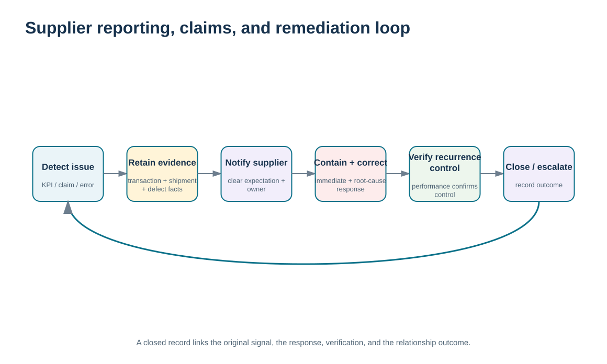
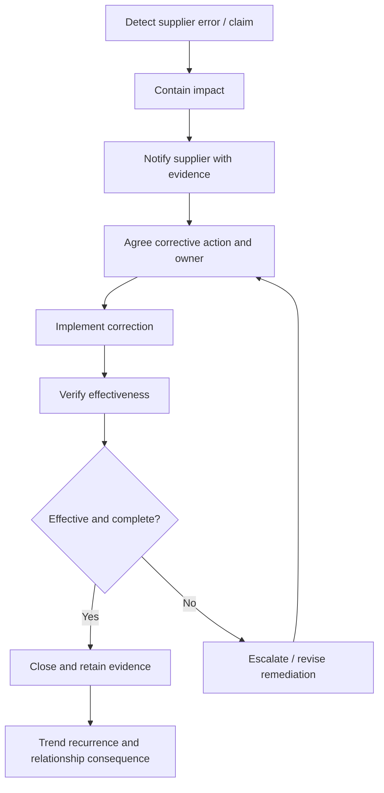

# 13. Supplier Performance Reporting, Error Control, Claims, and Remediation

## Learning objectives

After this topic, you should be able to:

- communicate supplier performance in a way that supports accountability and improvement
- close supplier errors through containment, corrective action, verification, and retained evidence
- manage freight or commercial claims as relationship evidence without reteaching transportation execution
- distinguish SRM remediation governance from root-cause methods such as DMAIC

## Concept in plain English

Performance reporting is the point where supplier measurement becomes relationship management. A scorecard that remains inside the buyer's organization cannot create joint improvement. Material results should be communicated to the supplier with enough evidence that both parties can understand the issue, agree on the impact, and determine the required response.

When an error occurs, the immediate need is often containment: protect production, customer service, safety, or financial exposure. Containment is not corrective action. Corrective action addresses the cause and is complete only when evidence shows the change has been implemented and the result is effective. The relationship record should therefore distinguish open problem, interim containment, root-cause/correction work, due date, verification, and closure.

Claims are another relationship-control mechanism. Freight claims or other commercial claims require evidence of the event, liability, quantity/value, timing, and communication. The purpose in Module 6 is not to teach transportation claims law or carrier execution. It is to show that claims become part of the supplier or partner relationship history and must be resolved through a controlled evidence trail.

Root-cause methods such as DMAIC, control charts, or other quality tools belong in Module 4. Module 6 consumes their outputs and focuses on supplier accountability, communication, escalation, closure, and the relationship decision when remediation does not work.

## Why it matters

Unclosed supplier problems teach both organizations that deadlines and scorecards do not matter. Repeated failures then become “normal,” customer-facing teams compensate manually, and the true relationship cost disappears into expediting and firefighting.

A disciplined remediation loop turns failure into learning while preserving fairness: the supplier sees the evidence, the buyer sees its own contribution where relevant, and closure is based on verification rather than promises.

## Decision model and workflow

The remediation-loop visual separates issue evidence, containment, supplier notification, corrective action, verification, and closure. A repeat failure reopens the governance decision rather than simply creating another ticket.

### Evidence retained through the workflow

| Evidence | Why retain it |
| --- | --- |
| Issue/claim record with business impact | Creates a common factual basis for supplier discussion. |
| Containment and responsibility | Protects the operation while the longer-term correction is developed. |
| Corrective-action evidence and due date | Makes remediation accountable and time bound. |
| Verification, closure, and recurrence history | Shows whether the correction worked and whether relationship escalation is needed. |

## Practical process flow

## Realistic example — ClearSpan Automation Systems

BlueMesa Electronics has weak delivery, quality, and corrective-action closure in the fictional supplier-performance data. Its certification record also contains four open corrective actions and a failed delivery gate. ClearSpan therefore places the relationship under a structured remediation plan rather than treating each late receipt or defect as an isolated transaction.

The plan separates immediate continuity protection from supplier correction. ClearSpan also checks whether its own forecast changes or specification decisions contributed to the problem so accountability remains evidence based.

## Applied decision artifact or worked calculation

[`supplier-performance.csv`](../../assets/data/module-6/supplier-performance.csv) shows BlueMesa with **15 corrective actions due and 8 closed**, producing **53.33%** closure under the locked calculation. [`relationship-communications.csv`](../../assets/data/module-6/relationship-communications.csv) includes a fictional **BlueMesa remediation** communication program with 12 actions due and 7 closed, or **58.33%** action closure.

The two datasets are not meant to be numerically identical; they represent different controlled records. The applied artifact is a **supplier remediation log** with issue, impact, containment, evidence package, supplier response, corrective action, owner, due date, verification method, claim reference if applicable, closure status, and recurrence indicator.

If remediation repeatedly fails, the relationship decision may need to escalate to sourcing, design, risk, or executive governance rather than generating more overdue actions.

## Decision logic

- Share material performance results with the supplier using reproducible evidence.
- Separate containment from permanent corrective action.
- Close actions only after effectiveness is verified.
- Retain claims and remediation history as relationship evidence.
- Escalate repeated or overdue failures to a relationship decision rather than normalizing them.

## Trade-offs

| Tension | Decision implication |
| --- | --- |
| Rapid containment vs. durable correction | Emergency action protects the operation; root-cause correction prevents recurrence. |
| Collaborative improvement vs. accountability | A constructive relationship should still make owners, due dates, and consequences explicit. |
| Detailed evidence vs. response speed | Good evidence supports fair claims and correction, but urgent containment cannot wait for a perfect dossier. |

## Commonly confused with

**SRM remediation** governs the supplier relationship around a problem. **DMAIC** or another quality method may be used to find and correct the process cause. The relationship owner should not replace the technical root-cause method; it should ensure that the right method is used, evidence is exchanged, and the action closes.

## Common mistakes

- Closing an action because the supplier submitted a response without verifying effectiveness.
- Confusing emergency containment with root-cause correction.
- Sending a scorecard with no opportunity to review evidence or agree actions.
- Allowing claims to remain outside the supplier relationship record.
- Continuing the same remediation cycle indefinitely without an escalation trigger.

## Original knowledge check

**Question.** A supplier sends a corrective-action report, but the same defect recurs the next month. What should ClearSpan conclude?

A. The action is closed because the report was submitted

B. The supplier score should automatically be set to zero

C. Effectiveness was not demonstrated; the remediation should be reopened or escalated

D. The issue no longer belongs in SRM because quality owns it

Answer and rationale

### Correct answer

**C. Effectiveness was not demonstrated; the remediation should be reopened or escalated**

### Why it is correct

Closure requires evidence that the corrective action worked. Recurrence indicates the correction was ineffective or incomplete.

### Why the other answers are wrong

- **A.** Submission is evidence of activity, not proof of effectiveness.

- **B.** A zero score may be arbitrary and does not diagnose or resolve the relationship problem.

- **D.** Quality may own technical analysis, but SRM still owns supplier accountability and relationship consequence.

## Practitioner perspective

Integrate quality notifications, claims, and supplier actions where practical, but preserve their distinct purposes. A defect record, financial claim, and supplier corrective action may refer to the same event while requiring different owners and evidence. The relationship view should link them without collapsing them into one generic issue status.

## Related concepts

- [Module 4 — Six Sigma and DMAIC](../../04-internal-operations-inventory/section-d-performance-and-continuous-improvement/14-six-sigma-and-dmaic.md)
- [Supplier Performance Measurement and KPI Governance](./11-supplier-performance-measurement-and-kpi-governance.md)
- [Module 5 — Transportation Strategy](../../05-forward-reverse-logistics/section-a-logistics-and-distribution/11-transportation-strategy-product-movement-and-temporary-storage.md)

---

[Previous: Supplier Certification, Rating Systems, and Qualification Evidence](./12-supplier-certification-rating-systems-and-qualification-evidence.md) · [Section overview](./README.md) · [Next: CRM-SRM Integration and End-to-End Relationship Management](./14-crm-srm-integration-and-end-to-end-relationship-management.md)