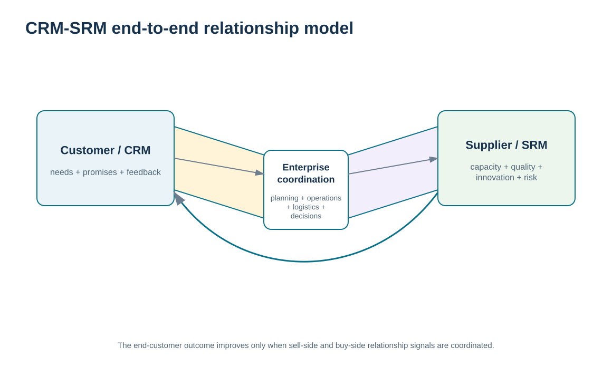
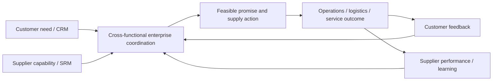

# 14. CRM-SRM Integration and End-to-End Relationship Management

## Learning objectives

After this topic, you should be able to:

- integrate CRM and SRM as connected relationship systems serving end-customer outcomes
- trace how customer needs, supplier capability, planning, operations, logistics, and feedback interact across organizational boundaries
- diagnose relationship failures caused by broken handoffs between sell-side and buy-side processes
- avoid re-teaching CRM or SRM fundamentals while designing the interface between them

## Concept in plain English

CRM manages relationships on the demand/customer side; SRM manages relationships on the supply/supplier side. Supply chain performance depends on the interface between them. A customer promise can be credible only when the organization understands supplier capacity, quality, lead time, technology, and risk. Likewise, supplier plans are stronger when they reflect real customer needs rather than disconnected internal forecasts.

End-to-end relationship management therefore moves information in both directions. Customer needs, service failures, design feedback, and demand changes can inform supplier priorities. Supplier constraints, innovation, risk, and capability changes can shape customer commitments and account conversations. Planning, operations, logistics, engineering, quality, finance, and commercial teams translate between those external relationships.

The objective is not uncontrolled transparency. Customers do not need every supplier detail, and suppliers do not need every customer fact. The organization should share the information required for a decision while protecting confidentiality and preserving accountable ownership.

A broken interface is often visible as contradiction: sales promises a date that supply cannot support; a supplier capacity risk is known in procurement but not communicated to account teams; a customer complaint signals a design or supplier problem but never reaches the upstream relationship. CRM-SRM integration creates the operating loop that prevents these failures from staying in separate functions.

## Why it matters

Customers ultimately experience the performance of the whole supply chain, even when the failure begins several tiers upstream. Managing customer and supplier relationships separately can optimize each side while leaving the end-to-end outcome weak.

The integrated view also creates learning. Customer feedback can influence supplier development and design; supplier innovation can create new customer value. That is where relationship management becomes a supply-chain capability rather than two independent commercial disciplines.

## Decision model and workflow

The bowtie visual shows customer needs and supplier capabilities converging through enterprise coordination, with service and learning feeding back to both sides.

### Evidence retained through the workflow

| Evidence | Why retain it |
| --- | --- |
| Customer need / commitment evidence | Defines the external outcome the supply network must support. |
| Supplier capability / constraint evidence | Shows what upstream relationships can reliably deliver. |
| Internal planning and execution decision | Translates external evidence into a feasible coordinated response. |
| Customer and supplier feedback | Shows whether the integrated decision created value and where the next adjustment is needed. |

## Practical process flow

## Realistic example — ClearSpan Automation Systems

ClearSpan's Service Networks are experiencing weak OTIF and response performance. The CRM view shows complaints and vulnerable accounts. The SRM view shows that BlueMesa Electronics has weak delivery, quality, and corrective-action closure, while also being a sole-source relationship in the fictional data.

Treating these as separate problems would lead to customer-service scripts on one side and supplier remediation on the other. The integrated relationship view connects them. Customer teams receive a realistic recovery plan; supplier governance receives the end-customer impact; planning and logistics coordinate the interim response; leadership sees the combined relationship risk.

## Applied decision artifact or worked calculation

Build an **end-to-end relationship issue record** by linking selected evidence from:

- [`customer-service-performance.csv`](../../assets/data/module-6/customer-service-performance.csv);
- [`customer-voc-interactions.csv`](../../assets/data/module-6/customer-voc-interactions.csv);
- [`supplier-performance.csv`](../../assets/data/module-6/supplier-performance.csv);
- [`supplier-sourcing-relationships.csv`](../../assets/data/module-6/supplier-sourcing-relationships.csv).

A training case can connect the Service Networks OTIF of **86.23%** with repeated VOC service issues and BlueMesa's **72.19/100** supplier-performance score plus sole-source concentration. The artifact should distinguish **evidence**, **causal hypothesis**, **confirmed cause**, **customer action**, **supplier action**, **internal owner**, and **verification**. Do not assume correlation proves that one supplier caused every customer issue; the integrated record is a structure for investigation and coordinated response.

## Decision logic

- Begin with the end-customer outcome and trace the upstream relationship evidence that can influence it.
- Share only the information needed for the cross-boundary decision.
- Distinguish a plausible cross-chain hypothesis from a confirmed cause.
- Coordinate customer recovery and supplier remediation when the issues are connected.
- Feed customer learning upstream and supplier capability downstream into future decisions.

## Trade-offs

| Tension | Decision implication |
| --- | --- |
| End-to-end visibility vs. confidentiality | Integration requires enough transparency for coordination without exposing unnecessary customer or supplier information. |
| Fast hypothesis vs. verified cause | Connecting signals accelerates response, but teams must still verify the causal chain. |
| Local optimization vs. system value | A function may meet its own KPI while the end-customer outcome remains poor. |

## Commonly confused with

**CRM-SRM integration** is not one software platform. It is the business operating interface between customer and supplier relationship processes. Technology can connect evidence, but planning, decision rights, communication, and governance create the end-to-end response.

## Common mistakes

- Assuming customer and supplier relationship teams can optimize independently.
- Sharing confidential customer or supplier data more broadly than the decision requires.
- Blaming a supplier based on correlation without confirming the cause.
- Fixing customer communication without addressing an upstream recurring failure.
- Improving supplier performance without checking whether the end-customer outcome improved.

## Original knowledge check

**Question.** Customer service sees repeated late-order complaints while supplier management knows a critical sole-source supplier is missing delivery targets. What is the strongest Module 6 response?

A. Keep the issues separate because CRM and SRM have different owners

B. Create a coordinated end-to-end issue view so customer recovery and supplier remediation use the same verified evidence

C. Tell the customer the supplier is at fault before investigation

D. Focus only on the supplier score because it is quantitative

Answer and rationale

### Correct answer

**B. Create a coordinated end-to-end issue view so customer recovery and supplier remediation use the same verified evidence**

### Why it is correct

CRM-SRM integration connects downstream customer impact with upstream supplier evidence while preserving investigation and coordinated ownership.

### Why the other answers are wrong

- **A.** Separate ownership does not require separate problem solving when the chain is connected.

- **C.** External blame without verified cause can damage both relationships and may disclose inappropriate information.

- **D.** Supplier metrics do not replace customer evidence or end-to-end diagnosis.

## Practitioner perspective

In enterprise design, connect relationship objects with traceable business keys where possible: customer/order, material/product, supplier, plant/location, issue, and time. The goal is not to create one massive record but to let teams navigate the evidence chain when a customer outcome depends on an upstream supplier event.

## Related concepts

- [Customer-Centric Relationships and CRM Purpose](../section-a-customer-relationships/01-customer-centric-relationships-and-crm-purpose.md)
- [SRM Foundations and Supply-Side Relationship Strategy](./01-srm-foundations-and-supply-side-relationship-strategy.md)
- [Supplier Performance Reporting, Error Control, Claims, and Remediation](./13-supplier-performance-reporting-error-control-claims-and-remediation.md)

---

[Previous: Supplier Performance Reporting, Error Control, Claims, and Remediation](./13-supplier-performance-reporting-error-control-claims-and-remediation.md) · [Section overview](./README.md) · [Next: Collaboration Structures: Virtual Organizations, Joint Ventures, and Partner Models](./15-collaboration-structures-virtual-organizations-joint-ventures-and-partner-models.md)
