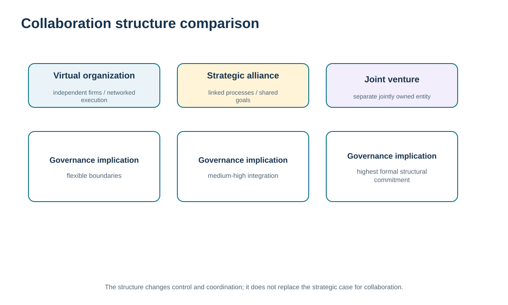
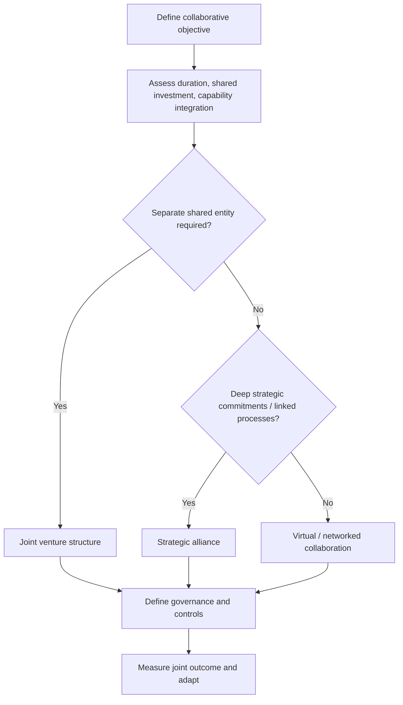

# 15. Collaboration Structures: Virtual Organizations, Joint Ventures, and Partner Models

## Learning objectives

After this topic, you should be able to:

- distinguish virtual organizations, strategic-alliance partner structures, and joint ventures by governance and structural commitment
- explain how distributed capabilities can operate as one customer-facing network without becoming one legal entity
- identify control, incentive, authority, and coordination requirements created by looser or tighter collaboration structures
- avoid duplicating make/buy economics or supplier relationship-model selection

## Concept in plain English

Collaboration can be organized through different structures. A **strategic alliance** connects independent organizations through shared objectives, information, investment, and linked processes without necessarily creating a separate owned entity. A **joint venture** creates a distinct entity owned by two or more parties to pursue a specific objective, which usually increases structural commitment and formal governance.

A **virtual organization** is looser. Independent organizations combine capabilities and may present themselves to customers as an integrated solution even though the underlying capabilities remain distributed. Teams and individuals can cooperate across organizational boundaries based on shared purpose, agreed processes, and technology-enabled coordination.

Structure changes the governance problem. A virtual organization needs clear informal and formal controls so local teams do not optimize only their own company. An alliance needs shared decision forums and reciprocal commitments. A joint venture adds ownership, entity governance, and clearer separation of what belongs inside the shared organization versus the parents.

No structure is universally superior. The organization should choose the lightest structure that can support the required value, risk sharing, capability integration, duration, and control. Module 3 owns make/buy and category relationship-model economics; this lesson focuses on how the chosen collaboration structure changes inter-organizational coordination.

## Why it matters

Organizations can over-structure collaboration by creating entities and heavy governance where a contractual alliance would be sufficient. They can also under-structure complex cooperation, expecting informal goodwill to coordinate multiple companies and decision makers.

Understanding the structural differences helps leaders match authority, incentives, information, and accountability to the level of interdependence.

## Decision model and workflow

The comparison visual positions virtual organizations, alliances, and joint ventures by structural/legal commitment, integration, and governance intensity.

### Evidence retained through the workflow

| Evidence | Why retain it |
| --- | --- |
| Shared objective and duration | Shows whether the collaboration is temporary, evolving, or intended to be deeply institutionalized. |
| Resource and capability contribution | Defines what each party is expected to bring to the collaboration. |
| Ownership and risk-sharing need | Indicates whether a separate joint entity may be justified. |
| Authority and coordination requirements | Shows how the chosen structure must govern cross-company decisions. |

## Practical process flow

## Realistic example — ClearSpan Automation Systems

ClearSpan could collaborate with a software provider to deliver a connected-service solution. If the parties only combine complementary capabilities around specific customer opportunities, a virtual/networked model may be sufficient. If they commit roadmaps, investment, and linked processes for several years, a strategic alliance may fit better. If they need a separately owned business to develop and commercialize a new platform, a joint venture becomes a different structural option.

The decision is not made by prestige. Each structure creates different control, funding, authority, and exit requirements.

## Applied decision artifact or worked calculation

Create a **collaboration-structure decision matrix**:

| Question | Virtual organization | Strategic alliance | Joint venture |
|---|---|---|---|
| Separate legal/shared entity | typically no | typically no | yes |
| Shared process/information | selective | substantial | substantial within JV scope |
| Shared investment | limited/selective | often meaningful | formal ownership contribution |
| Governance intensity | network coordination | alliance governance | entity + parent governance |
| Best fit | flexible capability combination | long-term strategic collaboration | objective requiring shared owned entity |

This is a conceptual decision artifact. Detailed legal, tax, accounting, and jurisdictional analysis is outside the Module 6 learning scope and would require appropriate professional expertise in practice.

## Decision logic

- Start with the collaboration objective rather than a preferred legal form.
- Use the lightest structure that can support the required integration, risk sharing, and duration.
- Define authority and incentives so distributed teams do not optimize only their local organization.
- Increase governance as shared ownership, investment, and interdependence increase.
- Plan how the collaboration can change or end as the objective evolves.

## Trade-offs

| Tension | Decision implication |
| --- | --- |
| Flexibility vs. control | Virtual/network structures adapt quickly; tighter structures provide stronger authority and commitment. |
| Independence vs. shared investment | Independent parties retain autonomy; a joint venture can pool resources while creating additional governance. |
| Speed to collaborate vs. structural durability | Light structures can start quickly; deeper structures may better support long-term investment. |

## Commonly confused with

A **joint venture** is not simply a very strong supplier relationship; it creates a separate entity with shared ownership. A **virtual organization** is not a cloud technology. It is an organizational arrangement in which independent parties coordinate capabilities as a network.

## Common mistakes

- Choosing a joint venture because it sounds more strategic.
- Using a virtual structure without defining authority, incentives, and accountability.
- Assuming an alliance requires a separate legal entity.
- Ignoring exit and change implications when parties share investment.
- Turning a relationship-structure lesson into a full legal or make/buy analysis.

## Original knowledge check

**Question.** Two independent companies want to combine capabilities for a long-term strategic initiative but do not need to create a separate owned entity. Which structure is most consistent with that intent?

A. Strategic alliance

B. Joint venture

C. Sole sourcing

D. Customer segmentation

Answer and rationale

### Correct answer

**A. Strategic alliance**

### Why it is correct

A strategic alliance can support long-term shared objectives, investment, and linked processes while the parties remain separate organizations.

### Why the other answers are wrong

- **B.** A joint venture creates a separate entity with shared ownership.

- **C.** Sole sourcing describes a supply-market condition, not a collaboration structure.

- **D.** Customer segmentation is unrelated to organizational structure.

## Practitioner perspective

Digital collaboration tools can make a loose network feel like one organization, but legal and decision boundaries still exist. Access provisioning, workflow approval, master-data ownership, and audit trails should respect the actual structure rather than assuming that shared technology creates shared authority.

## Related concepts

- [Strategic Alliance Design, Commitment, and Failure Modes](./09-strategic-alliance-design-commitment-and-failure-modes.md)
- [Collaboration Requirements, Management Tasks, and Barriers](./16-collaboration-requirements-management-tasks-and-barriers.md)
- [Module 3 — Make, Buy, and Core Capability](../../03-sourcing-strategy-product-design-supplier-execution/section-a-sourcing-alignment-and-total-cost/02-make-buy-and-core-capability.md)

---

[Previous: CRM-SRM Integration and End-to-End Relationship Management](./14-crm-srm-integration-and-end-to-end-relationship-management.md) · [Section overview](./README.md) · [Next: Collaboration Requirements, Management Tasks, and Barriers](./16-collaboration-requirements-management-tasks-and-barriers.md)
