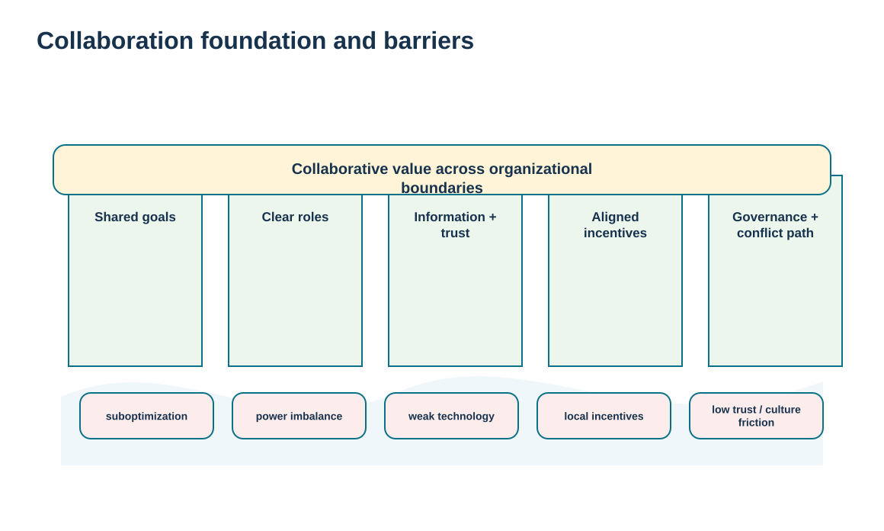
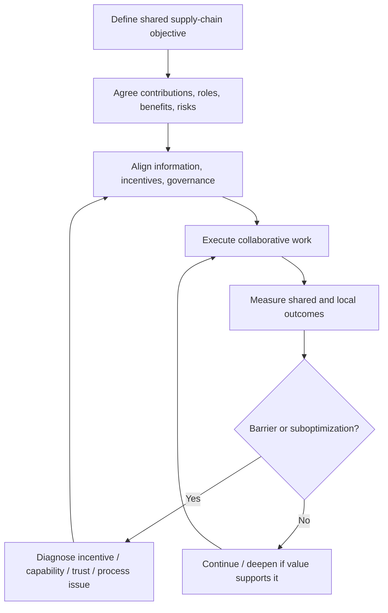

# 16. Collaboration Requirements, Management Tasks, and Barriers

## Learning objectives

After this topic, you should be able to:

- build collaborative relationships around shared goals, roles, resources, risks, rewards, values, and vision
- identify management tasks that support external supply-chain collaboration
- diagnose barriers such as suboptimization, misaligned incentives, weak technology, power imbalance, slow partners, and lack of trust
- calibrate collaboration depth to relationship need rather than treating collaboration as an unlimited good

## Concept in plain English

Collaboration means organizations work together on decisions that create more value than independent local action. The foundation usually includes a shared objective, clear roles, compatible incentives, useful information exchange, agreed resources, mutual benefits, and governance for resolving conflict. Collaboration is not the same as being agreeable; it requires the parties to make interdependent decisions and sometimes change local behavior for the good of the broader supply chain.

Management has several tasks. Leaders need to demonstrate commitment, define goals and contributions, align incentives, establish roles, agree how conflicts will be resolved, and remain involved when difficult trade-offs arise. The relationship should also define which information is shared and which remains protected.

Predictable barriers can undermine the arrangement. **Suboptimization** occurs when a function or company improves its own measure at the expense of the end-to-end result. Incentives can reward volume or local cost while harming inventory and service. Weak technology or data can slow information exchange. Power imbalance can make “collaboration” feel coercive. A partner that is unwilling or unable to invest may become the bottleneck for the whole network.

Collaboration depth should therefore fit the problem. Routine transactions do not require intensive joint governance. Strategic product development, capacity planning, continuity, or customer solutions may. The best design creates enough integration to capture the value without creating unnecessary dependence or administrative burden.

## Why it matters

Supply-chain problems often cross company boundaries. No single party can optimize demand variability, design changes, capacity, logistics, or service when information and decisions are fragmented.

At the same time, collaboration can fail when participants are rewarded for local results. A governance design that ignores incentives and power will not be fixed by additional meetings.

## Decision model and workflow

The bridge visual shows shared goals, roles, information, incentives, and governance as structural supports. Barriers weaken the span and must be actively managed.

### Evidence retained through the workflow

| Evidence | Why retain it |
| --- | --- |
| Shared goal and contribution statement | Clarifies what value the collaboration exists to create and what each party contributes. |
| Roles, decision rights, and conflict process | Prevents ambiguity when interdependent work creates disagreement. |
| Incentive and measure alignment | Shows whether local success supports or undermines the shared objective. |
| Barrier / action register | Makes trust, technology, resource, power, or capability obstacles visible and owned. |

## Practical process flow

## Realistic example — ClearSpan Automation Systems

ClearSpan and Apex Motion Components want to improve regional capacity responsiveness. If ClearSpan rewards its planners only for minimizing inventory while Apex is rewarded only for long production runs, the collaboration will repeatedly conflict. A shared capacity objective will not survive incompatible local incentives.

The parties define common service and capacity measures, clarify forecast responsibilities, and create an escalation process for demand changes. They also retain local financial measures, but the shared governance makes trade-offs visible instead of allowing each side to blame the other.

## Applied decision artifact or worked calculation

Use an **external collaboration charter** with the following fields: shared objective, parties, contributions, resources, risks, rewards/benefits, values/behavior expectations, information shared, decision rights, escalation, measures, known barriers, actions, and review date.

[`relationship-communications.csv`](../../assets/data/module-6/relationship-communications.csv) provides examples of governed cross-party programs. The fictional **Apex alliance steering** record defines the alliance steering team, joint value/capacity purpose, responsible and accountable owners, consulted roles, monthly cadence, confidentiality, and action closure of **80%**. That communication record is one operating component of collaboration—not proof that collaboration is healthy by itself.

## Decision logic

- Define the shared value before designing collaboration activities.
- Align local incentives and measures with the cross-company objective where practical.
- Make roles, contributions, and conflict resolution explicit.
- Use enough information sharing to support the decision without removing necessary boundaries.
- Treat persistent barriers as governance problems requiring action, not personality defects.

## Trade-offs

| Tension | Decision implication |
| --- | --- |
| Shared optimization vs. local accountability | Cross-chain value may require local compromise, but each organization still needs clear internal accountability. |
| Trust vs. verification | Trust supports speed while evidence and controls preserve fairness when interests diverge. |
| Deep collaboration vs. partner capability | An ambitious model cannot exceed the weaker partner’s ability or willingness to participate without development or redesign. |

## Commonly confused with

**Collaboration** is a way of working across organizational boundaries. It can exist within an alliance, a customer relationship, a supplier relationship, or a virtual organization. The structure defines the context; collaboration defines the joint behavior and decision process.

## Common mistakes

- Equating collaboration with frequent meetings.
- Keeping incentives that reward local behavior against the shared objective.
- Assuming trust means roles and controls are unnecessary.
- Ignoring power imbalance and calling one-sided demands “collaboration.”
- Trying to force deep collaboration with a partner that lacks the required capability without a development plan.

## Original knowledge check

**Question.** A buyer and supplier agree to reduce total supply-chain inventory, but the buyer rewards planners for local inventory reduction while the supplier rewards long production runs. What is the main collaboration problem?

A. Too much customer segmentation

B. Misaligned local incentives are undermining the shared objective

C. The parties need a joint venture

D. The supplier needs more invoices

Answer and rationale

### Correct answer

**B. Misaligned local incentives are undermining the shared objective**

### Why it is correct

Collaboration fails when people are rewarded for local outcomes that conflict with the cross-company goal.

### Why the other answers are wrong

- **A.** Customer segmentation does not address the incentive conflict.

- **C.** A different legal structure does not automatically fix misaligned incentives.

- **D.** Transaction volume is unrelated to the behavioral conflict.

## Practitioner perspective

When collaboration spans planning systems, define what is a shared signal and what remains a local decision. A common forecast does not necessarily mean both parties surrender planning authority. Clear ownership of forecast inputs, commitments, exceptions, and final decisions prevents the technology from implying more authority than the relationship actually grants.

## Related concepts

- [Supplier Co-Location, Integration, and Collaboration Depth](./03-supplier-co-location-integration-and-collaboration-depth.md)
- [Collaboration Structures](./15-collaboration-structures-virtual-organizations-joint-ventures-and-partner-models.md)
- [Communication Purpose, Audience, Channel, Feedback, and Management Plans](./17-communication-purpose-audience-channel-feedback-and-management-plans.md)

---

[Previous: Collaboration Structures: Virtual Organizations, Joint Ventures, and Partner Models](./15-collaboration-structures-virtual-organizations-joint-ventures-and-partner-models.md) · [Section overview](./README.md) · [Next: Communication Purpose, Audience, Channel, Feedback, and Management Plans](./17-communication-purpose-audience-channel-feedback-and-management-plans.md)
