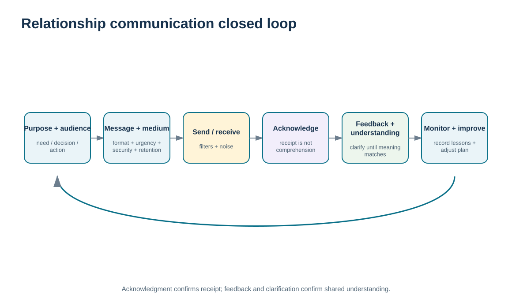
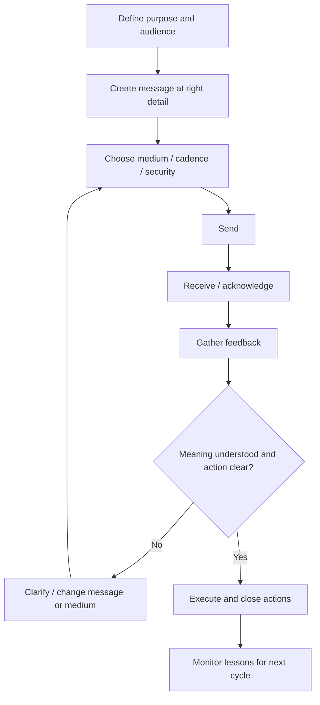

# 17. Communication Purpose, Audience, Channel, Feedback, and Management Plans

## Learning objectives

After this topic, you should be able to:

- design a supply-chain relationship communication plan around purpose, audience, message, medium, cadence, and ownership
- distinguish acknowledgment from feedback and use feedback to confirm understanding
- use RACI, confidentiality, retention, and channel choice to control complex stakeholder communication
- avoid introducing an unsupported communication-channel-count formula when the decision can be governed directly through audience, medium, ownership, feedback, and escalation

## Concept in plain English

Effective relationship communication starts with purpose. Before choosing email, a meeting, a portal, or another medium, the sender should know what the audience needs to understand or do. The message should contain enough information for that purpose without burying the decision in unnecessary detail.

Communication is a process: a sender encodes a message, sends it through a medium, and a receiver interprets it through experience, context, language, emotion, and culture. Noise or other filters can distort the result. **Acknowledgment** confirms that a message was received; **feedback** provides evidence of what the receiver understood or how they reacted. That distinction matters. A supplier clicking “received” on a portal notification does not prove agreement or comprehension.

A communication management plan makes the recurring expectations explicit. It can define target audiences, information needs, preferred media, formality, format, cadence, responsibilities, security/confidentiality, retention, and escalation. RACI is useful for deciding who is responsible, who is accountable, who must be consulted, and who only needs to be informed.

More stakeholders create more potential interactions and therefore more complexity, but this module does not introduce a numerical channel-count formula. The practical control is to reduce unnecessary formal paths, identify authorized representatives, and make sure feedback reaches the accountable owner.

## Why it matters

Supply-chain relationships cross functions, companies, time zones, languages, and levels of authority. A technically correct message can still fail if it reaches the wrong people, uses the wrong level of detail, arrives too late, or never checks understanding.

A plan also prevents communication from becoming personality dependent. When an issue is critical, teams should not have to guess which channel, owner, or audience is appropriate.

## Decision model and workflow

The communication-loop visual shows purpose and audience first, then message and medium, followed by acknowledgment, feedback, clarification, and monitoring. The loop closes only when understanding and action are confirmed.

### Evidence retained through the workflow

| Evidence | Why retain it |
| --- | --- |
| Purpose and target audience | Defines why the communication exists and who needs it. |
| Responsible/accountable roles and RACI context | Prevents messages from being sent without decision ownership. |
| Medium, cadence, security, and retention rule | Matches delivery method to urgency, sensitivity, and record requirements. |
| Acknowledgment, feedback, actions, and closure | Shows whether the communication was received, understood, and acted upon. |

## Practical process flow

## Realistic example — ClearSpan Automation Systems

ClearSpan's BlueMesa remediation involves quality, engineering, planning, supplier leadership, and executives. A casual email thread would be difficult to control. The communication plan defines a formal weekly review, a responsible Supplier Quality Manager, an accountable VP Supply Chain, consulted Engineering and Planning, and executive visibility. Confidentiality and retention are also specified.

The plan records that all eight planned messages were sent and acknowledged, but feedback was received for seven of eight expected responses and only seven of twelve due actions were closed. The communication mechanism is functioning; the remediation outcome is still incomplete.

## Applied decision artifact or worked calculation

Use [`relationship-communications.csv`](../../assets/data/module-6/relationship-communications.csv). The [formula/control sheet](../../calculations/relationship-performance/formula-sheet.md) defines repository training controls for message delivery, acknowledgment, feedback, and action closure.

For **BlueMesa remediation (COM-06)**:

- message delivery: **100%**;
- acknowledgment: **100%**;
- feedback rate: **87.5%**;
- action closure: **58.33%**.

This demonstrates why delivery and acknowledgment are not enough. A communication plan can be executed faithfully while the underlying business actions remain weak. The decision artifact should show purpose, audience, owner, RACI, medium, cadence, retention/confidentiality, feedback expectation, open actions, and closure status.

## Decision logic

- Start with purpose and audience before selecting the communication medium.
- Match detail, formality, speed, and security to the relationship situation.
- Distinguish acknowledgment from evidence of understanding.
- Use feedback and clarifying cycles for important decisions.
- Close the communication loop by tracking actions and lessons, not merely message delivery.

## Trade-offs

| Tension | Decision implication |
| --- | --- |
| Rich medium vs. efficiency | Meetings and video convey nuance; written/portal communication scales and provides a durable record. |
| Broad transparency vs. need-to-know | More recipients can improve awareness while increasing noise and confidentiality exposure. |
| Speed vs. formality/retention | Urgent communication may favor fast channels, while sensitive decisions may also require formal retained records. |

## Commonly confused with

**Acknowledgment** means the message was received. **Feedback** indicates the receiver's understanding or reaction. A read receipt or system acknowledgment is therefore not proof that the relationship partner understood or accepted the message.

## Common mistakes

- Choosing a channel because it is convenient for the sender rather than fit for the audience and purpose.
- Sending more information when the real problem is unclear accountability.
- Treating message delivery as proof of understanding.
- Ignoring confidentiality and retention requirements for partner communications.
- Leaving feedback and actions outside the communication plan.

## Original knowledge check

**Question.** A supplier portal shows that a critical remediation notice was received, but the supplier later says it interpreted the required action differently. What failed?

A. Acknowledgment

B. Feedback/understanding verification

C. The existence of the portal

D. The number of suppliers

Answer and rationale

### Correct answer

**B. Feedback/understanding verification**

### Why it is correct

Receipt was acknowledged, but the communication loop did not verify that the supplier understood the intended meaning and action.

### Why the other answers are wrong

- **A.** Acknowledgment succeeded; it only proved receipt.

- **C.** The portal can be an appropriate medium if the feedback control is designed correctly.

- **D.** Supplier count is unrelated to the misunderstanding.

## Practitioner perspective

For critical supply-chain workflows, distinguish system status from communication status. “Sent,” “delivered,” “read,” “accepted,” and “action completed” are different events. Model them separately so dashboards do not imply closure when only transmission has occurred.

## Related concepts

- [CRM Strategy, Process Design, and Organizational Ownership](../section-a-customer-relationships/10-crm-strategy-process-design-and-organizational-ownership.md)
- [Alliance Implementation, Governance, and Continuous Review](./10-alliance-implementation-governance-and-continuous-review.md)
- [Cross-Cultural Relationship Management and Communication](./18-cross-cultural-relationship-management-and-communication.md)

---

[Previous: Collaboration Requirements, Management Tasks, and Barriers](./16-collaboration-requirements-management-tasks-and-barriers.md) · [Section overview](./README.md) · [Next: Cross-Cultural Relationship Management and Communication](./18-cross-cultural-relationship-management-and-communication.md)
