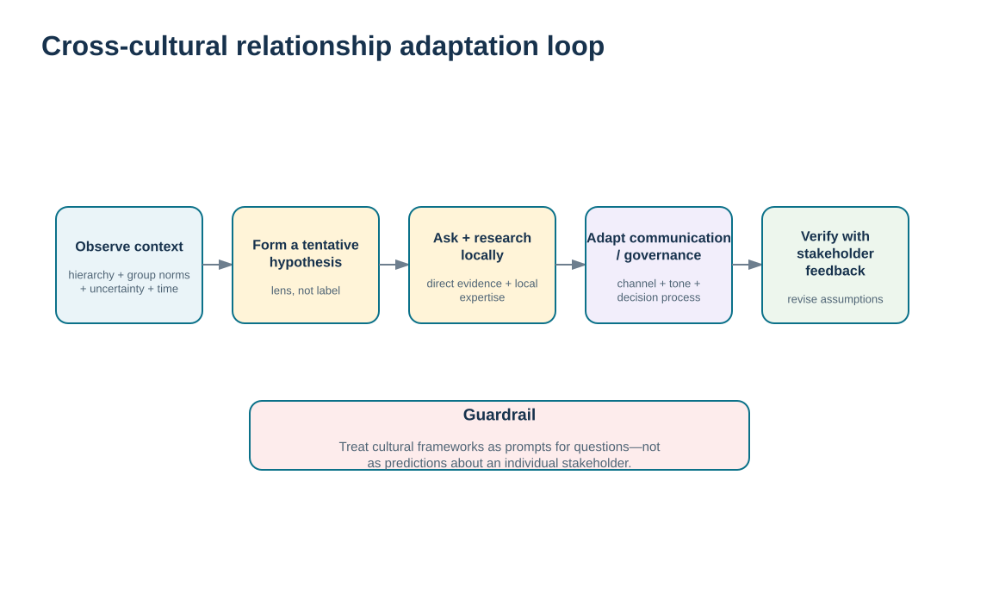
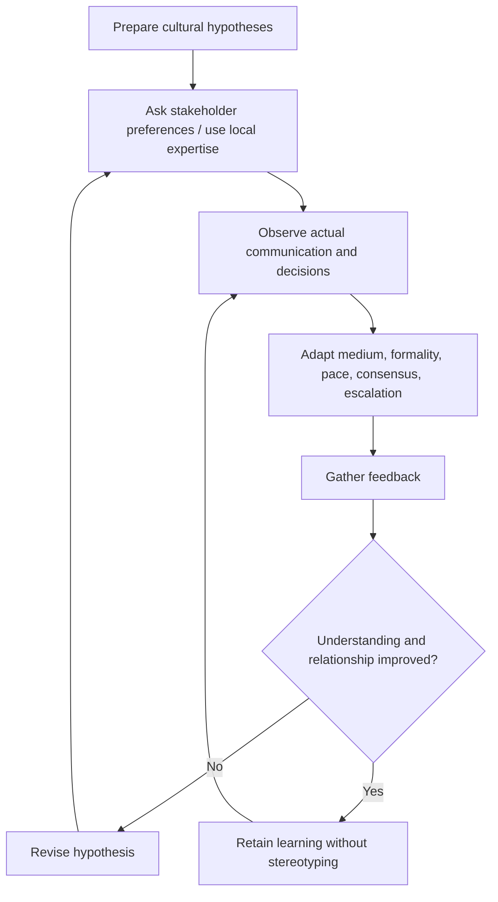

# 18. Cross-Cultural Relationship Management and Communication

## Learning objectives

After this topic, you should be able to:

- use cultural frameworks as hypotheses for relationship and communication design rather than as predictions about individuals
- recognize how expectations around hierarchy, individual/group orientation, uncertainty, consensus, time, and communication style can affect supply-chain relationships
- adapt through research, inquiry, local expertise, and direct stakeholder feedback
- avoid deterministic national stereotypes while still preparing for cultural differences in global collaboration

## Concept in plain English

Culture influences how people interpret authority, disagreement, uncertainty, relationships, time, formality, and communication. In global supply chains, those differences can affect negotiation, meetings, escalation, decision speed, feedback, conflict resolution, and the meaning of silence or directness.

Frameworks such as cultural dimensions can help teams generate questions. A context that tends to expect greater hierarchy may require more deliberate attention to who has authority to speak or decide. A more group-oriented context may emphasize relationship building and consensus. Different tolerance for uncertainty can affect how much detail, structure, or evidence stakeholders expect before committing. These are useful **lenses**, not rules about individuals.

The danger is stereotyping. Country averages cannot predict how a specific supplier manager, customer, engineer, or executive will behave. Organizations contain subcultures, professions differ, global teams mix experiences, and individuals vary widely. The correct use of a framework is to prepare for possible differences, ask respectful questions, observe actual behavior, and adapt based on direct evidence.

Cross-cultural effectiveness therefore becomes part of relationship management. The communication plan can specify language, translation needs, decision process, meeting structure, local holidays/time zones, degree of formality, feedback method, and escalation expectations. The team then learns from the relationship rather than relying on a static cultural profile.

## Why it matters

Misunderstandings in global relationships are often attributed to competence or bad intent when the deeper issue is different expectations about how decisions and disagreement should be expressed. That misdiagnosis can damage trust.

At the same time, overusing cultural stereotypes can be equally harmful. Treating a person as an average national profile prevents genuine listening and can become discriminatory. The discipline is informed curiosity plus direct evidence.

## Decision model and workflow

The adaptation-loop visual starts with a cultural hypothesis, then requires inquiry, observation, adaptation, feedback, and learning. It prevents the model from becoming a deterministic label.

### Evidence retained through the workflow

| Evidence | Why retain it |
| --- | --- |
| Stakeholder preferences and observed behavior | Provides direct evidence about the people in the actual relationship. |
| Local expert and language/context input | Adds interpretation that a generic cultural model may miss. |
| Decision and communication requirements | Shows which cultural differences could materially affect the business process. |
| Feedback after adaptation | Tests whether the modified approach improved understanding and relationship outcomes. |

## Practical process flow

## Realistic example — ClearSpan Automation Systems

ClearSpan launches a cross-cultural program involving teams in the United States, Japan, and Mexico. Instead of distributing a country stereotype sheet, the program manager asks country leads and team members how decisions will be made, who needs to be consulted, how disagreement should be surfaced, and which communications need written follow-up.

The resulting plan uses a weekly video meeting plus a written recap, defines roles and escalation, and explicitly checks understanding. The fictional communication record shows 100% message delivery, acknowledgment, feedback, and action closure for this program—but the team still treats those measures as process evidence, not proof that cultural learning is complete.

## Applied decision artifact or worked calculation

[`relationship-communications.csv`](../../assets/data/module-6/relationship-communications.csv) includes **COM-09 Cross-cultural launch**. It records a mixed US/Japan/Mexico project team, a purpose focused on roles, decision process, and escalation, weekly video plus written recap, confidential retention, and complete delivery/feedback/action evidence in the fictional period.

Create a **cross-cultural relationship preparation card** with:

- stakeholders and local/context expertise;
- possible differences that could affect the decision process;
- questions to validate preferences;
- language/time-zone/formality needs;
- meeting and written-record approach;
- escalation and conflict-resolution expectations;
- observed evidence;
- adaptation made;
- feedback/result.

The card must avoid statements such as “people from country X always behave Y.” Use conditional language and update the card from actual stakeholder evidence.

## Decision logic

- Use cultural frameworks to generate questions, not to predict individuals.
- Validate communication and decision preferences directly with stakeholders.
- Adapt medium, formality, pace, consensus, and escalation where the relationship evidence supports it.
- Use local expertise and translation/context support when stakes are high.
- Record learning from the actual relationship and revise assumptions over time.

## Trade-offs

| Tension | Decision implication |
| --- | --- |
| Preparation vs. stereotyping | Cultural awareness can prevent mistakes; rigid assumptions can create new ones. |
| Global standardization vs. local adaptation | Common governance supports consistency while some communication practices should fit local relationship needs. |
| Directness vs. relationship sensitivity | Fast explicit communication can improve clarity and can damage trust when the context requires a different approach. |

## Commonly confused with

A **cultural dimension** is a comparative framework describing patterns at a broad level. It is not an individual personality profile, a rule for national behavior, or a substitute for stakeholder research. Use it as a hypothesis that must be tested in the actual relationship.

## Common mistakes

- Memorizing country stereotypes and applying them to individuals.
- Assuming shared language means shared communication norms.
- Ignoring hierarchy or consensus expectations when designing decision forums.
- Using cultural difference to excuse unclear roles or poor process design.
- Failing to ask stakeholders whether the adapted communication actually improved understanding.

## Original knowledge check

**Question.** What is the most responsible way to use a cultural-dimensions framework in a supplier relationship?

A. Predict each individual’s behavior from national averages

B. Require every location to use one communication style regardless of context

C. Avoid discussing culture entirely

D. Use the framework to identify possible differences, then validate preferences with actual stakeholders and local expertise

Answer and rationale

### Correct answer

**D. Use the framework to identify possible differences, then validate preferences with actual stakeholders and local expertise**

### Why it is correct

Cultural frameworks are most useful as starting hypotheses that prompt inquiry and adaptation, not as deterministic labels.

### Why the other answers are wrong

- **A.** National averages do not predict individual behavior and can create harmful stereotypes.

- **C.** Ignoring culture can leave important communication assumptions unexamined.

- **B.** Uniformity can create misunderstandings when local relationship expectations differ materially.

## Practitioner perspective

Global process templates should define the non-negotiable control—decision ownership, required evidence, audit trail, security—while allowing locally appropriate communication practices where they do not weaken the control. Standardize the business outcome and governance; adapt the human interaction thoughtfully.

## Related concepts

- [Communication Purpose, Audience, Channel, Feedback, and Management Plans](./17-communication-purpose-audience-channel-feedback-and-management-plans.md)
- [Collaboration Requirements, Management Tasks, and Barriers](./16-collaboration-requirements-management-tasks-and-barriers.md)
- [Alliance Implementation, Governance, and Continuous Review](./10-alliance-implementation-governance-and-continuous-review.md)

---

[Previous: Communication Purpose, Audience, Channel, Feedback, and Management Plans](./17-communication-purpose-audience-channel-feedback-and-management-plans.md) · [Section overview](./README.md) · [Next: Section B Review](./19-section-b-review.md)