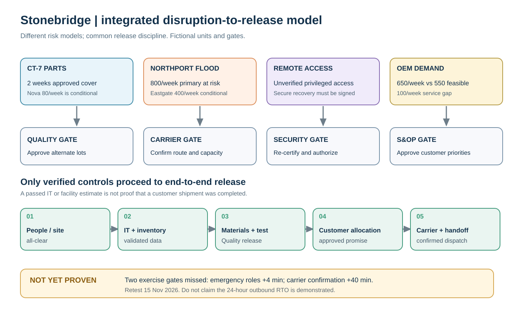
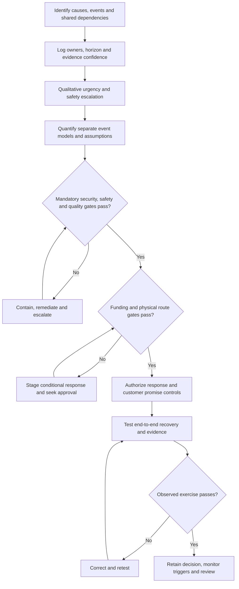

# Stonebridge Resilience Decision — Integrated Module 7 Capstone

> **Fictional training scenario; not an ASCM certification exercise.** All companies, disruption likelihoods, losses, costs, capacities, policy thresholds, and exercise findings were created for this repository. The scenario is anchored to the existing Module 7 Section A and B datasets, not to proprietary CSCP practice questions or real-world incident rates.

## Executive brief

It is **19 October 2026**. You are Stonebridge Industrial Components' supply-chain risk lead. Stonebridge assembles industrial controllers, sources critical CT-7 components, depends on a constrained Northport outbound hub, and uses supplier-connected digital production/order services. A supplier component interruption, flood warning, sudden OEM demand, and access-control weakness have become simultaneous management concerns. They are **potentially correlated**, but the source files do not provide a joint probability model.

The executive risk committee needs one defensible **12-month risk decision and 90-day activation plan**. Its decision is not simply “choose the cheapest insurance” or “switch on every backup.” It needs to know which risks threaten safety or committed service, what evidence remains unverified, how much expected exposure the modeled responses reduce, which physical capacity is really available, and whether a full customer order can be safely shipped after a disruption.

The scenario uses existing Stonebridge case data. **Do not merge different product-family volumes or incident probability models into one total without evidence.** CT-7 stock/consumption (120 units/week), the illustrative OEM surge (650 units/week), and the outbound hub (800 units/week) are distinct planning pools unless explicitly joined by a verified item-and-route allocation.

## Learning outcomes

On completion, the learner can:

1. Translate weak signals into an **owned causal risk register** with scope, review date, trigger, consequence, and evidence confidence (Section A).
2. Prioritize risks by **hard gates and urgency**, not just the product of two ordinal heat-map scores (A and B02–B03).
3. Calculate **signed operating-result EMV, expected annual loss, preventive cost plus residual-risk cost, and sensitivity** using one stated horizon (B04–B08).
4. Distinguish **supplier, network, demand, cyber, safety, and financial** risks, avoiding double counting and conditional-capacity claims (B09–B18).
5. Set an auditable **business continuity and funding decision** with RTO dependencies, observed test failures, partners, owners, escalation dates, and retests (B19).

## Source data — use the existing locked fictional values

The following links go **directly to the CSV**, not merely to a generic folder:

| Decision workstream | Required source files | Evidence role |
| --- | --- | --- |
| Governance, appetite, funding | [Risk policy](../../assets/data/module-7/risk-appetite-policy.csv), [funding plan](../../assets/data/module-7/risk-funding-plan.csv), [GRC control map](../../assets/data/module-7/grc-control-map.csv) | Mandatory limits, provisional authority, unfinished control evidence |
| Register, causes, urgency | [Risk categories](../../assets/data/module-7/risk-category-cases.csv), [qualitative ratings](../../assets/data/module-7/qualitative-risk-ratings.csv), [evidence quality](../../assets/data/module-7/risk-evidence-quality.csv), [register sample](../../assets/data/module-7/risk-register-sample.csv) | Events and owners, ordinal scores, confidence, formal record structure |
| Quantitative loss and responses | [Exclusive lane outcomes](../../assets/data/module-7/emv-outcome-scenarios.csv), [remote-access response options](../../assets/data/module-7/emv-response-options.csv), [sensitivity cases](../../assets/data/module-7/risk-sensitivity-cases.csv), [simulation specification](../../assets/data/module-7/risk-simulation-spec.csv) | Two **separate** modeling families, annual payments, residual risk, simulation assumptions |
| Supplier and network constraints | [Supplier continuity](../../assets/data/module-7/supply-continuity.csv), [network exposure](../../assets/data/module-7/network-exposure.csv), [route contingency](../../assets/data/module-7/environmental-route-continuity.csv) | Qualified stock, conditional substitute supply, physical node/route bottlenecks |
| Demand and incident-response constraints | [Demand cases](../../assets/data/module-7/demand-risk-scenarios.csv), [people/safety gates](../../assets/data/module-7/people-security-gates.csv), [response plan](../../assets/data/module-7/risk-response-plan.csv) | Separate demand pool; response permission, action trigger and owner |
| Continuity evidence | [BCMS dependencies](../../assets/data/module-7/business-continuity-dependencies.csv), [exercise results](../../assets/data/module-7/crisis-exercise-actions.csv), [partner ownership](../../assets/data/module-7/risk-owner-coordination.csv) | Targets versus estimated durations and observed drills |
| Other potential stress | [Financial stresses](../../assets/data/module-7/financial-risk-controls.csv), [IP/reputation controls](../../assets/data/module-7/ip-and-reputation-register.csv) | Stress amounts and legal/communications release conditions, **not** observed event frequencies |

Use the [Risk Response Calculation and Decision-Control Reference](../../calculations/risk-response/formula-sheet.md) and the original [Section A](../section-a-risk-management-and-supply-chain-risks/README.md) and [Section B](../section-b-risk-analysis-and-response/README.md) lessons for method boundaries. The verified replay program is [`capstone_replay.py`](../../calculations/risk-response/capstone_replay.py).

## Decision boundaries and assumptions

- **Period:** annual event-probability and annual control expenses refer to one forward-looking 12-month period; operational capacity is in **units per week**; recovery targets are in **hours**; the 30/60/90-day plan starts from 19 October 2026. All USD figures are illustrative.
- The **lane outcome model** and **remote-access control alternatives** are separate event models. Their losses are **not** an independently validated combined portfolio loss distribution. Under correlated incidents, addition without overlap evidence can double count impacts.
- Treat [`risk-appetite-policy.csv`](../../assets/data/module-7/risk-appetite-policy.csv)'s fictional **$25,000 incremental approved spend threshold** as a **combined annual authorization cap for this capstone's newly proposed preventive control portfolio**. This interpretation is an explicit training rule, not an actual corporate policy or general supply-chain standard. The separate **$40,000 unspecified-disruption reserve** needs incident authorization and is **not** general preventive funding.
- The `[security_gate_pass]` and `[insurance_coverage_gate_pass]` fields in the response-options file are **mandatory feasibility gates**; independently require a modeled **post-control probability at or below 10%** for the remote-access scenario. Changes to a probability estimate require evidence.
- **Safety stop-work, cybersecurity access, supplier quality release, carrier confirmation, and contract/legal clearance cannot be waived by favorable expected value.** Procurement and quality must approve a qualified alternate before counting its output.
- The 240 CT-7 units are approved usable inventory at the beginning of the interruption. Illustrative **four-week** supplier stress assumes no deliveries from the disrupted primary supplier and weekly demand of 120. The conditional Nova supply of 80/week can begin **only after quality approval on day 14**; absent approval it contributes zero.
- A flood scenario removes all 800 units/week of primary outbound capacity for the examined week. Eastgate has a **site capability** of 450 units/week in one data file but only **400 units/week of candidate carrier-supported lane capacity** in the route file. Count **the lower confirmed lane capacity, 400**, only after carrier and route gates pass. The weather-correlated 100-unit air alternative remains zero until separately cleared.
- The 650-unit OEM demand spike is a distinct illustration. Its output commitment must not borrow CT-7 or Northport capacities without a validated part/lane mapping.
- Nominal recovery estimates in the BCMS file are planning values, **not** successfully observed end-to-end recovery evidence. Never assume parallel tasks when approval predecessors are sequential.

## Integrated executive decision workflow

This is the ordered release-gate sequence, not a replacement for the underlying risk-response diagrams. Conditional capacity must not enter the approved state before supplier-quality and carrier evidence passes.

## The assignment — executive decision pack

### Task 1 — Build and govern the risk register

Create a *five-row minimum* priority register covering supplier availability (R7-11), plant/process interruption (R7-12), shared-route flood (R7-13), OEM surge (R7-14), and supplier-connected access or identity interruption (PF-02/GRC SB-G03). For each, identify **cause → event → operational consequence**, owner, evidence confidence, early signal, time horizon, and release/escalation gate. Show how shared freight or order visibility can propagate a disruption. Do not invent a probability for an event that has only a qualitative rating.

### Task 2 — Prioritize risk without bypassing gates

Recalculate the four qualitative scores from the source ratings. Rank immediate action by **urgency and mandatory safety, customer, or carrier gates**, then explain why the numerically highest heat-map product does not necessarily receive the first response. Assess the customer-delay policy row (SB-P02), the work-permit risk (SB-P01), and the privileged-access recheck (SB-G03). Label unresolved facts explicitly.

### Task 3 — Verify two separate quantitative decisions

**3A: Lane disruption loss.** Verify the three outcome probabilities total 1.00, compute expected *annual loss* and signed annual operating-result EMV, and state the severe **conditional** loss separately. Optional advanced check: reproduce the seeded simulation and explain what it can and cannot establish.

**3B: Supplier-connected access-control response.** For `BASE`, `PATCH`, `FAILOVER`, and `INSURE`, compute `certain annual cost + p × conditional loss`, list every failed eligibility gate, and choose the **lowest modeled cost among eligible and fundable options**. Do not use the insurance-only nominal result to override its coverage exclusion. Run a 17% post-control probability stress for hardening and show both the mathematical cost-indifference probability and the **earlier binding 10% security threshold**.

### Task 4 — Resolve physical supplier, network and demand constraints

Calculate CT-7 approved weeks of cover and the **weeks 3–4 uncovered units**, both with and without just-in-time Nova qualification. Do not count the 42-day alternate or conditional Nova supply before formal qualification. Reconcile Eastgate's 450 facility capability against its 400 candidate routed capacity; compute the primary-lane flood gap **before** and **after** confirming the 400 backup, with air excluded. Separately calculate the OEM surge shortfall. Record the effect on customer promises and the owner of each hard gate.

### Task 5 — Screen financial exposure, budget and reserves

Reproduce the FX and commodity stress increments. Do not convert these increments to expected annual losses without event probabilities. Prepare a portfolio funding request for: **$11,000 annual monitored hardening**, **$7,500 routing dry run**, and **$18,000 supplier fixture validation**. Compare the proposal with the case's $25,000 combined authorization threshold, distinguish staged spending from requested exceptional approval, and leave the $40,000 incident reserve untouched unless an incident charter is approved. Do not count the $11,000 hardening expense twice in the same economic total.

### Task 6 — Test actual business-continuity readiness

Compare the five recovery targets to their estimated durations, then audit all three drill observations against their targets. Explain why nominal RTO compliance cannot be declared even when estimated durations fit. Apply a **safe end-to-end release chain**: people/site all-clear → secure identity/inventory → approved product quality and supply → truthful customer allocation → confirmed transport and customer shipment. Supply the corrective owner and the already-scheduled **15 November 2026** retest date for the two failed exercise steps.

### Task 7 — Present the approved, conditional and rejected decisions

Deliver one executive table containing **decision, accountable owner, evidence, gate, approval status, risk/customer impact, alternate or rejection rationale, review trigger and date**. Provide a 30/60/90-day action sequence and executive escalation criteria. The plan must explicitly address supplier and carrier partner acknowledgments, security authorization, product-quality release, and customer communication. No risk may be marked “closed” simply because a plan was written.

### Task 8 — Stress-test and defend your assumptions

List at least **five** failure modes or uncertainties that could overturn the proposal: a common-mode terminal outage, supplier-qualification slip, degraded hardening efficacy, unverified carrier capacity, stale ERP/inventory snapshot, correlation among modeled outcomes, etc. For each, specify **the evidence needed**, not an invented confidence score. Conclude with the conditions for approving funding and conducting the next integrated exercise.

## Required executive submission structure

1. **One-page decision summary** with stop/go controls and unresolved risks.
2. **Owned register** with qualitative scores, urgency and evidence confidence.
3. **Reproducible calculation record** with horizon, units, formulas, case data and sensitivity.
4. **Physical supply/route capacity sheet** showing conditional and confirmed values separately.
5. **Funding gate and continuity gate assessment** with retests and accountable owners.
6. **30/60/90-day risk committee decision record** and learning handoff to Modules 1–6.

## Original capstone assessment (answer key in solution guide)

1. After a flood warning, the risk with a heat-map score of 10 has a three-day response window; a plant safety exposure scores 15 with a one-day window. What is the correct first move? **A** Rank by heat-map score only; **B** Act on the safety gate and one-day urgency while staging flood contingency; **C** Convert ordinal scores directly into annual event probabilities; **D** Wait until both have equal scores.

Answer and rationale

**Correct answer: B.** Safety clearance and the one-day deadline outrank a crude ordinal matrix. **A** discards hard gates; **C** misuses a 1–5 score as statistical probability; **D** delays necessary containment.

2. The lane model has 65% no loss, 25% $80,000 loss and 10% $250,000 loss. What is the expected annual **loss magnitude**? **A** $250,000; **B** $33,000; **C** $45,000; **D** $80,000.

Answer and rationale

**Correct answer: C.** The expected annual loss magnitude is $45,000: `0.65×0 + 0.25×80,000 + 0.10×250,000`. **A** confuses the severe conditional loss with annual expected loss; **B** is not the weighted sum; **D** uses only the moderate conditional loss.

3. Which remote-access response is the least modeled annual cost **among options passing the given security and coverage gates** at the base assumptions? **A** Insurance-only; **B** Baseline untreated; **C** Isolated failover; **D** Monitored hardening.

Answer and rationale

**Correct answer: D.** Monitored hardening is the lowest modeled annual-cost option among those passing the stated technical gates: PATCH is $28,600 versus $37,700 for FAILOVER. **A** violates coverage and security gates despite its smaller nominal number; **B** fails security; **C** is technically eligible but modeled as more expensive and needs a funding exception under the case cap.

4. Hardening's probability rises to 17%. Which decision rule binds first? **A** The 10% eligibility gate; **B** The 12.14% economic crossover; **C** Insurance-only eligibility; **D** The 25% moderate-lane-outcome weight.

Answer and rationale

**Correct answer: A.** The 10% eligibility gate binds first because the 17% stress already breaches mandatory policy. **B** is a later mathematical cost crossover; **C** remains disallowed regardless of PATCH efficacy; **D** belongs to a different lane scenario.

5. Stonebridge has 240 approved CT-7 components and demand of 120/week. What is supported immediately? **A** Five weeks because Nova is listed; **B** Two weeks of approved stock; **C** Two weeks plus 42 days of guaranteed supply; **D** Unlimited supply because dual sourcing exists.

Answer and rationale

**Correct answer: B.** Approved coverage is two weeks because `240÷120=2`. **A** counts unapproved Nova output; **C** treats a 42-day qualification path as assured receipts; **D** confuses having alternate suppliers with approved, immediately usable capacity.

6. Northport carries 800 units/week, Eastgate's site capacity is 450, and candidate emergency carrier capacity is 400, subject to confirmation. What may be counted **before** confirmation? **A** 400; **B** 450; **C** 500 including air; **D** Zero backup capacity.

Answer and rationale

**Correct answer: D.** Zero backup capacity may be counted before confirmation. **A** assumes the conditional 400-unit lane is accepted; **B** mistakes 450 units of building throughput for booked transport; **C** also counts an unapproved, weather-correlated air service.

7. The planned 24-hour outbound RTO is 20 hours, but the carrier-confirmation drill fails at 160 versus 120 minutes. Which statement is justified? **A** The plan is proven because 20 is less than 24; **B** The freight partner is automatically disqualified; **C** The release path remains unproven pending remediation and retest; **D** The RTO should be deleted.

Answer and rationale

**Correct answer: C.** The release path remains unproven: a 20-hour estimate does not override the observed 160-minute result against the 120-minute carrier-confirmation target. **A** confuses estimated RTO with observed partner readiness; **B** overgeneralizes one failed test into permanent carrier exclusion; **D** deletes a useful objective rather than closing the gap.

8. The proposed annual program costs $11,000 + $7,500 + $18,000 against a $25,000 joint authorization cap. What needs approval? **A** Nothing because each line is individually below $25,000; **B** A budget exception or reprioritization for the $11,500 aggregate excess; **C** Draw $11,500 automatically from the incident reserve; **D** Multiply all three certain costs by outage probability.

Answer and rationale

**Correct answer: B.** The aggregate excess is $11,500: `11,000+7,500+18,000−25,000 = 11,500`. **A** disregards the combined authorization rule; **C** treats the controlled incident reserve as unrestricted; **D** applies uncertainty to costs paid regardless of the event.

9. The FX stress changes an €800,000 payable from 1.10 to 1.17 USD/EUR. Which claim is supported? **A** A $56,000 conditional stress increment, not an EMV without a probability; **B** A proven $56,000 annual loss; **C** A $560,000 quarterly loss; **D** No effect because the payable amount in EUR is fixed.

Answer and rationale

**Correct answer: A.** The supported result is a $56,000 conditional FX increment: `€800,000×$0.07/€ = $56,000`. **B** adds an unstated event probability or actual loss; **C** is dimensionally and arithmetically wrong; **D** ignores the change in USD translation.

10. Can the $45,000 lane-outcome EMV and $46,800 untreated-access expected loss automatically be reported as one validated portfolio loss? **A** Yes, because both use annual units; **B** Yes, because the events are independent by definition; **C** Yes, after averaging the risk scores; **D** No: confirm scope, overlap and dependency before aggregation.

Answer and rationale

**Correct answer: D.** Do not automatically aggregate the two results. Shared dependency and overlapping consequences may matter even though both models use one year. **A** confuses common units with independence; **B** assumes away correlated loss; **C** cannot turn ordinal scores into a valid joint loss distribution.

## Submission quality gates

A passing decision pack must: link every number to source data; explain risk type, event, horizon and signed-vs-positive convention; calculate rather than merely request the arithmetic; enforce all hard gates before cost selection; keep conditional alternative capacity out of the approved state; distinguish customer/production pools; handle correlation transparently; show service, safety, financial and partner consequences; quantify a stress case; and close with owner, test and escalation **rather than an unowned checklist**.

**Instructor resources:** [Fully worked solution and decision record](./solution-guide.md) · [Module 7 overview](../README.md) · [Reproducible test program](../../calculations/risk-response/capstone_replay.py)
