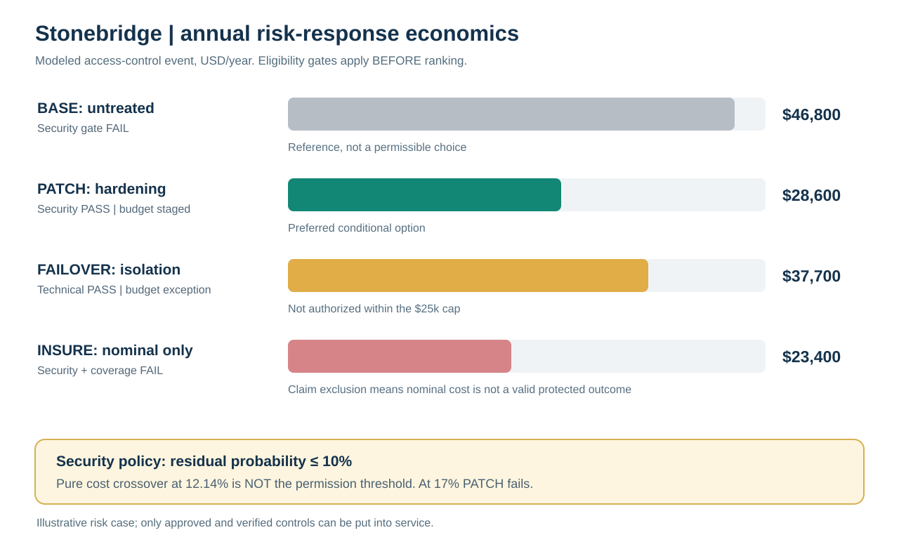

# Stonebridge Resilience Decision — Worked Capstone Solution

> **Instructor / self-check reference.** Every value below is from an existing fictional Module 7 dataset, a stated capstone-only assumption, or transparent arithmetic. Nothing is an observed Stonebridge business result, industry risk probability, or ASCM-mandated threshold. Source data are locked for the base scenario. Where a gate is unresolved, this guide does **not** claim the option is operationally active.

## 1. Executive decision summary

**Decision:** Contain the time-critical plant and safety exposure immediately; provisionally authorize **$11,000 annual monitored hardening** and the **$7,500 route activation test** within a combined fictional $25,000 cap (**$18,500 total**), **subject to security/process sign-offs and purchase authority**. Escalate the separate **$18,000 supplier fixture-validation request**, which takes the full package to **$36,500** and **$11,500 above** the assumed combined cap. Do **not** draw on the separately controlled $40,000 incident reserve simply to make the annual operating budget look sufficient. Confirm carrier capacity and product approval before promising recovery, and retest the failed activation and freight-response steps on **15 November 2026**.

Monitored hardening is the lowest one-year expected-cost *eligible security treatment on the base technical assumptions*, at **$28,600**. Its **$11,000 certain expense is already in that $28,600**; do not add it again when presenting modeled access-risk economics. If its assumed residual event probability is revised to **17%**, the option fails the mandatory fictional **10%** security gate and costs **$48,400**; the alternative isolated failover would require separate technical validation **and a budget exception** at its $29,000 annual cost. No insurance-only choice, unsafe production, unqualified supplier, or unconfirmed transport route can outrank a required gate.

**Continuity status: not yet demonstrated.** All five recovery estimates are within their individual targets, but two of three drill measures fail and critical downstream quality and carrier release dependencies remain untested under the joint disruption. This is a **conditional, staged control decision**, not a claim of organization-wide resilience or completed recovery.




## 2. Controlled source and scenario ledger

- **One-year models:** [Lane outcome scenarios](../../assets/data/module-7/emv-outcome-scenarios.csv) and [access-control options](../../assets/data/module-7/emv-response-options.csv) refer to **different modeled events**. Neither supplies a dependence structure across the models. **Do not total them as a validated enterprise loss number.**
- **Qualitative ordinal scales:** [Likelihood/impact](../../assets/data/module-7/qualitative-risk-ratings.csv) measure comparative workshop judgments, not empirical disruption probability. [Evidence quality](../../assets/data/module-7/risk-evidence-quality.csv) includes incomplete failure-mode evidence.
- **Live gates:** [Appetite](../../assets/data/module-7/risk-appetite-policy.csv), [GRC](../../assets/data/module-7/grc-control-map.csv), [people](../../assets/data/module-7/people-security-gates.csv), [supplier qualification](../../assets/data/module-7/supply-continuity.csv), [lane approval](../../assets/data/module-7/environmental-route-continuity.csv), and [BCMS release](../../assets/data/module-7/business-continuity-dependencies.csv).
- **Budget convention for this case:** $25,000 is treated as a **single combined annual incremental preventive authorization threshold**. This is an explicit instructional interpretation; a real policy owner would have to confirm how its spend threshold applies.

## 3. Owned priority register and causal chain

| ID and source | Cause → event → consequence | Indicative owner | Confidence / horizon | Trigger or unresolved gate | Immediate treatment |
|---|---|---|---|---|---|
| **R7-11 supply** | CT-7 primary supplier or equipment dependency → chip/part not available → 120/week consumption exceeds approved available supply after two weeks | Procurement / Supplier Continuity Lead | Moderate supplier shipment evidence (38 observations); 12-month exposure | Orders open over 14 days; Nova lab approval missing; alternate fixture validation separate | Allocate approved stock; initiate verified qualification; do not count candidate 80/week yet |
| **R7-12 process/safety** | Repeated controller/test-cell alarms → test-line interruption → production delay or unsafe restart | Plant Operations + EHS/Quality | Low (7 alarm records; failure-mode validation missing); 12-month exposure | **1-day urgency and safety review**; no bypass of safe work or quality test release | Contain, stop unsafe work, inspect root cause, obtain signed release |
| **R7-13 logistics** | Shared Northport freight dependency and flood alert → primary lane closure → up to 800 units/week outbound threatened | Logistics Continuity Lead | Moderate flood evidence (24 signals); 12-month exposure | **3-day urgency**; road clearance and alternate carrier/capacity verification | Stage Eastgate; count zero until confirmed; notify customer promise owner |
| **R7-14 demand** | OEM firm orders jump → constrained weekly qualified output → 100/week potential customer shortfall | Demand Planning / S&OP | Low (60 order-book records; cancellations unmodeled); 12-month exposure | **7-day urgency**; customer priority gate | Replan allocation and commitments; scenario-only until orders confirmed |
| **PF-02 / SB-G03 cybersecurity** | Unverified privileged access / compromised remote connection → order/schedule service isolated → control and dispatch interrupted | CISO / IT Security + service owner | No empirical incident frequency established by GRC file; modeled *separate* response case | One elevated access unverified; mandatory security control; post-control probability <=10% fictional training gate | Reconcile access now; provisionally select hardening subject to security and funding approval |

Risk statements come from [risk category](../../assets/data/module-7/risk-category-cases.csv), [process path](../../assets/data/module-7/process-failure-paths.csv), [GRC](../../assets/data/module-7/grc-control-map.csv), [qualitative](../../assets/data/module-7/qualitative-risk-ratings.csv) and [supplier continuity](../../assets/data/module-7/supply-continuity.csv) files. The **connector fixture** in the Section A sample register (`SB-R01`) and the **CT-7 chip** shortage scenario (`R7-11`) are related supplier-continuity concerns but are **not proven to be the same material or failure mode**; do not force them into one probability or promise fixture validation automatically cures the chip shortage.

### Qualitative priority and policy exceptions

| Risk | Likelihood | Consequence | Product | Urgency | Gate-first treatment |
|---|---: |---: |---: |---: |---|
| R7-11 | 4 | 4 | **16** | 21 days | Prepare supplier continuity, quality qualification required |
| R7-12 | 3 | 5 | **15** | **1 day** | **First protective action**: safety / quality review and stop-work where indicated |
| R7-13 | 2 | 5 | **10** | 3 days | Stage flood reroute while verifying carrier/road authorization |
| R7-14 | 4 | 3 | **12** | 7 days | Confirm orders, protect service and allocate feasible output |

The highest score, R7-11, is **not** a permission to ignore R7-12's one-day safety priority. `SB-P01` prohibits unsafe work without approval. `SB-P02` reports **3 days of projected customer delay against a 2-business-day policy threshold**. Treat this as a **provisional breach requiring prompt escalation and calendar-unit reconciliation**, not a verified 3-business-day violation: the two inputs do not demonstrate identical date conventions. Confirm business-day timing before issuing delivery promises. `SB-G03` has an outstanding privileged-access recertification; absence of evidence is not evidence of pass.

## 4. Quantitative analysis: two separate event models

### 4A. Exclusive annual lane outcomes

| Outcome | Probability | Loss if outcome occurs | Weighted annual loss |
|---|---: |---: |---: |
| No disruption | 0.65 | $0 | $0 |
| Moderate disruption | 0.25 | $80,000 | $20,000 |
| Severe disruption | 0.10 | $250,000 | $25,000 |
| **Total** | **1.00** | — | **$45,000 expected annual loss** |

The operating-result signed EMV is **−$45,000/year**. The severe conditional consequence remains **$250,000**; expected loss is **not** an insurance maximum or worst-case scenario. A seed-controlled teaching simulation from the existing [specification](../../assets/data/module-7/risk-simulation-spec.csv) produces 6,540 no-event draws, 2,467 moderate and 993 severe, with **$44,561 simulated sample mean**. The analytic expected loss remains $45,000; simulated frequencies are not measured physical incidents.

### 4B. Annual controls for a **different** supplier-connected access event

For all response alternatives:

`Expected annual cost = certain annual control expense + annual post-control event probability × loss if event occurs.`

| Alternative | Certain annual USD | Post-control p | Loss if event USD | Modeled annual total USD | Security / coverage gate | Decision |
|---|---: |---: |---: |---: |---| --- |
| Untreated BASE | $0 | 18% | $260,000 | **$46,800** | Security **fails** | Reference only, cannot select |
| Monitored PATCH | $11,000 | 8% | $220,000 | **$28,600** | Both pass; 8% <= 10% | **Preferred technical candidate** |
| Isolated FAILOVER | $29,000 | 6% | $145,000 | **$37,700** | Both pass; 6% <= 10% | Eligible technically; **funding exception** needed |
| INSURE-only | $18,000 | 18% | $30,000 nominal | **$23,400 nominal** | **Both fail; excluded loss not modeled** | Reject; arithmetic not valid insured recovery estimate |

On a like-for-like benchmark, PATCH's modeled annual total is **$18,200 below the ineligible untreated scenario** (46,800 − 28,600). Compared with the other technically eligible option, PATCH is **$9,100 lower** (37,700 − 28,600). This is not a realized savings claim and does not eliminate the requirement for security verification or budget approval.

**Sensitivity:** With hardening's p changed to 0.17, total = $11,000 + 0.17 × $220,000 = **$48,400**. It is **$10,700** more than failover, and fails the 10% mandatory gate. Set technical-cost equality to solve `$11,000 + p × $220,000 = $37,700` → `p = $26,700 / $220,000 = 0.121363636...`, or **12.14%**. But the **10% security gate binds first**. It would be incorrect to wait until 12.14% to change control status. If the degraded risk estimate is evidence-backed, quarantine PATCH as a standalone remedy and assess FAILOVER **subject to an explicit $29,000 budget authorization**, not automatically deploy it.

## 5. Supplier, route and demand stress sheets

### CT-7 supplier cover, conditioned on qualification

Opening approved stock: **240 units**; consumption **120 units/week** → `240/120 = 2.0 weeks` of usable coverage. A potential 80/week Nova stream has **14-day qualification** and is marked **conditional**, not currently accepted output. The 42-day primary alternate path is not qualified and cannot provide immediate approved cover.

**Four-week illustrative shutdown of the primary CT-7 source** (a capstone stress assumption, not a documented actual stoppage):

| Period | CT-7 demand | Approved stock issued | Qualified Nova supply if approved just in time | Uncovered if Nova is approved | Uncovered if Nova approval fails |
|---|---: |---: |---: | ---: | ---: |
| Week 1 | 120 | 120 | 0 | 0 | 0 |
| Week 2 | 120 | 120 | 0 | 0 | 0 |
| Week 3 | 120 | 0 | 80 | **40** | **120** |
| Week 4 | 120 | 0 | 80 | **40** | **120** |
| **Total (4 weeks)** | **480** | **240** | **160 conditional** | **80** | **240** |

The **80-unit modeled shortfall only applies if** quality signs off Nova at day 14 **and** the supplier supplies 80 units in each of weeks 3 and 4. Without confirmed approval, the modeled shortfall is **240**. Supplier Quality owns component release; Procurement owns confirmation, expedite and qualification evidence. No substitute is counted simply because an alternate name appears on a supplier list.

### Physical flood and shared network route

A capstone stress removes all primary Northport capacity **800 units/week**. The Eastgate node has **450 units/week facility capability** in [`network-exposure.csv`](../../assets/data/module-7/network-exposure.csv), but [`environmental-route-continuity.csv`](../../assets/data/module-7/environmental-route-continuity.csv) supports a **candidate 400 units/week alternate carrier lane** subject to a confirmation gate. Weather-correlated emergency air has **100 nominal units/week**, but is not safely authorized in this scenario.

| Emergency state | Confirmed usable primary | Confirmed usable backup | Air allowed | Weekly gap against 800 |
|---|---: |---: |---: | ---: |
| Before any backup confirmation | 0 | 0 | 0 | **800 units** |
| After verified Eastgate carrier and route clearance | 0 | 400 | 0 | **400 units** |

Do not use 450 as dispatched capacity merely because the building can process it. Do not add air to the 400 before separate weather/airspace clearance. The alternate route file projects **3 days**, which cannot by itself meet a **24-hour critical-order RTO** without additional validated staging or expedited delivery arrangements. Logistics must flag possible customer commitment breach and obtain a carrier acknowledgment before changing the order promise.

### Separate OEM surge planning pool

Demand of **650/week**, baseline approved **500/week**, reliable approved substitute **50/week** → `max(0,650−(500+50)) = 100 units/week` uncovered. Demand Planning/S&OP must either authorize capacity, prioritize customers, negotiate feasible revised commitments, or manage the shortfall as an exception. **This 100-unit demand gap is not automatically additive to the CT-7 or freight gap** because no item-to-line-to-lane crosswalk is supplied.

## 6. Financial stress, eligibility, and approval authority

### Other stress exposures are NOT automatically annual EMVs

- EUR payable: €800,000 × (1.17 − 1.10) USD/EUR = **$56,000** additional USD if that stress exchange rate applies to this fixed EUR payable. No probability specified.
- Steel purchasing: 50,000 kg × ($4.50 − $4.00)/kg = **$25,000** cost stress on the affected lot. No event likelihood given.
- Litigation: the provided file has a schematic sensitivity for a $250,000 claim with 0.20→0.25 inputs and a $12,500 difference, but the meaning of those numbers requires legal interpretation; do not represent it as an approved reserve or merge it into expected operating loss.

### Proposed combined annual preventive portfolio

| Prevention or rehearsal | Certain annual amount | Requested authority | Priority and release gate |
|---|---: |---|---|
| Monitored access hardening | **$11,000** | Business owner and CISO | Security authorization and validated residual p <=10% |
| Route dry run | **$7,500** | Logistics Director | Approved test plan and carrier participation |
| Supplier fixture validation | **$18,000** | VP Operations | Confirm applicability to affected material, qualified test and quality sign-off |
| **Full package** | **$36,500** | Cross-functional budget authority | **$11,500 above** the case's $25,000 combined cap |

**Staged recommendation:** Approve **$18,500** in the first authorization tranche **only if** the owner's gates pass, retain the **$6,500** unused headroom, and send the separate $18,000 fixture project for a documented exception or budget reprioritization. If the full package is authorized by the proper owner, the exceptional incremental approval is **$11,500**. The $40,000 reserve for an unspecified severe disruption remains subject to incident charter and is **not** an unrestricted source of annual operating funds.

**Double-count warning:** The $11,000 PATCH payment is **already included** in its $28,600 expected access-risk annual cost. The $36,500 portfolio cash request is a **budget envelope** that includes that same payment, not an increment to the $28,600 risk-control result. The lane expected loss $45,000 is another model: don't combine the annual estimates as a “risk-adjusted ROI” without verifying overlap and common assumptions.

## 7. Continuity scorecard and exact corrective actions

| Critical activity | Target (h) | Estimated (h) | Nominal within target? | Release evidence required |
|---|---: |---: |---|---|
| Personnel safety and site access | 1 | 1 | **Yes, at threshold** | Incident Commander all-clear; no unsafe entry |
| Secure identity and order visibility | 6 | 4 | **Yes** | IT security sign-off; clean snapshot and privilege check |
| Controller test cell | 12 | 10 | **Yes** | Verified power; Quality releases qualified test capability |
| Customer allocation | 8 | 7 | **Yes** | Accurate order book/inventory and customer promise approval |
| Critical outbound orders | 24 | 20 | **Yes** | Test release **and** confirmed alternate transport |

All **five estimated individual targets pass numerically**, but they are **unvalidated estimates**, and dependent activities cannot be declared successful just because each row meets a nominal maximum. Do not add all five as if they were serial without checking dependency order; do not run them all parallel without validating that their prerequisites can overlap. The [exercise file](../../assets/data/module-7/crisis-exercise-actions.csv) supplies actual observed tests:

| Exercise control | Target (minutes) | Observed (minutes) | Result | Gap / corrective owner | Retest |
|---|---: |---: |---|---| --- |
| Activate emergency roles | 15 | 19 | **Fail** | **4 minutes late**; Site Manager updates call tree | 2026-11-15 |
| Secure clean inventory snapshot | 60 | 40 | **Pass** | **20 minutes ahead**; IT Security verifies integrity | 2026-11-15 |
| Confirm alternate freight capacity | 120 | 160 | **Fail** | **40 minutes late**; Logistics prebooks backup carrier | 2026-11-15 |

**Actual readiness determination: NOT PROVEN.** Maintain stop-work for unsafe situations, lock privileged access until verified, quarantine counterfeit or unapproved components, and refuse release until Quality and the carrier supply valid records. The recovery chain must progress through **people and site → secure information → approved testing and material → authorized allocations → physically confirmed dispatch → customer acknowledgment**. An IT system up in four hours does not mean an OTIF shipment has occurred.

## 8. Executive risk decision register

| Decision / status | Accountable owner | Evidence and mandatory gate | Consequence / rejected alternative | Trigger / review |
|---|---|---|---|---|
| **Contain plant safety/process exposure — NOW** | Plant Manager + EHS/Quality | R7-12 urgency 1 day; permit and validated test release | Reject restart based solely on schedule pressure | New alarm, unsafe permit or failed test; immediate escalation, review daily |
| **Proceed with monitored hardening only after approvals — CONDITIONAL** | CISO + Operations Finance | p 8% modeled, annual $28,600 including $11k certain; check privileged access and <=10% threshold | INSURE and BASE fail gates; FAILOVER modeled higher annual cost | Any control effectiveness deterioration; monthly, immediate if p >10% |
| **Stage Eastgate, do not count before confirmation — CONDITIONAL** | Logistics Director | Carrier/route confirmation; lower verified 400 capacity vs 450 node capability | Without proof the alternative contributes zero, not 400 | Flood notice, missed gate-in, missed 120-min carrier confirmation; within 4h |
| **Protect CT-7 stock, qualify Nova — CONDITIONAL** | Head of Procurement + Supplier Quality | Two weeks usable stock; Nova's 80/w after 14d only upon signoff | Reject unqualified supply; 80 vs 240 four-week shortage dependent on approval | Open orders >14 days; daily through first two weeks |
| **Escalate forecast/commitments — OPEN** | Demand Planning + Customer Operations | 100/w shortage in separate OEM scenario; customer priority authorization | Do not promise 650 from 550 approved weekly capacity | Confirmed orders >550/week; at next demand review |
| **Seek fixture validation budget exception — OPEN** | VP Operations + Operations Finance | $36,500 proposed vs $25,000 cap; $11,500 excess if full package approved | Do not divert $40k emergency reserve absent incident charter | Written business case and cap approval, within 30 days |
| **Retest activation and carrier confirmation — NOT PROVEN** | Site Manager + Logistics Director | 19 vs 15 min and 160 vs 120 min; two corrective actions | No BCMS end-to-end success assertion before repeat exercise | Rehearsal **2026-11-15**; escalate missed target same day |
| **Financial/brand issues: verify, don't book automatic losses — OPEN** | Treasury + Legal + Brand Protection | $56k FX / $25k steel stress; IP permissions and communications approvals | Reject unsupported EMV or automatic legal reserve | Material market move, claim notice, firmware disclosure; specialist review |

### 30/60/90-day owned implementation

| Horizon from 2026-10-19 | Required verified outputs | Owner | Escalation trigger |
|---|---|---|---|
| **0–30 days** (through **2026-11-18**) | Incident roles and safety stop rules; immediate privileged-access review; record PATCH security signoff and $11k authorization if eligible; dispatch revised customer promises; confirmed Eastgate carrier contract; Nova QC schedule and inventory expiry; signed $7.5k test authorization; submit $18k fixture exception. Execute **Nov 15** activation / freight retest. | CISO, Plant/EHS, Procurement/Quality, Logistics, Finance and Customer Operations | Any unsafe release, unapproved privileged access, carrier gap, supplier qualification slip or exercise failure; same-day owner escalation |
| **31–60 days** (through **2026-12-18**) | Reevaluate remaining supplier cover, validate qualified alternate performance and actual lane throughput; document route/storm correlation; use observed incident and test data to challenge probability assumptions; refresh customer service exposure and source records; resolve or explicitly escalate exceptions. | Risk Director, S&OP, Supplier Quality, Logistics and IT | Residual p >10%, shortage >approved service tolerance, or missed retest corrective actions |
| **61–90 days** (through **2027-01-17**) | Run a joint supplier-site-carrier/IT continuity exercise; prove safe production release, credible customer allocation and delivery handover; evidence signoffs; issue dated risk register v2 and executive decision record for funded and deferred controls. | Executive Risk Committee sponsor; Incident Commander | Unverified end-to-end dispatch, expired approval, spend above authority or repeat failure → conditional approval withdrawn |

Any supplier or carrier should acknowledge the specific requested action and capacity, not merely receipt of an email. Customer Communications must not publish unsupported delivery dates or a misleading “fully recovered” assertion. A remediation task is closed only after the control actually passes its verification and retest.

## 9. Five-plus stress conditions that could overturn the choice

| Uncertainty / failure mode | What would change | Evidence needed before accepting the new state |
|---|---|---|
| Monitored hardening efficacy degrades | At 17%, PATCH becomes ineligible; possible FAILOVER funding exception | Updated access incident history, control efficacy results, probability assessment approval |
| Eastgate and primary share a hidden node | Both lanes may fail together; 400 potential backup cannot be assumed independent | Carrier origin/destination, terminal mapping, verified alternate routing and observed dispatch |
| Nova lab approval misses day 14 | Four-week CT-7 shortage rises from 80 to 240 units | Qualification signoff, lot releases, dispatch confirmations and revised stock plan |
| Supplier fixture is not the CT-7 constraint | $18k planned project may not mitigate critical CT-7 shortage | BOM / part-number / equipment dependency and qualified engineering verification |
| Demand surrogate does not match actual routing | 100-unit OEM surge gap cannot be added to CT-7 or lane gaps | End-item BOM, routing capacity, item-lane mapping, firm customer order confirmation |
| Cyber and lane disruptions cascade | Separate annual models cannot simply be aggregated; recovery RTO may slip | Joint scenario definition, conditional probabilities, impact overlap and common-mode model |
| Clean snapshot lacks valid inventory/quality status | IT access recovers but the shipment remains blocked | Reconciled ERP inventory, quality status and shipment/lot genealogy |
| Carrier drill fails again | 24-hour outbound continuity claim remains unproven | New carrier SLA, named contact with alternate, verified booked capacity, timed retest result |
| FX exposure differs from stress assumptions | $56k scenario may be too high/low; not automatically an annual loss | Live payable currency, hedge documentation, treasury validated rate and settlement timing |

## 10. Original capstone assessment — correct answers and explanations

1. **B.** Safety clearance and the one-day deadline outrank a crude ordinal matrix. **A** discards hard gates; **C** misuses a 1–5 score as statistical probability; **D** delays necessary containment.
2. **C, $45,000.** `0.65×0 + 0.25×80,000 + 0.10×250,000`. **A** confuses severe conditional with annual expected loss; **B** is not the weighted sum; **D** uses only the moderate conditional loss.
3. **D, monitored hardening.** PATCH = $28,600 and FAILOVER = $37,700 after the technical gate check. **A** violates coverage/security gates despite its smaller nominal number; **B** fails security; **C** is technically eligible but modeled more expensive and needs funding exception under the case cap.
4. **A, the 10% eligibility gate.** The 17% stress already breaches mandatory policy. **B** is a later purely mathematical crossover; **C** remains disallowed regardless of PATCH efficacy; **D** belongs to a different lane scenario.
5. **B, two weeks.** 240÷120=2. **A** counts unapproved Nova; **C** treats 42-day qualification as assured receipts; **D** confuses having alternate suppliers with approved immediately usable capacity.
6. **D, zero backup capacity before confirmation.** **A** assumes conditional lane capacity is accepted; **B** mistakes 450 building throughput for booked transport; **C** additionally counts unapproved weather-correlated air service.
7. **C, release path unproven.** **A** confuses estimated RTO with observed partner readiness; **B** overgeneralizes a failed test into permanent carrier exclusion; **D** deletes a useful objective rather than closing the gap.
8. **B, $11,500.** 11,000+7,500+18,000−25,000 = 11,500. **A** disregards the combined authorization rule; **C** treats controlled incident reserve as unrestricted; **D** applies uncertainty to costs paid regardless of the event.
9. **A, $56,000 conditional FX increment.** €800,000×$0.07/€ = $56,000. **B** adds an unstated event probability or actual loss; **C** is dimensionally and arithmetically wrong; **D** ignores USD translation changes.
10. **D, do not automatically aggregate.** Shared dependency and overlapping consequences may matter, even though both models use one year. **A** confuses common units with independence; **B** assumes away correlated loss; **C** cannot turn ordinal scores into a valid joint loss distribution.

## 11. Independent calculation verification

Run from the repository root:

```bash
python3 calculations/risk-response/capstone_replay.py
```

The replay checks exact dataset arithmetic, case gates, staged funding, supply-and-route conditional totals, exercise results, simulation seed and cost crossover. This is an independently reproducible teaching audit, **not** evidence that the fictional probabilities are statistically calibrated. The annual cost comparisons and reserve calculations must still be reviewed for scope and control overlap before business use.


## Executive recommendation

Recommend **conditional monitored hardening** on the fictional base evidence only after security and portfolio funding authorization. Protect plant safety immediately; withhold credit for unqualified CT-7 supply and unconfirmed Eastgate freight capacity. The business continuity program remains **not proven** until the two failed steps pass retest. The decision register in Section 8 contains each owner, evidence gate, and consequence.

## Sensitivity and failure cases

If monitored hardening's residual event probability reaches 17%, it fails the case's 10% security gate **before** the mathematical cost crossover is considered. The 14-day alternate-supplier qualification slip increases four-week CT-7 shortfall from 80 to 240 units. A hidden common-mode transport failure can remove the putative backup route. None of these cases should be averaged away using a composite score; see Section 9 for the specific evidence needed.

## Implementation roadmap

Use the 30/60/90-day sequence in Section 8 as the controlled implementation plan. At each checkpoint the accountable owner must supply evidence of approved funds, qualified supply, carrier booking, verified secure inventory data, and actual test performance. The **15 November 2026** drill retest is an explicit near-term gate; a written continuity plan is not the same as recovery proof.

## Evaluation rubric

| Criterion | Strong evidence | Unacceptable shortcut |
|---|---|---|
| Risk identification | Five or more causal risk statements with horizons, owners and shared dependencies | A list of generic hazards with no operational consequence |
| Quantification | Reproducible EMV, signed impact, conditional loss and scenario boundaries | Probabilities inferred from ordinal heat-map scores |
| Gate discipline | Security, safety, quality, funding, carrier and recovery gates checked before ranking | Cheapest nominal alternative selected despite failure |
| Physical continuity | CT-7 and lane gaps calculated separately, qualified capacity distinguished from potential capacity | Customer promise built on unqualified or unbooked alternatives |
| Execution | Dated 30/60/90-day owners, retests and escalation evidence | An unowned strategy checklist or unsupported 'fully recovered' claim |

## 12. Cross-module handoff (without reteaching Modules 1–6)

| Established module owner | Capstone input or handoff |
|---|---|
| [Module 1 — Demand and forecasting](../../01-supply-chains-demand-forecasting/README.md) | S&OP updates and customer-demand surge; Module 7 decides threshold, treatment and escalation |
| [Module 2 — Networks, data and performance](../../02-network-design-digital-connectivity-performance/README.md) | Network/data asset dependency evidence; Module 7 tests failure propagation and recovery viability |
| [Module 3 — Sourcing and contracting](../../03-sourcing-strategy-product-design-supplier-execution/README.md) | Qualified alternatives, rights and contract terms; Module 7 gates and maintains exposure decision |
| [Module 4 — Internal operations and inventory](../../04-internal-operations-inventory/README.md) | Approved available stock, quality clearance, test-cell capability; Module 7 calculates cover and continuity triggers |
| [Module 5 — Forward and reverse logistics](../../05-forward-reverse-logistics/README.md) | Carriers and route capabilities; Module 7 tests shared-node and booked contingency capacity |
| [Module 6 — Customer/supplier relationships](../../06-supply-chain-relationships/README.md) | SRM remediation and customer promise governance; Module 7 adds crisis ownership, testing and evidence |

**Completion checkpoint:** The preferred action is **conditional**, funding exception remains open, and end-to-end BCMS is **not yet proven**. Declare Module 7 capstone complete as a **teaching artifact**, not declare Stonebridge's fictional operational risk resolved.

---

[Return to capstone assignment](./README.md) · [Module 7 overview](../README.md) · [Risk formula reference](../../calculations/risk-response/formula-sheet.md)
