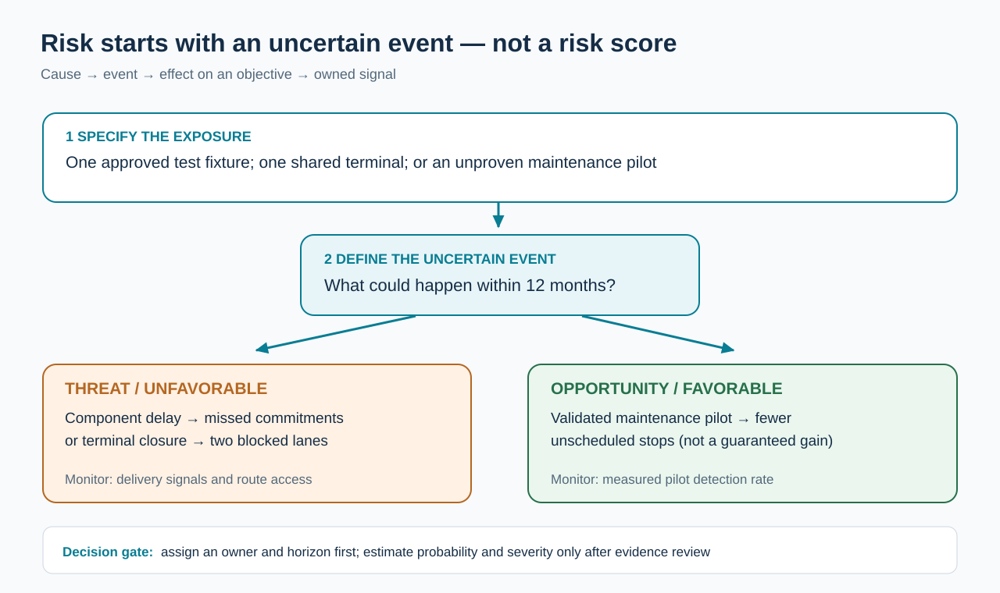
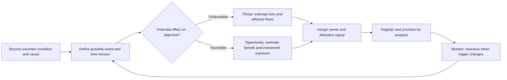

# 1. Risk, Uncertainty, Threats, Opportunities, and Supply-Chain Exposure

> **Released Module 7 lesson.** Stonebridge and all values are fictional training cases; no protected source content is reproduced.

## Learning objectives

After this topic, you should be able to:

- explain why an uncertain outcome can be a **threat** or an **opportunity**;
- state supply-chain risks as a credible cause, uncertain event, and measurable consequence instead of a generic worry;
- recognize that supply-chain exposure spans materials, information, financial flows, operating relationships, and physical assets; and
- distinguish **Module 7 risk management** from the resilience, supply, operations, and service decisions already described in Modules 1–6.

## Concept in plain English

An enterprise takes risks whenever the outcome of a decision depends on facts that it cannot completely know or control. A component supplier may deliver on the promised date, arrive late, or fail a quality test. A new monitoring system may prevent an outage, yet its performance is uncertain until it has been tested. The uncertainty becomes relevant to managers when it might change a business objective: customer service, safety, continuity, revenue, cost, regulatory standing, or confidence in a promise.

A **threat** is uncertainty with a potentially unfavorable outcome. An **opportunity** is uncertainty with a potentially favorable outcome. Opportunity does not mean guaranteed upside: an investment can fail to produce the expected benefit. Likewise, uncertainty alone is not a reason to stop all activity. Management needs to know what can happen, why it matters, which evidence changes the likelihood, and which choices would protect or improve the outcome.

Supply-chain risk is narrower than generic corporate uncertainty. It concerns failures or deviations that could damage flows through the network: goods and services, information, or funds. A shipment interruption may originate at a port, a manufacturer, or a service provider; the consequences may surface elsewhere as late production, a broken customer promise, loss of cash, or a damaged relationship. The location of the triggering event and the location of its consequence may be different.

For this reason, an effective risk statement is specific. “Supplier risk is high” does not tell someone what to watch or do. “Because the approved component has only one validated tooling path, a maintenance outage at the supplier could prevent scheduled deliveries, causing production stoppages within eight days” does. The latter has a cause, a possible event, an impact pathway, a time horizon, and a testable signal. It can be assigned to an owner and assessed for severity and treatment.

Module 7 turns earlier supply-chain methods into risk decisions. Module 2 has already introduced resilience and network choices; Module 3 has already developed supplier-selection and contract logic; Module 4 has already explained buffers, capacity, and material planning; and Module 5 has already covered distribution execution. Those are inputs here. The new task is to identify exposure, assess uncertainty and consequences, compare feasible responses, assign ownership, and keep the assessment current.

## Why it matters

Managers can make opposite mistakes. One is to describe every operational inconvenience as an existential risk, consuming resources on low-impact concerns. The other is to declare a supply chain safe because normal-month KPIs are good, even though a single supplier, shared transportation terminal, cyber-access point, or untested recovery dependency could interrupt the entire operation. The discipline of risk management helps distinguish ordinary variation from exposure that justifies a preventive control or recovery plan.

The customer often sees the cumulative effect of several events. Supplier capacity weakness can create material shortages, which alter the master production schedule, which cause missed delivery commitments. A useful risk discussion therefore records not just an event but the cross-functional path to the customer or financial consequence.

## Decision model and workflow

The original model separates uncertainty from its possible effects. The **cause** and **trigger** belong in the operating evidence record; the outcome and financial/service effects belong in the impact assessment. One event may produce more than one downstream effect.

### Evidence retained through the workflow

| Required evidence | Operating purpose | Owner / control |
| --- | --- | --- |
| Specific risk cause and event | Prevents confusing an underlying condition with the event itself | Risk owner validates statement |
| Affected process or network node | Shows where the event arises and where the business impact propagates | Process owner maintains dependency |
| Threat or opportunity outcome | Separates loss control from benefit evaluation | Business owner confirms objective |
| Signal and assessment horizon | Allows earlier detection and consistent comparison | Named monitor checks cadence |
| Consequence description | Supports probability, severity, and response evaluation in later lessons | Finance/operations validate units |

## Practical process flow

## Realistic example — Stonebridge Industrial Components

Stonebridge makes electromechanical controllers for customers who schedule installation crews in advance. A specialist connector is made using one qualified test fixture. A supplier's maintenance issue would not merely reduce a purchasing KPI; it could stop controller assembly and cause missed installation dates. The supply manager identifies the unvalidated backup test path as the **cause**, delayed connector deliveries as the **event**, and lost customer commitments as the **consequence**. The maintenance notice and pilot-lot acceptance record are possible leading signals.

Stonebridge also uses two trucking lanes that appear geographically separate but pass through the same intermodal terminal. A terminal closure could disrupt both routes. Listing two carriers alone would exaggerate resilience; the risk assessment must identify the shared dependency. A separate maintenance pilot creates an opportunity: early warning sensors could reduce unplanned equipment stoppages. The company should measure this potential upside through a controlled trial rather than calling it a confirmed saving.

## Applied decision artifact or worked calculation

Use the original fictional [risk classification sample](../../assets/data/module-7/risk-classification-sample.csv). It records three deliberately different uncertainty statements: supplier interruption, logistics concentration, and a maintenance improvement opportunity. For each, note a defined cause, a possible event, a consequence, an accountable owner, an early signal, and a 12-month assessment horizon.

The decision record is **not** a numeric risk ranking yet. Risk probability, loss severity, data quality, and response cost have not been established. Giving each row a score at this stage would create false precision. The appropriate next action is to test whether the cause-event-impact logic is specific enough for someone else to collect evidence and reassess it.

## Decision logic

- First identify the business objective exposed to uncertainty; a generic risk label is not an action.
- Trace the condition through the possible event to the customer, financial, operational, security, or legal consequence.
- Separate threat exposure from a speculative opportunity; neither is certain until evidence supports it.
- Record shared dependencies. Two nominal alternatives may fail together if they rely on the same terminal, service platform, or tooling path.
- Assign a monitoring owner and a time horizon before moving to probability or impact scoring.
- Use the decision capabilities of earlier modules as interventions, not as substitutes for estimating exposure.

## Trade-offs

| Decision tension | Implication |
| --- | --- |
| Comprehensive inventory versus actionable register | Too many vague risks dilute attention; specific event paths and ownership improve the value of the register. |
| Efficiency versus redundancy | Duplicate capability consumes resources but may prevent a disproportionate continuity loss; quantify it later. |
| Fast prioritization versus data quality | Early qualitative judgment is useful, but it must not be presented as statistically measured probability. |
| Opportunity pursuit versus downside control | A pilot or new market may offer benefits and introduce losses; evaluate the plausible full outcome range. |

## Commonly confused with

**Risk** is not the same as **a realized problem**. The potential for a port closure is a risk; the current closure is an incident requiring execution. Likewise, **resilience** is the capability to prepare, withstand, adapt, and recover; **risk management** is the process of identifying, analyzing, deciding, assigning, and reviewing what could jeopardize objectives. The concepts reinforce each other but are not identical.

## Common mistakes

- Calling the root cause itself the consequence, such as listing “single sourcing” with no plausible interruption event or harm.
- Treating an opportunity as a guaranteed revenue or efficiency improvement.
- Mistaking two vendors that share a critical sub-tier for independent alternative capacity.
- Repeating existing Module 2 network design or Module 3 supplier-selection lessons instead of analyzing the exposure those decisions create.
- Using a probability or risk score before the evidence quality and time horizon have been defined.

## Original knowledge check

**Question.** Stonebridge uses two outbound carriers, but both pass through the same vulnerable terminal. Which risk statement best supports subsequent assessment?

A. Because the company has two carriers, terminal risk has been eliminated.

B. Because transportation is important, the logistics manager should raise every delivery risk to the maximum rating.

C. Because both lanes use one terminal, a terminal closure could interrupt both routes and delay customer deliveries; the logistics manager should monitor terminal access and recovery alternatives.

D. Because forecasts are uncertain, all port and terminal disruptions should be assigned to demand planning.

Answer and rationale

### Correct answer

**C. Because both lanes use one terminal, a terminal closure could interrupt both routes and delay customer deliveries; the logistics manager should monitor terminal access and recovery alternatives.**

### Why it is correct

The statement links a shared dependency, an uncertain disruption, its effect on the supply chain, the accountable owner, and a relevant early-warning control. It can be evaluated rather than merely repeated as a label.

### Why the other answers are wrong

- **A.** Nominally separate carriers do not protect against a shared terminal failure.
- **B.** High importance does not justify an unsupported maximum probability/impact score.
- **D.** Demand planning is not the operating owner of transportation terminal continuity.

## Practitioner perspective

In an SAP-enabled manufacturing environment, source-of-supply, production-order, inventory, quality, transportation and customer-commitment records can expose different parts of the same dependency. A risk record should connect the business consequence to the authoritative transaction or planning evidence rather than assume that one application contains the whole chain. Decide which owner can act on a signal; an automated alert with no response owner does not make the business resilient.

## Related concepts

- [Module 1 — Supply Chains, Demand, and Forecasting](../../01-supply-chains-demand-forecasting/README.md)
- [Module 2 — Network Design, Digital Connectivity, and Performance](../../02-network-design-digital-connectivity-performance/README.md)
- [Module 3 — Sourcing Strategy, Product Design, and Supplier Execution](../../03-sourcing-strategy-product-design-supplier-execution/README.md)
- [Module 4 — Internal Operations and Inventory](../../04-internal-operations-inventory/README.md)
- [Module 5 — Forward and Reverse Logistics](../../05-forward-reverse-logistics/README.md)
- [Module 6 — Supply Chain Relationships](../../06-supply-chain-relationships/README.md)

---

[Previous: Section overview](./README.md) · [Section overview](./README.md) · [Next: Lesson 02](./02-end-to-end-risk-management-lifecycle.md)
