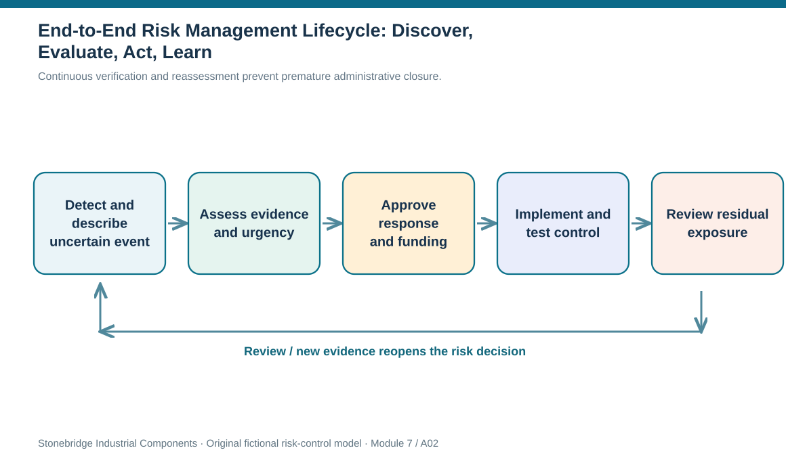
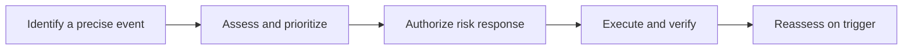

# 2. End-to-End Risk Management Lifecycle: Discover, Evaluate, Act, Learn

## Learning objectives

After this topic, you should be able to:

- trace a risk from initial signal to registered ownership, analysis, decision and monitoring
- distinguish a risk-management plan from the response selected for one risk
- describe feedback and review conditions that keep a register current

## Concept in plain English

Risk management is not a score calculated once a year. It is a repeatable management loop that starts when someone recognizes a vulnerability or potential upside and continues until the exposure no longer matters or has been accepted by an authorized owner. The initial record should connect a cause to an uncertain event, an affected objective, and a reasonable scope. An organization can then decide which risks merit deeper assessment rather than collecting undifferentiated warnings.

Identification asks what might occur and who could be affected. Qualitative assessment considers likelihood and consequences with the available evidence; quantitative analysis is added when the size of the decision warrants stronger estimates. Prioritization must also reflect urgency and information confidence. Two events may receive similar assessment scores yet call for different action because one will materialize tomorrow and the other cannot occur for several months.

Response planning is a separate step: evaluate feasible methods, determine preventive or contingent action, obtain authority and funding, and write a clear owner, trigger, and action for each selected response. Execution is the actual implementation, not the approval of a slide. The risk manager then measures whether the intervention works, whether residual exposure has changed, and whether the monitoring signal still gives enough warning. If conditions shift, the cycle starts again.

A useful organization treats the register as a living decision record. A risk can move from identified, to assessed, to funded, to controlled, to reopened when supplier configuration, customer dependency, geographic exposure, or security conditions change. No status should imply that a possible threat has disappeared simply because a previous review took place. The same discipline accommodates uncertain opportunities, but their costs and benefit evidence need explicit treatment rather than being mixed into loss scores.

## Why it matters

Without a lifecycle, supply-chain risks become lists of concerns with nobody responsible for the next step. Controls may be approved but never installed, or a long-lived risk may receive an annual green rating despite an obsolete backup plan. The lifecycle forces an operational handoff: who collects evidence, who signs the decision, which team acts, and who verifies effectiveness.

## Decision model and workflow

A continuous loop treats verification and reassessment as normal operations rather than final administrative closure.

### Evidence retained through the workflow

| Evidence or control | Why required |
| --- | --- |
| Event and exposure | Traceable risk statement with relevant affected flow |
| Assessment | Likelihood/impact rationale, urgency, evidence confidence |
| Approval | Selected action, delegated authority, funding, expiry |
| Verification | Test result, remaining exposure and next review date |

## Practical process flow

## Realistic example — Stonebridge Industrial Components

Stonebridge's backup connector fixture appears in the purchasing record but is not qualified for the current test method. The Supplier Continuity Lead first verifies whether the fixture exists and whether a usable pilot lot has been demonstrated. Only then is production-outage exposure prioritized. A scheduled validation can be proposed, funded, completed, and measured. A later engineering revision invalidating the fixture triggers reassessment, even if the record was marked controlled last quarter.

## Applied decision artifact or worked calculation

The fictional [`risk-lifecycle-events.csv`](../../assets/data/module-7/risk-lifecycle-events.csv) records three different stages of work. The connector item is monitored, the shared terminal item is still being identified, and the maintenance pilot is not yet backed by benefit evidence. A practical control ledger records stage, source document, next action, decision owner and a fixed review cadence. A percentage-complete number cannot replace proof that a selected control works.

## Decision logic

1. Document the event, cause, exposed objective and time horizon before issuing a score.
2. Use qualitative screening to decide which exposures justify detailed data and potential quantitative analysis.
3. Require an explicit decision authority, evidence requirement and response owner.
4. Track response implementation separately from residual-risk verification.
5. Reopen the register after material changes or a failed drill.

## Trade-offs

| Decision tension | Implication |
| --- | --- |
| Fast screening vs precision | Initial evidence can support triage, but does not automatically justify a numeric likelihood. |
| Closure vs surveillance | A completed action may reduce risk without removing the need to watch for recurrence. |
| Central policy vs local expertise | Risk governance must be consistent while evidence is collected near operations. |

## Commonly confused with

An incident is the realized disruption; a risk is a potential event. A response plan is the specific action to take, whereas the overarching risk management plan describes how all exposures are handled.

## Common mistakes

- Closing a risk immediately after a purchase order for its control is issued.
- Using a single green/yellow/red field to hide assessment, authorization and verification states.
- Retaining a prior probability when the supplier or network configuration changes.

## Original knowledge check

**Question.** A control was approved last month, but the backup capacity test failed yesterday. What is the strongest next step?

A. Reopen the risk, record failed verification and review an alternative response.

B. Keep the record closed because management approved the purchase.

C. Increase all supply risks to their highest category.

D. Delete the original evidence to avoid conflicting audit records.

Answer and rationale

### Correct answer

**A. Reopen the risk, record failed verification and review an alternative response.**

### Why it is correct

Correct: a failed capacity test invalidates the assumed control and requires renewed action.

### Why the other answers are wrong

- **B.** Approval does not show effectiveness and a failed test is decision-relevant evidence.

- **C.** Blanket maximum classification obscures differences between risks.

- **D.** Deleting earlier evidence destroys the decision history.

## Practitioner perspective

In a production-planning landscape, differentiate the date when a control was ordered from the date its alternate process passed an actual qualification run. A purchasing document can confirm money was committed, while a quality acceptance and capacity test confirm whether the promised recovery path exists. Keep both links under the same risk ID and reopen that ID if product specifications change.

## Related concepts

- [Module 6 — Supplier Remediation](../../06-supply-chain-relationships/section-b-supplier-and-supply-chain-relationships/13-supplier-performance-reporting-error-control-claims-and-remediation.md)
- [Risk Register and Integrity](./10-risk-statements-causes-triggers-horizons-and-register-integrity.md)

---

[Previous: Lesson 01](./01-risk-uncertainty-threats-opportunities-and-supply-chain-exposure.md) · [Section overview](./README.md) · [Next: Lesson 03](./03-integrated-scrm-maturity-roles-and-partner-accountability.md)
