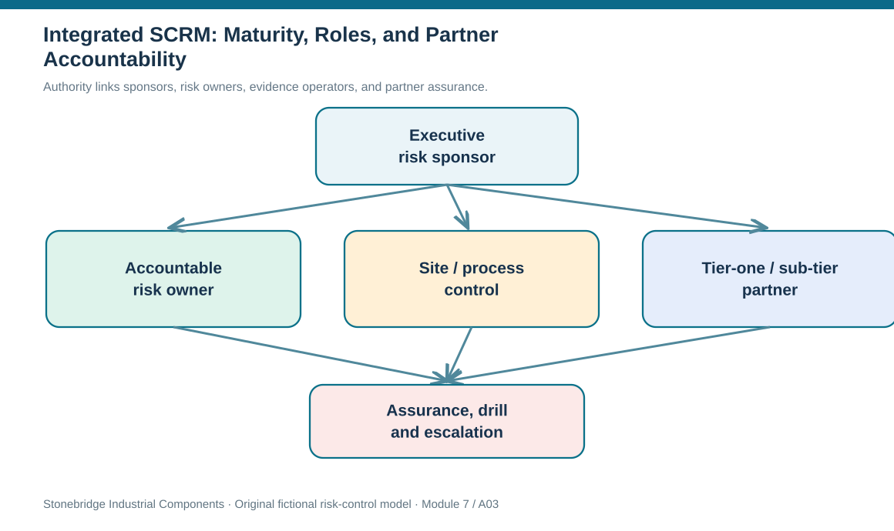

# 3. Integrated SCRM: Maturity, Roles, and Partner Accountability

## Learning objectives

After this topic, you should be able to:

- describe how an internal risk program depends on suppliers, carriers and service providers
- assign distinct executive, risk, process and partner responsibilities
- interpret maturity differences across supply, demand, process and environmental exposures

## Concept in plain English

An enterprise can protect its own sites and still be vulnerable to events at partners it barely knows. A direct supplier may be strong financially yet use one unqualified second-tier facility. Two carriers may present separate account teams but rely on the same third-party terminal. Risk accountability therefore requires end-to-end visibility into critical dependencies, not merely a checklist sent to tier-one suppliers.

Supply-chain risk management connects the risk practices of individual organizations while acknowledging that each has its own decision authority. The enterprise risk sponsor defines appetite and escalation rules. A risk manager maintains the method, challenges untested assumptions, and coordinates cross-functional review. A process owner knows which operational signals are credible and can execute a control. A partner contact supplies credible information about its dependencies and recovery options. An executive decision maker releases funding or accepts material residual exposure. A risk that lists only a department without a named accountable person has a governance gap.

Maturity is uneven across risk categories. Many organizations have established supplier scorecards, finance checks and sourcing alternatives. Demand risk may benefit from forecasting and S&OP but still lack explicit disruption modeling. Process and environmental exposures can be more difficult to anticipate because they cut across sites, systems, regulation and geography. These are directional maturity observations, not an assertion that every company scores the same way. The maturity test is practical: can the firm identify dependencies, act on evidence, fund a response, exercise it, and learn from failure?

End-to-end coordination also raises confidentiality and cooperation constraints. A supplier may not disclose a full sub-tier bill of materials. An appropriate agreement can request evidence of critical recovery capability, testing, restoration time, and notice obligations without demanding unrestricted access to trade secrets. Module 6 governs the partnership; Module 7 decides what risk proof the partnership must supply. A supplier certification certificate alone cannot demonstrate that its emergency power, specialist workforce, or shared component sub-tier will be available during a regional event.

## Why it matters

A weak response often appears at organizational boundaries. Procurement assumes quality owns the backup approval, quality assumes planning has enough inventory, and planning assumes logistics can find another route. Clear accountability shows which one owner will coordinate those handoffs before the disruption materializes.

## Decision model and workflow

Authority moves from sponsorship to evidence operators and external dependencies, then into independent assurance.

### Evidence retained through the workflow

| Evidence or control | Why required |
| --- | --- |
| Partner dependency | Which asset, sub-tier or route must function |
| Authority | Who owns, operates, escalates, and approves |
| Continuity test | Test date, outcome, exceptions, restoration estimate |
| Evidence limit | What is disclosed and under which contractual access |

## Practical process flow

## Realistic example — Stonebridge Industrial Components

Stonebridge's direct connector vendor reports 98% monthly delivery reliability. A dependency workshop finds its two product lines share one calibration service provider. Procurement already knows supplier performance, but no one had documented the shared calibration sub-tier. The risk owner requests a recovery-time test and escalation contact from that partner. Existing sourcing decisions are not repeated; the analysis concentrates on failure propagation through the shared service.

## Applied decision artifact or worked calculation

The fictional [risk owner coordination file](../../assets/data/module-7/risk-owner-coordination.csv) assigns an executive sponsor, risk owner, operating controller and partner contact for three exposures. The connector row requires a tier-two fixture location; the terminal row requires a bypass test. A RACI-like charter should make the risk owner accountable while retaining separate authorization for expenditure. Where a partner will not reveal a proprietary sub-tier, a documented independent continuity attestation may be a proportionate alternative.

## Decision logic

1. Map tier-one, critical sub-tier and shared service dependencies with evidence restrictions.
2. Assign a single accountable risk owner plus process operators and partner contacts.
3. Require critical partners to provide tested continuity evidence appropriate to contract and exposure.
4. Compare maturity using demonstrated practices rather than software ownership.
5. Escalate evidence refusal or untested recovery dependency as an unresolved risk, not a passed gate.

## Trade-offs

| Decision tension | Implication |
| --- | --- |
| Partner visibility vs confidentiality | Ask for testable continuity evidence without requiring unnecessary sensitive supplier design data. |
| Central consistency vs local control | The risk standard is shared, but facilities and partner staff own observations and drills. |
| Higher score vs proven maturity | A polished dashboard is not the same as exercised recovery capability. |

## Commonly confused with

Supplier relationship management measures cooperation and performance; SCRM uses that relationship information to assess disruptions, fund controls, and verify continuity across enterprise boundaries.

## Common mistakes

- Assuming a tier-one supplier scorecard includes all lower-tier dependencies.
- Calling one executive sponsor the operator of every risk response.
- Ranking maturity by number of software tools rather than tested controls.

## Original knowledge check

**Question.** Two approved suppliers use the same specialist calibration provider. What most improves the SCRM program?

A. Add another supplier without checking its dependencies.

B. Replace supplier quality metrics with a single subjective risk score.

C. Require all partners to disclose their full proprietary production designs.

D. Evaluate the shared sub-tier and validate its recovery capabilities with accountable owners.

Answer and rationale

### Correct answer

**D. Evaluate the shared sub-tier and validate its recovery capabilities with accountable owners.**

### Why it is correct

Correct: map and test the common dependency with clear risk ownership.

### Why the other answers are wrong

- **A.** An unexamined third supplier could share the same failure point.

- **B.** Quality and delivery evidence remain valuable and should not be discarded.

- **C.** Unnecessary proprietary disclosure is not a prerequisite for continuity evidence.

## Practitioner perspective

A supplier onboarding review may show a strong tier-one record without showing who maintains a shared calibration service. A risk owner can request test outcomes, notice triggers and a verified escalation route rather than unrestricted access to a supplier’s proprietary architecture. These are different artifacts from the SRM commercial performance scorecard.

## Related concepts

- [Module 6 — Supplier Concentration](../../06-supply-chain-relationships/section-b-supplier-and-supply-chain-relationships/06-single-sole-and-multisourcing-concentration-and-relationship-risk.md)
- [Module 2 — Network Design](../../02-network-design-digital-connectivity-performance/README.md)

---

[Previous: Lesson 02](./02-end-to-end-risk-management-lifecycle.md) · [Section overview](./README.md) · [Next: Lesson 04](./04-known-emerging-and-unknown-risk-exposure.md)
