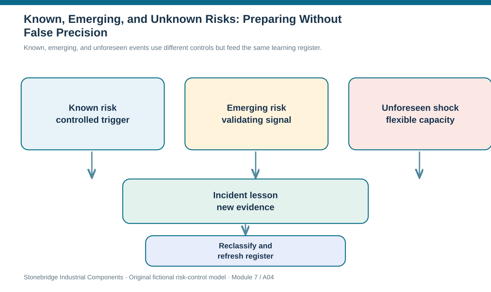
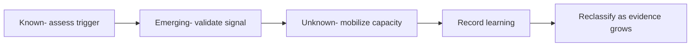

# 4. Known, Emerging, and Unknown Risks: Preparing Without False Precision

## Learning objectives

After this topic, you should be able to:

- separate documented known risks from emerging signals and currently unforeseen events
- design different monitoring and response capacities for different knowledge states
- explain when reserves and adaptable capabilities add value

## Concept in plain English

A known risk has a recognizable scenario and enough description for an organization to begin assessing it. This does not make the timing, probability, or consequence certain. A forecast of seasonal storms might be familiar even though the storm path is not. An emerging risk may be identified by weak but credible signals such as changes in customs practices, worsening site utility reliability, or widening lead-time variability. An unknown risk is not something the analyst can claim to have exhaustively listed in advance. Its future existence is one reason the business needs flexible resources, escalation procedures, and reserve capacity.

These knowledge states call for different decisions. For a known supplier fixture issue, management can define a monitoring trigger and test a specific alternate tool. For an emerging logistics pattern, the correct initial investment might be data collection and contingency route validation rather than the permanent purchase of expensive capacity. For truly unforeseen events, promising a named mitigation for a named unknown is contradictory. Management instead sets a method for mobilizing staff, spending controlled reserves, protecting people, stabilizing communications, and discovering the actual cause.

Unknown-event capacity has an economic cost. A cash reserve not used for operations, a cross-trained shift or a portable recovery kit can look inefficient in a calm quarter. The decision should be tied to the severity of objectives at risk, exposure aggregation, authorization, opportunity cost and past exercise results. No amount of reserve funding can guarantee protection from every extreme event; the objective is to improve the organization's ability to respond without bypassing safety or governance controls.

As information arrives, an emerging risk may become a well-defined known risk. It should gain an explicit event statement, owner, horizon, response choices and re-evaluation schedule. A novel incident, once observed, is no longer hypothetical: the incident-management process contains immediate damage, while SCRM updates the portfolio and learns what should be watched next. This prevents the organization from pretending that a single heat map predicts surprises.

A useful retrospective asks whether there were ignored signals, an invisible shared dependency, a lack of imagination, or genuinely unavailable information. These are different learning outcomes. Calling every incident a black swan discourages improvements in signal ownership.

## Why it matters

Unknowns do not justify abandoning structured planning. They justify transparent uncertainty, capabilities that can be repurposed, and decision rights that remain available when the usual data sources are down. Mature risk management knows which estimates are defensible and where management must rely on rehearsed adaptability.

## Decision model and workflow

Known, emerging, and unforeseen events use different controls but feed the same learning register.

### Evidence retained through the workflow

| Evidence or control | Why required |
| --- | --- |
| Known | Event and monitoring indicator can be described |
| Emerging | Signal and evidence request have an accountable owner |
| Unforeseen | Activation authority and flexible recovery resource exist |
| Learning | Newly observed dependency is documented and tested |

## Practical process flow

## Realistic example — Stonebridge Industrial Components

Stonebridge's connector fixture risk is known. A pattern of delayed terminal gate-ins creates an emerging transport risk; two consecutive misses cause the Logistics Lead to seek firm alternate capacity. A disruption that disables a previously unknown common cloud dependency is managed under a generic incident charter, emergency access rules and controlled reserve. Once the common dependency is identified, the new specific failure mode enters the register.

## Applied decision artifact or worked calculation

The [fictional uncertainty-signal ledger](../../assets/data/module-7/unknown-risk-signals.csv) records a distinct evidence gate for each state. It does not assign a universal probability to 'unknown events.' Reviewers should verify that the emerging-risk trigger produces a named investigation, that a known-risk backup has been exercised, and that the reserve cannot be spent without the delegated authority and documentation specified in A06.

## Decision logic

1. Mark each exposure by knowledge state and evidence confidence; avoid inventing precise probabilities for the unknown.
2. For known risks, choose a trigger and control to test.
3. For emerging risks, identify which new evidence would warrant escalation.
4. For unforeseen shocks, pre-authorize protected response processes and a bounded reserve.
5. After an incident, move validated lessons into the known-risk register.

## Trade-offs

| Decision tension | Implication |
| --- | --- |
| More scenarios vs usable capacity | Enumerating hypothetical disasters can displace investment in widely useful recovery capability. |
| Reserve vs idle capital | Protected funds support extraordinary response but have an opportunity cost. |
| Early warning vs false alarms | Emerging signals need validation thresholds so teams can escalate consistently. |

## Commonly confused with

A known risk can still have uncertain frequency. An unknown risk cannot be described as a complete event catalogue. A realized incident needs containment even while its underlying future recurrence is assessed.

## Common mistakes

- Adding an arbitrary 5% probability to an event that has never been described.
- Using the label unknown to bypass authorization or data review.
- Confusing an increased incident count with guaranteed future disruption.

## Original knowledge check

**Question.** An unanticipated technology dependency fails during a regional outage. Which existing preparation most directly supports response?

A. A documented incident charter with mobilization roles and controlled flexible resources.

B. An annual risk score assigned to every possible unknown technology incident.

C. A claim that the business no longer faces unknown risks after the outage.

D. A pre-approved decision to disregard regulatory access controls during emergencies.

Answer and rationale

### Correct answer

**A. A documented incident charter with mobilization roles and controlled flexible resources.**

### Why it is correct

Correct: prepared adaptable capacity and authority help when the specific scenario was not foreseen.

### Why the other answers are wrong

- **B.** The possible unknown cannot have a credible exhaustive scored catalogue.

- **C.** Learning about one event does not eliminate other unknowns.

- **D.** Emergency response must respect applicable hard compliance and safety controls.

## Practitioner perspective

An operational control tower can monitor emerging abnormalities but cannot know every future event. Keep a separate incident-mobilization playbook whose designated approver can activate communications, authorize bounded spending and record unexpected shared dependencies discovered after stabilization.

## Related concepts

- [Module 2 — Cybersecurity and Third-Party Risk](../../02-network-design-digital-connectivity-performance/section-b-connected-supply-networks-and-master-data/14-cybersecurity-and-third-party-risk.md)
- [Risk Management Plan](./06-risk-management-strategy-plan-budgets-and-authority.md)

---

[Previous: Lesson 03](./03-integrated-scrm-maturity-roles-and-partner-accountability.md) · [Section overview](./README.md) · [Next: Lesson 05](./05-risk-appetite-tolerance-thresholds-and-escalation.md)
