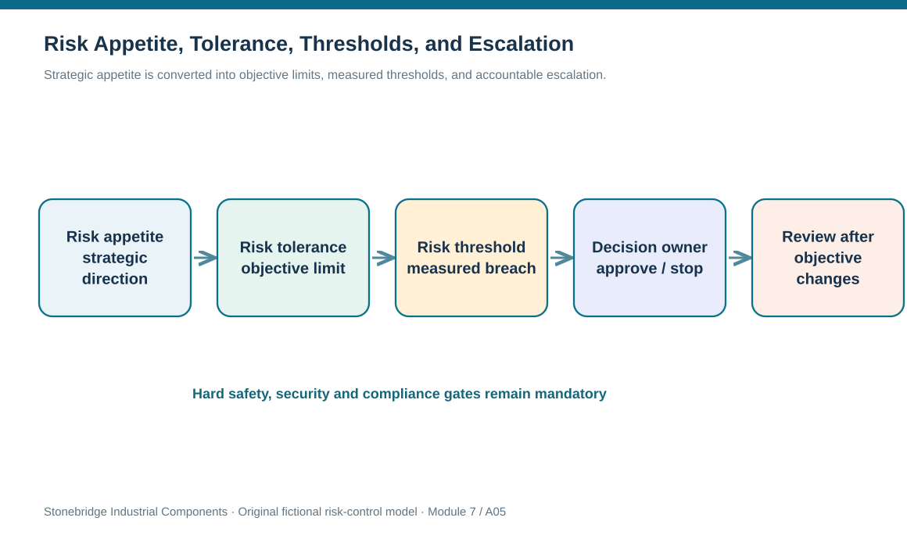
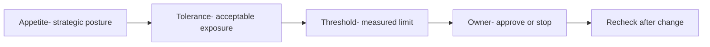

# 5. Risk Appetite, Tolerance, Thresholds, and Escalation

## Learning objectives

After this topic, you should be able to:

- explain different decision functions of appetite, tolerance, and a threshold
- build measurable, objective-specific policy boundaries for risk acceptance
- apply mandatory stop conditions before comparing economics

## Concept in plain English

Risk appetite describes the kinds and overall degree of uncertainty leaders are prepared to pursue or retain in pursuit of strategy. Tolerance gives that orientation operational meaning for an objective: how much variation or adverse effect is acceptable before leaders need to intervene. A threshold is the measured decision point at which a specific action, approval, or escalation becomes mandatory. The terms are related but should not be substituted for one another.

The same enterprise can willingly finance experimentation in a new product while retaining almost no appetite for uncontrolled personnel-safety hazards. It can tolerate small, quickly recoverable delivery variance but reject the same lateness for a critical emergency-service customer. An appetite statement is therefore incomplete until the company identifies objectives, owners, limits and evidence. Risk tolerance can be expressed in currency, days, severity, number of affected customers, or control conditions, provided the units and assessment horizon are explicit.

A practical threshold must produce a testable consequence. If a projected delay exceeds two business days, a named director might be required to approve the revised commitment and start a recovery plan. If an unapproved dangerous task is proposed, it must stop regardless of the estimated lost sales from stopping. That distinction matters: cost-benefit comparisons occur only among alternatives that pass mandatory safety, security and legal gates. A low EMV is not a permission to violate policy.

Risk tolerance is not necessarily the observed risk level. A company may have a maximum tolerable delay of one business day but discover a plausible three-day delay. The difference is an exceedance to manage, not evidence that the policy should automatically be relaxed. The risk owner documents the exposure, the temporary containment, available alternatives, and the authority needed to approve an exception—if such an exception is allowed at all.

Thresholds should be revisited when demand criticality, regulations, customer promises or infrastructure changes. A policy built for one product line may be inappropriate for high-consequence items. Module 2 provides service and financial metrics; Module 6 provides customer segmentation and commitments; Module 7 determines how an exceedance becomes an escalation and response decision.

## Why it matters

Vague risk tolerance lets each department silently apply its own limits. Procurement may call a week of delay acceptable because material is inexpensive, while planning knows it stops a constrained work center. Common thresholds convert strategy into a consistent risk decision and expose cases where a senior leader must explicitly accept the consequence.

## Decision model and workflow

Strategic appetite is converted into objective limits, measured thresholds, and accountable escalation.

### Evidence retained through the workflow

| Evidence or control | Why required |
| --- | --- |
| Objective | What must be protected, including non-financial obligations |
| Tolerance | Quantified or defined allowable outcome |
| Threshold | Measure that forces action |
| Exception control | Approver, rationale, expiry and evidence |

## Practical process flow

## Realistic example — Stonebridge Industrial Components

Stonebridge has limited appetite for delivery uncertainty to its hospital-equipment customers. Its fictional tolerance is one recoverable business day, with director escalation at two projected days. A planning report forecasts a three-day interruption. The Operations Director must activate an exception review even if the previous month delivered 99% of orders on time. For a separate high-energy maintenance task, an invalid work authorization is an immediate stop condition, not a matter for financial trade-off.

## Applied decision artifact or worked calculation

The [fictional appetite policy](../../assets/data/module-7/risk-appetite-policy.csv) contains three deliberately different expressions: safety, customer service, and short-term expense. The delivery exposure projects three days against a two-day escalation threshold, so it triggers director review. The cost line shows USD 18,000 against a USD 25,000 delegated limit; it does not cross that illustrative spending limit. These are Stonebridge training rules, **not** a universal standard or advice for legal tolerances.

## Decision logic

1. Name objective and stakeholder whose tolerance applies.
2. State appetite in business terms without implying a single universal number.
3. Specify tolerance with units, horizon and permissible exceptions.
4. Define measurable threshold, owner, warning signal and stop/approval action.
5. Test non-negotiable controls before ranking response economics.

## Trade-offs

| Decision tension | Implication |
| --- | --- |
| Flexibility vs consistency | Different business objectives need different limits, but escalation rules must be predictable. |
| Operational speed vs oversight | Delegation can accelerate minor decisions; protected hard gates remain mandatory. |
| Average KPI vs tail exposure | Good overall service cannot erase high-consequence rare-case exposure. |

## Commonly confused with

Appetite is the strategic willingness to take risk; tolerance states acceptable deviations; the threshold is the operating trip point. A hard safety gate is not a monetizable risk preference.

## Common mistakes

- Calling a supplier score of 80 a universal regulatory threshold.
- Allowing a cost-benefit calculation to waive a safety violation.
- Failing to name the time horizon or approver for an exception.

## Original knowledge check

**Question.** A shipment is projected three days late against a two-day escalation threshold. What does the rule require?

A. Automatic acceptance because average on-time delivery is strong.

B. Change the threshold to four days without approval.

C. Document the exceedance and escalate to the designated decision owner.

D. Use the lowest-cost option without checking any non-negotiable constraints.

Answer and rationale

### Correct answer

**C. Document the exceedance and escalate to the designated decision owner.**

### Why it is correct

Correct: a measured breach activates the documented risk decision.

### Why the other answers are wrong

- **A.** Portfolio averages do not cancel a specific threshold exceedance.

- **B.** The risk owner cannot unilaterally change executive appetite or thresholds.

- **D.** Hard safety/compliance requirements must be tested before economic optimization.

## Practitioner perspective

Avoid placing safety exceptions in a general weighted-risk scoring dashboard. A line-level maintenance stop criterion belongs in a safety authorization control; the customer delay threshold belongs in promise-management escalation; and a delegated spending cap belongs in finance approval. These controls can feed one risk portfolio without being averaged into a universal number.

## Related concepts

- [Module 6 — Customer Service](../../06-supply-chain-relationships/section-a-customer-relationships/14-customer-service-metrics-satisfaction-feedback-and-service-recovery.md)
- [Module 2 — Service Metrics](../../02-network-design-digital-connectivity-performance/README.md)

---

[Previous: Lesson 04](./04-known-emerging-and-unknown-risk-exposure.md) · [Section overview](./README.md) · [Next: Lesson 06](./06-risk-management-strategy-plan-budgets-and-authority.md)
