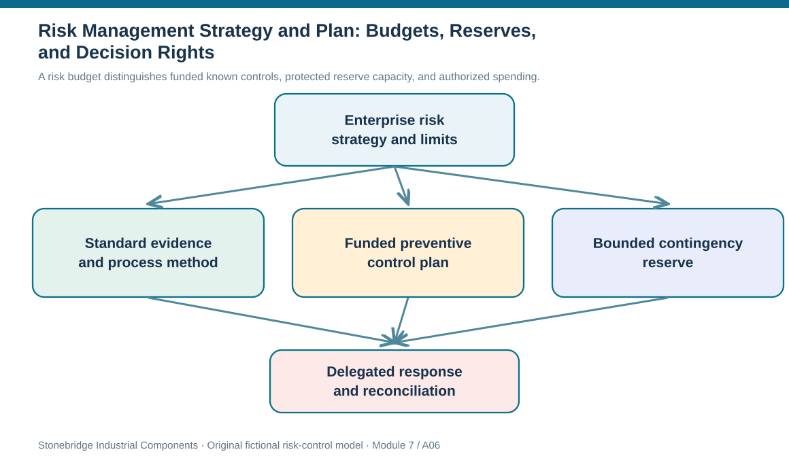

# 6. Risk Management Strategy and Plan: Budgets, Reserves, and Decision Rights

## Learning objectives

After this topic, you should be able to:

- separate enterprise risk strategy from the operational management plan
- specify methods, risk funding, reserves and delegated expenditure authority
- ensure exceptional response spending remains controlled during incidents

## Concept in plain English

A risk management strategy explains how an enterprise intends to handle uncertainty in pursuit of its objectives. It translates risk appetite into broad choices: where resilience matters more than minimum cost, which controls must be standardized, how partners participate, and what adverse consequences leadership will not accept. The risk management plan converts that intent into an operating system. A good plan says how risks are identified, described, grouped, assessed, responded to, reported and reconsidered.

The plan should identify approved data sources, qualitative rating conventions, any conditions for optional quantitative analysis, ownership of each record, review frequency, escalation routes and a controlled reporting mechanism. If two plants use different interpretations of the same 'high likelihood' label, the portfolio cannot be compared coherently. A shared assessment guide improves consistency while allowing local expertise to provide the actual evidence.

Funding cannot be postponed until every disruption has already started. Planned preventive work normally belongs in a known budget with a sponsor and measurable completion evidence. A separate reserve can support unforeseen events or unexpected residual needs, but this is not an unrestricted account. Define who can release it, an expenditure ceiling, evidence required for emergency approval, reconciliation after the event, and triggers for replenishment. A known, repeatable maintenance need should not be routinely charged to a supposedly unknown-risk reserve to hide underfunding.

Decision rights deserve the same attention as budgets. A site manager may be empowered to stop unsafe work immediately but not approve an untested supplier substitution. Procurement may negotiate a response contract while quality releases an alternate part and an executive approves a major capacity investment. The plan specifies which decisions are independent and which are sequential. Incident speed improves when these gates are documented before disruption.

Cost effectiveness is necessary but not sufficient. Management should verify that the response is operationally possible, compliant, and suited to the objective, then compare the economic consequences of feasible alternatives. Certain up-front or annual preventive costs should remain separate from probability-weighted contingent losses. Detailed response economics belongs in Section B, where the assumptions and scenario horizon are made explicit.

## Why it matters

The most expensive plan may be the one nobody can activate. Waiting for ad hoc budget approvals while production is stopped can destroy much more value than a proportionate exercise program. Conversely, writing blank-check emergency permissions creates fraud, safety and governance exposure. A usable plan balances speed with controlled approval.

## Decision model and workflow

A risk budget distinguishes funded known controls, protected reserve capacity, and authorized spending.

### Evidence retained through the workflow

| Evidence or control | Why required |
| --- | --- |
| Plan component | Method, owner, required evidence and review cadence |
| Preventive budget | Approved project, amount, milestone and verification |
| Reserve | Ceiling, activation authority and after-action reconciliation |
| Exception | Date/time, reason, temporary control and approver |

## Practical process flow

## Realistic example — Stonebridge Industrial Components

Stonebridge plans USD 18,000 for validation of a backup connector fixture and USD 7,500 for a recovery-routing exercise. The latter must generate a demonstrated bypass capability rather than a presentation. Leadership separately protects USD 40,000 for unforeseen disruptions. Finance cannot release that reserve solely because an operational team has an over-budget project; the delegated Risk Committee needs evidence of the exceptional incident and an accountable spend record.

## Applied decision artifact or worked calculation

The [risk-funding plan](../../assets/data/module-7/risk-funding-plan.csv) totals **USD 65,500**, comprising USD 25,500 of planned controls and USD 40,000 in an unknown-event reserve. The reserve is not modeled as certain annual expenditure nor as probability-weighted event loss. It is protected available funding; actual spending must be reconciled to authorizations and invoices. These numbers are fictional and should not be generalized into a recommended reserve percentage.

## Decision logic

1. Document enterprise risk intent and allowed response constraints.
2. Create standard assessment forms, source evidence requirements and review cadence.
3. Assign known preventive actions to budget owners and measurable acceptance tests.
4. Create a reserve with clear authorization, logging and reconciliation safeguards.
5. Define the escalation ladder from local containment to executive funding approval.

## Trade-offs

| Decision tension | Implication |
| --- | --- |
| Funding control vs activation speed | Delegated emergency authority works only when ceilings and evidence are specified in advance. |
| Fixed control cost vs contingent loss | Do not probability-weight a preventive investment paid whether or not an event occurs. |
| Flexibility vs auditability | Reserve use must remain auditable even during a communication outage. |

## Commonly confused with

A risk strategy sets posture and priorities; the risk management plan governs the method; a risk response plan specifies actions for a particular threat or opportunity. A financial reserve is available capacity, not necessarily an expense already incurred.

## Common mistakes

- Treating allocated reserve dollars as certain annual losses.
- Accepting verbal emergency approvals without post-incident evidence.
- Describing owners without identifying who may approve expenditure.

## Original knowledge check

**Question.** Stonebridge allocates USD 40,000 to an unknown-risk reserve. Which statement is correct before any incident occurs?

A. The full reserve is automatically an annual disruption cost.

B. Each registered risk receives an equal USD 40,000 probability-weighted benefit.

C. The reserve can replace mandatory safety and compliance controls.

D. It is protected funding subject to defined authorization and reconciliation controls.

Answer and rationale

### Correct answer

**D. It is protected funding subject to defined authorization and reconciliation controls.**

### Why it is correct

Correct: availability of funds is distinct from spend and must be governed.

### Why the other answers are wrong

- **A.** Reserved capacity is not necessarily a realized expense.

- **B.** The reserve cannot be credited to every scenario as a generic financial benefit.

- **C.** A cash reserve does not authorize unsafe or noncompliant actions.

## Practitioner perspective

Connect each preventive measure to a purchase/work order, an acceptance test and an owner with sign-off authority. A reserve should have a distinct finance code, release approval and retrospective invoice check. A consumption report must separate the amount held available from the actual expense recognized when an incident occurs.

## Related concepts

- [Module 4 — Capacity and Inventory](../../04-internal-operations-inventory/README.md)
- [Expected Response Economics](../section-b-risk-analysis-and-response/06-response-economics-certain-costs-and-residual-risk.md)

---

[Previous: Lesson 05](./05-risk-appetite-tolerance-thresholds-and-escalation.md) · [Section overview](./README.md) · [Next: Lesson 07](./07-coso-erm-governance-risk-compliance-and-controls.md)
