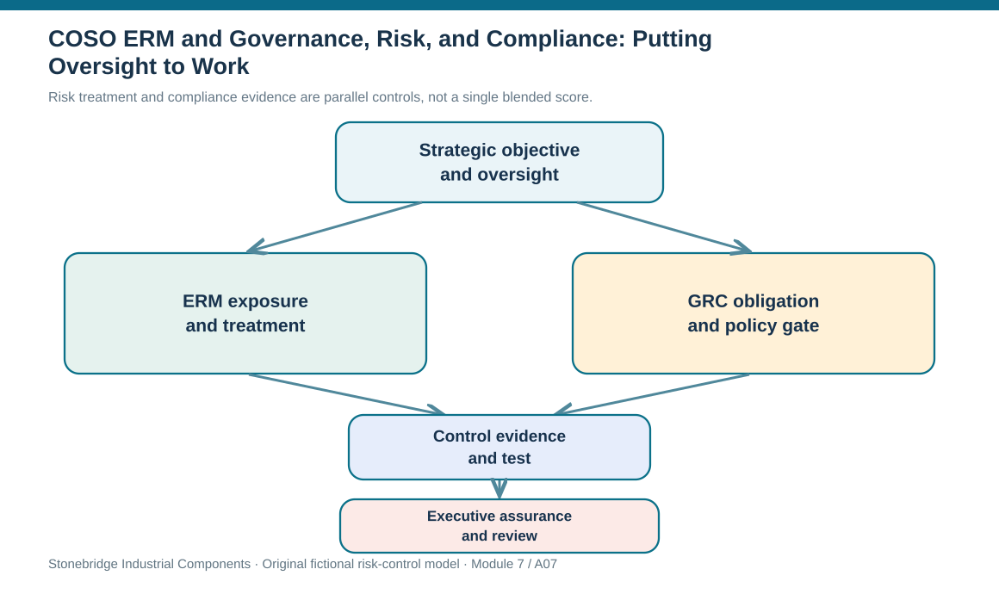

# 7. COSO ERM and Governance, Risk, and Compliance: Putting Oversight to Work

## Learning objectives

After this topic, you should be able to:

- describe the purpose of enterprise risk management and GRC without mixing their roles
- link board-level objectives to operational control owners and assurance
- distinguish framework teaching examples from formal regulatory requirements

## Concept in plain English

Enterprise risk management connects uncertainty with strategy and performance rather than leaving each operational department to manage isolated exposures. The COSO approach is useful because risk decisions belong inside objective setting and governance. Board oversight and executive leadership clarify which business outcomes matter and which uncertainty is acceptable. Managers then identify material events, assess consequences, choose responses, establish controls, communicate evidence, and monitor whether the arrangement remains effective.

The supplied learning material describes an eight-part COSO ERM component view: the internal environment, setting objectives, identifying events, assessing risks, choosing responses, control activities, information/communication, and monitoring. That view can help learners reason about a complete operating loop. It should not, however, be advertised as the only or current formal COSO framework taxonomy. The 2017 strategy-and-performance-oriented edition is discussed in the source material; where a company formally adopts a standard, governance staff must consult the actual published edition and requirements.

Governance, risk management, and compliance (GRC) are connected but different accountabilities. Governance determines who has decision rights, how misconduct is addressed, how risk relates to strategy, and how oversight operates. Risk management identifies uncertain events and chooses appropriate treatment. Compliance checks obligations established by law, regulation, contracts, and internal policy; it cannot simply be traded off against revenue. A board may accept business risk within policy, but no one can authorize an illegal payment because its expected cost appears favorable.

A cross-functional GRC record can link a business decision to its exposure, relevant policy, evidence, control execution, and assurance result. For example, selecting a logistics intermediary creates an operational continuity question and a separate anti-corruption due-diligence requirement. The risk analyst estimates disruption consequences; procurement validates partner capability; compliance establishes that onboarding conditions have been met; leadership authorizes the commercial decision. None of those records substitute for the others.

Technology can consolidate policy mapping and evidence, but a workflow platform cannot prove that a control is operating unless someone reviews results, exceptions and remediation closure. Control failures should trigger an action with ownership and a time bound. An annual dashboard showing many closed tasks can mask one overdue privileged-access review with serious consequences. The point of GRC is disciplined organizational behavior, not a larger collection of checkboxes.

## Why it matters

Supply-chain decisions cross legal, operational and technology boundaries. Without shared governance a control can be marked complete by one function despite a downstream failure. A clearly linked risk and compliance view prevents a supplier or technology decision from receiving approval while a critical gate is unresolved.

## Decision model and workflow

Risk treatment and compliance evidence are parallel controls, not a single blended score.

### Evidence retained through the workflow

| Evidence or control | Why required |
| --- | --- |
| Governance | Approved policy, escalation body and decision rights |
| Risk | Exposure, uncertainty, owner and treatment logic |
| Compliance | Applicable requirement and demonstrable conformity |
| Assurance | Evidence of operating effectiveness and exception closure |

## Practical process flow

## Realistic example — Stonebridge Industrial Components

Stonebridge's logistics partner is proposed for a high-value lane. The transportation team verifies capacity and alternative routing, while compliance discovers that an intermediary's anti-bribery attestation has not been refreshed. Leadership may consider the lane strategically beneficial, but the contract cannot bypass the applicable onboarding gate. The operating record needs a named owner for the attestation, a retest date and evidence of closure, not just a note that 'legal is reviewing.'

## Applied decision artifact or worked calculation

The [fictional GRC control map](../../assets/data/module-7/grc-control-map.csv) distinguishes three evidence types: a risk-appetite approval, supplier compliance attestation and technology access recertification. The technology row has one unverified elevated access, which must not be interpreted as passing its hard gate. Reviewers should check the authority matrix and the underlying control record rather than accept an aggregate risk score as proof of compliance.

## Decision logic

1. Confirm strategic objective and the board/executive limit governing exposure.
2. Assign operational risk assessment and control execution to specific accountable roles.
3. Inventory legal, contract and policy obligations independently of financial attractiveness.
4. Record required evidence and conduct control testing at an appropriate cadence.
5. Treat unclosed mandatory gates as blockers until an authorized, legally permissible resolution exists.

## Trade-offs

| Decision tension | Implication |
| --- | --- |
| Standardized evidence vs business flexibility | Control mapping should be proportionate but not waive a mandatory obligation. |
| Formal oversight vs timely response | Delegation allows quick action where policy permits; executive exceptions remain recorded. |
| Risk appetite vs legal compliance | A willingness to take commercial risk does not authorize illegal conduct. |

## Commonly confused with

COSO ERM provides enterprise strategy/risk integration; GRC combines oversight, risk method and obligation management. Compliance is not simply one probability-impact category that can be averaged away.

## Common mistakes

- Treating a passed business case as proof of legal or contractual compliance.
- Assuming installation of GRC software demonstrates effective controls.
- Confusing the educational eight-component description with a claim about the current official edition.

## Original knowledge check

**Question.** A supplier scores best economically but fails a mandatory anti-bribery onboarding control. What should the risk committee do?

A. Hold the award pending documented compliance remediation or select an eligible alternative.

B. Approve because a low disruption EMV outweighs the missing document.

C. Assign a lower weight to compliance to improve the composite score.

D. Classify the gap as an opportunity and ignore the control result.

Answer and rationale

### Correct answer

**A. Hold the award pending documented compliance remediation or select an eligible alternative.**

### Why it is correct

Correct: the mandatory gate must pass before commercial comparison.

### Why the other answers are wrong

- **B.** Compliance cannot be waived through economic scoring.

- **C.** A weighting adjustment cannot repair a failed hard requirement.

- **D.** Renaming a problem does not change the obligation.

## Practitioner perspective

A supplier may pass a delivery-rate target while failing a mandatory data-access recertification or partner due-diligence condition. Keep the performance score, risk scenario, evidence gate and remediation ticket linked but distinct; only the accountable policy owner should confirm whether the hard gate has closed.

## Related concepts

- [Module 3 — Contract Governance](../../03-sourcing-strategy-product-design-supplier-execution/section-d-supplier-selection-contracting-and-procurement/05-contract-deployment-and-compliance.md)
- [Module 2 — Cybersecurity](../../02-network-design-digital-connectivity-performance/section-b-connected-supply-networks-and-master-data/14-cybersecurity-and-third-party-risk.md)

---

[Previous: Lesson 06](./06-risk-management-strategy-plan-budgets-and-authority.md) · [Section overview](./README.md) · [Next: Lesson 08](./08-iso-risk-management-standards-principles-techniques-and-vocabulary.md)
