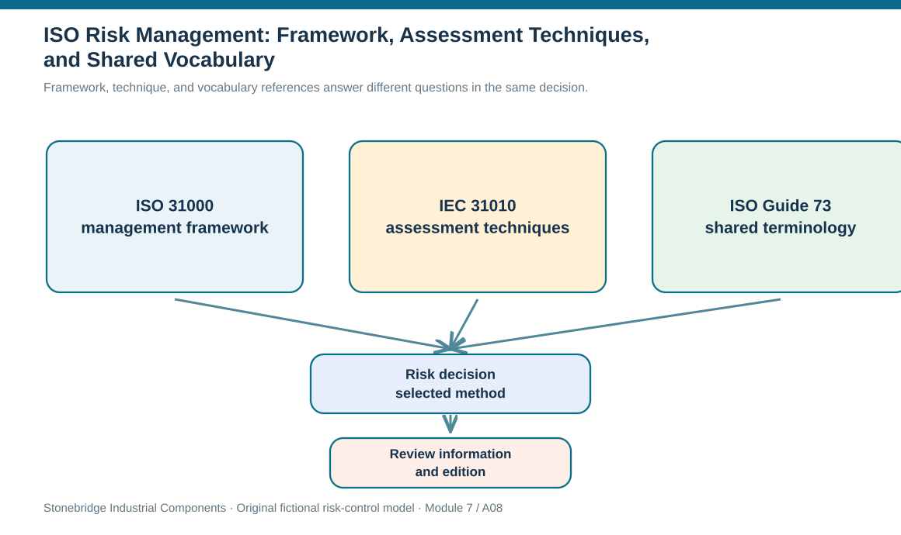
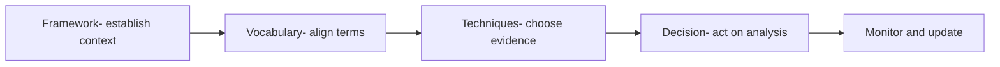

# 8. ISO Risk Management: Framework, Assessment Techniques, and Shared Vocabulary

## Learning objectives

After this topic, you should be able to:

- explain how ISO 31000, IEC 31010 and ISO Guide 73 serve different purposes
- select a suitable assessment technique based on the decision and available evidence
- avoid confusing standards guidance with claims of certification or current edition

## Concept in plain English

Risk discussions fail when participants use the same word to mean different things. A warehouse director may call an event 'likely' if it has occurred once at another site; an analyst may mean a measured event frequency; a customer may think 'likely' means next week. An organization needs a shared language, an integrating management approach, and a way to choose assessment techniques. The standards discussed here play different roles in that system.

ISO 31000 provides broad risk-management principles, a framework, and an iterative process applicable across organizational activities. Leadership commitment matters because risk decisions affect strategy, budget and stakeholder trust. The process should be integrated with operations rather than maintained as a separate report. An effective implementation defines context, identifies risks, analyzes and evaluates them, treats risks, communicates and consults, monitors and reviews, and retains records. The quality test is whether management can use these steps to make a specific decision, not whether a document reproduces a diagram.

IEC 31010, referenced in the supplied material as ISO 31010:2019, helps select and apply risk-assessment techniques. Methods range from expert interviews and checklists to fault-tree analysis, FMEA, decision trees and simulation. A structured interview can be fit for discovering a process dependency; a probability-impact matrix is a useful qualitative screening tool; a distribution model may be justified when loss probabilities, costs and decision sensitivity matter. The most mathematically sophisticated method is not automatically best if the source estimates are weak.

ISO Guide 73:2009 addresses vocabulary. Its practical value is common interpretation of risk, consequence, likelihood and associated management terms across functions and partners. A shared dictionary does not eliminate judgment; it ensures participants know which questions they are judging. A company should document local definitions, such as the number of hours represented by 'rapid recovery,' alongside standard terminology rather than silently changing meaning across dashboards.

The three references work together: leadership adopts risk governance; managers agree on language; analysts select an appropriate technique; operations execute and review controls. Publication dates are part of the cited source identity and must not be represented as a promise that the standard is still the latest edition. ISO 31000 is guidance on risk management, not a stand-alone certification claim. Any actual conformity or regulatory decision requires the current primary standard text and applicable local requirements.

## Why it matters

A coherent standards stack avoids fake precision and inconsistent treatment. It allows a site team to explain why an interview was enough to discover a failure path but why a capital investment needs scenario analysis. Stakeholders can also distinguish a company claiming to follow guidance from a company holding a separate, legitimately audited certification.

## Decision model and workflow

Framework, technique, and vocabulary references answer different questions in the same decision.

### Evidence retained through the workflow

| Evidence or control | Why required |
| --- | --- |
| ISO 31000 | Management principles, framework and process |
| IEC 31010 | Assessment technique selection and use |
| ISO Guide 73 | Terminology coordination |
| Internal adoption | Evidence, responsible owner, review and edition check |

## Practical process flow

## Realistic example — Stonebridge Industrial Components

Stonebridge evaluates a shared transport terminal dependency. Interviews with dispatchers reveal the common node. A process map confirms the routes. The risk analyst uses a qualitative matrix to screen impact, then considers a probabilistic delay-cost model because management must compare annual bypass contracts. All teams use one agreed definition of 'service delay' and one 12-month exposure horizon. No one represents an ISO mention on the project charter as evidence that the carrier is certified.

## Applied decision artifact or worked calculation

The [standards-use ledger](../../assets/data/module-7/risk-standard-use-ledger.csv) maps the three source-identified documents to a concrete control artifact and a responsible owner. The ledger intentionally says that edition verification is required; it is not a verified external edition register. The last-step decision is to confirm each standard's current official status before a public claim or formal implementation.

## Decision logic

1. Choose the governance question before choosing a standard reference.
2. Use shared definitions for likelihood, consequence, control, residual exposure and risk owner.
3. Select evidence-gathering or analytic techniques based on uncertainty, resources and decision stakes.
4. Record the edition used, owner and last authoritative edition-status check.
5. Do not label an ISO guidance document as automatically conferring organizational certification.

## Trade-offs

| Decision tension | Implication |
| --- | --- |
| Method rigor vs data availability | A complex simulation may conceal unsupported probabilities when simple expert screening is better. |
| Uniform terminology vs local measurement | Shared terms still need process-specific units and horizons. |
| Guidance vs certification | Avoid implying endorsement or third-party certification where none exists. |

## Commonly confused with

ISO 31000 is a broad management guidance framework; IEC 31010 concerns assessment techniques; ISO Guide 73 concerns vocabulary. None automatically supersedes a binding industry or national regulation.

## Common mistakes

- Claiming ISO 31000 certification merely because a company followed its ideas.
- Treating a brainstorming workshop as equivalent to calibrated numerical probability.
- Referencing dated editions as current without checking official status.

## Original knowledge check

**Question.** A manager asks which reference is most useful for deciding whether to use interviews, FMEA or simulation. What is the best answer?

A. ISO Guide 73 because it establishes official service-level contracts.

B. IEC 31010 because it discusses assessment technique selection and suitability.

C. ISO 31000 because it is a product-safety certification checklist.

D. Any one of the three because their purposes are identical.

Answer and rationale

### Correct answer

**B. IEC 31010 because it discusses assessment technique selection and suitability.**

### Why it is correct

Correct: IEC 31010 is the assessment-technique-oriented reference.

### Why the other answers are wrong

- **A.** Guide 73 focuses on terminology rather than a technique comparison.

- **C.** ISO 31000 supplies overarching risk guidance and is not a safety certificate.

- **D.** Framework, methods and vocabulary serve different needs.

## Practitioner perspective

When an analyst adds a probability-impact score to a control-tower dashboard, its legend should disclose the scale, time window and confidence. The organization’s vocabulary guide explains terms, its technique guide justifies why a matrix was selected, and its governance standard explains who authorizes treatment—three different responsibilities.

## Related concepts

- [Module 4 — Quality Methods](../../04-internal-operations-inventory/section-d-performance-and-continuous-improvement/README.md)
- [Module 2 — Risk and Technology](../../02-network-design-digital-connectivity-performance/README.md)

---

[Previous: Lesson 07](./07-coso-erm-governance-risk-compliance-and-controls.md) · [Section overview](./README.md) · [Next: Lesson 09](./09-risk-identification-methods-and-evidence-gathering.md)
